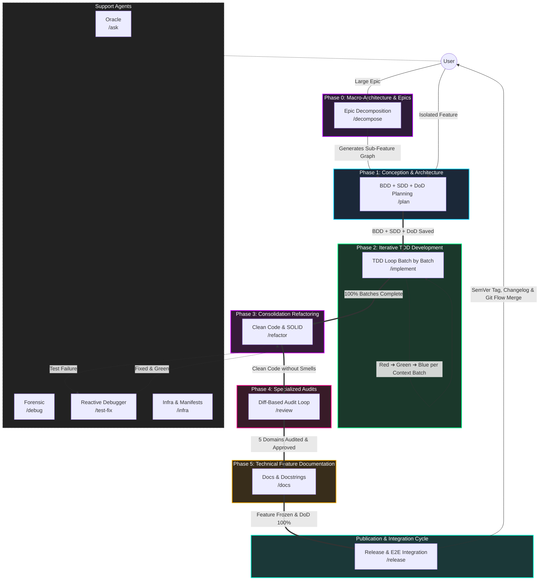

# 🪐 Antigravity Agentic Workflows

<p align="center">
  <em>An AI Agent-driven Software Engineering ecosystem based on State Machines, "Second Brain" (Obsidian Vault), and Separation of Concerns.</em>
</p>

<p align="center">
  
  
  
  
</p>

---

## 🎯 The Pitch (Why Antigravity?)

Working with LLMs on large codebases frequently results in the "trigger-happy" problem: the AI tries to refactor entire files before understanding the context, causing regressions and knowledge loss.

The **Antigravity IDE Ecosystem** solves this by enforcing a **Strict State Machine Architecture**, **Ephemeral Chat Windows**, and deep integration with a **"Second Brain"** (Obsidian Vault via MCP).

Each AI agent has restricted permissions and an isolated scope — from requirements engineering (BDD/SDD) and living DoD logs, through iterative TDD pipelines and diff-scoped Refactoring, down to OWASP-aligned Code Review, atomic documentation, and release management.

**The principle is absolute: AI suggests, human orchestrates and approves.**

---

## 🚀 Getting Started (5-Minute Quick Setup)

### 1. Prerequisites
* An IDE compatible with the Antigravity ecosystem (e.g., local Gemini/Claude setup).
* The **Obsidian** app installed locally (for project Knowledge Graph).

### 2. Installation (Automated Setup)

Clone the repository (or download and extract the ZIP file):

```bash
git clone https://github.com/MarcosVeniciu/antigravity-agentic-workflows.git
cd antigravity-agentic-workflows
```

Run the automated installer for your operating system:

#### 🪟 Windows
* **1-Click**: Double-click `install.bat` in File Explorer.
* **PowerShell (Interactive Menu)**:
  ```powershell
  .\install.ps1
  ```
  *(Options: `[1] Global`, `[2] Project`, `[3] Restore Backup`, `[4] Uninstall`, `[5] Exit`)*
* **PowerShell (Direct CLI)**:
  ```powershell
  # Global install (~/.gemini)
  .\install.ps1 -Global

  # Specific project install (.agents/)
  .\install.ps1 -Project "C:\Path\To\YourProject"

  # Restore / Rollback to a previous snapshot
  .\install.ps1 -Restore

  # Uninstall workflows, skills and rules cleanly
  .\install.ps1 -Uninstall
  ```

#### 🐧 Linux & 🍎 macOS
```bash
# Make executable and run interactive menu:
chmod +x install.sh
./install.sh

# Or direct CLI flags:
./install.sh --global
./install.sh --project "/path/to/your/project"
./install.sh --restore
./install.sh --uninstall
```

> [!TIP]
> **Safety, Backups, Rollback & Uninstall**:
> * **Transaction Manifest (`manifest.json`)**: Every installation records both modified and newly added files. When rolling back a fresh install, all newly added files are deleted cleanly, restoring the environment to a 100% clean state.
> * **Rollback**: Access previous snapshots via menu option `[3] Restore Backup` or `.\install.ps1 -Restore` / `./install.sh --restore`.
> * **Uninstall**: Cleanly remove installed resources via option `[4] Uninstall` or `.\install.ps1 -Uninstall` / `./install.sh --uninstall`. A safety backup is always created automatically prior to removal.
> * **Dry-Run**: Append `--dry-run` (or `-DryRun`) to any command to preview operations without modifying files on disk.

### 3. Engaging the "Second Brain"
1. Open Obsidian.
2. Open your project's vault folder.
3. Enable the MCP (Model Context Protocol) server to connect the knowledge base to the AI.

### 4. First Run
Start your workflow by consulting project context or planning a new feature:

```bash
# Consult the Oracle (Read-Only Context)
/ask Explain how the current microservices architecture is designed.

# Start the Development Cycle (BDD & Requirements)
/plan
```

---

## 🏗️ Agent & Skill Architecture

The ecosystem adopts a **self-sufficient, open Agent Skills architecture** ([agentskills.io](https://agentskills.io/home)) natively integrated into Google Antigravity 2.0:

1. **Self-Sufficient Agent Skills (`skills/`)**: Rather than separate single-file workflows and loose external skills, each lifecycle phase or support capability is an autonomous Agent Skill package (`skills/<name>/`). The skill's `SKILL.md` acts as the command entry point and phase pipeline, while contextual operation guides reside in `references/`, schemas and templates in `resources/`, automation CLI tools in `scripts/`, and reference cases in `examples/`.
2. **Native Slash Commands**: Each skill folder maps directly to a native IDE slash command (`/decompose`, `/plan`, `/implement`, `/refactor`, `/review`, `/docs`, `/release`, `/test-fix`, `/ask`, `/debug`, `/infra`, and `@obsidian`).
3. **Progressive Context Loading**: Metadata (`name`, `description`) is indexed upfront in the agent context. Full operational instructions, scripts, and templates are loaded strictly on demand, eliminating prompt bloat and context hopping.
4. **Living Execution Log & DoD (`01-concepcao/dod-[slug].md`)**: Dynamic document centralizing development timeline history and gating functional acceptance criteria, non-functional rules, audits, and releases.
5. **Worktree & Branch Lifecycle Governance**: Every feature runs in an isolated branch (`feature/[slug]`) or ephemeral git worktree. Upon completion and merge into the base branch (`develop`/`main`), the worktree and branch are cleanly pruned.

> [!NOTE]
> **Source / Matrix Repository**: The `skills/` and `prompts/` directories in this repository represent the **development matrix** of the ecosystem. When deployed globally to the developer's environment, they are installed into `~/.gemini/GEMINI.md` and `~/.gemini/config/skills/` (or `<project>/.agents/skills/` and `<project>/GEMINI.md` inside specific workspaces).

### 📂 Repository Directory Structure

```text
antigravity-agentic-workflows/
├── install.bat                   # 1-Click Windows installer launcher (File Explorer)
├── install.ps1                   # Native PowerShell installer (Windows 10/11 & Core)
├── install.sh                    # Native POSIX Bash installer (Linux / macOS / WSL)
├── prompts/                      # System prompts & global governance
│   └── gemini.md                 # Antigravity engine core protocol & human-AI pair programming rules
├── skills/                       # 12 Self-Sufficient Agent Skills (Antigravity 2.0 / agentskills.io)
│   ├── ask/                      # /ask       - Support: Read-Only Project Oracle & Vault Search
│   ├── debug/                    # /debug     - Support: Forensic Crash Investigator (5 Whys & RCA)
│   ├── decompose/                # /decompose - Phase 0: Macro-Architecture & Epic Slicing
│   ├── docs/                     # /docs      - Phase 5: Technical Feature Documentation & Docstrings
│   ├── implement/                # /implement - Phase 2: Iterative TDD Development (Red -> Green -> Blue)
│   ├── infra/                    # /infra     - Support: Dependency Manifests, Docker & Safe Env
│   ├── obsidian/                 # @obsidian  - Support: Second Brain SSOT, Metadata & ADR Management
│   ├── plan/                     # /plan      - Phase 1: Conception, BDD Gherkin, SDD Contracts & Living DoD
│   ├── refactor/                 # /refactor  - Phase 3: Consolidation Refactoring (Clean Code on Diff)
│   ├── release/                  # /release   - Publication: E2E Integration Suite, SemVer & Git Flow
│   ├── review/                   # /review    - Phase 4: Specialized Audits (Arch, Sec, Quality, Perf, Resilience)
│   └── test-fix/                 # /test-fix  - Support: Reactive Debugger & Surgical Production Fixes
├── docs/                         # Comprehensive technical documentation & guides
│   ├── README.md                 # Architectural overview & 5-Phase lifecycle
│   ├── agentes/                  # Deep-dive manuals for each workflow & orchestrator
│   │   ├── README.md             # Agents catalog & quality gates map
│   │   ├── core-gemini.md        # Core engine protocol & pair programming rules
│   │   └── [phase].md            # Step-by-step orchestrator guides (/plan, /implement, etc.)
│   ├── skills/                   # Technical manuals & operational reference guides
│   │   ├── README.md             # Modular skills catalog & domain map
│   │   └── [skill-name].md       # Specific technical procedures and checklists
│   ├── references/               # Authoritative security & architecture standards (OWASP, open specs)
│   └── change_history/           # Architecture evolution & migration logs
└── tests/                        # Automated integrity and scanner test suite
    ├── test_flow_skills_integrity.py  # Validation of frontmatter, structure & references
    └── skills/test_scanners.py        # Unit tests for automated AST, boundary & sink scanners
```

---

## 🗺️ Ecosystem Lifecycle (Multi-Chat SDLC Pipeline)

To avoid model degradation caused by accumulated context (*token exhaustion*), execution is partitioned into **Ephemeral Chat Windows**:



---

## ⚡ Workflow Optimizations & Technical Rationale

1. **Phase 2 (`/implement`) Full TDD Loop (Red ➔ Green ➔ Blue)**:
   - Phase 2 manages the entire TDD cycle divided into dependent context batches: Red (AAA unit tests), Green (minimal SOLID code), and Blue (local micro-refactoring of the batch class/methods).
   - For every completed green batch, a local micro-checkpoint (`git commit`) is recorded and the timeline in `dod-[slug].md` is updated.

2. **Diff-Scoped Efficient Refactoring (Phase 3)**:
   - Refactoring takes place in its own dedicated consolidation phase (Phase 3), executed strictly on a 100% green test suite (*Make it Right*).
   - Analysis and refactoring scope is **strictly limited to files modified on the active branch** (`git diff develop...HEAD --name-only`), eliminating token waste and the risk of regressions in untouched legacy code while validating cyclomatic complexity with AST scanners ($V(G) \le 10$).

3. **Living Tracking Artifact (`01-concepcao/dod-[slug].md`)**:
   - Centralizes development timeline history and the Definition of Done (DoD) with functional, non-functional, audit, and release checklists.
   - Acts as the Single Source of Truth (SSOT) for objective gating before authorizing versioning and merges.

4. **Domain-Specialized Audits (Phase 4)**:
   - `/review` decomposes analysis into 5 atomic audits executed directly on the git diff: Architecture, Security (OWASP Top 10/ASVS), Quality (AST $V(G) \le 10$), Performance, and Resilience, backed by automated Python scanners in `skills/review/scripts/`.

5. **Reactive Debugger Support (`/test-fix`) & Forensic RCA (`/debug`)**:
   - `/test-fix` provides surgical debugging support if tests fail during implementation (`/implement`) or refactoring (`/refactor`), isolating root cause in 1 sentence and applying minimal fixes to production code.
   - `/debug` conducts deep forensic investigation of crashes using the 5 Whys framework.

6. **Worktree & Branch Lifecycle Cleanup**:
   - Tasks and features execute under git worktrees or isolated branches. At task completion, when merging into the base branch (`develop`/`main`), the ephemeral worktree and task branch are systematically deleted, preventing branch proliferation.

---

## 🤖 Agents & Slash Commands Catalog

| Command | Skill Package | Phase / Role | Description / Main Responsibility |
| :--- | :--- | :--- | :--- |
| `/decompose` | [`skills/decompose/`](skills/decompose/SKILL.md) | **Phase 0** | Decomposes complex epics and large demands into evolutionary, monotonic vertical slices. |
| `/plan` | [`skills/plan/`](skills/plan/SKILL.md) | **Phase 1** | Outcome-Based debate, Git Flow branch setup, BDD scenarios, SDD blueprints, and Living DoD. |
| `/implement` | [`skills/implement/`](skills/implement/SKILL.md) | **Phase 2** | TDD Developer: Batch planning, AAA unit tests (Red), minimal SOLID code (Green), micro-refactor (Blue), and checkpoints. |
| `/refactor` | [`skills/refactor/`](skills/refactor/SKILL.md) | **Phase 3** | Clean Code & SOLID: Refactors green code strictly scoped to files modified in the diff. |
| `/review` | [`skills/review/`](skills/review/SKILL.md) | **Phase 4** | Iterative audit loop: Architecture, Security (OWASP), AST Quality, Performance, and Resilience. |
| `/docs` | [`skills/docs/`](skills/docs/SKILL.md) | **Phase 5** | Updates living technical documentation (module/root READMEs) and docstrings traceable to Obsidian. |
| `/release` | [`skills/release/`](skills/release/SKILL.md) | **Publication** | Verifies 100% DoD, runs staged E2E integration test suite, computes SemVer, generates Changelog, and finishes Git Flow. |
| `/test-fix` | [`skills/test-fix/`](skills/test-fix/SKILL.md) | **Support** | Reactive Debugger: Analyzes terminal tracebacks and applies minimal surgical fixes to production code. |
| `/ask` | [`skills/ask/`](skills/ask/SKILL.md) | **Support** | Read-Only Oracle: Answers conceptual and technical questions without modifying any files. |
| `/debug` | [`skills/debug/`](skills/debug/SKILL.md) | **Support** | Forensic Investigator: Diagnoses runtime crashes and complex systemic failures using 5 Whys. |
| `/infra` | [`skills/infra/`](skills/infra/SKILL.md) | **Support** | DevOps/SysAdmin: Safely manages dependency manifests, container configurations, and environment variables. |
| `@obsidian` | [`skills/obsidian/`](skills/obsidian/SKILL.md) | **Foundation** | Second Brain SSOT: Vault knowledge graph, metadata queries, and surgical patch governance. |

> [!NOTE]
> **Foundational Core Protocol**: The global engine directives (*Active Co-Programming*, Outcome-Based Socratic inquiry with `ask_question`, initial status banner, SSOT memory governance, and worktree cleanup) are specified in [`prompts/gemini.md`](prompts/gemini.md).

---

## 🧰 Modular Skills Catalog (12 Unified Agent Skills)

All 12 skills adhere to the Single Responsibility Principle (SRP) and Google Antigravity 2.0 directory bundle standards. Loaded on-demand via Progressive Disclosure:

| Category | Skill Package | Bundled References & Tooling | Primary Responsibility |
| :--- | :--- | :--- | :--- |
| **Conception & Slicing** | [`decompose`](skills/decompose/SKILL.md) | `references/decompose-*`, `resources/task-template.md` | Monotonic vertical slicing and roadmap breakdown for complex epics. |
| **Conception & Slicing** | [`plan`](skills/plan/SKILL.md) | `references/plan-*`, `resources/plan-template.md`, `scripts/validate_*.py` | Outcome-Based debate, Gherkin BDD, typed SDD contracts, Git Flow, and Living DoD setup. |
| **TDD Construction** | [`implement`](skills/implement/SKILL.md) | `references/tdd-*`, `resources/*-template.py` | Context batching, Red-Green-Blue TDD cycle, micro-checkpoints, and DoD logging. |
| **TDD Construction** | [`test-fix`](skills/test-fix/SKILL.md) | `references/test-fix-protocol.md`, `resources/diagnostic-report-template.md` | Rapid traceback diagnosis, 1-sentence root cause isolation, and minimal fixes. |
| **Refactoring** | [`refactor`](skills/refactor/SKILL.md) | `references/solid-catalog.md`, `scripts/ast_complexity.py`, report template | Clean Code & SOLID refactoring scoped to branch diff with AST complexity $V(G) \le 10$. |
| **Audits** | [`review`](skills/review/SKILL.md) | `references/review-*`, `scripts/check_arch_boundaries.py`, `scan_sinks.py`, `ast_complexity.py` | 5-domain audits: Architecture, OWASP v2 Security, AST Quality, Performance, Resilience. |
| **Documentation & Release** | [`docs`](skills/docs/SKILL.md) | `references/docs-guidelines.md`, `resources/doc-template.md` | Living module/root READMEs validated against manifests and Obsidian-traceable docstrings. |
| **Documentation & Release** | [`release`](skills/release/SKILL.md) | `references/release-checklist.md`, `scripts/validate_release.py`, template | 100% DoD audit gate, staged E2E suite, SemVer 2.0.0 calculation, and Git Flow finish. |
| **Support & Knowledge** | [`ask`](skills/ask/SKILL.md) | `references/ask-sources.md` | Strictly read-only repository and Obsidian Vault knowledge retrieval with citations. |
| **Support & Knowledge** | [`debug`](skills/debug/SKILL.md) | `references/debug-methodology.md`, `resources/rca-template.md` | 5 Whys forensic investigation, crash reproduction, and Root Cause Analysis. |
| **Support & Knowledge** | [`infra`](skills/infra/SKILL.md) | `references/infra-setup.md`, `scripts/validate_env.py`, `resources/env-template.md` | Manifest hygiene, container configurations, and secret-safe environment management. |
| **Support & Knowledge** | [`obsidian`](skills/obsidian/SKILL.md) | `references/obsidian-protocol.md`, `resources/note-template.md` | SSOT Vault governance, metadata search, surgical patching, and ADR management. |

---

## 📚 Deep Delegation & Technical References

To explore architecture details, execution runbooks, and project standards:

* 🛡️ **[Core Engine Protocol](prompts/gemini.md)**: Foundational pair-programming rules (*Active Co-Programming*, Socratic inquiry with `ask_question`, worktree cleanup, status banners).
* 🧰 **[Modular Skills Catalog](skills/)**: All 12 self-contained Agent Skills with operational references, schemas, scripts, and templates.
* 🔒 **[OWASP Security Code Review Reference](docs/references/OWASP_Code_Review_Guide_v2.pdf)**: Authoritative OWASP Code Review Guide v2 used by the review agent.

---

<p align="center">
  <em>Built as a cutting-edge experiment on how engineering teams will work in collaboration with AIs in the future.</em>
</p>
