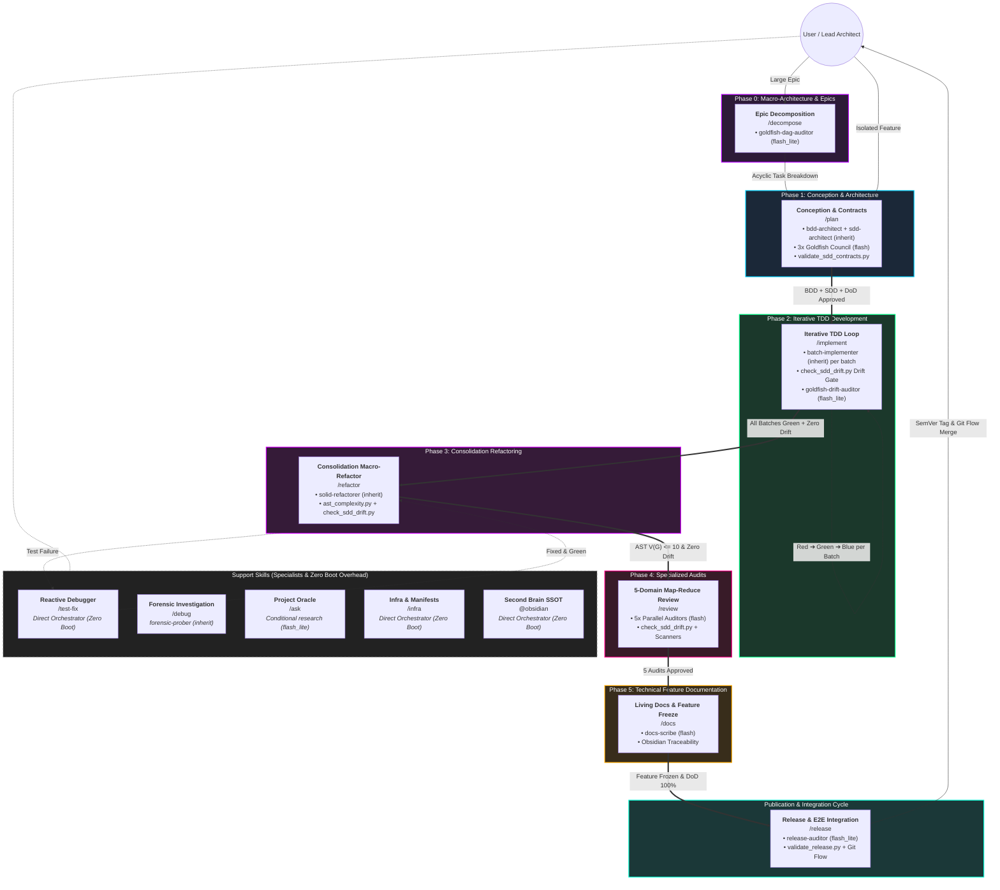

# 🪐 Antigravity Agentic Skills

<p align="center">
  <em>An AI Agent-driven Software Engineering ecosystem based on "Second Brain" (Obsidian Vault), and Separation of Concerns.</em>
</p>

<p align="center">
  
  
  
  
</p>

---

## 🎯 The Pitch (Why Antigravity?)

Working with LLMs on large codebases frequently results in the "trigger-happy" problem: the AI tries to refactor entire files before understanding the context, causing regressions and knowledge loss.

The **Antigravity IDE Ecosystem** solves this by enforcing a **Strict State Machine Architecture**, **Ephemeral Chat Windows**, and deep integration with a **"Second Brain"** (Obsidian Vault via MCP).

Each AI agent has restricted permissions and an isolated scope — from requirements engineering (BDD/SDD) and living DoD logs, through iterative TDD pipelines and diff-scoped Refactoring, down to OWASP-aligned Code Review, atomic documentation, and release management.

**The principle is absolute: AI suggests, human orchestrates and approves.**

---

## 🚀 Getting Started (5-Minute Quick Setup)

### 1. Prerequisites
* An IDE compatible with the Antigravity ecosystem (e.g., local Gemini/Claude setup).
* The **Obsidian** app installed locally (for project Knowledge Graph).

### 2. Installation (Automated Setup)

Clone the repository (or download and extract the ZIP file):

```bash
git clone https://github.com/MarcosVeniciu/antigravity-agentic-workflows.git
cd antigravity-agentic-workflows
```

Run the automated installer for your operating system:

#### 🪟 Windows
* **1-Click**: Double-click `install.bat` in File Explorer.
* **PowerShell (Interactive Menu)**:
  ```powershell
  .\install.ps1
  ```
  *(Options: `[1] Global`, `[2] Project`, `[3] Restore Backup`, `[4] Uninstall`, `[5] Exit`)*
* **PowerShell (Direct CLI)**:
  ```powershell
  # Global install (~/.gemini)
  .\install.ps1 -Global

  # Specific project install (.agents/)
  .\install.ps1 -Project "C:\Path\To\YourProject"

  # Restore / Rollback to a previous snapshot
  .\install.ps1 -Restore

  # Uninstall workflows, skills and rules cleanly
  .\install.ps1 -Uninstall
  ```

#### 🐧 Linux & 🍎 macOS
```bash
# Make executable and run interactive menu:
chmod +x install.sh
./install.sh

# Or direct CLI flags:
./install.sh --global
./install.sh --project "/path/to/your/project"
./install.sh --restore
./install.sh --uninstall
```

> [!TIP]
> **Safety, Backups, Rollback & Uninstall**:
> * **Transaction Manifest (`manifest.json`)**: Every installation records both modified and newly added files. When rolling back a fresh install, all newly added files are deleted cleanly, restoring the environment to a 100% clean state.
> * **Rollback**: Access previous snapshots via menu option `[3] Restore Backup` or `.\install.ps1 -Restore` / `./install.sh --restore`.
> * **Uninstall**: Cleanly remove installed resources via option `[4] Uninstall` or `.\install.ps1 -Uninstall` / `./install.sh --uninstall`. A safety backup is always created automatically prior to removal.
> * **Dry-Run**: Append `--dry-run` (or `-DryRun`) to any command to preview operations without modifying files on disk.

### 3. Engaging the "Second Brain"
1. Open Obsidian.
2. Open your project's vault folder.
3. Enable the MCP (Model Context Protocol) server to connect the knowledge base to the AI.

### 4. First Run
Start your workflow by consulting project context or planning a new feature:

```bash
# Consult the Oracle (Read-Only Context)
/ask Explain how the current microservices architecture is designed.

# Start the Development Cycle (BDD & Requirements)
/plan
```

---

## 🏗️ Agent & Skill Architecture (SDD 2.0: Elephant & Goldfish)

The ecosystem adopts a **self-sufficient, open Agent Skills architecture** ([agentskills.io](https://agentskills.io/home)) natively integrated into Google Antigravity 2.0, powered by the **SDD 2.0 (Elephant & Goldfish) Multi-Agent Architecture**:

1. **The Elephant & Goldfish Paradigm (Context-Zero Subagent Isolation)**:
   - **The Elephant (Main Orchestrator / Maestro)**: Retains long-term project memory, active Git Flow lifecycle governance, user collaboration through interactive Socratic inquiry (`ask_question`), and Living Definition of Done updates (`dod-[slug].md`).
   - **The Goldfish (Context-Zero Blind Subagents)**: Instantiated with an empty session (`conversationId`) and zero chat history baggage. Operates with the pristine memory of a goldfish to eliminate confirmation bias (*"grading one's own homework"*), prevent *lost-in-the-middle* token degradation, and insulate the orchestrator from noisy terminal outputs (intermediate failing `pytest` tracebacks, raw AST outputs, or multi-directory grep searches).
2. **Three-Tier Model Topology & Zero Boot Overhead**:
   - **Frontier Reasoning (`Model: inherit`)**: Allocated to heavy architectural conception, BDD/SDD modeling, iterative TDD batch implementation, SOLID macro-refactoring, and forensic crash probing (`bdd-architect`, `sdd-architect`, `batch-implementer`, `solid-refactorer`, `forensic-prober`).
   - **High-Speed Parallel Squads (`Model: flash`)**: Concurrent adversarial critique councils and multi-domain reviews (the 3x parallel Goldfish Council in `/plan`, the 5x parallel domain auditors in `/review`, and `docs-scribe` in `/docs`).
   - **Ultra-Fast Deterministic Verifiers (`Model: flash_lite`)**: Sub-second structural audits and boundary checks (`goldfish-dag-auditor` in `/decompose`, `goldfish-drift-auditor` in `/implement`, `release-auditor` in `/release`, and exploratory `research` in `/ask`).
   - **Zero Boot Overhead (Direct Orchestrator Execution)**: Operational support commands (`/test-fix`, `/infra`, `@obsidian`) execute directly inside the Main Orchestrator with zero subagent boot latency.
3. **Deterministic Verification Gates**: Automated CLI scripts (`validate_sdd_contracts.py`, `check_sdd_drift.py`, `ast_complexity.py`, `check_arch_boundaries.py`, `scan_sinks.py`, `validate_release.py`, `validate_env.py`) enforce hard invariants before any phase transition.
4. **Self-Sufficient Agent Skills (`skills/`)**: Rather than separate single-file workflows and loose external skills, each lifecycle phase or support capability is an autonomous Agent Skill package (`skills/<name>/`). The skill's `SKILL.md` acts as the command entry point and phase pipeline, while contextual operation guides reside in `references/`, schemas and templates in `resources/`, automation CLI tools in `scripts/`, and reference cases in `examples/`.
5. **Living Execution Log & DoD (`01-concepcao/dod-[slug].md`)**: Dynamic document centralizing development timeline history and gating functional acceptance criteria, non-functional rules, audits, and releases.
6. **Worktree & Branch Lifecycle Governance**: Every feature runs in an isolated branch (`feature/[slug]`) or ephemeral git worktree. Upon completion and merge into the base branch (`develop`/`main`), the worktree and branch are cleanly pruned.

> [!NOTE]
> **Source / Matrix Repository**: The `skills/` and `prompts/` directories in this repository represent the **development matrix** of the ecosystem. When deployed globally to the developer's environment, they are installed into `~/.gemini/GEMINI.md` and `~/.gemini/config/skills/` (or `<project>/.agents/skills/` and `<project>/GEMINI.md` inside specific workspaces).

### 📂 Repository Directory Structure

```text
antigravity-agentic-workflows/
├── install.bat                   # 1-Click Windows installer launcher (File Explorer)
├── install.ps1                   # Native PowerShell installer (Windows 10/11 & Core)
├── install.sh                    # Native POSIX Bash installer (Linux / macOS / WSL)
├── prompts/                      # System prompts & global governance
│   └── gemini.md                 # Antigravity core protocol & active co-programming directives
├── skills/                       # 12 Self-Sufficient Agent Skills (Antigravity 2.0 / agentskills.io)
│   ├── ask/                      # /ask       - Support: Read-Only Project Oracle & Vault Search
│   ├── debug/                    # /debug     - Support: Forensic Crash Investigator (5 Whys & RCA)
│   ├── decompose/                # /decompose - Phase 0: Macro-Architecture & Epic Slicing
│   ├── docs/                     # /docs      - Phase 5: Technical Feature Documentation & Docstrings
│   ├── implement/                # /implement - Phase 2: Iterative TDD Development (Red -> Green -> Blue)
│   ├── infra/                    # /infra     - Support: Dependency Manifests, Docker & Safe Env
│   ├── obsidian/                 # @obsidian  - Support: Second Brain SSOT, Metadata & ADR Management
│   ├── plan/                     # /plan      - Phase 1: Conception, BDD Gherkin, SDD Contracts & Living DoD
│   ├── refactor/                 # /refactor  - Phase 3: Consolidation Refactoring (Clean Code on Diff)
│   ├── release/                  # /release   - Publication: E2E Integration Suite, SemVer & Git Flow
│   ├── review/                   # /review    - Phase 4: Specialized Audits (Arch, Sec, Quality, Perf, Resilience)
│   └── test-fix/                 # /test-fix  - Support: Reactive Debugger & Surgical Production Fixes
├── doc/                          # Architectural documentation & authoritative engineering standards
│   ├── README.md                 # Architectural overview & cross-cutting SDD 2.0 principles
│   ├── <skill>/README.md         # Per-skill architectural specifications, subagents & evolution guides
│   └── references/               # Authoritative external standards (OWASP Code Review Guide v2)
│       └── OWASP_Code_Review_Guide_v2.pdf
└── tests/                        # Automated integrity and scanner test suite
    ├── test_flow_skills_integrity.py  # Validation of frontmatter, structure & references
    └── skills/test_scanners.py        # Unit tests for automated AST, boundary & sink scanners
```

---

## 🗺️ Ecosystem Lifecycle (Multi-Chat SDLC Pipeline)

To avoid model degradation caused by accumulated context (*token exhaustion*), execution is partitioned into **Ephemeral Chat Windows** backed by **Context-Zero Subagents**:



---

## ⚡ Workflow Optimizations & Technical Rationale

1. **SDD 2.0 (Elephant & Goldfish) Paradigm & Context-Zero Isolation**:
   - The Orchestrator (*Elephant*) retains the overall journey, branch context, and Living DoD without polluting its context with low-level execution logs.
   - Independent subagents (*Goldfish*) execute with pristine zero-token context windows, eliminating confirmation bias (*"grading one's own homework"*), preventing prompt bloat, and shielding the chat from noisy terminal outputs.
   - Tiered model allocation maximizes speed and cost efficiency: heavy reasoning uses `Model: inherit`, parallel squads run on `Model: flash`, and sub-second validations run on `Model: flash_lite`.

2. **Phase 0 (`/decompose`): Monotonic Evolutionary Slicing & Blind DAG Audit**:
   - Decomposes initiatives into atomic, dependent batches (Batch 1: domain contracts, intermediate: use cases, final: adapters).
   - Validated by the Context-Zero `goldfish-dag-auditor` (`Model: flash_lite`) to mathematically guarantee an acyclic dependency graph (DAG), explicit contract introduction prior to consumers, and absence of oversized slices ($L$).

3. **Phase 1 (`/plan`): Context-Zero Conception & Goldfish Council Adversarial Review**:
   - Orchestrator facilitates the Socratic scope debate (`ask_question`) and eliminates XY problems.
   - Context-Zero `bdd-architect` generates pure Gherkin scenarios (`bdd-[slug].md`), and `sdd-architect` generates typed Mermaid diagrams and contracts (`sdd-[slug].md`), verified deterministically via `validate_sdd_contracts.py`.
   - A 3x parallel **Goldfish Council** (`Model: flash`: `goldfish-yagni`, `goldfish-adversary`, `goldfish-implementer`) critiques the architecture across overengineering, edge cases, and implementability before human arbitration.

4. **Phase 2 (`/implement`): Batch-Isolated TDD Loop & SDD Drift Gate**:
   - Phase 2 structures work into sequential batches declared in `task_list.md` with explicit **Batch Acceptance Criteria** (target files, SDD contracts, and BDD scenarios).
   - Each batch executes in a dedicated, isolated `batch-implementer` subagent (`Model: inherit`) through the Red ➔ Green ➔ Blue cycle, discarding intermediate `pytest` failure traces.
   - Spec Drift is prevented deterministically: `check_sdd_drift.py` runs both per batch (`--batch`) and as a full exit gate (`--check-files`), while `goldfish-drift-auditor` (`Model: flash_lite`) confirms 100% acceptance criteria parity.

5. **Phase 3 (`/refactor`): Diff-Scoped Macro-Refactoring**:
   - Consolidation refactoring executes strictly on a 100% green test suite (*Make it Right*).
   - Analysis and refactoring scope is **strictly limited to files modified on the active branch** (`git diff develop...HEAD --name-only`), eliminating token waste and regression risks.
   - The context-isolated `solid-refactorer` subagent (`Model: inherit`) enforces Clean Code and SOLID principles, verifies cyclomatic complexity $V(G) \le 10$ with `ast_complexity.py`, and guarantees zero public contract drift with `check_sdd_drift.py`.

6. **Phase 4 (`/review`): 5-Domain Map-Reduce Parallel Audits**:
   - `/review` executes pre-flight CLI scanners (`check_sdd_drift.py`, `check_arch_boundaries.py`, `scan_sinks.py`, `ast_complexity.py`).
   - Dispatches **5 parallel domain auditors** (`Model: flash`) in a Map-Reduce architecture: Architecture & SDD Drift, OWASP Security & Taint Analysis, AST Quality, Performance & Algorithmic Complexity, and Resilience.
   - Eliminates *lost-in-the-middle* context degradation. In Mode B (`--fix`), fixes are applied centrally by the Orchestrator, completely avoiding file write race conditions.

7. **Phase 5 (`/docs`): Living Documentation Offload & Feature Freeze**:
   - `docs-scribe` (`Model: flash`) generates living module and root `README.md` files and enriches docstrings with bidirectional Obsidian links (`[[sdd-[slug]]]`) validated against project manifests.
   - Freezes the feature branch with a semantic commit, preparing it for release bundling.

8. **Publication Gating & Release Finalization (`/release`)**:
   - The fast `release-auditor` subagent (`Model: flash_lite`) audits candidate feature branches to verify that 100% of Living DoD checkboxes (`dod-[slug].md`) are signed off and calculates SemVer 2.0.0 increments.
   - The Main Orchestrator runs full staged E2E integration test suites, validates with `validate_release.py`, and executes atomic Git Flow Mode 5 release merges into `main` and `develop`.

9. **Forensic Root Cause Analysis (`/debug`) & Reactive Fixes (`/test-fix`)**:
   - `/debug` uses `forensic-prober` (`Model: inherit`) to run context-isolated probing tests and empirical characterization tests, drilling down the 5 Whys to test-escape mechanics before presenting an RCA artifact for human approval.
   - `/test-fix` operates directly in the Main Orchestrator with **Zero Boot Overhead**, isolating defects in 1 sentence and applying surgical production fixes governed by the Double-Strike Rule.

10. **Knowledge Consultation (`/ask`) & SSOT Memory (`@obsidian`)**:
    - `/ask` handles narrow inquiries directly and conditionally offloads broad repository/vault surveys to the `research` subagent (`Model: flash_lite`) with strict code line citations.
    - `@obsidian` runs directly in the Main Orchestrator with **Zero Boot Overhead**, executing surgical patches and maintaining knowledge graph integrity.

11. **Worktree & Branch Lifecycle Governance**:
    - Features execute under isolated branches (`feature/[slug]`) or ephemeral git worktrees. Upon completion and merge into the base branch, worktrees and branches are systematically pruned, preventing repository clutter.

---

## 🤖 Agents & Slash Commands Catalog

| Command | Skill Package | Phase / Role | Multi-Agent Topology & Model Tier | Description & Main Responsibility |
| :--- | :--- | :--- | :--- | :--- |
| `/decompose` | [`skills/decompose/`](skills/decompose/SKILL.md) | **Phase 0** | `goldfish-dag-auditor` (`Model: flash_lite`) | Slices complex initiatives into atomic vertical batches; validates acyclic DAG and contract introduction. |
| `/plan` | [`skills/plan/`](skills/plan/SKILL.md) | **Phase 1** | `bdd-architect` & `sdd-architect` (`Model: inherit`) + 3x parallel Goldfish Council (`Model: flash`) + `validate_sdd_contracts.py` | Socratic debate, Gherkin BDD, typed SDD contracts, 3x parallel blind critique council, and Living DoD setup. |
| `/implement` | [`skills/implement/`](skills/implement/SKILL.md) | **Phase 2** | `batch-implementer` (`Model: inherit`) per batch + `check_sdd_drift.py` Drift Gate + `goldfish-drift-auditor` (`Model: flash_lite`) | Batch-isolated Red-Green-Blue TDD cycle, explicit batch acceptance criteria, drift gate enforcement, and micro-checkpoints. |
| `/refactor` | [`skills/refactor/`](skills/refactor/SKILL.md) | **Phase 3** | `solid-refactorer` (`Model: inherit`) + `ast_complexity.py` + `check_sdd_drift.py` | Macro-refactoring scoped to branch diff enforcing SOLID, cyclomatic complexity $V(G) \le 10$, and contract preservation. |
| `/review` | [`skills/review/`](skills/review/SKILL.md) | **Phase 4** | 5x parallel domain auditors (`Model: flash`) Map-Reduce + `check_sdd_drift.py` & scanners | 5-domain concurrent audit (Arch + SDD Drift, OWASP Security, Quality, Perf, Resilience) with centralized Mode B fix. |
| `/docs` | [`skills/docs/`](skills/docs/SKILL.md) | **Phase 5** | `docs-scribe` (`Model: flash`) | Living module/root READMEs, Obsidian traceability (`[[sdd-[slug]]]`), and semantic feature freeze. |
| `/release` | [`skills/release/`](skills/release/SKILL.md) | **Publication** | `release-auditor` (`Model: flash_lite`) + `validate_release.py` | 100% Living DoD checkbox gatekeeper, staged E2E suite, SemVer 2.0.0 calculation, and Git Flow finalization. |
| `/debug` | [`skills/debug/`](skills/debug/SKILL.md) | **Support** | `forensic-prober` (`Model: inherit`) | 5 Whys forensic investigation, isolated empirical probing/characterization tests, and RCA approval gate. |
| `/ask` | [`skills/ask/`](skills/ask/SKILL.md) | **Support** | Direct Orchestrator + conditional `research` (`Model: flash_lite`) | Read-only oracle; direct quick lookups and isolated broad surveys with strict code/vault citations. |
| `/test-fix` | [`skills/test-fix/`](skills/test-fix/SKILL.md) | **Support** | Direct Main Orchestrator *(Zero Boot Overhead)* | Reactive debugger: 1-sentence root cause isolation, minimal surgical fix, and Double-Strike escalation. |
| `/infra` | [`skills/infra/`](skills/infra/SKILL.md) | **Support** | Direct Main Orchestrator *(Zero Boot Overhead)* | Package manifests, Docker multi-stage configs, and secret-safe environment validation (`validate_env.py`). |
| `@obsidian` | [`skills/obsidian/`](skills/obsidian/SKILL.md) | **Foundation** | Direct Main Orchestrator *(Zero Boot Overhead)* | Second Brain SSOT: Knowledge graph, metadata queries, ADR governance, and surgical vault patching. |

> [!NOTE]
> **Foundational Core Protocol**: The global engine directives (*Active Co-Programming*, Outcome-Based Socratic inquiry with `ask_question`, initial status banner, SSOT memory governance, and worktree cleanup) are specified in [`prompts/gemini.md`](prompts/gemini.md).

---

## 🧰 Modular Skills Catalog (12 Unified Agent Skills)

All 12 skills adhere to the Single Responsibility Principle (SRP) and Google Antigravity 2.0 directory bundle standards. Loaded on-demand via Progressive Disclosure:

| Category | Skill Package | Bundled References, Tooling & Subagents | Primary Responsibility & SDD 2.0 Governance |
| :--- | :--- | :--- | :--- |
| **Conception & Slicing** | [`decompose`](skills/decompose/SKILL.md) | `references/decompose-*`, `resources/task-template.md`, `goldfish-dag-auditor` (`flash_lite`) | Monotonic vertical slicing, task breakdown, and blind acyclic DAG validation. |
| **Conception & Slicing** | [`plan`](skills/plan/SKILL.md) | `bdd-architect` & `sdd-architect` (`inherit`), 3x Goldfish Council (`flash`), `validate_sdd_contracts.py`, templates | Socratic debate, Gherkin BDD, typed SDD contracts, blind adversarial review council, and Living DoD setup. |
| **TDD Construction** | [`implement`](skills/implement/SKILL.md) | `batch-implementer` (`inherit`), `goldfish-drift-auditor` (`flash_lite`), `check_sdd_drift.py`, templates | Context-isolated batch TDD loop, explicit batch acceptance criteria, drift gate enforcement, and micro-checkpoints. |
| **TDD Construction** | [`test-fix`](skills/test-fix/SKILL.md) | `references/test-fix-protocol.md`, `resources/diagnostic-report-template.md` *(Direct Orchestrator)* | Rapid traceback diagnosis, 1-sentence root cause isolation, minimal fixes, and Double-Strike rule. |
| **Refactoring** | [`refactor`](skills/refactor/SKILL.md) | `solid-refactorer` (`inherit`), `ast_complexity.py`, `check_sdd_drift.py`, `references/solid-catalog.md` | Clean Code & SOLID refactoring scoped to branch diff with AST complexity $V(G) \le 10$ and zero contract drift. |
| **Audits** | [`review`](skills/review/SKILL.md) | 5x parallel domain auditors (`flash`), `check_sdd_drift.py`, `check_arch_boundaries.py`, `scan_sinks.py`, `ast_complexity.py` | 5-domain parallel Map-Reduce review: Architecture + SDD Drift, OWASP Security, Quality, Performance, Resilience. |
| **Documentation & Release** | [`docs`](skills/docs/SKILL.md) | `docs-scribe` (`flash`), `references/docs-guidelines.md`, `resources/doc-template.md` | Living module/root READMEs validated against manifests, Obsidian-traceable docstrings, and feature freeze. |
| **Documentation & Release** | [`release`](skills/release/SKILL.md) | `release-auditor` (`flash_lite`), `scripts/validate_release.py`, `references/release-checklist.md` | 100% Living DoD audit gate, staged E2E suite, SemVer 2.0.0 calculation, changelog sync, and Git Flow finish. |
| **Support & Knowledge** | [`ask`](skills/ask/SKILL.md) | Direct lookup + conditional `research` subagent (`flash_lite`), `references/ask-sources.md` | Strictly read-only repository and Obsidian Vault knowledge retrieval with line-anchored citations. |
| **Support & Knowledge** | [`debug`](skills/debug/SKILL.md) | `forensic-prober` (`inherit`), `references/debug-methodology.md`, `resources/rca-template.md` | 5 Whys forensic investigation, isolated empirical probing/characterization tests, and RCA approval gate. |
| **Support & Knowledge** | [`infra`](skills/infra/SKILL.md) | `scripts/validate_env.py`, `references/infra-setup.md`, `resources/env-template.md` *(Direct Orchestrator)* | Manifest hygiene, container configurations, and secret-safe environment validation. |
| **Support & Knowledge** | [`obsidian`](skills/obsidian/SKILL.md) | `references/obsidian-protocol.md`, `resources/note-template.md` *(Direct Orchestrator)* | SSOT Vault governance, metadata search, surgical patching, and ADR management. |

---

## 📚 Deep Delegation & Technical References

To explore architecture details, execution runbooks, and project standards:

* 📖 **[Architectural Documentation](doc/README.md)**: Deep-dive architectural documentation, cross-cutting SDD 2.0 principles, and per-skill evolution blueprints ([`doc/plan`](doc/plan/README.md), [`doc/implement`](doc/implement/README.md), [`doc/review`](doc/review/README.md)).
* 🛡️ **[Core Engine Protocol](prompts/gemini.md)**: Foundational pair-programming rules (*Active Co-Programming*, Socratic inquiry with `ask_question`, worktree cleanup, status banners).
* 🧰 **[Modular Skills Catalog](skills/)**: All 12 self-contained Agent Skills with operational references, schemas, scripts, and templates.
* 🔒 **[OWASP Security Code Review Reference](doc/references/OWASP_Code_Review_Guide_v2.pdf)**: Authoritative OWASP Code Review Guide v2 used by the review agent.

---

<p align="center">
  <em>Built as a cutting-edge experiment on how engineering teams will work in collaboration with AIs in the future.</em>
</p>
