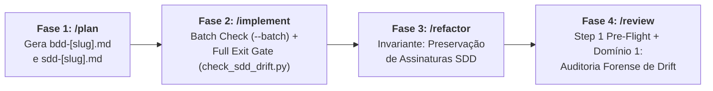

# Documentação Arquitetural do Ecossistema Antigravity Agentic Workflows

> [!IMPORTANT]
> **Documentação Geral de Engenharia do Ecossistema:**
> Este diretório (`doc/`) centraliza a documentação de arquitetura, padrões e planejamento evolutivo de cada skill do ecossistema.
> Nenhuma pasta ou arquivo contido em `doc/` é copiado para os diretórios de instalação de skills (`~/.gemini/config/skills/` ou `.agents/skills/`), preservando o isolamento de contexto e o consumo de tokens dos agentes em produção.

---

## 1. Índice de Documentação por Skill

Cada skill do ciclo de vida possui sua respectiva pasta de documentação com arquitetura e guias de evolução específicos:

| Skill | Escopo no Ciclo de Vida | Modelo Arquitetural | Documentação Específica |
| :--- | :--- | :---: | :--- |
| **`/plan`** | Fase 1: Concepção, BDD, SDD e Living DoD | **SDD 2.0 (Elephant & Goldfish)** | [`doc/plan/README.md`](./plan/README.md) |
| **`/implement`** | Fase 2: Implementação TDD Iterativa em Lotes | **SDD 2.0 (Batch Isolation + Drift Gate + `flash_lite` Verifier)** | [`doc/implement/README.md`](./implement/README.md) |
| **`/refactor`** | Fase 3: Macro-Refatoração e AST Complexity | *Invariantes SOLID + Drift Audit (Previsto)* | `doc/refactor/README.md` *(Previsto)* |
| **`/review`** | Fase 4: Auditorias Especializadas em 5 Domínios | **SDD 2.0 (5x Parallel `flash` Map-Reduce + Drift Gate)** | [`doc/review/README.md`](./review/README.md) |
| **`/docs`** | Fase 5: Documentação Técnica e Sincronização | *Traceabilidade Obsidian + Code Freeze (Previsto)* | `doc/docs/README.md` *(Previsto)* |
| **`/release`** | Gatekeeper: Publicação de Versão SemVer 2.0.0 | *100% Mathematical DoD Gatekeeper (Previsto)* | `doc/release/README.md` *(Previsto)* |

---

## 2. Princípios Transversais do Ecossistema (SDD 2.0)

1. **Separação Estrita de Responsabilidades:**
   - Comportamento de Negócio pertence ao **BDD (Gherkin puro)**.
   - Decisões estruturais e contratos pertencem ao **SDD (Mermaid + Tipos Nativos)**.
   - Código de produção só existe a partir do `/implement`.
2. **Context-Zero Firewall & Isolamento por Lote/Domínio:**
   - Subagentes operam sem contaminação pelo histórico do chat principal, eliminando viés de auto-concordância e expurgando *tracebacks* intermediários.
3. **Conselhos e Squads Paralelos Multi-Persona (`flash` / `flash_lite`):**
   - No `/plan`, o *Goldfish Council* (`3x flash`) ataca a especificação.
   - No `/implement`, cada lote roda em um `batch-implementer` (`inherit`) isolado e o fechamento é auditado pelo `goldfish-drift-auditor` (`flash_lite`).
   - No `/review`, os 5 domínios rodam simultaneamente em 5 subagentes `flash` no padrão **Map-Reduce**.
4. **Governança por Living Definition of Done (DoD) & Drift Gate:**
   - SSOT rastreável que acompanha a feature da concepção ao release, blindado pelo script determinístico [`check_sdd_drift.py`](../skills/implement/scripts/check_sdd_drift.py).

---

## 3. Arquitetura Transversal do *Drift Gate* (`check_sdd_drift.py`)

O combate ao **Spec Drift** (divergência entre o planejado no SDD e o código real gerado no TDD) atua em 3 pontos de ancoragem:

### 3.1. Ancoragem no `/implement` ([`doc/implement/README.md`](./implement/README.md))
- **Critérios de Aceite Explícitos por Lote (`task_list.md`):** Mapeia contratos SDD e cenários BDD antes de iniciar os lotes.
- **Script `check_sdd_drift.py`:** Roda em modo `--batch` ao final de cada lote e em modo completo (`--check-files`) no Step 3, respeitando desvios documentados em `02-auditorias/pivots-[slug].md`.
- **Verificador `goldfish-drift-auditor` (`Model: "flash_lite"`):** Confere 100% dos checkboxes de Critérios de Aceite e paridade BDD ↔ Testes Unitários.

### 3.2. Ancoragem no `/refactor`
- Verificação da preservação estrita de contratos do SDD antes do handover para `/review`.

### 3.3. Ancoragem no `/review` ([`doc/review/README.md`](./review/README.md))
- Execução de `check_sdd_drift.py` no Step 1 (*Pre-Flight*) e inspeção dedicada pelo subagente `auditor-architecture` no Domínio 1 (`02-auditorias/audit-architecture-[slug].md`).
