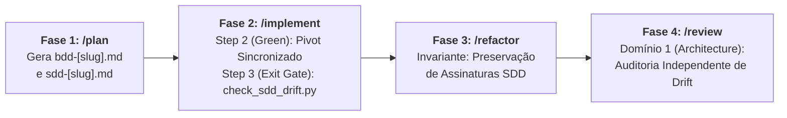

# Documentação Arquitetural do Ecossistema Antigravity Agentic Workflows

> [!IMPORTANT]
> **Documentação Geral de Engenharia do Ecossistema:**
> Este diretório (`doc/`) centraliza a documentação de arquitetura, padrões e planejamento evolutivo de cada skill do ecossistema.
> Nenhuma pasta ou arquivo contido em `doc/` é copiado para os diretórios de instalação de skills (`~/.gemini/config/skills/` ou `.agents/skills/`), preservando o isolamento de contexto e o consumo de tokens dos agentes em produção.

---

## 1. Índice de Documentação por Skill

Cada skill do ciclo de vida possui sua respectiva pasta de documentação com arquitetura e guias de evolução específicos:

| Skill | Escopo no Ciclo de Vida | Modelo Arquitetural | Documentação Específica |
| :--- | :--- | :---: | :--- |
| **`/plan`** | Fase 1: Concepção, BDD, SDD e Living DoD | **SDD 2.0 (Elephant & Goldfish)** | [`doc/plan/README.md`](./plan/README.md) |
| **`/implement`** | Fase 2: Implementação TDD Iterativa em Lotes | *TDD em Lotes + Drift Gate (Em Revisão)* | `doc/implement/README.md` *(Previsto)* |
| **`/refactor`** | Fase 3: Macro-Refatoração e AST Complexity | *Invariantes SOLID + Drift Audit (Previsto)* | `doc/refactor/README.md` *(Previsto)* |
| **`/review`** | Fase 4: Auditorias Especializadas em 5 Domínios | *5-Domain Audits + AST Scanners (Previsto)* | `doc/review/README.md` *(Previsto)* |
| **`/docs`** | Fase 5: Documentação Técnica e Sincronização | *Traceabilidade Obsidian + Code Freeze (Previsto)* | `doc/docs/README.md` *(Previsto)* |
| **`/release`** | Gatekeeper: Publicação de Versão SemVer 2.0.0 | *100% Mathematical DoD Gatekeeper (Previsto)* | `doc/release/README.md` *(Previsto)* |

---

## 2. Princípios Transversais do Ecossistema (SDD 2.0)

1. **Separação Estrita de Responsabilidades:**
   - Comportamento de Negócio pertence ao **BDD (Gherkin puro)**.
   - Decisões estruturais e contratos pertencem ao **SDD (Mermaid + Tipos Nativos)**.
   - Código de produção só existe a partir do `/implement`.
2. **Context-Zero Firewall:**
   - Subagentes operam sem contaminação pelo histórico do chat principal, eliminando viés de auto-concordância.
3. **Conselho Crítico Multi-Persona (Goldfish Council):**
   - Subagentes paralelos e especializados atacam as especificações com lentes distintas (YAGNI/Simplicidade, Adversário/Concorrência, Implementador Cego).
4. **Governança por Living Definition of Done (DoD):**
   - SSOT rastreável que acompanha a feature da concepção ao release.

---

## 3. Planejamento Futuro: Onde o *Drift Report* se Encaixa

Durante a revisão das próximas skills (`/implement`, `/refactor` e `/review`), o combate ao **Spec Drift** (divergência entre o planejado no SDD e o código real gerado no TDD) será implementado em 3 pontos de ancoragem:

### 3.1. Ancoragem no `/implement`
- **Sincronização no Technical Pivot:** Toda alteração técnica registrada em `02-auditorias/pivots-[slug].md` atualizará cirurgicamente `01-concepcao/sdd-[slug].md`.
- **Script `check_sdd_drift.py` no Step 3:** Script AST que compara classes, métodos públicos e o *File Impact Analysis* do SDD contra os arquivos Python gerados.

### 3.2. Ancoragem no `/refactor`
- Verificação da preservação estrita de contratos do SDD no Step 4 antes do handover para `/review`.

### 3.3. Ancoragem no `/review`
- Validação da paridade `SDD ↔ Código` integrada ao relatório `02-auditorias/audit-architecture-[slug].md` no Domínio 1.
