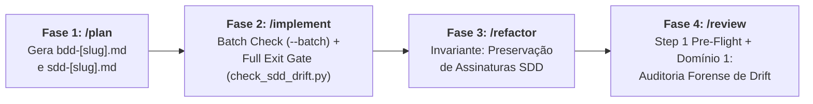

# Documentação Arquitetural do Ecossistema Antigravity Agentic Workflows

> [!IMPORTANT]
> **Documentação Geral de Engenharia do Ecossistema:**
> Este diretório (`doc/`) centraliza a documentação de arquitetura, padrões e planejamento evolutivo de cada skill do ecossistema.
> Nenhuma pasta ou arquivo contido em `doc/` é copiado para os diretórios de instalação de skills (`~/.gemini/config/skills/` ou `.agents/skills/`), preservando o isolamento de contexto e o consumo de tokens dos agentes em produção.

---

## 1. Índice de Documentação por Skill (12 Skills do Ecossistema)

Cada skill do ciclo de vida possui sua respectiva pasta de documentação com arquitetura, guardrails e guias de evolução específicos:

| Skill | Escopo no Ciclo de Vida | Modelo Arquitetural (SDD 2.0) | Documentação Específica |
| :--- | :--- | :--- | :--- |
| **`/decompose`** | Fase 0: Macro-Arquitetura e Decomposição de Épicos em Fatias Verticais | **Main Orchestrator + Subagente `goldfish-dag-auditor` (`Model: "flash_lite"`, Read-Only)** | [`doc/decompose/README.md`](./decompose/README.md) |
| **`/plan`** | Fase 1: Concepção, BDD, SDD e Living DoD | **SDD 2.0 Elephant & Goldfish: Orchestrator + Subagentes `bdd-architect` & `sdd-architect` (`inherit`) + Goldfish Council (3x `flash` Read-Only)** | [`doc/plan/README.md`](./plan/README.md) |
| **`/implement`** | Fase 2: Implementação TDD Iterativa em Lotes | **SDD 2.0 Batch Isolation: Orchestrator + Subagente `batch-implementer` (`inherit`, 1x por Lote) + `check_sdd_drift.py` + Subagente `goldfish-drift-auditor` (`flash_lite`, Read-Only)** | [`doc/implement/README.md`](./implement/README.md) |
| **`/refactor`** | Fase 3: Macro-Refatoração e Complexidade AST | **SDD 2.0 SOLID Consolidation: Orchestrator + Subagente `solid-refactorer` (`inherit`, Isolado) + AST $V(G) \le 10$ + Drift Gate** | [`doc/refactor/README.md`](./refactor/README.md) |
| **`/review`** | Fase 4: Auditorias Especializadas em 5 Domínios | **SDD 2.0 Map-Reduce: Orchestrator (Pre-Flight & Reduce) + 5 Subagentes Paralelos (`Model: "flash"`, Read-Only em Map) + Drift Gate** | [`doc/review/README.md`](./review/README.md) |
| **`/docs`** | Fase 5: Documentação Técnica, Docstrings e Feature Freeze | **SDD 2.0 Living Docs: Orchestrator + Subagente `docs-scribe` (`Model: "flash"`) + Rastreabilidade Obsidian + Feature Freeze** | [`doc/docs/README.md`](./docs/README.md) |
| **`/release`** | Gatekeeper: Publicação de Versão SemVer 2.0.0 | **SDD 2.0 Release Gatekeeper: Orchestrator + Subagente `release-auditor` (`Model: "flash_lite"`) + 100% Living DoD Gate + Git Flow Modo 5** | [`doc/release/README.md`](./release/README.md) |
| **`/debug`** | Suporte Crítico: Investigação Forense de Bugs e Causa Raiz | **SDD 2.0 Forensic Bug Investigation: Orchestrator + Subagente `forensic-prober` (`Model: "inherit"`) + Testes de Sondagem / MRE + 5 Whys + RCA Gate** | [`doc/debug/README.md`](./debug/README.md) |
| **`/test-fix`** | Suporte Reativo: Diagnóstico de Tracebacks e Correção Cirúrgica | **Reactive Debugger Direto: 100% Main Orchestrator (Zero Subagents, Zero Boot Token Overhead, RCA em 1 Frase, Double-Strike Rule com Escalada para `/debug`)** | [`doc/test-fix/README.md`](./test-fix/README.md) |
| **`/ask`** | Consulta: Oráculo de Conhecimento e Análise da Base de Código | **Project Oracle: Orchestrator Direto (Buscas pontuais) + Subagente Condicional `research` (`Model: "flash_lite"`, Read-Only para Varreduras Amplas)** | [`doc/ask/README.md`](./ask/README.md) |
| **`/infra`** | Governança: Infraestrutura, Manifestos e Variáveis de Ambiente | **Infrastructure & Environment: 100% Main Orchestrator (Zero Subagents, Zero Boot Token Overhead, Contenção Estrita de Segredos + `validate_env.py`)** | [`doc/infra/README.md`](./infra/README.md) |
| **`/obsidian`** | Base de Conhecimento: Single Source of Truth (SSOT) do Repositório | **SSOT Knowledge Bridge: 100% Main Orchestrator (Zero Subagents, Zero Boot Token Overhead, Patches Cirúrgicos com `vault_patch`, Governança Frontmatter e Wikilinks)** | [`doc/obsidian/README.md`](./obsidian/README.md) |

---

## 2. Princípios Transversais do Ecossistema (SDD 2.0)

1. **Separação Estrita de Responsabilidades:**
   - Comportamento de Negócio pertence ao **BDD (Gherkin puro)**.
   - Decisões estruturais e contratos pertencem ao **SDD (Mermaid + Tipos Nativos)**.
   - Código de produção só existe a partir do `/implement`.
2. **Context-Zero Firewall & Isolamento por Lote/Domínio:**
   - Subagentes operam com sessões isoladas e sem contaminação pelo histórico do chat principal, eliminando viés de auto-concordância e expurgando *tracebacks* intermediários.
3. **Conselhos e Squads Paralelos Multi-Persona (`flash` / `flash_lite`):**
   - No `/plan`, o *Goldfish Council* (`3x flash`) ataca a especificação sob três perspectivas críticas (YAGNI, Adversary, Implementer).
   - No `/implement`, cada lote roda em um `batch-implementer` (`inherit`) isolado e o fechamento é auditado pelo `goldfish-drift-auditor` (`flash_lite`).
   - No `/review`, os 5 domínios rodam simultaneamente em 5 subagentes `flash` no padrão **Map-Reduce**.
4. **Governança por Living Definition of Done (DoD) & Drift Gate:**
   - SSOT rastreável que acompanha a feature da concepção ao release, blindado pelo script determinístico [`check_sdd_drift.py`](../skills/implement/scripts/check_sdd_drift.py).
5. **Otimização de Boot Token Overhead (Orquestrador Direto vs. Subagentes):**
   - Skills reativas de correção rápida, consultas pontuais ou governança passo único (`/test-fix`, `/infra`, `/obsidian`) executam **100% no Orquestrador Principal**. Isso elimina o overhead de 3.000 a 8.000 tokens de boot por subagente e evita latência desnecessária, reservando subagentes apenas para fluxos com alta densidade de contexto, paralelismo massivo ou necessidade estrita de isolamento de *tracebacks*.

---

## 3. Arquitetura Transversal do *Drift Gate* (`check_sdd_drift.py`)

O combate ao **Spec Drift** (divergência entre o planejado no SDD e o código real gerado no TDD) atua em pontos de ancoragem determinísticos:

### 3.1. Ancoragem no `/implement` ([`doc/implement/README.md`](./implement/README.md))
- **Critérios de Aceite Explícitos por Lote (`task_list.md`):** Mapeia contratos SDD e cenários BDD antes de iniciar os lotes.
- **Script `check_sdd_drift.py`:** Roda em modo `--batch` ao final de cada lote e em modo completo (`--check-files`) no Step 3, respeitando desvios documentados em `02-auditorias/pivots-[slug].md`.
- **Verificador `goldfish-drift-auditor` (`Model: "flash_lite"`):** Confere 100% dos checkboxes de Critérios de Aceite e paridade BDD ↔ Testes Unitários.

### 3.2. Ancoragem no `/refactor`
- Verificação da preservação estrita de contratos do SDD antes do handover para `/review`.

### 3.3. Ancoragem no `/review` ([`doc/review/README.md`](./review/README.md))
- Execução de `check_sdd_drift.py` no Step 1 (*Pre-Flight*) e inspeção dedicada pelo subagente `auditor-architecture` no Domínio 1 (`02-auditorias/audit-architecture-[slug].md`).

---

## 4. Materiais e Guias de Referência Arquitetural

- [`references/OWASP_Code_Review_Guide_v2.pdf`](./references/OWASP_Code_Review_Guide_v2.pdf) — Guia de referência técnica oficial da OWASP (*Open Web Application Security Project*) para revisão estática de código-fonte, taint analysis e prevenção de vulnerabilidades (OWASP Top 10 e CWE Top 25). Este documento fundamenta os checklists estritos do Domínio 2 (`review-security`) na skill `/review`.
