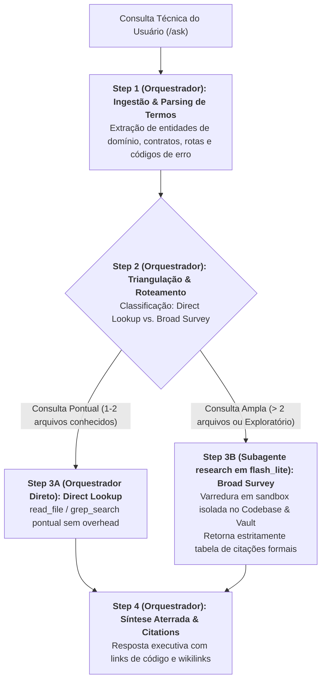
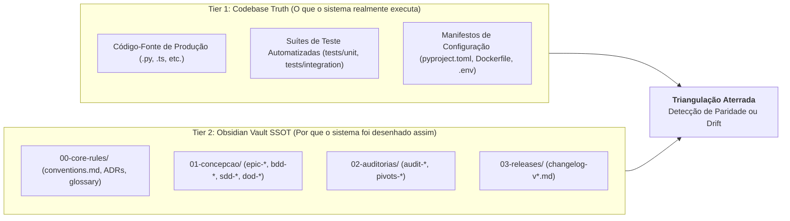

# Arquitetura da Skill `/ask` (SDD 2.0 — Context-Isolated Project Oracle)

> [!IMPORTANT]
> **Documento Exclusivo de Engenharia e Manutenção da Skill `/ask`:**
> Este documento reside em `doc/ask/README.md` e detalha a especificação arquitetural da evolução da skill `/ask` para o modelo SDD 2.0. Ele **não** é instalado em `~/.gemini/config/skills/` nem em `.agents/skills/`, garantindo **zero poluição de contexto** para o agente em produção.

---

## 1. O Problema Resolvido: Context Bloat em Consultas Amplas vs. Consultas Pontuais

Na operação tradicional de consulta arquitetural e técnica com agente único:
1. **Poluição Massiva de Contexto por Varreduras Brutas (*Raw Search Context Bloat*):** Ao responder a perguntas exploratórias ou transversais (ex: *"Como funciona a autenticação e autorização ponta a ponta no sistema?"*), comandos `grep` recursivos, buscas textuais amplas e leituras sucessivas de múltiplos arquivos despejam centenas de linhas de código intermediário e logs diretamente na janela de contexto principal. Quando a pergunta é finalmente respondida, a sessão já está saturada de ruído.
2. **Ausência de Triangulação Estruturada (Alucinação vs. Fato):** Consultas sem separação formal entre a verdade de execução (*Codebase Truth*) e a verdade de intenção (*Obsidian Vault SSOT*) levam o modelo a especular comportamentos ou assumir que implementações legadas ou rascunhos de código refletem a política oficial da organização.
3. **Inexistência de Firewall de Contexto Adaptativo:** Tratar uma leitura cirúrgica de 1 ou 2 arquivos conhecidos com a mesma cerimônia de uma busca exploratória que cruza múltiplos módulos gera ou lentidão desnecessária para casos simples ou transbordamento de contexto para casos complexos.

---

## 2. Nova Arquitetura: Roteamento Condicional (Direct Lookup vs. Subagente `research` em `flash_lite`)

A skill `/ask` adota um padrão de **Firewall de Contexto com Roteamento Condicional**:
- **Ingestão e Triangulação (Orquestrador Principal):** O Orquestrador analisa a intenção do usuário, decompõe entidades de interesse e classifica a amplitude da investigação.
- **Ramo Rápido — *Direct Lookup* (1–2 arquivos conhecidos):** Se o usuário perguntar sobre um arquivo ou classe pontual, o próprio Orquestrador lê cirurgicamente os arquivos (`read_file` ou `grep_search` focado), sintetizando a resposta instantaneamente sem overhead de invocação de subagente.
- **Ramo Isolado — *Broad Survey* (> 2 arquivos ou localização desconhecida):** Se a busca exigir investigação exploratória cross-module ou pesquisa profunda no Obsidian Vault, o Orquestrador delega o Step 3 para o subagente nativo **`research`** rodando em **`Model: "flash_lite"`** (`Role: "Read-Only Codebase & Vault Scout"`). O subagente realiza todo o trabalho bruto de grep e leitura em um contexto isolado de sandbox, retornando ao Orquestrador **estritamente a tabela consolidada de evidências e citações formais**.
- **Síntese Aterrada (Orquestrador Principal):** O Orquestrador recebe as evidências limpas e entrega uma resposta concisa, fundamentada em links de código e wikilinks do Vault.

---

## 3. Matriz de Responsabilidades dos Agentes

| Etapa | Responsável | Modelo (`invoke_subagent`) | Permissão de Escrita | Insumos Recebidos | Entregável / Ação |
| :--- | :--- | :---: | :---: | :--- | :--- |
| **Step 1: Query Ingestion** | **Orquestrador Principal** | Sessão Ativa | Read-Only | Prompt da consulta do usuário. | Extração de entidades-chave e classificação do tipo de pergunta (*Implementação*, *Arquitetura* ou *Governança*). |
| **Step 2: Source Triangulation & Routing** | **Orquestrador Principal** | Sessão Ativa | Read-Only | Termos parseados e árvore do projeto. | Decisão de roteamento: *Direct Lookup* (local) ou *Broad Survey* (delegação a subagente). |
| **Step 3A: Direct Lookup (Pontual)** | **Orquestrador Principal** | Sessão Ativa | Read-Only | Caminho de 1–2 arquivos identificados. | Leitura pontual de linhas via `view_file`/`grep_search` sem poluir contexto. |
| **Step 3B: Broad Survey (Amplo)** | **Subagente `research`** | `Model: "flash_lite"` | Read-Only (`EnableWriteTools: false`) | Termos de busca, diretórios-alvo e escopo conceitual. | Tabela de evidências auditadas (`file:///path#L10-L25` e `[[note]]`), mantendo o chat principal imune a logs brutos. |
| **Step 4: Grounded Synthesis & Citations** | **Orquestrador Principal** | Sessão Ativa | Read-Only | Evidências extraídas de 3A ou 3B. | Resposta estruturada (Sumário Direto, Racional Arquitetural, Evidências no Código, Gaps e Próxima Ação recomendada). |

---

## 4. O Framework de Triangulação de Fontes em 2 Camadas

Para garantir precisão sem alucinação, a skill `/ask` cruza duas camadas complementares de autoridade técnica:

### Regras de Ouro da Investigação
1. **Prioridade de Execução vs. Intenção:** O código de produção representa o comportamento real em execução. O Obsidian Vault representa a intenção de design e as regras de governança.
2. **Tratamento de Discrepâncias (*Spec Drift*):** Se o código contradiz a documentação do Vault, o agente não esconde nem adivinha: relata formalmente a discrepância encontrada.
3. **Humildade Epistêmica (*Epistemic Humility*):** Se uma funcionalidade pesquisada não existir no código nem no Vault, o agente declara expressamente sua ausência, sem especulações.

---

## 5. Padrões de Citação Formal e Árvore de Decisão para Handover

Toda resposta emitida deve conter citações auditáveis e navegáveis:
- **Citações de Código:** Devem utilizar links Markdown completos com o esquema `file:///` e números de linha (`[auth_service.py#L42-L65](file:///path/to/auth_service.py#L42-L65)`).
- **Citações do Obsidian Vault:** Devem utilizar a sintaxe canônica de wikilinks (`[[conventions]]`, `[[adr-002-jwt-auth]]`, `[[sdd-user-registration]]`).

### Árvore de Decisão de Handover:
Ao final da resposta, caso o usuário deseje agir sobre as conclusões da consulta, o `/ask` direciona formalmente para a skill especializada correspondente:

| Se a necessidade identificada pelo usuário for... | Skill Recomendada |
| :--- | :---: |
| Especificar uma nova funcionalidade ou alterar contratos vigentes | `/plan` |
| Implementar um plano previamente concebido e aprovado | `/implement` |
| Corrigir uma falha cirúrgica em teste unitário quebrado | `/test-fix` |
| Investigar um crash em tempo de execução via *5 Whys* | `/debug` |
| Eliminar complexidade ciclomática, code smells ou violações SOLID | `/refactor` |
| Realizar auditoria estática especializada em 5 domínios | `/review` |
| Fatiar uma iniciativa complexa ou épico multi-PR em fatias atômicas | `/decompose` |
| Sincronizar documentação técnica e atualizar READMEs | `/docs` |
| Publicar uma versão homologada em produção sob SemVer 2.0.0 | `/release` |
