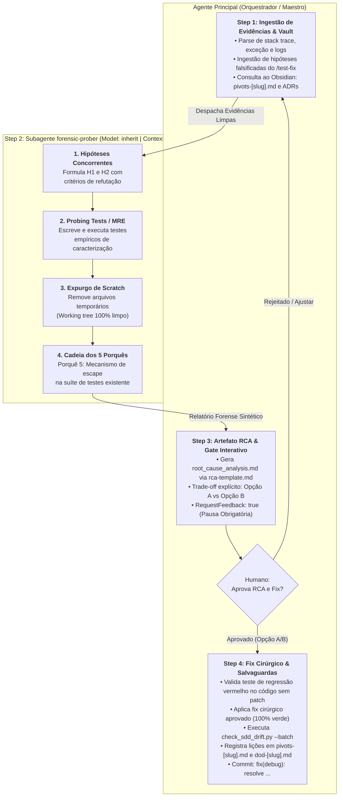

# Arquitetura da Skill `/debug` (SDD 2.0 — Context-Isolated Forensic Probing & Drift Gate)

> [!IMPORTANT]
> **Documento Exclusivo de Engenharia e Manutenção da Skill `/debug`:**
> Este documento reside em `doc/debug/README.md` e detalha a especificação arquitetural da evolução da skill `/debug` para o modelo SDD 2.0. Ele **não** é instalado em `~/.gemini/config/skills/` nem em `.agents/skills/`, garantindo **zero poluição de contexto** para o agente em produção.

---

## 1. O Problema Resolvido: Context Bloat por Tracebacks, Especulação e Spec Drift

No diagnóstico e resolução tradicional de bugs em agente único:
1. **Poluição Progressiva da Janela de Contexto (*Context Bloat* por Tracebacks):** Durante a investigação forense de exceções de runtime, condições de corrida ou falhas de integração, múltiplos comandos `pytest -vv`, dumps de pilha de chamadas e saídas de depuração saturam a janela de contexto. Quando o agente finalmente identifica a causa raiz, seu contexto útil já está degradado por dezenas de logs descartados.
2. **Correção Cega e Especulativa (*Guess-and-Check*):** Sem isolamento e método científico, o agente tende a tentar adivinhar a falha inspecionando o código estaticamente ou aplicando remendos sintomáticos que mascaram o defeito em vez de erradicá-lo.
3. **Escalada Ineficiente a partir do `/test-fix`:** Quando uma falha é escalada do `/test-fix` (após o acionamento do *Double-Strike Rule*), o agente de debug frequentemente reexecuta as mesmas tentativas já refutadas por falta de um protocolo estruturado de ingestão de hipóteses falsificadas.
4. **Ausência da Causa Raiz Sistêmica (O 5º Porquê):** Análises superficiais corrigem o sintoma imediato, mas ignoram a pergunta crucial de engenharia: *"Por que a nossa suíte automatizada de testes pré-existente falhou em capturar este defeito antes de atingir o runtime?"*
5. **Spec Drift Silencioso em Fixes Críticos:** Correções aplicadas com pressa sob incidentes costumam introduzir métodos ad-hoc ou alterar contratos públicos definidos no SDD (`01-concepcao/sdd-[slug].md`), quebrando a arquitetura planejada sem o devido registro de *Technical Pivot*.

---

## 2. Nova Arquitetura: Orquestrador + Subagente `forensic-prober` (`Model: "inherit"`) + RCA Gate + Drift Gate

A skill `/debug` adota uma separação rigorosa entre orquestração de incidentes e investigação empírica isolada:
- **Agente Principal (Orquestrador):** Conduz a triagem inicial (Step 1), ingere evidências e histórico do Obsidian (`02-auditorias/pivots-[slug].md`), submete o artefato formal de RCA com pausa interativa obrigatória (`RequestFeedback: true` no Step 3) e aplica o fix cirúrgico aprovado com salvaguarda de regressão e Drift Gate (Step 4).
- **Subagente `forensic-prober` (`Model: "inherit"`, Step 2):** Opera em sessão isolada com permissão de escrita estrita para testes temporários de caracterização/probing (MRE). Formula hipóteses concorrentes ($H_1, H_2$), executa testes determinísticos, refuta ou confirma empiricamente as hipóteses, **remove todos os arquivos de scratch antes de retornar**, deduz a cadeia dos 5 Porquês e entrega apenas um relatório forense conciso ao chat principal.



---

## 3. Matriz de Responsabilidades dos Agentes

| Etapa | Responsável | Modelo (`invoke_subagent`) | Permissão de Escrita | Insumos Recebidos | Entregável |
| :--- | :--- | :---: | :--- | :--- | :--- |
| **Step 1: Triagem & Ingestão de Evidências** | **Orquestrador Principal** | Sessão Ativa | Somente Leitura / CLI | Relatório de incidente, logs de erro, stack trace, histórico do `/test-fix` e notas do Obsidian (`pivots-[slug].md`). | Evidências sanitizadas, ambiente inspecionado e contexto de falha mapeado. |
| **Step 2: Investigação Forense & Probing Tests** | **Subagente `forensic-prober`** | `Model: "inherit"` | `EnableWriteTools: true` *(apenas para testes temporários em scratch)* | Evidências do Step 1, contratos do SDD e hipóteses previamente descartadas. | Relatório Forense: Matriz de refutação empírica de $H_1/H_2$, 5 Porquês completos, opções de correção (A vs B) e teste de regressão desenhado. Scratch 100% limpo. |
| **Step 3: Artefato RCA & Aprovação Interativa** | **Orquestrador Principal** | Sessão Ativa | Escrita em `root_cause_analysis.md` | Relatório do `forensic-prober` + [`rca-template.md`](../../skills/debug/resources/rca-template.md). | Artefato `root_cause_analysis.md` com `RequestFeedback: true` aguardando confirmação explícita do engenheiro. |
| **Step 4.1: Teste de Regressão & Fix Cirúrgico** | **Orquestrador Principal** | Sessão Ativa | Escrita em `tests/` e `src/` | Solução e design de teste aprovados no Step 3. | Teste de regressão permanente validado vermelho antes do fix, código corrigido cirurgicamente e suíte 100% verde. |
| **Step 4.2: SDD Drift Gate & Governança** | **Orquestrador Principal** | Sessão Ativa | CLI + `@obsidian` + Git | `01-concepcao/sdd-[slug].md`, `02-auditorias/pivots-[slug].md` e `01-concepcao/dod-[slug].md`. | Verificação determinística AST via `check_sdd_drift.py`, registro do pivot e commit semântico `fix(debug): ...`. |

---

## 4. O Protocolo de Limpeza de Scratch (*Zero Dirt Working Tree*)

Para evitar que scripts temporários ou testes de sondagem sejam acidentalmente commitados no repositório:
1. **Ambiente Efêmero de Probing:** O subagente `forensic-prober` cria testes temporários de caracterização e reprodução mínima exclusivamente em arquivos de teste temporários ou diretórios de scratch autorizados.
2. **Execução e Refutação Empírica:** Os testes são executados deterministicamente via CLI (`pytest` ou execução direta do interpretador) para comprovar a falha e isolar a variável exata que deflagra o bug.
3. **Limpeza Mandatória:** Imediatamente após a coleta das asserções e confirmação de qual hipótese é verdadeira, o `forensic-prober` deleta todos os arquivos de script e testes de sondagem temporários criados.
4. **Garantia de Estado Limpo:** Ao retornar o controle para o Orquestrador, `git status --short` não deve conter nenhum artefato residual de investigação na árvore de trabalho.

---

## 5. A Disciplina Forense dos 5 Porquês (O 5º Porquê Sistêmico)

O framework dos 5 Porquês não se limita à causa física do código:
- **Porquês 1 a 3 (Sintoma e Cadeia de Efeitos):** Exploram a falha observável, o estado inconsistente na memória e a violação lógica de negócio imediata.
- **Porquê 4 (Causa Raiz Arquitetural):** Identifica a falha de encapsulamento, acoplamento indevido ou suposição frágil sobre ciclo de vida ou concorrência.
- **Porquê 5 (Causa Sistêmica de Escape de Teste — Mandatório):** Responde obrigatoriamente: *"Por que a nossa suíte automatizada de testes pré-existente não detectou esta quebra no momento da implementação?"*
  - Exemplos: Mocks complacentes que retornavam objetos perfeitos em vez de estruturas parciais; ausência de testes de concorrência com pool saturado; asserções que validavam apenas código de status HTTP sem checar integridade do payload de saída.

---

## 6. O Guardião de Contratos SDD e Registro de Pivots (`check_sdd_drift.py`)

Mesmo em cenários de depuração crítica sob incidentes, a arquitetura SDD 2.0 não permite desvios descontrolados de contratos:
1. **Validação Determinística de Drift:** Se a funcionalidade afetada possuir especificação formal (`01-concepcao/sdd-[slug].md`), após a suíte ficar 100% verde o Orquestrador executa:
   ```bash
   python skills/implement/scripts/check_sdd_drift.py 01-concepcao/sdd-[slug].md <modified_src_files> --batch --pivots 02-auditorias/pivots-[slug].md
   ```
2. **Registro de Technical Pivot Obrigatório:** Se a erradicação definitiva da falha exigir alterar uma assinatura pública de método, introduzir nova exceção tipada ou modificar parâmetros previstos no SDD, o Orquestrador deve documentar a justificativa técnica em `02-auditorias/pivots-[slug].md` via `@obsidian` antes de aprovar o gate.
3. **Loop de Recuperação de Regressão:** Caso a tentativa de correção cirúrgica continue falhando ou gere quebras colaterais em testes existentes, o Orquestrador executa imediatamente `git reset --hard HEAD`, registra a hipótese refutada e reabre nova formulação ($H_3$).
