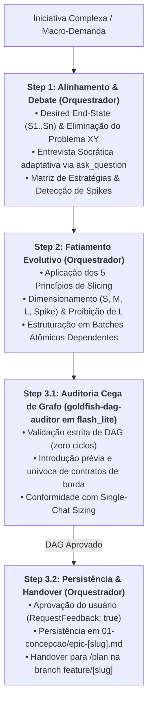
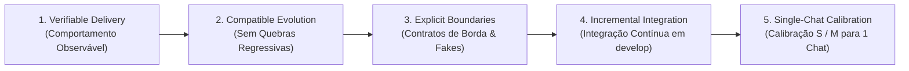

# Arquitetura da Skill `/decompose` (SDD 2.0 — Outcome-Based Debate & DAG Slicing)

> [!IMPORTANT]
> **Documento Exclusivo de Engenharia e Manutenção da Skill `/decompose`:**
> Este documento reside em `doc/decompose/README.md` e detalha a especificação arquitetural da evolução da skill `/decompose` para o modelo SDD 2.0. Ele **não** é instalado em `~/.gemini/config/skills/` nem em `.agents/skills/`, garantindo **zero poluição de contexto** para o agente em produção.

---

## 1. O Problema Resolvido: Epics Monolíticos, Problema XY e Dependências Circulares

No planejamento macro tradicional conduzido por agente único ou de forma ad-hoc:
1. **O Problema XY Macro e Epics Monolíticos:** Demandas arquiteturais de grande porte chegam frequentemente formuladas como soluções pré-fixadas e indivisíveis (ex: *"Reescrever o módulo de pagamentos"*), sem clareza do *Desired Observable End-State* ($S_1 \dots S_n$). Isso produz especificações gigantescas, impossíveis de implementar em uma única sessão de chat, gerando *pull requests* massivos e context drift.
2. **Dependências Circulares e Contratos Órfãos:** Decomposições informais criam grafos de dependência ambíguos, nos quais a Fatia $A$ depende de interfaces que a Fatia $B$ ainda não introduziu, ou onde múltiplos fluxos paralelos assumem contratos compartilhados sem um proprietário definido.
3. **Viés de Auto-Concordância do Decompositor:** O mesmo agente que conduz a conversa de escopo tende a justificar fatias excessivamente amplas (`L`) ou a aceitar premissas frágeis sem testar a consistência do grafo de dependências (*DAG*).

---

## 2. Nova Arquitetura: Debate Socrático + 5 Princípios de Slicing + Subagente `goldfish-dag-auditor` (`Model: "flash_lite"`)

A skill `/decompose` estrutura a **Fase 0 (Macro-Arquitetura & Fatiamento)** do ciclo de vida:
- **Step 1 — Alinhamento & Debate do Macro-Problema (Orquestrador Principal):** O Orquestrador estabelece o *Desired Observable End-State* ($S_1 \dots S_n$), trata soluções sugeridas estritamente como hipóteses de trabalho para eliminar o Problema XY, conduz entrevista socrática objetiva (3 a 5 perguntas via ferramenta interativa `ask_question`), projeta a Matriz de Estratégias de Fatiamento (MVP-First, Contract-First ou Strangler Fig) e detecta proativamente a necessidade de *Spikes* técnicos.
- **Step 2 — Fatiamento Evolutivo & Batches Atômicos (Orquestrador Principal):** Aplica os **5 Princípios do Fatiamento Evolutivo**, executa o dimensionamento de complexidade ($S, M, L, Spike$) — com proibição estrita de fatias $L$ no plano final — e agrupa o trabalho em lotes dependentes atômicos (Batch 1: Domínio base $\rightarrow$ Batches Intermediários: Casos de uso $\rightarrow$ Batch Final: Adaptadores/Infra/E2E).
- **Step 3 — Auditoria Cega de Grafo & Handover (`goldfish-dag-auditor` em `Model: "flash_lite"` + Orquestrador):** O subagente cego `goldfish-dag-auditor` (`Model: "flash_lite"`, `EnableWriteTools: false`) inspeciona o artefato de decomposição em contexto zero (sem o ruído da conversa anterior). Ele valida determinística e logicamente o grafo acíclico, a posse de contratos e a calibração de tamanho. Após a aprovação humana (`RequestFeedback: true`), o Orquestrador persiste o plano em `01-concepcao/epic-[slug].md` e gera a instrução de abertura da primeira feature branch para o `/plan`.



---

## 3. Matriz de Responsabilidades dos Agentes

| Etapa | Responsável | Modelo (`invoke_subagent`) | Permissão de Escrita | Insumos Recebidos | Entregável / Ação |
| :--- | :--- | :---: | :---: | :--- | :--- |
| **Step 1: Problem Alignment & Debate** | **Orquestrador Principal** | Sessão Ativa | Interativo (`ask_question`) | Demanda do usuário, arquitetura vigente e ADRs. | *Desired End-State* consolidado, eliminação do Problema XY e estratégia de fatiamento selecionada. |
| **Step 2: Evolutionary Slicing** | **Orquestrador Principal** | Sessão Ativa | Escrita local em `task_list.md` ou draft | Estratégia aprovada e dependências do repositório. | Fatias verticais estruturadas em Batches Atômicos (Batches 1..N) com dimensionamento ($S/M/Spike$). |
| **Step 3.1: Blind DAG Audit** | **Subagente `goldfish-dag-auditor`** | `Model: "flash_lite"` | Read-Only (`EnableWriteTools: false`) | Rascunho da decomposição (`epic-[slug].md` ou `task_list.md`). | Parecer Context-Zero atestando grafo acíclico, posse de contratos e ausência de itens $L$ (`[PASS]: DAG_VERIFIED`). |
| **Step 3.2: Persistência & Handover** | **Orquestrador Principal** | Sessão Ativa | Escrita no Obsidian Vault | Artefato aprovado pelo usuário (`RequestFeedback: true`). | `01-concepcao/epic-[slug].md` persistido e comando de criação de branch para a Fase 1 (`/plan`). |

---

## 4. Os 5 Princípios do Fatiamento Evolutivo (*Evolutionary Slicing*)

O fracionamento de iniciativas arquiteturais obedece a 5 princípios fundamentais:



1. **Entrega Verificável (*Verifiable Delivery*):** Toda fatia deve entregar comportamento de negócio observável ou um habilitador técnico estritamente justificado. Fatias puramente especulativas são descartadas.
2. **Evolução Compatível (*Compatible Evolution*):** A fatia $N+1$ deve estender a fatia $N$ de forma incremental e aditiva, sem retrabalho destrutivo ou quebra de testes previamente selados.
3. **Fronteiras Explícitas (*Explicit Boundaries*):** Contratos de borda (`IRepository`, `IClient`, `IEventBus`) são definidos pelo primeiro consumidor da interface e isolados por implementações falsas (`<<Fake>>`) até que o adaptador concreto seja integrado.
4. **Integração Incremental (*Incremental Integration*):** Cada fatia concluída integra continuamente em `develop` sob portas de qualidade; a integração com dependências externas nunca é deixada como "etapa final surpresa".
5. **Calibração para Sessão Única (*Single-Chat Calibration*):** Cada sub-feature planejada deve caber com folga em uma sessão efêmera de chat. Fatias avaliadas como **Large ($L$)** são obrigatoriamente fracionadas em itens **Small ($S$)** ou **Medium ($M$)**.

---

## 5. O Auditor Cego de Grafo: `goldfish-dag-auditor` (`Model: "flash_lite"`)

Localizado como subagente especialista da Fase 0 (conforme documentado em [`skills/decompose/references/decompose-subagents.md`](../../skills/decompose/references/decompose-subagents.md)), o **`goldfish-dag-auditor`** garante a higienização matemática do planejamento antes da autorização do usuário:

### 5.1. Critérios Estritos de Auditoria Context-Zero
O auditor não recebe o bate-papo inicial para evitar qualquer contaminação mental, avaliando friamente 3 invariantes:
1. **Grafo Acíclico Dirigido (Acyclic DAG):** Verifica se o fluxo de dependências é unidirecional e estritamente acíclico. Nenhuma fatia $N$ pode depender de uma fatia posterior $N+k$ ou de uma branch de trabalho paralela não mergeada.
2. **Posse e Introdução Unívoca de Contratos (Contract Ownership):** Toda interface de borda consumida deve ter sido explicitamente introduzida em um lote ou fatia anterior. Contratos sem fatia introdutora identificada causam rejeição do plano.
3. **Calibração de Escopo (Single-Chat Sizing):** Confirma se zero fatias acionáveis permaneceram com tamanho $L$. Itens de incerteza técnica elevada devem ter sido convertidos em *Spikes* timeboxados.

### 5.2. Handover para a Fase 1 (`/plan`)
Uma vez emitido o parecer `[PASS]: DAG_VERIFIED` e aprovado pelo usuário, o Orquestrador entrega a instrução padrão de transição:

```bash
git switch develop; git pull --ff-only; git switch -c feature/[first-feature-slug]
```

> **[NEXT STEP]** *"Macro-arquitetura fatiada com sucesso e grafo de dependências validado sem ciclos. Execute o comando Git acima e abra um novo chat acionando `/plan` para conceber a primeira fatia da iniciativa!"*
