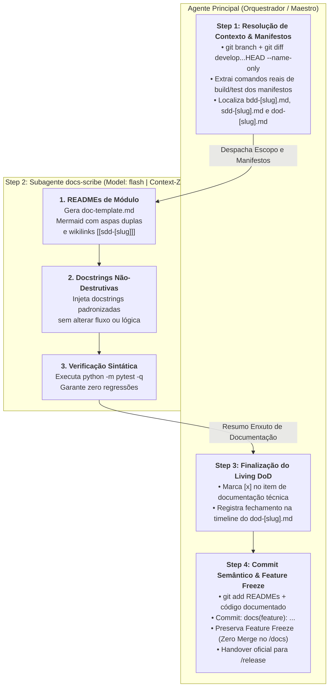

# Arquitetura da Skill `/docs` (SDD 2.0 — Cost-Efficient Flash Scribe & Feature Freeze)

> [!IMPORTANT]
> **Documento Exclusivo de Engenharia e Manutenção da Skill `/docs`:**
> Este documento reside em `doc/docs/README.md` e detalha a especificação arquitetural da evolução da skill `/docs` para o modelo SDD 2.0. Ele **não** é instalado em `~/.gemini/config/skills/` nem em `.agents/skills/`, garantindo **zero poluição de contexto** para o agente em produção.

---

## 1. O Problema Resolvido: Desperdício de Janela Nobre, Regressões Sintáticas e Comandos Fictícios

Na fase de documentação técnica tradicional executada no chat principal por um único agente:
1. **Desperdício de Tokens de Raciocínio de Alta Capacidade:** Na Fase 5, a arquitetura e a implementação da feature já estão consolidadas e auditadas. Usar o modelo de raciocínio principal (`Model: "inherit"`) para ler integralmente dezenas de arquivos de código e gerar documentação estruturada consome cotas elevadas e incha o contexto com operações mecânicas de escrita.
2. **Risco de Alteração Acidental de Lógica de Produção:** Ao inserir docstrings ou anotações diretamente nos arquivos-fonte, agentes frequentemente alteram acidentalmente identações, linhas de controle de fluxo ou expressões, introduzindo regressões sintáticas não percebidas.
3. **Alucinação de Comandos Operacionais:** Guias de onboarding e READMEs costumam registrar comandos hipotéticos de execução, teste ou instalação que divergem dos manifestos reais configurados no repositório (`pyproject.toml`, `package.json`, etc.).
4. **Falta de Rastreabilidade Bidirecional com a Concepção:** Módulos e classes recém-criados perdem a conexão com suas especificações originais por não conterem referências formais às notas do Obsidian Vault (`[[sdd-[slug]]]`).
5. **Quebra Precoce da Disciplina de Git Flow:** Tentativas de realizar merge da feature branch diretamente em `develop` ou `main` ainda durante a fase de documentação, ignorando o processo formal e matematicamente auditado do `/release`.

---

## 2. Nova Arquitetura: Orquestrador + Subagente `docs-scribe` (`Model: "flash"`) + Verificação `pytest -q` + Feature Freeze

A skill `/docs` estabelece uma esteira enxuta e econômica:
- **Agente Principal (Orquestrador):** Resolve a branch ativa e os arquivos alterados no diff (`git diff develop...HEAD --name-only`), extrai os comandos reais dos manifestos (Step 1), delega a geração de artefatos ao subagente, atualiza o Living DoD no Obsidian (`01-concepcao/dod-[slug].md` no Step 3) e executa o commit semântico consolidado selando o *Feature Freeze* da branch (Step 4).
- **Subagente `docs-scribe` (`Model: "flash"`, Step 2):** Opera em sessão isolada com um modelo ultra-rápido e de baixo custo, ideal para sintetizar documentação a partir de templates estruturados: cria e atualiza `README.md` de módulo com diagramas Mermaid seguros (rótulos entre aspas duplas), enriquece docstrings no código com anotações de rastreabilidade `[[sdd-[slug]]]`, e valida deterministicamente que nenhuma sintaxe foi quebrada via `python -m pytest -q` antes de finalizar.



---

## 3. Matriz de Responsabilidades dos Agentes

| Etapa | Responsável | Modelo (`invoke_subagent`) | Permissão de Escrita | Insumos Recebidos | Entregável |
| :--- | :--- | :---: | :--- | :--- | :--- |
| **Step 1: Resolução de Escopo & Manifestos** | **Orquestrador Principal** | Sessão Ativa | Somente Leitura / CLI | `git diff develop...HEAD`, manifestos do repo (`pyproject.toml`, etc.), `01-concepcao/`. | Lista de arquivos do diff, comandos operacionais verificados e caminhos das especificações. |
| **Step 2: Geração de Docs & Enriquecimento de Código** | **Subagente `docs-scribe`** | `Model: "flash"` | `EnableWriteTools: true` *(READMEs e in-code docstrings)* | Lista de arquivos modificados, comandos reais, `01-concepcao/sdd-[slug].md` e [`doc-template.md`](../../skills/docs/resources/doc-template.md). | READMEs de módulo estruturados, docstrings com `[[sdd-[slug]]]`, validação `pytest -q` 100% verde e resumo conciso. |
| **Step 3: Finalização do Living DoD** | **Orquestrador Principal** | Sessão Ativa | Escrita via `@obsidian` | Resumo de conclusão do `docs-scribe` + `01-concepcao/dod-[slug].md`. | Checkbox de documentação marcado (`[x]`) e evento registrado na timeline cronológica do DoD. |
| **Step 4: Semantic Commit & Feature Freeze** | **Orquestrador Principal** | Sessão Ativa | Git Commit | Árvore de trabalho atualizada com documentação e código verificado. | Commit semântico `docs(feature): ...`, branch congelada (*Feature Freeze*) e aviso de transição para `/release`. |

---

## 4. Estratégia de Custo e Eficiência: Offloading para `Model: "flash"`

A delegação da geração de documentação para o subagente `docs-scribe` no perfil `Model: "flash"` oferece vantagens arquiteturais essenciais:
1. **Otimização Extrema de Cotas:** O modelo `flash` é altamente veloz e possui custo por token significativamente menor, executando tarefas estruturadas de preenchimento de templates e docstrings sem desperdiçar recursos dos modelos de raciocínio nobre.
2. **Isolamento de I/O em Massa:** A leitura detalhada de múltiplos módulos-fonte e a escrita em vários pontos do projeto não sobrecarregam o histórico do chat principal, que permanece conciso para o acompanhamento do usuário.
3. **Fidelidade aos Padrões Pré-Estabelecidos:** Orientado estritamente por [`doc-template.md`](../../skills/docs/resources/doc-template.md) e [`docs-guidelines.md`](../../skills/docs/references/docs-guidelines.md), o `docs-scribe` gera tabelas de mapeamento de componentes e diagramas Mermaid uniformes.

---

## 5. Protocolo de Injeção Não-Destrutiva de Docstrings e Salvaguarda `pytest -q`

Para erradicar qualquer possibilidade de efeitos colaterais na base de código durante a documentação:
- **Invariante de Lógica Intocada (Zero Logic Alteration):** O subagente está expressamente proibido de alterar estruturas de controle (`if`, `for`, `try`), expressões aritméticas/lógicas, nomes de variáveis, imports ou assinaturas de métodos. Sua atuação restringe-se estritamente à inserção de docstrings, comentários explicativos e type hints.
- **Padrão de Rastreabilidade com Obsidian:** Cada docstring adicionada deve conter o vínculo direto com o blueprint de concepção da funcionalidade:
  ```python
  """
  Resumo operacional conciso da classe ou método.

  Ref: Obsidian note [[sdd-[slug]]]
  """
  ```
- **Exit Gate Determinístico (`pytest -q`):** Antes de concluir sua execução e retornar ao Orquestrador, o `docs-scribe` executa:
  ```bash
  python -m pytest -q
  ```
  Isso garante matematicamente que nenhuma indentação ou erro sintático foi introduzido nas fontes alteradas.

---

## 6. Governança de Feature Freeze & Handover para `/release`

Ao término da documentação, a feature atinge o estado de **Congelamento (*Feature Freeze*)**:
1. **Compromisso Semântico Padronizado:** Todas as alterações são consolidadas pelo Orquestrador através de:
   ```bash
   git commit -m "docs(feature): technical documentation and docstrings for [slug]"
   ```
2. **Proibição de Merge Prematuro:** O Orquestrador **nunca** executa `git checkout develop` ou `git merge` dentro da skill `/docs`. A branch `feature/[slug]` permanece isolada e estática.
3. **Handover para a Fase de Publicação:** O ciclo individual da feature é considerado concluído com 100% de Living DoD preenchido. O Orquestrador orienta o usuário a abrir um novo contexto e acionar `/release` para a condução do gatekeeper de publicação, cálculo de SemVer 2.0.0 e finalização do Git Flow.
