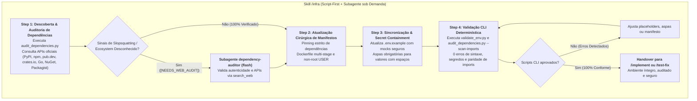

# Arquitetura da Skill `/infra` (Infrastructure, Multi-Ecosystem Supply-Chain & Environment Governance)

> [!IMPORTANT]
> **Documento Exclusivo de Engenharia e Manutenção da Skill `/infra`:**
> Este documento reside em `doc/infra/README.md` e detalha a especificação arquitetural, pipeline e guardrails da skill `/infra`. Ele **não** é instalado em `~/.gemini/config/skills/` nem em `.agents/skills/`, garantindo **zero poluição de contexto** para o agente em produção.

---

## 1. O Problema Resolvido: Slopsquatting, Alucinações de Dependências e Vazamento de Segredos

Alterações de infraestrutura e dependências frequentemente introduzem riscos críticos ao ecossistema de software:
1. **Slopsquatting e Alucinação de Pacotes:** LLMs frequentemente alucinam nomes plausíveis de pacotes ou submódulos que não existem oficialmente. Atacantes exploram isso registrando pacotes maliciosos com nomes comumente alucinados (*slopsquatting*) ou com grafias quase idênticas (*typosquatting*) nos registries públicos (PyPI, npm, pub.dev, etc.).
2. **Upgrades Cegos e Quebras Transitivas:** Execuções indiscriminadas de comandos como `pip install --upgrade *` ou `npm update` introduzem breaking changes não planejadas em dependências transitivas.
3. **Vazamento Acidental de Credenciais (*Secret Leakage*):** O commit de arquivos `.env` ou a inserção de chaves reais em arquivos de exemplo (`.env.example`) expõe senhas de banco de dados, chaves de API (`sk-proj-...`, `ghp_...`) e tokens JWT.
4. **Divergência entre Código e Manifesto (*Undeclared Imports*):** Módulos são importados no código de produção (`src/`, `lib/`), mas não constam nos arquivos de manifesto do projeto, quebrando builds de CI/CD e empacotamento em containers.
5. **Contaminação de Código de Aplicação:** Operações de infraestrutura que inadvertidamente alteram lógicas de negócio em `src/`, quebrando o isolamento de camadas.

A skill **`/infra`** governa manifests de pacotes, configurações de containers Docker e variáveis de ambiente com contenção absoluta de credenciais, auditoria determinística multiplataforma contra slopsquatting e verificação de paridade de imports.

---

## 2. Decisão Arquitetural: Abordagem Híbrida (Script-First + Subagente Inspetor sob Demanda)

A skill `/infra` adota o padrão **Script-First + Subagente sob Demanda**:
- **Caminho Determinístico Rápido (Zero Subagents):** Para manifestos conhecidos (Python, Node/TS, Dart/Flutter, Rust, Go, .NET, PHP) e variáveis de ambiente, o Orquestrador executa diretamente os scripts Python nativos ([`validate_env.py`](../../skills/infra/scripts/validate_env.py) e [`audit_dependencies.py`](../../skills/infra/scripts/audit_dependencies.py)) com zero boot token overhead.
- **Escalação para Subagente Inspetor (`dependency-auditor`):** Apenas quando o scanner identifica sinais de risco de slopsquatting (`[SLOPSQUATTING_RISK]`), pacotes recém-criados (< 60 dias), ausência de repositório público rastreável, manifestos não suportados nativamente (ex.: Maven/Gradle, Swift, Elixir) ou necessidade de verificar APIs internas de submódulos, o Orquestrador aciona o subagente `dependency-auditor` (`Model: flash`, `EnableWriteTools: false`, tool: `search_web`).



---

## 3. Matriz Operacional e Invariantes da Skill `/infra`

| Propriedade | Diretriz Arquitetural |
| :--- | :--- |
| **Ambiente de Execução** | **Orquestrador Principal (Script-First)** com escalação opcional para `dependency-auditor` |
| **Uso de Subagentes** | `dependency-auditor` (`Model: flash`, `search_web`) apenas em caso de `[NEEDS_WEB_AUDIT]` ou risco de slopsquatting |
| **Escopo Permitido** | Arquivos de manifesto (`pyproject.toml`, `package.json`, `pubspec.yaml`, `Cargo.toml`, `go.mod`, etc.), containers (`Dockerfile`, `docker-compose.yml`) e `.env*` |
| **Isolamento de Código** | **Estritamente proibido** alterar regras de negócio, serviços ou entidades de domínio em `src/` ou `lib/` |
| **Zero Hallucinated Deps** | Proibido instalar pacotes sem atestar existência na API do registry ou via `dependency-auditor` |
| **Anti-Slopsquatting** | Alerta pacotes publicados há menos de 60 dias, sem link de repositório público ou descontinuados/yanked |
| **Paridade de Imports** | Todo módulo importado no código-fonte deve estar declarado no manifesto correspondente |
| **Contenção de Segredos** | Credenciais reais nunca são commitadas; `.env` deve constar no `.gitignore` |
| **Validadores Obrigatórios** | [`validate_env.py`](../../skills/infra/scripts/validate_env.py) e [`audit_dependencies.py`](../../skills/infra/scripts/audit_dependencies.py) |

---

## 4. O Pipeline em 4 Passos

### 4.1. Step 1: Discover & Audit Dependencies
- Identifica os manifestos presentes no projeto:
  - Python: `pyproject.toml`, `requirements.txt`, `poetry.lock`.
  - Node / TypeScript: `package.json`, `package-lock.json`.
  - Dart / Flutter: `pubspec.yaml`, `pubspec.lock`.
  - Rust: `Cargo.toml`, `Cargo.lock`.
  - Go: `go.mod`, `go.sum`.
  - .NET: `*.csproj`.
  - PHP: `composer.json`, `composer.lock`.
- Executa a pré-verificação antes de qualquer instalação:
  ```bash
  python skills/infra/scripts/audit_dependencies.py --ecosystem pub --check provider http
  ```
- Se o script emitir `[NEEDS_WEB_AUDIT]` ou `[SLOPSQUATTING_RISK]`, o orquestrador aciona o subagente `dependency-auditor`.

### 4.2. Step 2: Configure Pinned Manifests & Containers
- Aplica adição cirúrgica com versões rigorosamente fixadas (*pinned*):
  - Python: `poetry add <pkg>` ou versão exata no `pyproject.toml`.
  - Node: `npm install --save-exact <pkg>`.
  - Dart/Flutter: `flutter pub add <pkg>` com versão explícita no `pubspec.yaml`.
- Higiene e segurança de containers Docker:
  - Uso de *multi-stage builds* separando ambiente de build da imagem final.
  - Execução sob usuário sem privilégios (`USER appuser`).
  - Imagens base enxutas com tags imutáveis (`python:3.11-slim`, `node:20-alpine`).
  - `.dockerignore` excluindo `.git`, `.env`, `.venv`, `node_modules` e `.dart_tool`.

### 4.3. Step 3: Environment Synchronization & Secret Containment
- Se a capacidade exige novas variáveis, sincroniza o `.env.example` conforme [`resources/env-template.md`](../../skills/infra/resources/env-template.md).
- **As Três Regras de Ouro de Variáveis de Ambiente:**
  1. **Nunca commitar o `.env` real:** O arquivo `.env` permanece isolado e blindado pelo `.gitignore`.
  2. **Placeholders Seguros:** No `.env.example`, todo valor sensível usa exemplos seguros.
  3. **Aspas em Valores Complexos:** Valores contendo espaços ou caracteres especiais devem estar entre aspas duplas.

### 4.4. Step 4: Validate CLI & Import Parity Gate
- Execução dos validadores determinísticos:
  ```bash
  python skills/infra/scripts/audit_dependencies.py pyproject.toml --scan-imports src
  python skills/infra/scripts/validate_env.py --env .env --example .env.example --strict
  ```
- O validador atesta:
  - Formato sintático e ausência de credenciais reais (`validate_env.py`).
  - Existência e ausência de slopsquatting nos registries oficiais (`audit_dependencies.py`).
  - Paridade entre módulos importados no código (`src/`, `lib/`) e pacotes declarados no manifesto.
- Handover imediato para retomar `/implement` ou testar via `/test-fix`.

---

## 5. Ferramental Determinístico e Subagentes

### 5.1. Script `audit_dependencies.py`
Localizado em [`skills/infra/scripts/audit_dependencies.py`](../../skills/infra/scripts/audit_dependencies.py):
- Suporte nativo multiplataforma a 7 ecossistemas sem dependências de pacotes externos.
- Avaliação de metadados dos registries (data da primeira release, URLs de repositórios oficiais, flags de depreciação/yanked).
- Parser AST para Python e regex para Node e Dart/Flutter para validar paridade de imports.
- Total conformidade com limites de complexidade ciclomática ($V(G) \le 10$).

### 5.2. Script `validate_env.py`
Localizado em [`skills/infra/scripts/validate_env.py`](../../skills/infra/scripts/validate_env.py):
- Garante conformidade de sintaxe `KEY=VALUE` e quoting.
- Detecta padrões heurísticos de credenciais expostas (AWS, OpenAI, GitHub, JWT, chaves privadas).
- Valida paridade completa entre `.env` e `.env.example`.

### 5.3. Subagente `dependency-auditor`
- **Modelo:** `Model: "flash"`, `EnableWriteTools: false`.
- **Ferramentas:** `search_web`, `read_file`.
- **Papel:** Investigador de cadeia de suprimentos e integridade de bibliotecas. Pesquisa na web a documentação oficial, repositórios canônicos e existência de submódulos para neutralizar slopsquatting e alucinações de IA.

---

## 6. Referências e Recursos Acoplados

- [`references/infra-setup.md`](../../skills/infra/references/infra-setup.md) — Guia aprofundado de setup seguro, regras anti-slopsquatting e convenções de ecossistemas.
- [`resources/env-template.md`](../../skills/infra/resources/env-template.md) — Template padronizado e documentado para arquivos `.env.example`.
- [`scripts/validate_env.py`](../../skills/infra/scripts/validate_env.py) — Script linter determinístico de variáveis e credenciais.
- [`scripts/audit_dependencies.py`](../../skills/infra/scripts/audit_dependencies.py) — Scanner de existência, anti-slopsquatting e paridade de imports.
- [`examples/infra-example.md`](../../skills/infra/examples/infra-example.md) — Demonstração passo a passo de auditoria de dependência, escalação e sanitização de variáveis.
