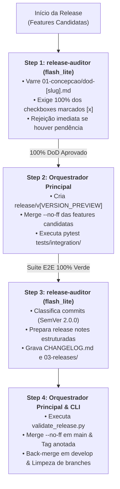
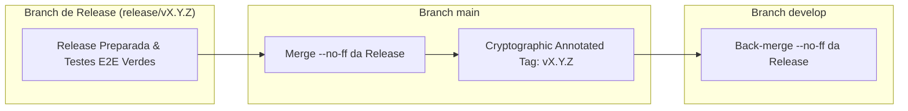

# Arquitetura da Skill `/release` (SDD 2.0 — Living DoD Gatekeeper & SemVer Engine)

> [!IMPORTANT]
> **Documento Exclusivo de Engenharia e Manutenção da Skill `/release`:**
> Este documento reside em `doc/release/README.md` e detalha a especificação arquitetural da evolução da skill `/release` para o modelo SDD 2.0. Ele **não** é instalado em `~/.gemini/config/skills/` nem em `.agents/skills/`, garantindo **zero poluição de contexto** para o agente em produção.

---

## 1. O Problema Resolvido: Publicações Manuais, Débito Técnico Oculto e Spec Drift

No modelo tradicional de finalização e publicação de releases com agente único ou manual:
1. **Bypass Silencioso do Living DoD (*A Falsa Sensação de Conclusão*):** Em releases com múltiplas features, tarefas esquecidas de fases anteriores (como testes de integração ausentes, auditorias de segurança pendentes ou documentação defasada) passam inadvertidamente para a branch `main` porque a conferência visual de múltiplos checklists é exaustiva e sujeita a falhas.
2. **Cálculo Erático de SemVer e Changelogs Descentralizados:** A atribuição de versões (Major, Minor, Patch) frequentemente sofre inconsistências por falta de análise sistemática de histórico de commits. Além disso, notas de lançamento costumam ficar desatualizadas na raiz do repositório ou ausentes do histórico imutável do Obsidian Vault.
3. **Saturação de Contexto por DoDs e Históricos Git Extensos:** Ler todos os arquivos `dod-[slug].md` e dezenas ou centenas de commits na janela do chat principal consome grande parte do orçamento de tokens antes mesmo da execução crítica dos testes de integração e dos merges atômicos de Git Flow.

---

## 2. Nova Arquitetura: Orquestrador + Subagente `release-auditor` (`Model: "flash_lite"`) + `validate_release.py` + Git Flow Mode 5

A skill `/release` adota um modelo híbrido com delegação algorítmica para um subagente de contexto isolado e governança centralizada no Orquestrador:
- **Step 1 — Entry Gate Audit (`release-auditor` em `Model: "flash_lite"`):** O subagente inspeciona em sandbox todos os arquivos `01-concepcao/dod-[slug].md` das features candidatas. Se encontrar qualquer caixa desmarcada (`- [ ]`), a release é imediatamente rejeitada e abortada.
- **Step 2 — Branch de Release & Testes E2E (Orquestrador Principal):** O Orquestrador cria a branch provisória `release/v[VERSION_PREVIEW]`, executa os merges sem fast-forward (`--no-ff`) das features aprovadas e roda a suíte de testes ponta a ponta e de integração (`pytest tests/integration/ -v`).
- **Step 3 — SemVer 2.0.0 & Sincronização Dupla de Changelog (`release-auditor` em `Model: "flash_lite"`):** O subagente analisa os cabeçalhos de commits unificados, calcula matematicamente o incremento SemVer (`MAJOR > MINOR > PATCH`), atualiza a raiz `CHANGELOG.md` e grava o snapshot imutável em `03-releases/changelog-v[VERSION].md` no Obsidian Vault.
- **Step 4 — Validador CLI Determinístico & Finalização Git Flow Mode 5 (Orquestrador Principal):** O script CLI `validate_release.py` confere estritamente branches, versão e DoD. Em seguida, o Orquestrador executa o merge atômico em `main`, cria a tag criptográfica anotada (`git tag -a v[VERSION]`), sincroniza de volta em `develop` e remove as branches transitórias.



---

## 3. Matriz de Responsabilidades dos Agentes

| Etapa | Responsável | Modelo (`invoke_subagent`) | Permissão de Escrita | Insumos Recebidos | Entregável / Ação |
| :--- | :--- | :---: | :---: | :--- | :--- |
| **Step 1: Entry Gate DoD Audit** | **Subagente `release-auditor`** | `Model: "flash_lite"` | Read-Only | Lista de slugs das features candidatas e caminhos `01-concepcao/dod-[slug].md`. | Veredito formal de aprovação ou rejeição detalhada (`[REJECTED]` com arquivo e linha pendente). |
| **Step 2: Release Branch & E2E** | **Orquestrador Principal** | Sessão Ativa | Escrita + Git CLI | Slugs aprovados no Step 1 e branch `develop`. | Branch `release/v[VERSION_PREVIEW]` criada, features merged via `--no-ff` e suíte de integração verde. |
| **Step 3: SemVer & Changelogs** | **Subagente `release-auditor`** | `Model: "flash_lite"` | Escrita em Docs (`EnableWriteTools: true`) | Log de commits (`git log develop..HEAD --oneline`) e template de release. | Bump calculado segundo SemVer 2.0.0, `CHANGELOG.md` na raiz e `03-releases/changelog-v[VERSION].md` persistidos. |
| **Step 4: CLI Gate & Git Mode 5** | **Orquestrador Principal** | Sessão Ativa | Git CLI + Sistema de Arquivos | Versão consolidada e caminhos dos changelogs e DoDs. | Validação estrita via `validate_release.py`, tag `v[VERSION]`, sincronização em `main` e `develop` e branches limpas. |

---

## 4. O Subagente `release-auditor` (`Model: "flash_lite"`)

O subagente especialista é configurado estrategicamente em **`Model: "flash_lite"`** com salvaguardas invariantes:

### Por que `flash_lite`?
- **Eficiência e Baixo Custo:** A conferência de checkboxes em arquivos Markdown e a taxonomia de commits convencionais (`feat:`, `fix:`, `feat!:`) são tarefas estritamente determinísticas que não exigem raciocínio matemático complexo de modelos pesados.
- **Isolamento de Contexto:** Dezenas de arquivos de DoD e centenas de linhas de logs Git não entram na janela de contexto da conversa principal.

### Invariantes de Segurança Operacional
- **Permissão de Escrita Cirúrgica:** O subagente tem permissão de escrita (`EnableWriteTools: true`) restrita à atualização de `CHANGELOG.md` e criação de `03-releases/changelog-v[VERSION].md`.
- **Proibição Absoluta de Comandos Mutantes Git:** O subagente é terminantemente proibido de executar `git merge`, `git checkout`, `git tag` ou `git branch`. O controle de fluxo Git reside exclusivamente no Orquestrador Principal.

---

## 5. Validação Determinística (`validate_release.py`) e Git Flow Mode 5

### 5.1. O Script de Validação CLI (`validate_release.py`)
Localizado em [`skills/release/scripts/validate_release.py`](../../skills/release/scripts/validate_release.py), o utilitário Python multiplataforma valida antes do fechamento:
1. **Formato SemVer 2.0.0:** Verifica se a versão segue o padrão canônico `vX.Y.Z` (ou com pré-release/build metadata).
2. **Nomenclatura da Branch:** Garante que a branch ativa segue estritamente `release/vX.Y.Z`.
3. **Existência e Conteúdo do Changelog:** Checa se o arquivo de changelog existe e contém a seção correspondente à versão indicada.
4. **Verificação de DoD (`--check-dod`):** Varre os padrões glob informados (`01-concepcao/dod-*.md`) e falha com código de saída diferente de zero se houver qualquer `- [ ]`.

```bash
python skills/release/scripts/validate_release.py \
  --version v1.2.0 \
  --branch release/v1.2.0 \
  --changelog CHANGELOG.md \
  --check-dod "01-concepcao/dod-*.md"
```

### 5.2. Regras de Precedência SemVer 2.0.0
- **MAJOR (`v(X+1).0.0`):** Qualquer commit contendo `BREAKING CHANGE:` ou modificadores como `feat!:` / `fix!:`, ou quebra explícita de contratos públicos.
- **MINOR (`vX.(Y+1).0`):** Commits com novas funcionalidades retrocompatíveis (`feat:`).
- **PATCH (`vX.Y.(Z+1)`):** Commits compostos exclusivamente por correções (`fix:`), refatorações internas (`refactor:`, `perf:`), documentação (`docs:`) ou manutenção (`chore:`).

### 5.3. Git Flow Mode 5 Finalization
O encerramento atômico garante a integridade dos históricos de produção e desenvolvimento:



1. Merge sem fast-forward na branch `main`: `git merge --no-ff release/v[VERSION]`
2. Criação da tag criptográfica anotada: `git tag -a v[VERSION] -m "Release v[VERSION]"`
3. Sincronização de volta para `develop`: `git merge --no-ff release/v[VERSION]`
4. Remoção das branches temporárias de release e das features já incorporadas: `git branch -d release/v[VERSION]`
