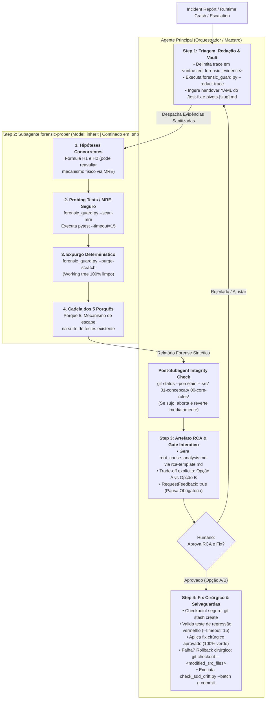

# Arquitetura da Skill `/debug` (SDD 2.0 — Context-Isolated Forensic Probing, AST Guard & Drift Gate)

> [!IMPORTANT]
> **Documento Exclusivo de Engenharia e Manutenção da Skill `/debug`:**
> Este documento reside em `doc/skills/debug/README.md` e detalha a especificação arquitetural da evolução da skill `/debug` para o modelo SDD 2.0 com mitigação OWASP LLM & Agentic (2025/2026). Ele **não** é instalado em `~/.gemini/config/skills/` nem em `.agents/skills/`, garantindo **zero poluição de contexto** para o agente em produção.

---

## 1. O Problema Resolvido: Context Bloat por Tracebacks, Especulação, RCE em Scratch e Spec Drift

No diagnóstico e resolução tradicional de bugs em agente único:
1. **Poluição Progressiva da Janela de Contexto (*Context Bloat* por Tracebacks):** Durante a investigação forense de exceções de runtime, condições de corrida ou falhas de integração, múltiplos comandos `pytest -vv`, dumps de pilha de chamadas e saídas de depuração saturam a janela de contexto. Quando o agente finalmente identifica a causa raiz, seu contexto útil já está degradado por dezenas de logs descartados.
2. **Correção Cega e Especulativa (*Guess-and-Check*):** Sem isolamento e método científico, o agente tende a tentar adivinhar a falha inspecionando o código estaticamente ou aplicando remendos sintomáticos que mascaram o defeito em vez de erradicá-lo.
3. **Escalada Ineficiente ou Viciada a partir do `/test-fix` (`[DEBUG-ASI07-05]`):** Quando uma falha é escalada do `/test-fix` (após o acionamento do *Double-Strike Rule*), faltava um protocolo estruturado em YAML para distinguir tentativas superficiais inconclusivas de falsificações reais, evitando descartar prematuramente o mecanismo físico correto.
4. **Execução Inesperada de Código em Scripts MRE e Vazamento de Segredos (`[DEBUG-ASI05-01]`, `[DEBUG-LLM02-02]`):** Scripts de reprodução gerados por LLM sem verificação AST podiam executar comandos destrutivos (`os.system`, `shutil.rmtree`) ou modificar arquivos fora do diretório de scratch, e *stack traces* brutos frequentemente vazavam credenciais (`Bearer`, `sk-...`, DSNs) nos relatórios de RCA.
5. **Ausência da Causa Raiz Sistêmica (O 5º Porquê):** Análises superficiais corrigem o sintoma imediato, mas ignoram a pergunta crucial de engenharia: *"Por que a nossa suíte automatizada de testes pré-existente falhou em capturar este defeito antes de atingir o runtime?"*
6. **Spec Drift Silencioso e Rollbacks Destrutivos (`[DEBUG-ASI02-03]`):** O uso anterior de `git reset --hard HEAD` em falhas de regressão destruía o novo teste em `tests/regression/` e arquivos não relacionados do desenvolvedor.

---

## 2. Nova Arquitetura: Orquestrador + Subagente `forensic-prober` (`Model: "inherit"`) + `forensic_guard.py` + RCA Gate + Drift Gate

A skill `/debug` adota uma separação rigorosa entre orquestração de incidentes, higienização determinística (`skills/debug/scripts/forensic_guard.py`) e investigação empírica isolada:
- **Agente Principal (Orquestrador):** Conduz a triagem inicial (Step 1), isola *tracebacks* em `<untrusted_forensic_evidence>`, sanitiza segredos via `forensic_guard.py --redact-trace`, ingere o bloco YAML de handover do `/test-fix` e histórico do Obsidian (`02-auditorias/pivots-[slug].md`). Ao retorno do subagente (Step 2), executa verificação mecânica de integridade do workspace (`git status --porcelain -- src/ 01-concepcao/ 00-core-rules/`). No Step 3, submete o artefato formal de RCA com pausa interativa obrigatória (`RequestFeedback: true`). No Step 4, cria checkpoint de segurança (`git stash create`), aplica o fix cirúrgico aprovado com rollback cirúrgico restrito a `src/` (`git checkout -- <modified_src_files>`) e roda o Drift Gate.
- **Subagente `forensic-prober` (`Model: "inherit"`, Step 2):** Opera em sessão isolada com permissão de escrita estritamente confinada a `.tmp/forensic-scratch/`. Formula hipóteses concorrentes ($H_1, H_2$ — podendo reavaliar o mecanismo físico do `/test-fix` via MRE empírico caso a tentativa anterior tenha falhado por erro superficial de sintaxe/mock), valida cada script MRE via `forensic_guard.py --scan-mre`, executa testes determinísticos com `--timeout=15`, **expurga `.tmp/forensic-scratch/` via `forensic_guard.py --purge-scratch` antes de retornar**, deduz a cadeia dos 5 Porquês e entrega apenas um relatório forense sanitizado ao chat principal.



---

## 3. Matriz de Responsabilidades dos Agentes e Guardrails OWASP

| Etapa | Responsável | Modelo (`invoke_subagent`) | Permissão de Escrita & Guardrail | Insumos Recebidos | Entregável |
| :--- | :--- | :---: | :--- | :--- | :--- |
| **Step 1: Triagem & Sanitização de Evidências** | **Orquestrador Principal** | Sessão Ativa | Somente Leitura / CLI (`--redact-trace`) | Relatório de incidente, stack trace em `<untrusted_forensic_evidence>`, YAML de handover do `/test-fix` e `pivots-[slug].md`. | Evidências sanitizadas (`[REDACTED_SECRET]`), ambiente inspecionado e contexto mapeado. |
| **Step 2: Investigação Forense & Probing Tests** | **Subagente `forensic-prober`** | `Model: "inherit"` | `EnableWriteTools: true` *(confinado a `.tmp/forensic-scratch/` + `--scan-mre` + Verificação pós-subagente pelo Orquestrador)* | Evidências sanitizadas do Step 1, contratos do SDD e bloco YAML do `/test-fix`. | Relatório Forense: Matriz de refutação empírica de $H_1/H_2$ (`--timeout=15`), 5 Porquês completos, opções A vs B e design de teste. Scratch purgado via `--purge-scratch`. |
| **Step 3: Artefato RCA & Aprovação Interativa** | **Orquestrador Principal** | Sessão Ativa | Escrita em `root_cause_analysis.md` | Relatório do `forensic-prober` + [`rca-template.md`](../../../skills/debug/resources/rca-template.md). | Artefato `root_cause_analysis.md` sanitizado com `RequestFeedback: true` aguardando confirmação humana. |
| **Step 4.1: Teste de Regressão & Fix Cirúrgico** | **Orquestrador Principal** | Sessão Ativa | Escrita em `tests/regression/` e `src/` *(com `git stash create` e rollback cirúrgico `git checkout -- <modified_src_files>`)* | Solução e design de teste aprovados no Step 3. | Teste de regressão permanente validado vermelho antes do fix, código corrigido cirurgicamente e suíte 100% verde (`--timeout=15`). |
| **Step 4.2: SDD Drift Gate & Governança** | **Orquestrador Principal** | Sessão Ativa | CLI + `@obsidian` + Git | `01-concepcao/sdd-[slug].md`, `02-auditorias/pivots-[slug].md` e `01-concepcao/dod-[slug].md`. | Verificação determinística AST via `check_sdd_drift.py`, registro do pivot e commit semântico `fix(debug): ...`. |

---

## 4. O Guardião Forense Determinístico (`forensic_guard.py`) e Protocolo de Scratch

Para eliminar riscos de RCE (`[DEBUG-ASI05-01]`), vazamento de segredos (`[DEBUG-LLM02-02]`) e contaminação de workspace (`[DEBUG-LLM03-04]`):
1. **Confinamento Estrito em `.tmp/forensic-scratch/`:** O subagente `forensic-prober` cria scripts MRE exclusivamente dentro de `.tmp/forensic-scratch/`.
2. **Validação AST Pré-Execução (`--scan-mre`):** Antes de executar qualquer script de sondagem, é obrigatório rodar:
   ```bash
   python skills/debug/scripts/forensic_guard.py --scan-mre .tmp/forensic-scratch/reproduce_bug.py
   ```
   O script bloqueia (`exit 1`) chamadas a `os.system`, `subprocess.*` com `shell=True`, `shutil.rmtree`, `eval`, `exec` ou escrita de arquivos fora de `.tmp/forensic-scratch/`.
3. **Execução com Timeout Rígido (`--timeout=15`):** Todos os comandos de reprodução são executados com limite de tempo explícito para evitar travamentos por deadlocks ou loops infinitos.
4. **Expurgo Determinístico (`--purge-scratch`) e Verificação de Integridade Pós-Subagente:**
   ```bash
   python skills/debug/scripts/forensic_guard.py --purge-scratch
   git status --porcelain -- src/ 01-concepcao/ 00-core-rules/
   ```
   Se `forensic-prober` tiver modificado qualquer arquivo em `src/`, `01-concepcao/` ou `00-core-rules/`, o Orquestrador aborta imediatamente e reverte (`git checkout -- src/ 01-concepcao/ 00-core-rules/`).

---

## 5. A Disciplina Forense dos 5 Porquês (O 5º Porquê Sistêmico)

O framework dos 5 Porquês não se limita à causa física do código:
- **Porquês 1 a 3 (Sintoma e Cadeia de Efeitos):** Exploram a falha observável, o estado inconsistente na memória e a violação lógica de negócio imediata.
- **Porquê 4 (Causa Raiz Arquitetural):** Identifica a falha de encapsulamento, acoplamento indevido ou suposição frágil sobre ciclo de vida ou concorrência.
- **Porquê 5 (Causa Sistêmica de Escape de Teste — Mandatório):** Responde obrigatoriamente: *"Por que a nossa suíte automatizada de testes pré-existente não detectou esta quebra no momento da implementação?"*

---

## 6. O Guardião de Contratos SDD (`check_sdd_drift.py`) e Rollback Cirúrgico Seguro

Mesmo em cenários de depuração crítica sob incidentes, a arquitetura SDD 2.0 protege contratos e preserva o workspace do desenvolvedor:
1. **Checkpoint Pré-Mutação:** Antes de iniciar o Step 4, o Orquestrador cria um ponto de restauração seguro via `git stash create` (ou `git stash push -u -m "antigravity-debug-safety"`).
2. **Rollback Cirúrgico Seguro (`[DEBUG-ASI02-03]`):** **O comando `git reset --hard HEAD` é estritamente proibido.** Caso a tentativa de correção cirúrgica em `src/` falhe ou gere quebras colaterais, o Orquestrador reverte **apenas** os arquivos de produção tocados:
   ```bash
   git checkout -- <modified_src_files>
   ```
   Isso preserva integralmente o novo teste de regressão escrito em `tests/regression/` e quaisquer arquivos não relacionados do usuário.
3. **Validação Determinística de Drift:** Após a suíte ficar 100% verde, o Orquestrador executa:
   ```bash
   python skills/implement/scripts/check_sdd_drift.py 01-concepcao/sdd-[slug].md <modified_src_files> --batch --pivots 02-auditorias/pivots-[slug].md
   ```
4. **Registro de Technical Pivot Obrigatório:** Se a erradicação definitiva da falha exigir alterar uma assinatura pública prevista no SDD, o Orquestrador documenta a justificativa em `02-auditorias/pivots-[slug].md` via `@obsidian` antes de aprovar o gate.
