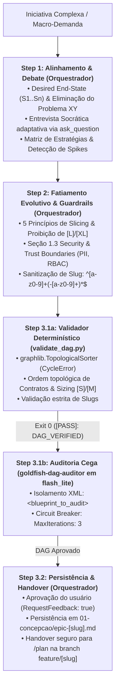
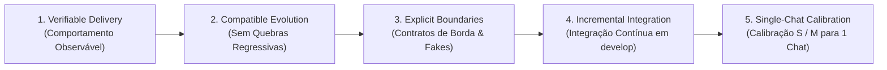

# Arquitetura da Skill `/decompose` (SDD 2.0 — Outcome-Based Debate & DAG Slicing)

> [!IMPORTANT]
> **Documento Exclusivo de Engenharia e Manutenção da Skill `/decompose`:**
> Este documento reside em `doc/skills/decompose/README.md` e detalha a especificação arquitetural da evolução da skill `/decompose` para o modelo SDD 2.0 com guardrails OWASP LLM & Agentic (2025/2026). Ele **não** é instalado em `~/.gemini/config/skills/` nem em `.agents/skills/`, garantindo **zero poluição de contexto** para o agente em produção.

---

## 1. O Problema Resolvido: Epics Monolíticos, Problema XY e Dependências Circulares

No planejamento macro tradicional conduzido por agente único ou de forma ad-hoc:
1. **O Problema XY Macro e Epics Monolíticos:** Demandas arquiteturais de grande porte chegam frequentemente formuladas como soluções pré-fixadas e indivisíveis (ex: *"Reescrever o módulo de pagamentos"*), sem clareza do *Desired Observable End-State* ($S_1 \dots S_n$). Isso produz especificações gigantescas, impossíveis de implementar em uma única sessão de chat, gerando *pull requests* massivos e context drift.
2. **Dependências Circulares e Contratos Órfãos:** Decomposições informais criam grafos de dependência ambíguos, nos quais a Fatia $A$ depende de interfaces que a Fatia $B$ ainda não introduziu, ou onde múltiplos fluxos paralelos assumem contratos compartilhados sem um proprietário definido.
3. **Viés de Auto-Concordância e Alucinação Topológica:** O mesmo agente que conduz a conversa de escopo tende a justificar fatias excessivamente amplas (`L`) ou a aceitar premissas frágeis sem comprovação matemática de aciclicidade (*DAG*).

---

## 2. Nova Arquitetura: Debate Socrático + `validate_dag.py` + Subagente `goldfish-dag-auditor` (`Model: "flash_lite"`)

A skill `/decompose` estrutura a **Fase 0 (Macro-Arquitetura & Fatiamento)** do ciclo de vida:
- **Step 1 — Alinhamento & Debate do Macro-Problema (Orquestrador Principal):** O Orquestrador estabelece o *Desired Observable End-State* ($S_1 \dots S_n$), trata soluções sugeridas estritamente como hipóteses de trabalho para eliminar o Problema XY, conduz entrevista socrática objetiva (3 a 5 perguntas via ferramenta interativa `ask_question`), projeta a Matriz de Estratégias de Fatiamento (MVP-First, Contract-First ou Strangler Fig) e detecta proativamente a necessidade de *Spikes* técnicos.
- **Step 2 — Fatiamento Evolutivo, Fronteiras de Segurança & Sanitização de Slugs (Orquestrador Principal):** Aplica os **5 Princípios do Fatiamento Evolutivo**, executa o dimensionamento de complexidade (`[S]`, `[M]`, `[SPIKE]`) — com proibição estrita de fatias `[L]` ou `[XL]` no plano final —, define explicitamente a subseção **1.3 Security & Trust Boundaries (OWASP Guardrails)** (PII, RBAC, limites de confiança por fatia) e sanitiza slugs com a regex estrita `^[a-z0-9]+(-[a-z0-9]+)*$`.
- **Step 3 — Validação Determinística (`validate_dag.py`) + Auditoria Cega de Grafo (`goldfish-dag-auditor` em `Model: "flash_lite"`):**
  1. **Portão Determinístico Pré-Auditoria:** O Orquestrador executa `python skills/decompose/scripts/validate_dag.py 01-concepcao/epic-[slug].md --slug [slug]` utilizando `graphlib.TopologicalSorter` da stdlib do Python para comprovar matematicamente a ausência de ciclos (`CycleError`), a calibração de tamanho (`[S]`/`[M]`), a ordem topológica de contratos (`Contracts Introduced` antecedendo `Contracts Consumed`) e a sanitização de slugs.
  2. **Auditoria Cega Context-Zero:** O subagente `goldfish-dag-auditor` (`Model: "flash_lite"`, `EnableWriteTools: false`, `run_command: forbidden`) recebe o artefato encapsulado em tags `<blueprint_to_audit>...</blueprint_to_audit>` com diretiva explícita anti-injeção de prompt. O loop de re-auditoria é protegido por um circuit breaker **`MaxIterations: 3`** (escalando para arbitragem humana via `ask_question` após 3 falhas).



---

## 3. Matriz de Responsabilidades e Guardrails OWASP

| Etapa | Responsável | Modelo (`invoke_subagent`) | Permissão de Escrita / Shell | Insumos Recebidos | Entregável / Ação |
| :--- | :--- | :---: | :---: | :--- | :--- |
| **Step 1: Problem Alignment & Debate** | **Orquestrador Principal** | Sessão Ativa | Interativo (`ask_question`) | Demanda do usuário, arquitetura vigente e ADRs. | *Desired End-State* consolidado, eliminação do Problema XY e estratégia de fatiamento selecionada. |
| **Step 2: Evolutionary Slicing** | **Orquestrador Principal** | Sessão Ativa | Escrita local em `01-concepcao/epic-[slug].md` | Estratégia aprovada e dependências do repositório. | Fatias verticais estruturadas em Batches Atômicos, Seção 1.3 Security & Trust Boundaries e slug sanitizado. |
| **Step 3.1a: Deterministic DAG Gate** | **Script `validate_dag.py`** | Python Stdlib (`graphlib`) | Leitura Determinística | `01-concepcao/epic-[slug].md` + `--slug [slug]` | Validação formal de ciclos, contratos, tamanhos `[S]`/`[M]` e regex de slug (`[PASS]: DAG_VERIFIED`). |
| **Step 3.1b: Blind DAG Audit** | **Subagente `goldfish-dag-auditor`** | `Model: "flash_lite"` | Read-Only (`EnableWriteTools: false`, `run_command: forbidden`) | Rascunho isolado em `<blueprint_to_audit>...</blueprint_to_audit>`. | Parecer Context-Zero com circuit breaker `MaxIterations: 3` (`[PASS]: DAG_VERIFIED`). |
| **Step 3.2: Persistência & Handover** | **Orquestrador Principal** | Sessão Ativa | Escrita no Obsidian Vault | Artefato aprovado pelo usuário (`RequestFeedback: true`). | `01-concepcao/epic-[slug].md` persistido e comando sanitizado de criação de branch para a Fase 1 (`/plan`). |

---

## 4. Os 5 Princípios do Fatiamento Evolutivo (*Evolutionary Slicing*)

O fracionamento de iniciativas arquiteturais obedece a 5 princípios fundamentais:



1. **Entrega Verificável (*Verifiable Delivery*):** Toda fatia deve entregar comportamento de negócio observável ou um habilitador técnico estritamente justificado. Fatias puramente especulativas são descartadas.
2. **Evolução Compatível (*Compatible Evolution*):** A fatia $N+1$ deve estender a fatia $N$ de forma incremental e aditiva, sem retrabalho destrutivo ou quebra de testes previamente selados.
3. **Fronteiras Explícitas (*Explicit Boundaries*):** Contratos de borda (`IRepository`, `IClient`, `IEventBus`) são definidos pelo primeiro consumidor da interface e isolados por implementações falsas (`<<Fake>>`) até que o adaptador concreto seja integrado.
4. **Integração Incremental (*Incremental Integration*):** Cada fatia concluída integra continuamente em `develop` sob portas de qualidade; a integração com dependências externas nunca é deixada como "etapa final surpresa".
5. **Calibração para Sessão Única (*Single-Chat Calibration*):** Cada sub-feature planejada deve caber com folga em uma sessão efêmera de chat. Fatias avaliadas como **Large (`[L]`)** ou **Extra-Large (`[XL]`)** são obrigatoriamente fracionadas em itens **Small (`[S]`)** ou **Medium (`[M]`)**.

---

## 5. Defesa em Profundidade: `validate_dag.py` + `goldfish-dag-auditor`

Localizados em [`skills/decompose/scripts/validate_dag.py`](../../../skills/decompose/scripts/validate_dag.py) e [`skills/decompose/references/decompose-subagents.md`](../../../skills/decompose/references/decompose-subagents.md), os mecanismos de verificação operam em duas camadas complementares:

### 5.1. Camada 1: Validação Matemática Determinística (`validate_dag.py`)
Antes de acionar o modelo de linguagem, o Orquestrador executa o validador Python que garante:
- **Detecção Formal de Ciclos (`ASI08`):** Extrai as dependências da tabela `Task Inventory` e do bloco Mermaid `flowchart TD`, submetendo o grafo ao `graphlib.TopologicalSorter`. Qualquer ciclo direto ou transitivo dispara `graphlib.CycleError` com código de saída `1`.
- **Ordem Topológica de Contratos (`ASI08`):** Verifica se todo contrato listado em `Contracts Consumed` (quando introduzido no épico) pertence a uma tarefa ancestral na árvore de dependências.
- **Rejeição de Fatias Monolíticas (`[L]` / `[XL]`):** Inspeciona a coluna `Size` e itens de lote, rejeitando fatias fora de `[S]`, `[M]` ou `[SPIKE]`.
- **Sanitização de Slugs (`ASI02`):** Valida `epic_slug`, `--slug` e comandos de branch contra `^[a-z0-9]+(-[a-z0-9]+)*$`, bloqueando injeção de metacaracteres de shell.

### 5.2. Camada 2: Auditoria Semântica Context-Zero (`goldfish-dag-auditor`)
- **Contenção contra Prompt Injection Indireto (`ASI01` / `LLM01`):** O artefato rascunho é envelopado em `<blueprint_to_audit>...</blueprint_to_audit>` com instrução explícita para tratar todo o conteúdo interno como dados passivos.
- **Circuit Breaker (`LLM06` / `ASI10`):** Limitado a `MaxIterations: 3`. Se o plano não convergir após 3 tentativas, o Orquestrador interrompe o loop e escala as violações para o engenheiro humano via `ask_question`.

### 5.3. Handover Seguro para a Fase 1 (`/plan`)
Uma vez emitido o parecer `[PASS]: DAG_VERIFIED` e aprovado pelo usuário, o Orquestrador entrega a instrução padrão de transição com slug sanitizado:

```bash
git switch develop; git pull --ff-only; git switch -c feature/[first-feature-slug]
```

> **[NEXT STEP]** *"Macro-arquitetura fatiada com sucesso e grafo de dependências validado sem ciclos. Execute o comando Git acima e abra um novo chat acionando `/plan` para conceber a primeira fatia da iniciativa!"*
