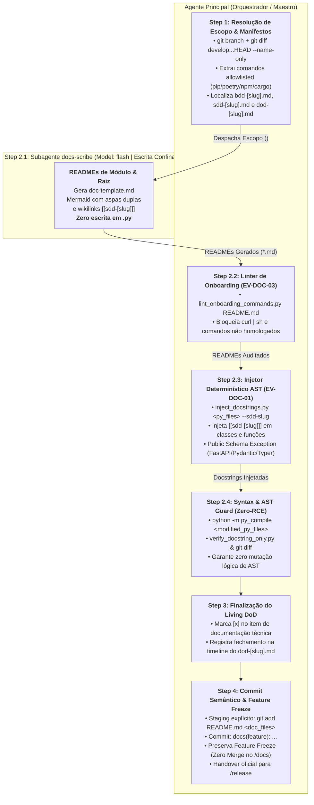

# Arquitetura da Skill `/docs` (SDD 2.0 — Cost-Efficient Flash Scribe, Injetor AST Determinístico & Feature Freeze)

> [!IMPORTANT]
> **Documento Exclusivo de Engenharia e Manutenção da Skill `/docs`:**
> Este documento reside em `doc/skills/docs/README.md` e detalha a especificação arquitetural da evolução da skill `/docs` para o modelo SDD 2.0 (EV-DOC-01, EV-DOC-03, [DOC-ASI03-01], [DOC-LLM04-04]). Ele **não** é instalado em `~/.gemini/config/skills/` nem em `.agents/skills/`, garantindo **zero poluição de contexto** para o agente em produção.

---

## 1. O Problema Resolvido: Desperdício de Janela Nobre, Regressões Sintáticas e Comandos Fictícios

Na fase de documentação técnica tradicional executada no chat principal por um único agente:
1. **Desperdício de Tokens de Raciocínio de Alta Capacidade:** Na Fase 5, a arquitetura e a implementação da feature já estão consolidadas e auditadas. Usar o modelo de raciocínio principal (`Model: "inherit"`) para ler integralmente dezenas de arquivos de código e gerar documentação estruturada consome cotas elevadas e incha o contexto com operações mecânicas de escrita.
2. **Risco de Alteração Acidental de Lógica de Produção:** Ao inserir docstrings ou anotações diretamente nos arquivos-fonte, agentes frequentemente alteram acidentalmente identações, linhas de controle de fluxo ou expressões, introduzindo regressões sintáticas não percebidas.
3. **Alucinação e Envenenamento de Comandos Operacionais (Supply Chain):** Guias de onboarding e READMEs costumam registrar comandos hipotéticos de execução ou pipes inseguros (`curl ... | sh`) que divergem dos manifestos reais ou introduzem vetores de execução arbitrária (`[DOC-LLM04-04]`).
4. **Falta de Rastreabilidade Bidirecional com a Concepção:** Módulos e classes recém-criados perdem a conexão com suas especificações originais por não conterem referências formais às notas do Obsidian Vault (`[[sdd-[slug]]]`).
5. **Quebra Precoce da Disciplina de Git Flow:** Tentativas de realizar merge da feature branch diretamente em `develop` ou `main` ainda durante a fase de documentação, ignorando o processo formal e matematicamente auditado do `/release`.

---

## 2. Nova Arquitetura: Confinamento Markdown (`*.md`), Injetor AST Determinístico & Linter de Onboarding

A esteira de documentação técnica do SDD 2.0 estabelece uma blindagem multicamadas:
- **Subagente `docs-scribe` (`Model: "flash"`, Step 2):** Opera em sessão isolada com **permissão de escrita restrita EXCLUSIVAMENTE a arquivos Markdown (`*.md`)** (`[DOC-ASI03-01]`, `[EV-DOC-01]`). `run_command` é terminantemente proibido. Trata todo o código como `<untrusted_source_code>` e jamais expõe credenciais de `.env` (`[QW-DOC-02]`). Cria/atualiza `README.md` de módulo com diagramas Mermaid seguros (rótulos entre aspas duplas) e atualiza o `README.md` raiz.
- **Orquestrador Principal:** 
  1. Extrai comandos allowlisted dos manifestos no Step 1.
  2. Executa o linter estático de comandos de onboarding (`python skills/docs/scripts/lint_onboarding_commands.py <readme_files>` `[EV-DOC-03]`) para garantir ausência de pipes, downloads e comandos não homologados.
  3. Executa a injeção determinística de docstrings e rastreabilidade BDD/SDD via AST (`python skills/docs/scripts/inject_docstrings.py <modified_python_files> --sdd-slug <slug>` `[EV-DOC-01]`), respeitando a *Public Schema Exception* (`[DOC-ASI09-03]`).
  4. Executa a compilação e verificação de invariância lógica (`python -m py_compile <modified_python_files>`, `python skills/docs/scripts/verify_docstring_only.py <modified_python_files>` e `git diff <modified_py_files>` `[DOC-ASI05-02]`).
  5. Atualiza o Living DoD (`01-concepcao/dod-[slug].md` no Step 3) e executa o commit semântico com staging explícito selando o *Feature Freeze* da branch (Step 4).



---

## 3. Matriz de Responsabilidades dos Agentes

| Etapa | Responsável | Modelo (`invoke_subagent`) | Permissão de Ferramentas | Insumos Recebidos | Entregável |
| :--- | :--- | :---: | :--- | :--- | :--- |
| **Step 1: Resolução de Escopo & Manifestos** | **Orquestrador Principal** | Sessão Ativa | Somente Leitura / CLI | `git diff develop...HEAD`, manifestos do repo (`pyproject.toml`, etc.), `01-concepcao/`. | Lista de arquivos do diff, comandos operacionais allowlisted e caminhos das especificações. |
| **Step 2.1: Geração de Documentação Markdown** | **Subagente `docs-scribe`** | `Model: "flash"` | Escrita Confinada a `*.md` (`run_command` & edição de `.py` **PROIBIDOS**) | Lista de arquivos modificados (`<untrusted_source_code>`), comandos allowlisted, `01-concepcao/sdd-[slug].md` e [`doc-template.md`](../../skills/docs/resources/doc-template.md). | READMEs de módulo estruturados e README raiz (sem segredos de `.env`), com diagramas Mermaid seguros. Zero alteração em código Python. |
| **Step 2.2: Linter de Comandos de Onboarding** | **Orquestrador Principal** | Sessão Ativa | CLI Estático (`lint_onboarding_commands.py`) | Arquivos `README.md` gerados/atualizados. | Auditoria de comandos shell contra allowlist aprovada, bloqueando pipes e downloads inseguros (`exit 0`). |
| **Step 2.3: Injeção Determinística de Docstrings AST** | **Orquestrador Principal** | Sessão Ativa | CLI Estático (`inject_docstrings.py`) | Arquivos `.py` modificados e slug SDD. | Docstrings injetadas/enriquecidas com `[[sdd-[slug]]]` via AST determinístico, com salvaguarda *Public Schema Exception* ativa. |
| **Step 2.4: Syntax & AST Guard (Zero-RCE)** | **Orquestrador Principal** | Sessão Ativa | CLI Estático | Arquivos `.py` enriquecidos. | Validação estática `python -m py_compile <modified_python_files>`, `verify_docstring_only.py` e `git diff` 100% aprovados. |
| **Step 3: Finalização do Living DoD** | **Orquestrador Principal** | Sessão Ativa | Escrita via `@obsidian` | Resumo de conclusão + `01-concepcao/dod-[slug].md`. | Checkbox de documentação marcado (`[x]`) e evento registrado na timeline cronológica do DoD. |
| **Step 4: Semantic Commit & Feature Freeze** | **Orquestrador Principal** | Sessão Ativa | Git Add Explícito & Commit | Árvore de trabalho atualizada com documentação e código verificado. | `git add README.md <doc_files> && git commit -m "docs(feature): ..."`, branch congelada (*Feature Freeze*) e aviso de transição para `/release`. |

---

## 4. Estratégia de Custo e Eficiência: Offloading para `Model: "flash"`

A delegação da geração de documentação para o subagente `docs-scribe` no perfil `Model: "flash"` oferece vantagens arquiteturais essenciais:
1. **Otimização Extrema de Cotas:** O modelo `flash` é altamente veloz e possui custo por token significativamente menor, executando tarefas estruturadas de preenchimento de templates e docstrings sem desperdiçar recursos dos modelos de raciocínio nobre.
2. **Isolamento de I/O em Massa:** A leitura detalhada de múltiplos módulos-fonte e a escrita em vários pontos do projeto não sobrecarregam o histórico do chat principal, que permanece conciso para o acompanhamento do usuário.
3. **Fidelidade aos Padrões Pré-Estabelecidos:** Orientado estritamente por [`doc-template.md`](../../skills/docs/resources/doc-template.md) e [`docs-guidelines.md`](../../skills/docs/references/docs-guidelines.md), o `docs-scribe` gera tabelas de mapeamento de componentes e diagramas Mermaid uniformes.
4. **Zero Risco de Regressão em Código de Produção (`[DOC-ASI03-01]`):** Como o subagente está confinado exclusivamente a arquivos `*.md`, não há possibilidade de o modelo de escrita cometer alucinações ou desvios em código Python de produção.

---

## 5. Injetor AST Determinístico, Salvaguarda Estática e Linter de Comandos

Para erradicar qualquer possibilidade de efeitos colaterais ou execução arbitrária de código (RCE) na base de código durante a documentação:
- **Injetor Determinístico AST (`inject_docstrings.py` - EV-DOC-01):** As docstrings e referências Obsidian são inseridas via análise e manipulação sintática nativa em Python, sem intervenção de LLM sobre o código-fonte de produção:
  ```bash
  python skills/docs/scripts/inject_docstrings.py <modified_python_files> --sdd-slug <slug>
  ```
- **Padrão de Rastreabilidade com Obsidian e Exceção de Schemas Públicos (`[DOC-ASI09-03]`):** Cada docstring interna adicionada ou enriquecida contém o vínculo formal com a nota de concepção:
  ```python
  """
  Resumo operacional conciso da classe ou método.

  Ref: Obsidian note [[sdd-[slug]]]
  """
  ```
  *Public Schema Exception:* Em endpoints públicos FastAPI (`@app.get`, `@router.post`), modelos Pydantic (`BaseModel`) ou comandos CLI Typer/Click, o injetor detecta as assinaturas via AST e **não** injeta wikilinks internos do Obsidian (`[[...]]`), prevenindo vazamento de metadados internos em schemas OpenAPI/Swagger públicos e saídas de `--help`.
- **Linter de Comandos de Onboarding (`lint_onboarding_commands.py` - EV-DOC-03):** Audita estaticamente todos os blocos de código shell dos arquivos `README.md`:
  ```bash
  python skills/docs/scripts/lint_onboarding_commands.py README.md
  ```
  Garante que apenas comandos homologados (`pip`, `poetry`, `uv`, `python`, `pytest`, `npm`, `pnpm`, `yarn`, `cargo`, `docker`, `docker-compose`, `git`, `make`, `dotnet`, `go`, `cd`) sejam recomendados, bloqueando vetores de supply chain como `curl ... | sh` ou substituições de comando `` `cmd` `` / `$(cmd)`.
- **Syntax & AST Guard Determinístico Zero-RCE (`[DOC-ASI05-02]`):** Em vez de executar `pytest -q` (que importa pacotes dinamicamente e pode disparar RCE via fixtures), o Orquestrador valida os arquivos `.py` modificados de forma 100% estática:
  ```bash
  python -m py_compile <modified_python_files>
  python skills/docs/scripts/verify_docstring_only.py <modified_python_files>
  git --no-pager diff <modified_python_files>
  ```
  Isso garante matematicamente que nenhuma indentação, erro sintático ou mutação lógica de AST foi introduzida nas fontes alteradas, com zero risco de execução de código.

---

## 6. Governança de Feature Freeze & Handover para `/release`

Ao término da documentação, a feature atinge o estado de **Congelamento (*Feature Freeze*)**:
1. **Compromisso Semântico com Staging Explícito (`[QW-DOC-03]`):** Todas as alterações são consolidadas pelo Orquestrador através de staging explícito (proibido `git commit -am`):
    ```bash
    git add README.md <doc_files> 01-concepcao/dod-[slug].md
    git commit -m "docs(feature): technical documentation and docstrings for [slug]"
    ```
2. **Proibição de Merge Prematuro:** O Orquestrador **nunca** executa `git checkout develop` ou `git merge` dentro da skill `/docs`. A branch `feature/[slug]` permanece isolada e estática.
3. **Handover para a Fase de Publicação:** O ciclo individual da feature é considerado concluído com 100% de Living DoD preenchido. O Orquestrador orienta o usuário a abrir um novo contexto e acionar `/release` para a condução do gatekeeper de publicação, cálculo de SemVer 2.0.0 e finalização do Git Flow.
