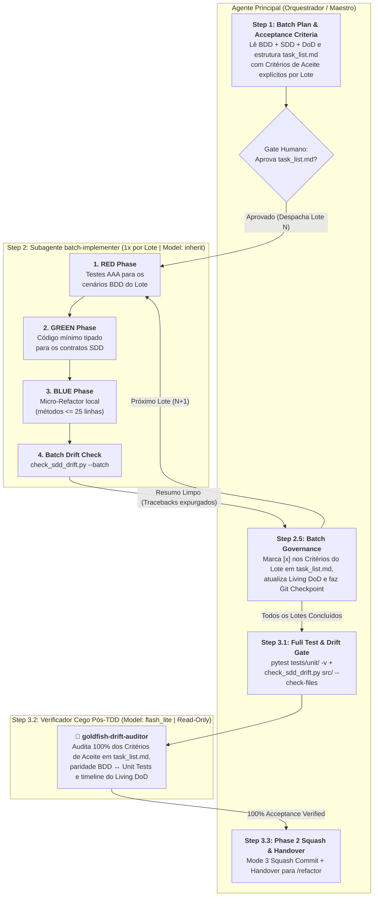

# Arquitetura da Skill `/implement` (SDD 2.0 — Batch Isolation & Drift Gate)

> [!IMPORTANT]
> **Documento Exclusivo de Engenharia e Manutenção da Skill `/implement`:**
> Este documento reside em `doc/implement/README.md` e detalha a especificação arquitetural da evolução da skill `/implement` para o modelo SDD 2.0. Ele **não** é instalado em `~/.gemini/config/skills/` nem em `.agents/skills/`, garantindo **zero poluição de contexto** para o agente em produção.

---

## 1. O Problema Resolvido: Context Bloat, Tarefas Vagas e Spec Drift

Na implementação TDD tradicional com agente único:
1. **Poluição Progressiva de Contexto (*Context Bloat* entre Batches):** Ao executar 4 ou 5 lotes sequenciais na mesma conversa, todos os *tracebacks* de falha da fase RED, tentativas de correção do *Double-Strike* e diffs de micro-refatoração do Batch 1 continuam consumindo tokens quando o agente já está no Batch 4.
2. **Ausência de Critérios de Aceite Explícitos por Lote:** Listar apenas tarefas genéricas em `task_list.md` (*"Escrever testes"*, *"Implementar serviço"*) deixa o agente sem saber quais cenários exatos do BDD e quais contratos exatos do SDD pertencem àquele lote.
3. **Spec Drift Silencioso:** O agente altera nomes de métodos, parâmetros ou arquivos durante o código sem registrar um *Technical Pivot*, tornando o `01-concepcao/sdd-[slug].md` obsoleto.

---

## 2. Nova Arquitetura: Orquestrador + `batch-implementer` + Drift Gate + `flash_lite` Verifier

Cada lote (*Batch*) roda em uma invocação limpa do subagente **`batch-implementer`** (`Model: "inherit"`), mantendo o cache quente durante o ciclo coeso *Red → Green → Blue* daquele lote e descartando os logs de terminal antes do próximo lote começar. Ao final de todos os lotes, o script determinístico `check_sdd_drift.py` e o subagente ultra-rápido **`goldfish-drift-auditor`** (`Model: "flash_lite"`, Read-Only) selam a entrega.

---

## 3. Matriz de Responsabilidades dos Agentes

| Etapa | Responsável | Modelo (`invoke_subagent`) | Permissão de Escrita | Insumos Recebidos | Entregável |
| :--- | :--- | :---: | :--- | :--- | :--- |
| **Step 1: Batch Plan & Acceptance Criteria** | **Orquestrador Principal** | Sessão Ativa | Escrita em `task_list.md` | `bdd-[slug].md`, `sdd-[slug].md`, `dod-[slug].md`. | `task_list.md` com **Critérios de Aceite** (arquivos-alvo, contratos SDD e cenários BDD mapeados por lote). |
| **Step 2.1–2.4: Ciclo TDD do Lote $N$** | **Subagente `batch-implementer`** | `Model: "inherit"` | `EnableWriteTools: true` *(restrito a `src/` e `tests/unit/` do Lote $N$)* | Critérios de Aceite do Lote $N$ + `<spec_context>` (`bdd-[slug].md`, `sdd-[slug].md`) + `src/` existente. | Testes AAA (`--tb=short`, zero rede) + Código tipado (apenas stdlib/manifesto) + Micro-refactor + `check_sdd_drift.py --batch` 100% verde. |
| **Step 2.5: Governança do Lote & Scope Guard** | **Orquestrador Principal** | Sessão Ativa | Escrita + Git Commit | Resumo enxuto de conclusão do Lote $N$ + `git status --porcelain` / `git diff --name-only`. | Validação determinística de escopo (aborta/reverte se `.env`, `.github/` ou `skills/` forem tocados), `task_list.md` e `dod-[slug].md` atualizados + Git Checkpoint do lote. |
| **Step 3.1: Full Exit Drift Gate** | **Orquestrador Principal** | Sessão Ativa | CLI (`check_sdd_drift.py`) | `01-concepcao/sdd-[slug].md`, `src/` e `02-auditorias/pivots-[slug].md`. | Validação determinística AST de 100% das classes, interfaces, métodos, exceções e arquivos (autorização de pivots restrita a caminhos exatos ou bloco YAML `pivots:`). |
| **Step 3.2: Verificação de Aceite Pós-TDD** | **Subagente `goldfish-drift-auditor`** | `Model: "flash_lite"` | `EnableWriteTools: false` (Read-Only) | `task_list.md`, `bdd-[slug].md`, `dod-[slug].md` e `tests/unit/`. | Veredito `[PASS]: 100%_ACCEPTANCE_VERIFIED` comprovando zero cenários BDD esquecidos e rejeitando asserções triviais (`assert True`, `assert res is not None`, `assert len(x) >= 0`). |
| **Step 3.3: Fechamento & Handover** | **Orquestrador Principal** | Sessão Ativa | Git Squash Commit | Aprovação do Drift Gate e do `goldfish-drift-auditor`. | Commit semântico consolidado da Fase 2 e recomendação de abertura do `/refactor`. |

---

## 4. O Validador Determinístico de Drift (`check_sdd_drift.py`)

Localizado em [`skills/implement/scripts/check_sdd_drift.py`](../../skills/implement/scripts/check_sdd_drift.py), o script opera em dois modos complementares:
1. **Modo Lote (`--batch`):** Verifica apenas as classes já criadas nos arquivos do lote atual, garantindo que todos os seus métodos públicos previstos no SDD foram implementados (sem acusar falso-positivo pelas classes que só serão criadas nos lotes seguintes).
2. **Modo Exit Gate Completo (`--check-files`):** Exige que **todas** as classes de produção, interfaces (`<<Interface>>`), métodos públicos e exceções (`*Error`/`*Exception`) do SDD existam no código, e que qualquer arquivo modificado fora da tabela *File Impact Analysis* possua justificativa documentada em `--pivots 02-auditorias/pivots-[slug].md` (mediante caminho relativo exato, nome exato do arquivo ou estrutura YAML `pivots:`, prevenindo bypass por substrings de diretório como `src`).

---

## 5. Guardrails de Segurança Agentic (OWASP Top 10 for LLM & Agentic 2026)

1. **Prevenção de Bypass de Pivots (`[IMP-ASI06-01]`):** `check_sdd_drift.py` proíbe correspondência de segmentos de diretório (ex.: `"src"`) ao autorizar arquivos fora do SDD. Apenas caminhos relativos exatos (`norm_path`), nomes exatos de arquivos ou blocos YAML estruturados (`pivots:`) concedem isenção.
2. **Salvaguarda de Rollback Não-Destrutivo (`[IMP-LLM03-01]`):** Ao atingir o limite da regra *Double-Strike* (> 2 falhas), o rollback é obrigatoriamente precedido por `git stash push -u -m "antigravity-safety-rollback-strike2"` (ou `git checkout -- <batch_files>`), protegendo arquivos não rastreados ou trabalho em andamento do desenvolvedor antes de `git reset --hard HEAD`.
3. **Post-Batch Scope Guard Determinístico (`[IMP-ASI03-01]`):** No Step 2.5, o Orquestrador audita `git status --porcelain` e `git diff --name-only` antes do checkpoint. Qualquer modificação fora dos arquivos planejados de `src/` e `tests/unit/` do Lote $N$ (como `.env`, `.github/` ou `skills/`) dispara aborto e reversão imediatos.
4. **Delimitadores Anti-Prompt Injection & Anti-Slopsquatting (`[IMP-ASI05-01]`):** O prompt do `batch-implementer` isola especificações com `<spec_context>...</spec_context>`, veda a importação de pacotes ausentes no manifesto do projeto (`pyproject.toml` / `requirements.txt`) e executa `pytest` sem I/O de rede/socket (`--tb=short`, `--timeout=30` quando disponível).
5. **Rigor Semântico no Auditor Cego (`[IMP-ASI09-01]`):** O `goldfish-drift-auditor` (`flash_lite`) proíbe expressamente asserções tautológicas ou triviais (`assert True`, `assert res is not None`, `assert len(x) >= 0`), exigindo validação concreta de estado, exceção ou redação (`***REDACTED***`), especialmente em cenários `@security` e `@concurrency`.
