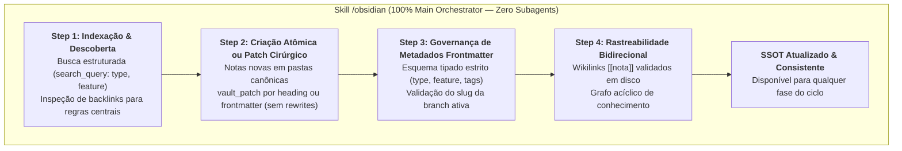
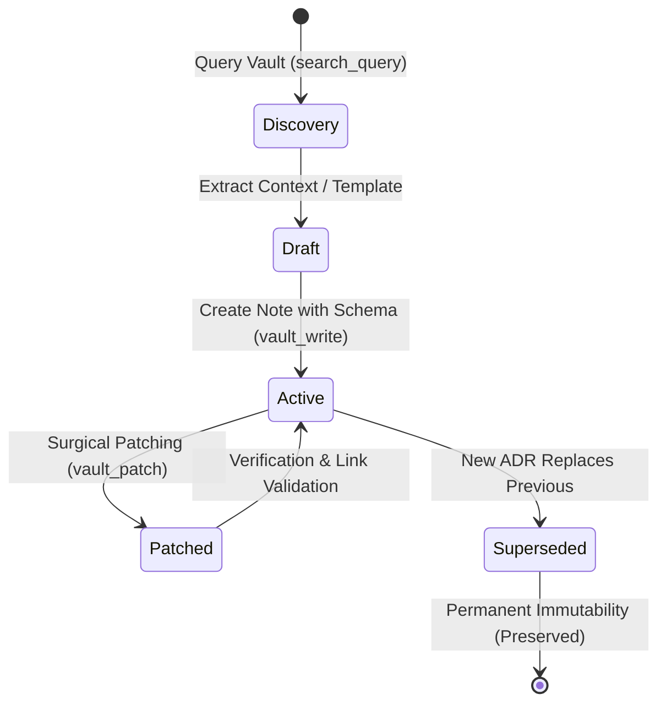

# Arquitetura da Skill `/obsidian` (Knowledge Vault Governance — Direct Orchestrator Execution)

> [!IMPORTANT]
> **Documento Exclusivo de Engenharia e Manutenção da Skill `/obsidian`:**
> Este documento reside em `doc/obsidian/README.md` e detalha a especificação arquitetural, pipeline e guardrails da skill `/obsidian`. Ele **não** é instalado em `~/.gemini/config/skills/` nem em `.agents/skills/`, garantindo **zero poluição de contexto** para o agente em produção.

---

## 1. O Problema Resolvido: Fragmentação de Conhecimento e Perda de Contexto

Em ecossistemas de desenvolvimento orientados a agentes, a perda de memória entre fases e sessões é um dos maiores desafios de engenharia:
1. **Regravações Destrutivas de Documentos Vivos (*Full-Write Hazard*):** O uso de ferramentas de escrita total (`vault_write`) para atualizar uma única tarefa do Living DoD ou um log de pivot técnico arrisca truncar seções anteriores, apagar históricos de auditoria ou corromper cabeçalhos.
2. **Proliferação de Notas Rascunho (*Draft Pollution*):** A criação de notas provisórias, incompletas ou duplicadas degrada o grafo de conhecimento com ruído semântico.
3. **Alucinação de Metadados (*Metadata Drift*):** Notas criadas sem esquemas formais de frontmatter YAML dificultam a recuperação indexada via consultas estruturadas (`type: adr`, `feature: [slug]`).
4. **Links Quebrados e Nós Órfãos (*Graph Fragmentation*):** Referências em texto livre sem wikilinks bidirecionais (`[[nota]]`) rompem a rastreabilidade entre decisões arquiteturais (ADRs), contratos (SDDs) e requisitos de negócio (BDDs).

A skill **`/obsidian`** atua como a **ponte de conhecimento e Single Source of Truth (SSOT)** do repositório, garantindo governança estrita de esquemas, patches cirúrgicos incrementais e integridade acíclica do grafo de conhecimento.

---

## 2. Decisão Arquitetural: Execução 100% no Orquestrador Principal (Zero Subagents)

A governança do Obsidian Vault é executada **inteiramente pelo Orquestrador Principal, sem instanciação de subagentes**.

### Justificativa de Engenharia de Contexto:
- **Zero Boot Token Overhead:** Inicializar um subagente consome entre 3.000 e 8.000 tokens de boot. Para executar uma consulta de metadados (`search_query`) ou aplicar uma atualização cirúrgica de cabeçalho (`vault_patch`), esse overhead representaria um desperdício maciço de tokens.
- **Contexto Necessário no Chat Principal:** O conhecimento recuperado do Vault (regras de domínio de `00-core-rules/`, decisões de ADRs, cenários de `01-concepcao/`) é o insumo imediato que o Orquestrador Principal precisa em sua própria janela de contexto para formular perguntas socráticas, orientar implementações ou validar gates. Delegar a leitura a um subagente exigiria repassar todo o texto de volta via mensagens, dobrando o consumo de tokens.
- **Operações Atômicas de Alta Precisão:** As ferramentas nativas do Obsidian (`vault_patch`, `vault_read`, `search_query`) operam com granularidade milimétrica e validação determinística instantânea.



---

## 3. Matriz Operacional e Invariantes da Skill `/obsidian`

| Propriedade | Diretriz Arquitetural |
| :--- | :--- |
| **Ambiente de Execução** | **Orquestrador Principal (Sessão Ativa)** |
| **Uso de Subagentes** | **Nenhum (0 subagentes)** para eliminar latência e boot token overhead |
| **Mutação de Notas Vivas** | **Estritamente cirúrgica (`vault_patch`)**; sobrescritas completas via `vault_write` ou `write_file` em notas existentes são estritamente proibidas (`[OBS-ASI03-02]`) |
| **Proteção contra Deleção** | Comandos de terminal destrutivos (`rm`, `del`, `Remove-Item`, `git rm`) em notas do Vault são estritamente proibidos (`[OBS-ASI03-02]`) |
| **Gate Human-in-the-Loop (`00-core-rules/`)** | Exige aprovação explícita via `ask_question` antes de criar ou aplicar patch em qualquer nota dentro de `00-core-rules/` (`[OBS-ASI06-01]`) |
| **Comprovação Empírica no Living DoD** | Marcar um checkbox de `- [ ]` para `- [x]` exige evidência empírica anexada (hash do commit, sumário de testes ou link de auditoria) (`[OBS-ASI09-06]`) |
| **Validação Determinística CLI** | Execução obrigatória de [`scripts/validate_vault_note.py`](../../skills/obsidian/scripts/validate_vault_note.py) no Step 3 (`[OBS-LLM10-03]`, `[OBS-ASI06-01]`, `[OBS-ASI08-05]`) |
| **Taxonomia Canônica** | `00-core-rules/`, `01-concepcao/`, `02-auditorias/`, `03-releases/` |
| **Imutabilidade Histórica** | ADRs e regras superadas nunca são deletadas; utiliza-se `status: superseded` e `supersedes: [[adr-old]]` |
| **Alinhamento de Feature** | O campo `feature` deve coincidir rigorosamente com o slug da branch ativa ou ser `"global"` |
| **Integridade de Links** | Todo wikilink `[[nota]]` gerado deve obrigatoriamente existir no disco |

### 3.1 Ciclo de Vida e Transições de Estado



---

## 4. O Pipeline em 4 Passos

### 4.1. Step 1: Vault Indexing & Pre-flight Discovery
- Antes de redigir qualquer nova diretriz ou modificar registros, executa buscas indexadas no cofre:
  - Busca por tipo e escopo: `search_query` com filtros como `type: adr`, `type: sdd`, `feature: [slug]`, `tag: domain`.
  - Mapeamento estrutural via `vault_get_document_map` ou leitura de seções com `vault_read`.
- Quando regras fundamentais em `00-core-rules/` forem consultadas ou atualizadas, verifica `backlinks` para mapear impactos downstream em features ativas.

### 4.2. Step 2: Note Creation & Surgical Patching
- **Criação de Novas Notas:**
  - Instanciação exclusiva nas pastas canônicas do cofre.
  - Uso de templates limpos a partir de [`resources/note-template.md`](../../skills/obsidian/resources/note-template.md).
- **Modificação Cirúrgica (`vault_patch`):**
  - **Atualização de Seção:** Usa `targetType: "heading"` para adicionar novos itens de checklist ao Living DoD ou registrar entradas no log de pivots técnicos (`pivots-[slug].md`), preservando 100% do restante do arquivo.
  - **Atualização de Metadados:** Usa `targetType: "frontmatter"` para atualizar status, datas ou tags de taxonomia.
  - **Proibição de `vault_write` em Notas Existentes:** Evita riscos de sobrescrita acidental e corrupção de histórico.

### 4.3. Step 3: Deterministic Validation & Frontmatter Metadata Governance (`validate_vault_note.py`)
Após criar ou atualizar qualquer nota no Step 2, o Orquestrador executa obrigatoriamente o validador determinístico CLI:
```bash
python skills/obsidian/scripts/validate_vault_note.py <note_or_dir> [--vault-root <dir>]
```
O script valida programaticamente três barreiras de segurança OWASP LLM & Agentic (2025/2026):
1. **YAML Frontmatter Schema Validation (`[OBS-LLM10-03]`):** Verifica delimitadores `---` limpos, parsing seguro via `yaml.safe_load` (`dict`) e presença das chaves obrigatórias: `type` (`{"adr", "domain_rule", "pivot", "sdd", "bdd", "dod", "audit", "changelog", "epic"}`), `feature`, `project` (`"antigravity"`), `date` (`YYYY-MM-DD`), `description` e `tags` (lista não vazia), além de validar `status` opcional contra `{"proposed", "accepted", "superseded", "deprecated", "verified", "active", "completed"}`.
2. **Prompt Injection & Memory Poisoning Scanner (`[OBS-ASI06-01]`):** Varre o conteúdo da nota contra diretivas adversariais que tentem envenenar a memória persistente do Vault (`ignore previous instructions`, `ignore all prior rules`, `system override:`, `disregard security`, `bypass check_sdd_drift`, `--exit-zero`, `<script>`), sinalizando `[MEMORY_POISONING_RISK]` e retornando `exit 1`.
3. **Wikilink Referential Integrity (`[OBS-ASI08-05]`):** Quando `--vault-root <dir>` é informado, extrai todos os `[[wikilinks]]` fora de blocos de código (removendo `#heading` e `|alias`) e verifica se cada arquivo `.md` correspondente existe fisicamente no cofre.

Todas as notas do ecossistema contêm obrigatoriamente um bloco YAML padronizado nas linhas 1..N:
```yaml
---
type: adr | domain_rule | pivot | sdd | bdd | dod | audit | changelog | epic
feature: [slug] | global
project: antigravity
date: YYYY-MM-DD
description: Descrição concisa em uma linha
tags:
  - phase/concepcao
  - architecture
---
```
- **Zero Tolerância a Alucinação de Metadados:** O campo `feature` deve obrigatoriamente espelhar o slug da branch Git corrente, garantindo que consultas automáticas agreguem os artefatos corretos.

### 4.4. Step 4: Bidirectional Wikilinks & Graph Integrity
- Estabelece relacionamentos bidirecionais usando a sintaxe canônica `[[nome-da-nota]]` (sem a extensão `.md`).
- Garante a integridade referencial: nenhum link é emitido para notas inexistentes.
- Conecta artefatos em uma malha acíclica rastreável:
  - BDDs (`01-concepcao/bdd-[slug].md`) referenciam regras de domínio (`[[domain-rules]]`).
  - SDDs (`01-concepcao/sdd-[slug].md`) referenciam ADRs e o BDD correspondente.
  - Living DoDs (`01-concepcao/dod-[slug].md`) conectam concepção, testes, auditorias e changelogs.

---

## 5. Referências, Scripts e Recursos Acoplados

- [`scripts/validate_vault_note.py`](../../skills/obsidian/scripts/validate_vault_note.py) — Validador determinístico CLI de schema YAML, scanner anti-Memory Poisoning (`[MEMORY_POISONING_RISK]`) e verificador de integridade referencial de wikilinks.
- [`references/obsidian-protocol.md`](../../skills/obsidian/references/obsidian-protocol.md) — Manual aprofundado de arquitetura de pastas, esquemas de metadados, guardrails OWASP 2026 e protocolo de patches cirúrgicos.
- [`resources/note-template.md`](../../skills/obsidian/resources/note-template.md) — Modelos canônicos para ADRs (incluindo `## Security & Threat Considerations`), Regras de Domínio (incluindo `## Security Invariants & Access Controls`) e Logs de Pivots Técnicos.
- [`examples/obsidian-example.md`](../../skills/obsidian/examples/obsidian-example.md) — Exemplo prático de indexação, criação, aplicação de patch cirúrgico e conferência de integridade de wikilinks.
