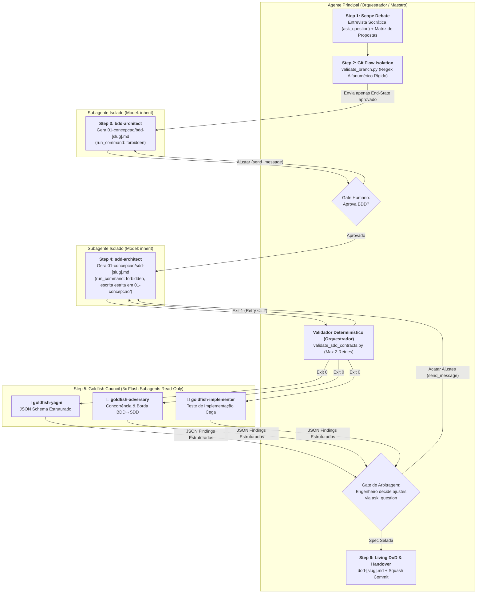

# Arquitetura da Skill `/plan` (SDD 2.0 — Elephant & Goldfish)

> [!IMPORTANT]
> **Documento Exclusivo de Engenharia e Manutenção da Skill `/plan`:**
> Este documento reside em `doc/plan/README.md` e detalha a especificação arquitetural da evolução da skill `/plan` para o modelo SDD 2.0. Ele **não** é instalado em `~/.gemini/config/skills/` nem em `.agents/skills/`, garantindo **zero poluição de contexto** para o agente em produção.

---

## 1. O Problema Resolvido: Do SDD 1.0 ao SDD 2.0

No modelo tradicional de SDD (1.0), um único agente conduz o debate de escopo, redige o BDD, desenha o SDD e aprova o checklist do DoD. Isso gera:
1. **Viés de Auto-Concordância e Contaminação de Contexto:** O agente "sabe" o que conversou no debate e preenche silenciosamente lacunas da especificação.
2. **Validação Puramente Sintática:** Scripts que apenas checam títulos e aspas deixam passar falhas lógicas e de paridade entre BDD e SDD.
3. **Phase Gate Sem Contraponto (*A Raposa Cuidando do Galinheiro*):** O próprio autor da especificação atesta a sua suficiência sem sofrer testes de estresse independentes.
4. **Superfície de RCE e Permissões Excessivas em Subagentes:** Subagentes com privilégios de execução de terminal (`run_command`) executando loops de validação descontrolados ("until exit 0") sem circuit breaker.

---

## 2. Nova Arquitetura: Orquestrador Único + Subagentes de Contexto Zero

O Antigravity permite instanciar subagentes com sessão isolada (`conversationId` próprio) e **zero compartilhamento de histórico do chat**.

---

## 3. Matriz de Responsabilidades dos Agentes

| Etapa | Responsável | Modelo (`invoke_subagent`) | Permissão de Escrita | Insumos Recebidos (Context Window) | Entregável |
| :--- | :--- | :---: | :--- | :--- | :--- |
| **Step 1: Scope Debate** | **Orquestrador Principal** | Sessão Ativa | Leitura / Chat (`ask_question`) | Pedido do usuário, `epic-[slug].md`, ADRs e código. | Consenso sobre o *Desired End-State* e aprovação da Proposta Arquitetural. |
| **Step 2: Branch Isolation** | **Orquestrador Principal** | Sessão Ativa | CLI (`validate_branch.py`) | Nome do `slug` aprovado. | Branch `feature/[slug]` validada com regex alfanumérico rígido (sem injeção de shell). |
| **Step 3: BDD Specification** | **Subagente `bdd-architect`** | `Model: "inherit"` | `EnableWriteTools: true` (`run_command: forbidden`) | **Apenas** o resumo estruturado da proposta aprovada + `references/plan-bdd.md`. Escrita restrita a `01-concepcao/`. | `01-concepcao/bdd-[slug].md` em Gherkin puro, validado pelo humano no Gate 1. |
| **Step 4: SDD & Contracts** | **Subagente `sdd-architect`** | `Model: "inherit"` | `EnableWriteTools: true` (`run_command: forbidden`) | **Apenas** `01-concepcao/bdd-[slug].md` + proposta escolhida + manifestos do repo + `references/plan-sdd.md`. Escrita restrita a `01-concepcao/`. | `01-concepcao/sdd-[slug].md` validado exclusivamente pelo Orquestrador com circuit breaker (`MaxIterations: 2`). |
| **Step 5: Goldfish Council** | **3 Subagentes em Paralelo** (`yagni`, `adversary`, `implementer`) | `Model: "flash"` | `EnableWriteTools: false` (Read-Only) | **Apenas** `01-concepcao/bdd-[slug].md` + `01-concepcao/sdd-[slug].md` envolto em `<untrusted_spec>`. | 3 pareceres em formato JSON padronizado entregues ao Orquestrador para a Matriz de Arbitragem. |
| **Step 6: Living DoD & Handover** | **Orquestrador Principal** | Sessão Ativa | Escrita + Git Commit | `bdd-[slug].md` e `sdd-[slug].md` pós-arbitragem + `references/plan-dod.md`. | `01-concepcao/dod-[slug].md` inicializado e commit `docs(conception): ...`. |

---

## 4. O Conselho Goldfish (Step 5)

Os 3 revisores cegos rodam com **`Model: "flash"`** em paralelo com saída estritamente estruturada em JSON Schema:
1. 🐠 **`goldfish-yagni`:** Caça abstrações especulativas, classes/interfaces redundantes e violações de simplicidade.
2. 🐠 **`goldfish-adversary`:** Caça concorrência desprotegida, estados parciais e cenários `@unhappy-path`/`@security`/`@concurrency` do BDD sem ramos `alt/else` ou exceções tipadas no SDD.
3. 🐠 **`goldfish-implementer`:** Simula um desenvolvedor TDD cego na Fase 2 (`/implement`), apontando ambiguidades de contratos, assinaturas ou fakes `<<Fake>>`.

O Orquestrador reúne os achados na **Matriz de Arbitragem** e aciona `ask_question` para o usuário decidir o que acatar antes de consolidar o Living DoD.

---

## 5. Validação Semântica no `validate_sdd_contracts.py`

O validador executado pelo Orquestrador garante:
1. **Paridade `sequenceDiagram` ↔ `classDiagram`:** Métodos chamados nas setas de ida do diagrama de sequência devem existir no diagrama de classes.
2. **Paridade BDD ↔ SDD (`--bdd <path>`):** Se o BDD tiver cenários negativos ou de segurança, o SDD deve obrigatoriamente possuir ramos `alt/else`, exceções tipadas e contratos de segurança (`security: authorization_scope, sensitive_fields`).
