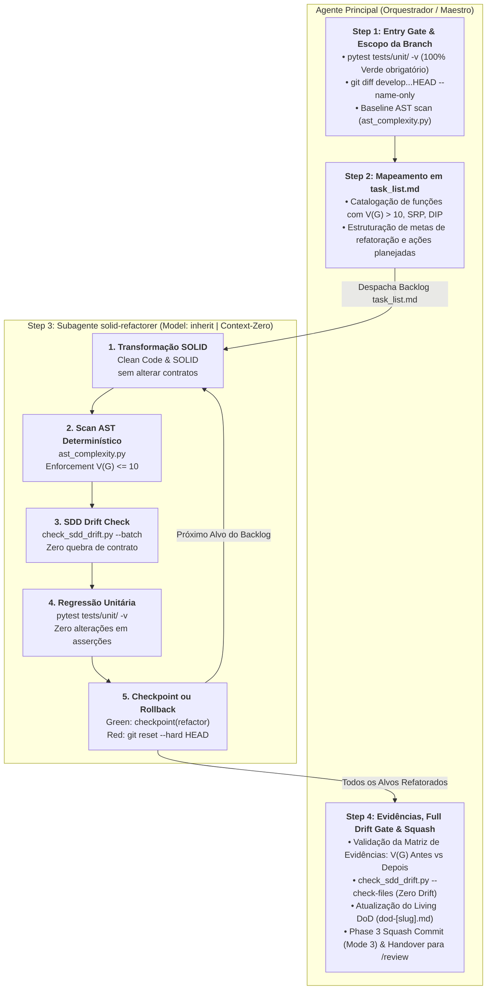

# Arquitetura da Skill `/refactor` (SDD 2.0 — Context-Isolated SOLID Refactoring & Drift Gate)

> [!IMPORTANT]
> **Documento Exclusivo de Engenharia e Manutenção da Skill `/refactor`:**
> Este documento reside em `doc/refactor/README.md` e detalha a especificação arquitetural da evolução da skill `/refactor` para o modelo SDD 2.0. Ele **não** é instalado em `~/.gemini/config/skills/` nem em `.agents/skills/`, garantindo **zero poluição de contexto** para o agente em produção.

---

## 1. O Problema Resolvido: Context Bloat por Scans Repetitivos, Regressões e Violação de Contratos SDD

Na refatoração macro tradicional conduzida no chat principal por um único agente:
1. **Poluição Progressiva da Janela de Contexto (*Context Bloat* por Ciclos Iterativos):** Ao iterar sobre 5 a 10 funções em múltiplos módulos, rodar `pytest -v` e executáveis de análise estática repetidamente satura a conversa com milhares de linhas de logs de teste e diffs provisórios, degradando a atenção do modelo.
2. **Spec Drift Silencioso em Refatorações Macro:** Ao aplicar princípios SOLID (como segregação de interfaces ou inversão de dependência), agentes frequentemente renomeiam métodos públicos, extraem classes auxiliares tornando as originais obsoletas ou alteram assinaturas previamente seladas no SDD (`01-concepcao/sdd-[slug].md`).
3. **Tentação de Enfraquecer Testes (*Assertion Tampering*):** Sem barreiras rígidas, agentes que encontram testes quebrando após uma refatoração tentam "consertar" o teste alterando asserções, violando a regra máxima de invariância comportamental.
4. **Falta de Métricas Objetivas de Complexidade:** Refatorações eram guiadas por impressões estéticas subjetivas, sem aferição matemática da complexidade ciclomática de McCabe ou detecção de ineficiências assintóticas ($O(N^2)$).

---

## 2. Nova Arquitetura: Orquestrador + Subagente `solid-refactorer` (`Model: "inherit"`) + Drift Gate + AST Complexity

A skill `/refactor` estrutura a macro-refatoração em uma esteira protegida por invariantes:
- **Agente Principal (Orquestrador):** Valida o Entry Gate (100% dos testes verdes no Step 1), descobre os arquivos modificados na branch (`git diff develop...HEAD --name-only`), executa o scan baseline de complexidade, mapeia as oportunidades em `task_list.md` (Step 2), e no Step 4 consolida a Matriz de Evidências, executa o Drift Gate completo, atualiza o Living DoD e sela a fase com o *Phase Squash Commit*.
- **Subagente `solid-refactorer` (`Model: "inherit"`, Step 3):** Executa o ciclo cirúrgico de transformação em sessão isolada: aplica padrões SOLID/Clean Code, reexecuta o validador AST exigindo $V(G) \le 10$, roda o Drift Gate determinístico (`check_sdd_drift.py --batch`), roda a suíte de regressão, grava micro-checkpoints para cada alvo verde ou executa rollback imediato (`git reset --hard HEAD`) se qualquer teste falhar.



---

## 3. Matriz de Responsabilidades dos Agentes

| Etapa | Responsável | Modelo (`invoke_subagent`) | Permissão de Escrita | Insumos Recebidos | Entregável |
| :--- | :--- | :---: | :--- | :--- | :--- |
| **Step 1: Entry Gate & Scope Discovery** | **Orquestrador Principal** | Sessão Ativa | Somente Leitura / CLI | Repositório na branch ativa, `develop...HEAD`. | Confirmação de 100% dos testes verdes + verificação de cobertura (`pytest --cov=<target_files>`, alerta se < 80% em alvos $V(G)>10$), lista de arquivos do diff e relatório baseline de complexidade. |
| **Step 2: Mapeamento de Oportunidades** | **Orquestrador Principal** | Sessão Ativa | Escrita em `task_list.md` | Relatório baseline de complexidade + [`solid-catalog.md`](../../skills/refactor/references/solid-catalog.md). | `task_list.md` preenchido com alvos cirúrgicos, smells identificados e transformações planejadas. |
| **Step 3: Loop de Refatoração Cirúrgica** | **Subagente `solid-refactorer`** | `Model: "inherit"` | `EnableWriteTools: true` *(restrito a `src/` e `task_list.md`; proibido alterar `tests/`)* | `task_list.md`, `01-concepcao/sdd-[slug].md`, `solid-catalog.md` e código-fonte. | Código refatorado (Zero Novas Dependências Externas — apenas stdlib/manifesto; `MaxIterations: 2` por alvo), zero quebra de contratos, $V(G) \le 10$, micro-checkpoints no git e Matriz de Evidências consolidada. |
| **Step 4: Validação Final, Tampering Gate, Drift Gate & Squash** | **Orquestrador Principal** | Sessão Ativa | CLI + `@obsidian` + Git | Matriz de Evidências entregue pelo `solid-refactorer`, `01-concepcao/dod-[slug].md`. | Auditoria determinística contra adulteração de testes (`git diff --exit-code <PHASE_START_HASH>...HEAD -- tests/`), validação com `check_sdd_drift.py --check-files`, DoD atualizado, Phase Squash Commit e recomendação de `/review`. |

---

## 4. Os Guardiões Determinísticos: Complexidade AST, SDD Drift Gate e Test Tampering Gate

A refatoração no SDD 2.0 não depende de opiniões abstratas; ela é blindada por ferramentas CLI determinísticas:

### 4.1. Analisador AST de Complexidade Ciclomática (`ast_complexity.py`)
Localizado em [`skills/refactor/scripts/ast_complexity.py`](../../skills/refactor/scripts/ast_complexity.py), o script analisa a Árvore Sintática Abstrata (AST) do Python:
- **Teto Rigoroso e Bloqueante de Complexidade (`[REF-ASI06-01]`):** Nenhuma função ou método pode ultrapassar $V(G) \le 10$. O script retorna obrigatoriamente `exit 1` sempre que houver funções acima do threshold ou erros de parsing (sem flag `--exit-zero` de bypass).
- **Detecção de Gargalos Assintóticos:** Emite alertas para laços aninhados ($O(N^2)$) e operações lineares de pertinência (`item in list`) dentro de loops.

### 4.2. O Guardião de Contratos SDD (`check_sdd_drift.py`)
Localizado em [`skills/implement/scripts/check_sdd_drift.py`](../../skills/implement/scripts/check_sdd_drift.py):
- **Preservação Comportamental Estrita (Invariante #2):** Refatorar significa mudar a estrutura interna sem alterar o comportamento observável. O script valida que todas as classes, interfaces, métodos públicos e exceções mapeadas no `01-concepcao/sdd-[slug].md` continuam existindo e com as assinaturas idênticas.
- **Execução em Dois Modos:**
  - *Modo Alvo (`--batch`):* Executado pelo `solid-refactorer` logo após cada refatoração individual.
  - *Modo Exit Gate Completo (`--check-files`):* Executado pelo Orquestrador no Step 4 para assegurar integridade global da feature.

### 4.3. Gate Determinístico Contra Adulteração de Testes (`[REF-ASI02-01]`)
No Step 4 (Verify), antes de executar o *Phase Squash Commit*, o Orquestrador executa obrigatoriamente:
```bash
git diff --exit-code <PHASE_START_HASH>...HEAD -- tests/
```
Se o código de saída for diferente de zero (qualquer arquivo de teste modificado, excluído ou enfraquecido durante a refatoração), a Fase 3 é imediatamente **ABORTADA** e as modificações em `tests/` são revertidas.

---

## 5. Governança Git Flow & Guardrails OWASP (2026)

A manipulação do histórico git e da cadeia de suprimentos em `/refactor` segue modos operacionais estritos:
1. **Zero-Regression Safe Rollback (`[REF-LLM03-01]`, Mode 4):** Se qualquer transformação introduzir falha em testes unitários ou violação de contrato e atingir a **Regra do Double-Strike** (`MaxIterations: 2` por alvo, `[REF-ASI08-01]`), o rollback é precedido por um stash de segurança para nunca destruir arquivos não rastreados do desenvolvedor:
   ```bash
   git stash push -u -m "antigravity-refactor-safety-rollback"
   git reset --hard <target_start_hash>
   ```
2. **Zero Novas Dependências Externas (`[REF-LLM04-01]`):** Durante a refatoração SOLID, é estritamente proibido introduzir pacotes externos não declarados no manifesto do projeto (`pyproject.toml` / `requirements.txt`). Padrões como DIP, ISP e Strategy devem utilizar exclusivamente a biblioteca padrão do Python (`typing.Protocol`, `dataclasses`, `abc`, `functools`, `enum`), prevenindo *Slopsquatting*.
3. **Micro-Checkpoints Atômicos (Mode 2):** A cada alvo refatorado com testes 100% verdes, $V(G) \le 10$ e drift zero, registra-se um micro-commit:
   ```bash
   git commit -m "checkpoint(refactor): [target] - [action applied]"
   ```
4. **Consolidação em Phase Squash Commit (Mode 3):** No Step 5, após aprovação no Tampering Gate, AST Gate e Drift Gate, todos os micro-checkpoints intermediários são condensados em um único commit semântico limpo para a Fase 3:
   ```bash
   git reset --soft <PHASE_START_HASH>
   git commit -m "refactor(consolidation): apply Clean Code and SOLID for [slug]"
   ```
