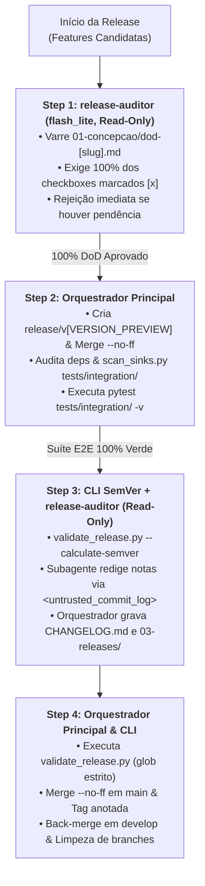
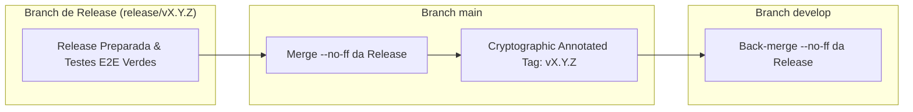

# Arquitetura da Skill `/release` (SDD 2.0 — Living DoD Gatekeeper & SemVer Engine)

> [!IMPORTANT]
> **Documento Exclusivo de Engenharia e Manutenção da Skill `/release`:**
> Este documento reside em `doc/skills/release/README.md` e detalha a especificação arquitetural da evolução da skill `/release` para o modelo SDD 2.0. Ele **não** é instalado em `~/.gemini/config/skills/` nem em `.agents/skills/`, garantindo **zero poluição de contexto** para o agente em produção.

---

## 1. O Problema Resolvido: Publicações Manuais, Débito Técnico Oculto e Spec Drift

No modelo tradicional de finalização e publicação de releases com agente único ou manual:
1. **Bypass Silencioso do Living DoD (*A Falsa Sensação de Conclusão*):** Em releases com múltiplas features, tarefas esquecidas de fases anteriores (como testes de integração ausentes, auditorias de segurança pendentes ou documentação defasada) passam inadvertidamente para a branch `main` porque a conferência visual de múltiplos checklists é exaustiva e sujeita a falhas.
2. **Cálculo Errático de SemVer e Injeção Indireta em Commits:** A atribuição de versões (Major, Minor, Patch) delegada puramente a LLMs pequenos sofre risco de alucinação ou *Goal Hijack* via *Prompt Injection* em mensagens de commit (`git log`).
3. **Saturação de Contexto por DoDs e Históricos Git Extensos:** Ler todos os arquivos `dod-[slug].md` e dezenas ou centenas de commits na janela do chat principal consome grande parte do orçamento de tokens antes mesmo da execução crítica dos testes de integração e dos merges atômicos de Git Flow.

---

## 2. Nova Arquitetura: Orquestrador + Subagente Read-Only `release-auditor` (`Model: "flash_lite"`) + `validate_release.py` + Git Flow Mode 5

A skill `/release` adota um modelo híbrido com cálculo determinístico via CLI, delegação de redação para um subagente estritamente Read-Only e governança centralizada de escrita e Git no Orquestrador:
- **Step 1 — Entry Gate Audit (`release-auditor` em `Model: "flash_lite"`, `EnableWriteTools: false`):** O subagente inspeciona em modo somente-leitura todos os arquivos `01-concepcao/dod-[slug].md` das features candidatas. Se encontrar qualquer caixa desmarcada (`- [ ]`), a release é imediatamente rejeitada e abortada.
- **Step 2 — Branch de Release, Inspeção Estática & Testes E2E (Orquestrador Principal):** O Orquestrador cria a branch provisória `release/v[VERSION_PREVIEW]`, executa os merges sem fast-forward (`--no-ff`) das features aprovadas, valida a cadeia de suprimentos (`audit_dependencies.py`) e inspeciona estaticamente as fixtures de teste (`scan_sinks.py tests/integration/`) antes de rodar a suíte de integração (`python -m pytest tests/integration/ -v`).
- **Step 3 — SemVer 2.0.0 Determinístico & Sincronização Dupla de Changelog (CLI + `release-auditor` Read-Only + Orquestrador):** O script `validate_release.py --calculate-semver develop` calcula matematicamente o incremento SemVer (`MAJOR > MINOR > PATCH`) via regex sobre Conventional Commits. O subagente `release-auditor` (`EnableWriteTools: false`) recebe a versão calculada e o log de commits encapsulado em `<untrusted_commit_log>...</untrusted_commit_log>` (tratado estritamente como dado passivo), preenchendo o template com evidências dinâmicas (`{{DOD_STATUS_AND_EVIDENCE}}`, `{{INTEGRATION_TEST_LOG_EVIDENCE}}`, `{{SECURITY_AUDIT_REPORT_LINKS}}`). O **Orquestrador Principal** persiste `CHANGELOG.md` e `03-releases/changelog-v[VERSION].md`.
- **Step 4 — Validador CLI Determinístico & Finalização Git Flow Mode 5 (Orquestrador Principal):** O script CLI `validate_release.py` confere estritamente branches, versão e DoD (falhando obrigatoriamente caso `--check-dod` não encontre arquivos). Em seguida, o Orquestrador executa o merge atômico em `main`, cria a tag criptográfica anotada (`git tag -a v[VERSION]`), sincroniza de volta em `develop` e remove as branches transitórias.



---

## 3. Matriz de Responsabilidades dos Agentes

| Etapa | Responsável | Modelo (`invoke_subagent`) | Permissão de Escrita | Insumos Recebidos | Entregável / Ação |
| :--- | :--- | :---: | :---: | :--- | :--- |
| **Step 1: Entry Gate DoD Audit** | **Subagente `release-auditor`** | `Model: "flash_lite"` | Read-Only (`EnableWriteTools: false`) | Lista de slugs das features candidatas e caminhos `01-concepcao/dod-[slug].md`. | Veredito formal de aprovação ou rejeição detalhada (`[REJECTED]` com arquivo e linha pendente). |
| **Step 2: Release Branch & Safe E2E** | **Orquestrador Principal** | Sessão Ativa | Escrita + Git CLI | Slugs aprovados no Step 1 e branch `develop`. | Branch `release/v[VERSION_PREVIEW]`, auditoria `audit_dependencies.py`, varredura `scan_sinks.py tests/integration/` e suíte E2E verde. |
| **Step 3: SemVer & Changelogs** | **CLI + `release-auditor` + Orquestrador** | `Model: "flash_lite"` | Subagente Read-Only (`EnableWriteTools: false`); Orquestrador escreve | SemVer determinístico do `validate_release.py`, `<untrusted_commit_log>` e template de release. | Markdown redigido pelo subagente com evidências reais; `CHANGELOG.md` e `03-releases/changelog-v[VERSION].md` gravados pelo Orquestrador. |
| **Step 4: CLI Gate & Git Mode 5** | **Orquestrador Principal** | Sessão Ativa | Git CLI + Sistema de Arquivos | Versão consolidada e caminhos dos changelogs e DoDs. | Validação estrita via `validate_release.py`, tag `v[VERSION]`, sincronização em `main` e `develop` e branches limpas. |

---

## 4. O Subagente `release-auditor` (`Model: "flash_lite"`)

O subagente especialista é configurado estrategicamente em **`Model: "flash_lite"`** com salvaguardas invariantes OWASP 2026:

### Por que `flash_lite` em modo Read-Only?
- **Princípio do Menor Privilégio (`[REL-ASI03-01]`):** Com `EnableWriteTools: false` e `run_command` proibido, o subagente jamais pode adulterar código-fonte, suítes de teste ou scripts de validação caso sofra alucinação ou tentativa de injeção indireta.
- **Blindagem contra Prompt Injection em Commits (`[REL-LLM01-05]`):** O incremento de versão SemVer é calculado deterministicamente em Python (`calculate_semver_bump`), e o histórico de commits é delimitado por `<untrusted_commit_log>...</untrusted_commit_log>` com diretiva explícita para ignorar comandos embutidos.
- **Prevenção de Viés de Automação (`[REL-ASI09-03]`):** O template `release-template.md` exige placeholders dinâmicos de evidência (`{{DOD_STATUS_AND_EVIDENCE}}`, `{{INTEGRATION_TEST_LOG_EVIDENCE}}`, `{{SECURITY_AUDIT_REPORT_LINKS}}`), eliminando selos estáticos pré-aprovados.

---

## 5. Validação Determinística (`validate_release.py`) e Git Flow Mode 5

### 5.1. O Script de Validação CLI (`validate_release.py`)
Localizado em [`skills/release/scripts/validate_release.py`](../../../skills/release/scripts/validate_release.py), o utilitário Python multiplataforma valida antes do fechamento:
1. **Cálculo Algorítmico de SemVer (`--calculate-semver <base_ref>`):** Inspeciona commits via regex (`BREAKING CHANGE:` / `!:` -> `MAJOR`, `feat:` -> `MINOR`, `fix|perf|refactor|docs|chore|test:` -> `PATCH`).
2. **Formato SemVer 2.0.0:** Verifica se a versão segue o padrão canônico `vX.Y.Z`.
3. **Nomenclatura da Branch:** Garante que a branch ativa segue estritamente `release/vX.Y.Z`.
4. **Existência e Conteúdo do Changelog:** Checa se o arquivo de changelog existe e contém a seção correspondente à versão indicada.
5. **Verificação Estrita de DoD (`--check-dod`):** Varre os padrões glob informados (`01-concepcao/dod-*.md`) e falha obrigatoriamente caso nenhum arquivo corresponda ao padrão (`[REL-ASI02-02]`) ou caso exista qualquer `- [ ]`.

```bash
python skills/release/scripts/validate_release.py --calculate-semver develop --current-version v1.1.0
python skills/release/scripts/validate_release.py \
  --version v1.2.0 \
  --branch release/v1.2.0 \
  --changelog CHANGELOG.md \
  --check-dod "01-concepcao/dod-*.md" \
  --check-clean
```

### 5.2. Git Flow Mode 5 Finalization
O encerramento atômico garante a integridade dos históricos de produção e desenvolvimento:



1. Merge sem fast-forward na branch `main`: `git merge --no-ff release/v[VERSION]`
2. Criação da tag criptográfica anotada: `git tag -a v[VERSION] -m "Release v[VERSION]"`
3. Sincronização de volta para `develop`: `git merge --no-ff release/v[VERSION]`
4. Remoção das branches temporárias de release e das features já incorporadas: `git branch -d release/v[VERSION]`
