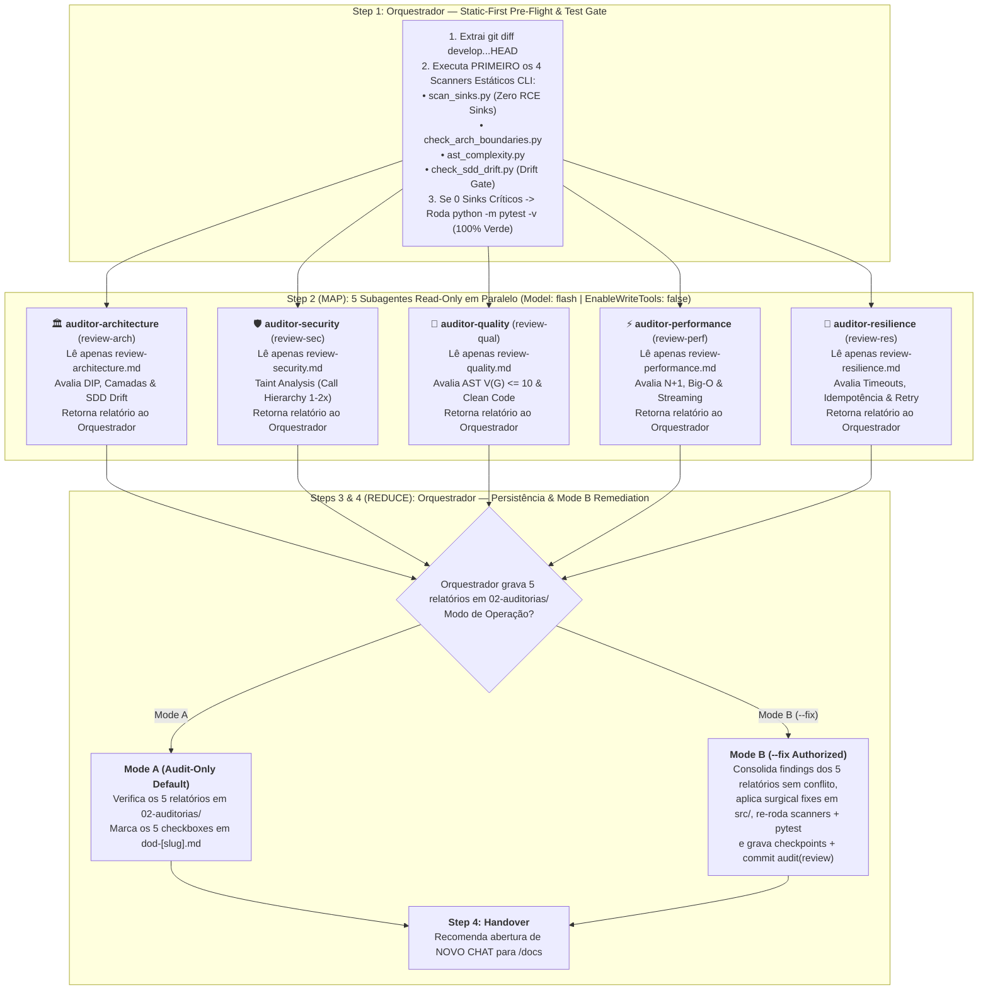

# Arquitetura da Skill `/review` (SDD 2.0 — 5-Domain Parallel Map-Reduce)

> [!IMPORTANT]
> **Documento Exclusivo de Engenharia e Manutenção da Skill `/review`:**
> Este documento reside em `doc/review/README.md` e detalha a especificação arquitetural da evolução da skill `/review` para o modelo SDD 2.0 Map-Reduce. Ele **não** é instalado em `~/.gemini/config/skills/` nem em `.agents/skills/`, garantindo **zero poluição de contexto** para o agente em produção.

---

## 1. O Problema Resolvido: Fadiga de Atenção Sequencial e Conflito de Escrita

Na revisão tradicional de 5 domínios executada em série por um único agente (`Architecture -> Security -> Quality -> Performance -> Resilience`):
1. **Degradação *Lost-in-the-Middle*:** Ao chegar nos domínios 4 (Performance) e 5 (Resilience), a janela de contexto do agente já está saturada com 3 manuais de referência anteriores, outputs de scanners e 3 relatórios completos gerados, reduzindo a profundidade analítica nos últimos domínios.
2. **Desperdício de Tokens de Referência e Latência 5x Maior:** Mesmo no modo padrão (*Mode A — Audit-Only*), onde os 5 relatórios são totalmente independentes, o usuário aguardava 5 ciclos sequenciais.
3. **Risco de *Race Condition* em Arquivos no Mode B (`--fix`):** Se 5 subagentes paralelos editassem o mesmo arquivo `.py` simultaneamente para corrigir achados de diferentes domínios, sobrescreveriam o código uns dos outros.

---

## 2. Nova Arquitetura: Map-Reduce com 5 Subagentes Paralelos (`Model: "flash"`) + Drift Gate

A skill `/review` adota o padrão **Map-Reduce Arquitetural**:
- **Pre-Flight (Orquestrador — Static-First `[REV-ASI05-01]`):** Extrai o `git diff develop...HEAD`, executa **PRIMEIRO os 4 scanners estáticos determinísticos** (`scan_sinks.py`, `check_arch_boundaries.py`, `ast_complexity.py`, `check_sdd_drift.py`) e **SOMENTE DEPOIS** valida a suíte de testes (`python -m pytest -v`). *Racional de Segurança (`[REV-ASI05-01]`):* a análise estática de AST e sinks perigosos deve aprovar o código (zero sinks críticos de RCE/command injection no diff) antes de importar e executar código dinâmico ou fixtures `conftest.py` via `pytest`.
- **Fase MAP (5 Subagentes `Model: "flash"` 100% em Paralelo — Read-Only `[REV-ASI03-02]`):** No mesmo turno, o Orquestrador dispara os 5 auditores especialistas (`review-arch`, `review-sec`, `review-qual`, `review-perf`, `review-res`) com `EnableWriteTools: false`. Cada auditor carrega **apenas o guia do seu domínio** (`references/review-[domain].md`), inspeciona o diff delimitado por `<untrusted_diff>...</untrusted_diff>` (tratando todo código e comentários como dados não confiáveis contra Prompt Injection `[REV-LLM01-03]`) e retorna seu relatório Markdown estruturado ao Orquestrador, **sem poder modificar nenhum arquivo em disco**.
- **Fase REDUCE (Orquestrador):** O Orquestrador principal grava fisicamente os 5 relatórios em `02-auditorias/audit-[domain]-[slug].md`, atualiza o Living DoD e, caso esteja em **Mode B (`--fix`)**, aplica as correções cirúrgicas de forma centralizada e livre de conflitos de concorrência.

---

## 3. Matriz de Responsabilidades dos Agentes

| Etapa / Agente | Modelo (`invoke_subagent`) | Guia Carregado (Isolamento de Contexto) | Scanner Base Recebido | Arquivo Gerado / Ação |
| :--- | :---: | :--- | :--- | :--- |
| **Step 1: Orquestrador (Pre-Flight)** | Sessão Ativa | `SKILL.md` | 1º: 4 scripts estáticos CLI; 2º: `pytest -v` | Diff unificado (`<untrusted_diff>`) e logs dos 4 scanners prontos para despacho. |
| **2.1 `auditor-architecture` (`review-arch`)** | `Model: "flash"` (`EnableWriteTools: false`) | [`review-architecture.md`](../../skills/review/references/review-architecture.md) | `check_arch_boundaries.py` + `check_sdd_drift.py` | Retorna Markdown; Orquestrador grava `02-auditorias/audit-architecture-[slug].md`. |
| **2.2 `auditor-security` (`review-sec`)** | `Model: "flash"` (`EnableWriteTools: false`) | [`review-security.md`](../../skills/review/references/review-security.md) | `scan_sinks.py` | Retorna Markdown; Orquestrador grava `02-auditorias/audit-security-[slug].md`. |
| **2.3 `auditor-quality` (`review-qual`)** | `Model: "flash"` (`EnableWriteTools: false`) | [`review-quality.md`](../../skills/review/references/review-quality.md) | `ast_complexity.py` ($V(G) \le 10$) | Retorna Markdown; Orquestrador grava `02-auditorias/audit-quality-[slug].md`. |
| **2.4 `auditor-performance` (`review-perf`)** | `Model: "flash"` (`EnableWriteTools: false`) | [`review-performance.md`](../../skills/review/references/review-performance.md) | `ast_complexity.py` (Heurísticas Big-O) | Retorna Markdown; Orquestrador grava `02-auditorias/audit-performance-[slug].md`. |
| **2.5 `auditor-resilience` (`review-res`)** | `Model: "flash"` (`EnableWriteTools: false`) | [`review-resilience.md`](../../skills/review/references/review-resilience.md) | Contratos de erro/timeout do SDD | Retorna Markdown; Orquestrador grava `02-auditorias/audit-resilience-[slug].md`. |
| **Step 3 & 4: Orquestrador (Reduce)** | Sessão Ativa | `SKILL.md` | 5 relatórios de auditoria retornados | Grava `02-auditorias/audit-*.md`, atualiza `dod-[slug].md`; se Mode B (`--fix`), aplica fixes cirúrgicos e roda scanners + `pytest -v`. |
