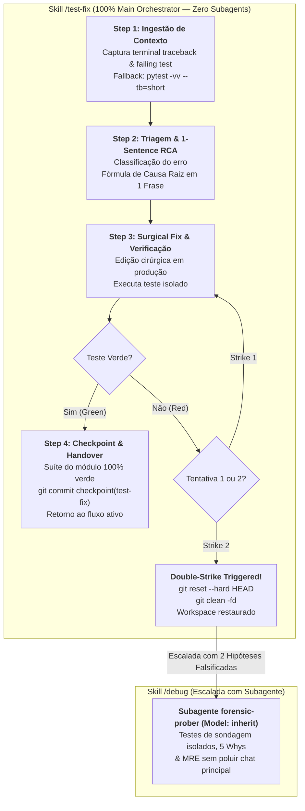

# Arquitetura da Skill `/test-fix` (Reactive Debugger — Direct Orchestrator Execution)

> [!IMPORTANT]
> **Documento Exclusivo de Engenharia e Manutenção da Skill `/test-fix`:**
> Este documento reside em `doc/test-fix/README.md` e detalha a especificação arquitetural, pipeline e guardrails da skill `/test-fix`. Ele **não** é instalado em `~/.gemini/config/skills/` nem em `.agents/skills/`, garantindo **zero poluição de contexto** para o agente em produção.

---

## 1. O Problema Resolvido: Correção Reativa Rápida vs. Investigação Forense Profunda

Durante os ciclos de TDD (`/implement`), refatoração (`/refactor`) ou remediação de revisões (`/review`), falhas de teste unitário ocorrem com alta frequência. Tratar toda falha de teste com um processo pesado de depuração forense gera:
1. **Sobrecarga de Boot Tokens e Latência Desnecessária:** Instanciar subagentes para ajustar uma tipagem incompatível ou um import faltante consome entre 3.000 e 8.000 tokens de inicialização (*system prompts*, ferramentas e esquemas) e introduz atraso perceptível de *cold start*.
2. **Proliferação de Tentativas Cegas (*Context Poisoning*):** Sem uma disciplina estrita de parada, agentes tendem a fazer sucessivas alterações aleatórias no código, acumulando *diffs* confusos e mascarando o defeito real.
3. **Violação da Inviolabilidade dos Testes:** Agentes frequentemente caem na armadilha de afrouxar asserções (`assert True`, remoção de *checks*) para "fazer o teste passar", em vez de corrigir o código de produção.

A skill **`/test-fix`** resolve isso atuando como o **Depurador Reativo Cirúrgico**: diagnostica falhas a partir de *stack traces* de terminal, isola a causa raiz em exatamente uma frase, aplica correções mínimas estritamente no código de produção e possui uma regra matemática de corte (a **Regra do Double-Strike**).

---

## 2. Decisão Arquitetural: Execução 100% no Orquestrador Principal (Zero Subagents)

Diferente de skills complexas como `/plan` (Conselho Goldfish), `/review` (5 auditores Map-Reduce) e `/debug` (`forensic-prober`), a skill `/test-fix` opera **100% no Orquestrador Principal, sem instanciar subagentes**.

### Justificativa de Engenharia de Contexto:
- **Zero Boot Token Overhead:** Elimina o custo de boot (3k–8k tokens) que seria desperdiçado para correções de 1 a 5 linhas de código.
- **Latência Ultrabaixa:** Execução direta de comandos no terminal e edição cirúrgica em um único turno, essencial para manter o ritmo ágil do loop Red-Green-Blue do TDD.
- **Delimitação de Responsabilidade (`/test-fix` vs. `/debug`):**
  - **`/test-fix` (Orquestrador Direto):** Destinado a falhas determinísticas e pontuais com *traceback* claro (ex.: `TypeError`, `KeyError`, `ImportError`, erro de lógica simples). Limite de 2 tentativas.
  - **`/debug` (Subagente `forensic-prober`):** Acionado quando o problema envolve concorrência, *race conditions*, vazamentos de memória ou falhas que resistiram ao `/test-fix`. O subagente absorve centenas de linhas de logs de testes de sondagem (*probing tests*) e MREs (*Minimal Reproducible Examples*), blindando a conversa principal contra poluição de contexto.



---

## 3. Matriz Operacional da Skill `/test-fix`

| Propriedade | Diretriz Arquitetural |
| :--- | :--- |
| **Ambiente de Execução** | **Orquestrador Principal (Sessão Ativa)** |
| **Uso de Subagentes** | **Nenhum (0 subagentes)** para evitar *boot overhead* e latência |
| **Permissão de Escrita** | Estritamente arquivos de produção modificados pela falha |
| **Inviolabilidade de Testes** | Modificações em asserções de testes existentes são estritamente proibidas |
| **Formato da Causa Raiz** | **1 Frase Canônica:** `[Categoria]: [Componente] falha porque [mecanismo], resultando em [falha].` |
| **Teto de Tentativas** | Máximo de **2 tentativas (Double-Strike Rule)** |
| **Ação pós-Double-Strike** | `git reset --hard HEAD` + `git clean -fd` e escalada documentada para `/debug` |
| **Micro-Checkpoint** | `checkpoint(test-fix): surgical fix for [concise description]` |

---

## 4. O Protocolo em 4 Passos

### 4.1. Step 1: Context Resolution & Traceback Ingestion
- Valida o estado do workspace com `git status --short`.
- Captura o identificador do teste (`test_file.py::test_name`), a classe da exceção e o frame inferior do *stack trace*.
- Se o *traceback* fornecido pelo usuário estiver truncado, reexecuta o teste imediatamente com flags detalhadas:
  ```bash
  python -m pytest path/to/test_file.py -k test_name -vv --tb=short
  ```
- Consulta contratos arquiteturais no Obsidian Vault via `@obsidian` (`type: sdd`, `feature: [slug]`) se aplicável.

### 4.2. Step 2: Traceback Triage & 1-Sentence RCA
O defeito é classificado em uma das 4 categorias da Matriz de Triagem:
- **Type Mismatch / Signature Error:** Tipos incompatíveis em chamadas de fronteira ou ausência de conversão.
- **Missing Import / Name Resolution:** Identificador inexistente ou import circular/quebrado.
- **Logic / Calculation Defect:** Desvio condicional incorreto, *off-by-one* ou cálculo inválido de retorno.
- **Mock / Fixture Misconfiguration:** Atributo de mock faltante, retorno divergente ou vazamento de estado em fixtures.

A causa raiz é formulada e declarada em **exatamente uma frase**:
> **Root Cause:** `[Error Category]: [Component/Function] fails because [exact defect mechanism], resulting in [observed failure].`

### 4.3. Step 3: Surgical Production Code Fix & Isolated Verification
- Aplica a edição estritamente nas linhas causadoras da falha no código de produção.
- Executa imediatamente o teste-alvo de forma isolada:
  ```bash
  python -m pytest path/to/test_file.py -k test_name -v
  ```
- **Avaliação do Double-Strike:**
  - *Verde:* Avança imediatamente para o Step 4.
  - *Strike 1 (Falha na 1ª tentativa):* Analisa o novo erro, ajusta a hipótese e tenta uma segunda edição pontual.
  - *Strike 2 (Falha na 2ª tentativa):* **Aborto imediato.** Executa reversão automática:
    ```bash
    git reset --hard HEAD
    git clean -fd
    ```
    Emite relatório de escalada com o teste reprodutor e as duas hipóteses falsificadas, transferindo o problema para a skill `/debug`.

### 4.4. Step 4: Checkpoint & Handover
- Executa a suíte completa do módulo (`pytest path/to/test_file.py -v`) para garantir ausência de regressões colaterais.
- Cria o micro-checkpoint Git:
  ```bash
  git add path/to/modified_file.py
  git commit -m "checkpoint(test-fix): surgical fix for [falha]"
  ```
- Emite handover para retorno ao fluxo ativo (`/implement`, `/refactor` ou `/review`).

---

## 5. Referências e Recursos Acoplados

- [`resources/diagnostic-report-template.md`](../../skills/test-fix/resources/diagnostic-report-template.md) — Modelo de relatório de diagnóstico estruturado com RCA em 1 frase.
- [`references/test-fix-protocol.md`](../../skills/test-fix/references/test-fix-protocol.md) — Protocolo operacional aprofundado e matriz de classificação.
- [`examples/test-fix-example.md`](../../skills/test-fix/examples/test-fix-example.md) — Exemplo prático de diagnóstico e remediação cirúrgica de um `TypeError`.
