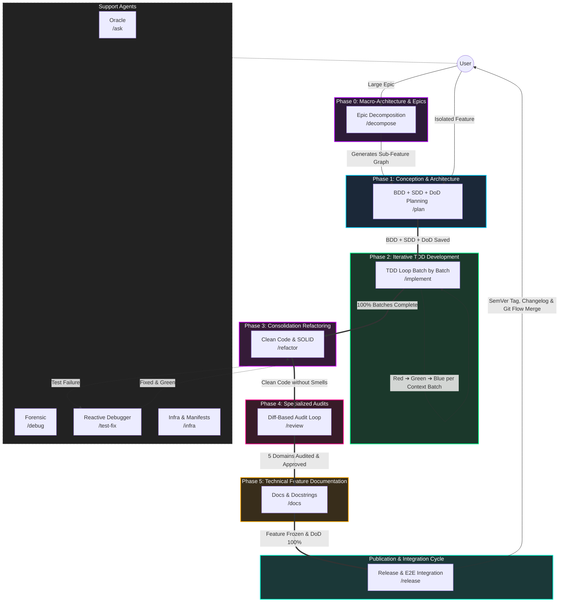

# Agent & Skill Architecture: Antigravity IDE

The operational intelligence of the **Antigravity IDE** is grounded in strict separation of concerns (*Single Responsibility Principle - SRP*) and *Outcome-Based Prompting*. Instead of monolithic prompts vulnerable to hallucinations and context exhaustion, the architecture organizes the software engineering lifecycle into:

1. **Phase 0 (Macro-Architecture):** Evolutionary decomposition of epics into monotonic sub-features via `/decompose`.
2. **Feature Lifecycle (5 Phases in Ephemeral Chats):** Conception $\rightarrow$ TDD $\rightarrow$ Refactoring $\rightarrow$ Audits $\rightarrow$ Documentation.
3. **Publication Cycle (Release Pipeline):** E2E integration tests, SemVer calculation, Changelog generation, and Git Flow via `/release`.

---

## 🔀 Self-Sufficient Agent Skills Architecture

Under **Google Antigravity 2.0** and the open [Agent Skills specification](https://agentskills.io/home), the ecosystem is organized into self-sufficient skill bundles (`skills/<name>/`) rather than disconnected single-file workflows:

1. **Autonomous Skill Bundles (`skills/`)**: Each slash command corresponds to an autonomous skill package containing its execution orchestrator (`SKILL.md`), contextual reference guides (`references/`), document templates (`resources/`), executable validation scripts (`scripts/`), and concrete examples (`examples/`).
2. **Progressive Context Loading**: Lightweight metadata (`name`, `description`) is indexed upfront in the agent's context. Detailed operational guidelines, scripts, and schemas are read only on-demand when the skill is activated.
3. **Living Execution Log & DoD (`01-concepcao/dod-[slug].md`)**: Dynamic document centralizing development timeline history and Definition of Done (DoD) criteria for functional, non-functional, audit, and release validation.
4. **Worktree & Branch Lifecycle Governance**: Every feature runs in an isolated branch (`feature/[slug]`) or ephemeral git worktree. Upon completion and merge into the base branch (`develop`/`main`), the worktree and branch are cleanly pruned.

---

## 🗺️ Complete Antigravity Ecosystem Map

---

## 🎯 Phase & Workflow Deep Dive

### 1. Phase 0: Macro-Architecture & Epics ([`/decompose`](agentes/decompose.md))
When an architectural epic is too complex to fit safely into a single feature branch, `/decompose` aligns the core problem (*Outcome-Based*) and breaks scope down into an ordered roadmap of monotonic vertical sub-features (contracts first, zero destructive rework). Persists `01-concepcao/epic-[slug].md`.
* **Skill Package:** [`skills/decompose`](../skills/decompose/SKILL.md)
* **Operational Guides:** [`decompose-protocol.md`](../skills/decompose/references/decompose-protocol.md), [`task-template.md`](../skills/decompose/resources/task-template.md).

### 2. Phase 1: Conception & Architecture ([`/plan`](agentes/plan.md) - Chat 1)
Surgical scope discovery via Socratic interviewing (3-5 questions), Git Flow branch validation, pure Gherkin BDD behavioral specification, SDD architectural blueprint with typed contracts/mocks, and Living DoD initialization.
* **Skill Package:** [`skills/plan`](../skills/plan/SKILL.md)
* **Operational Guides:** [`plan-debate.md`](../skills/plan/references/plan-debate.md), [`plan-git.md`](../skills/plan/references/plan-git.md), [`plan-bdd.md`](../skills/plan/references/plan-bdd.md), [`plan-sdd.md`](../skills/plan/references/plan-sdd.md), [`plan-dod.md`](../skills/plan/references/plan-dod.md).
* **Validation Scripts:** [`validate_branch.py`](../skills/plan/scripts/validate_branch.py), [`validate_sdd_contracts.py`](../skills/plan/scripts/validate_sdd_contracts.py).

### 3. Phase 2: Iterative TDD Development ([`/implement`](agentes/implement.md) - Chat 2)
Executes the full TDD pipeline batch by batch (Red ➔ Green ➔ Blue). Each batch writes AAA unit tests (Red), implements minimal SOLID production code (Green), and conducts focused micro-refactoring (Blue), recording local checkpoints and updating the DoD timeline.
* **Skill Package:** [`skills/implement`](../skills/implement/SKILL.md)
* **Operational Guides:** [`tdd-test.md`](../skills/implement/references/tdd-test.md), [`tdd-code.md`](../skills/implement/references/tdd-code.md), [`tdd-refactor.md`](../skills/implement/references/tdd-refactor.md), [`tdd-dod.md`](../skills/implement/references/tdd-dod.md), [`tdd-git.md`](../skills/implement/references/tdd-git.md).

### 4. Phase 3: Consolidation Refactoring ([`/refactor`](agentes/refactor.md) - Chat 3)
Optimizes internal software design across the whole feature (*Make it Right*). Strictly restricted to files modified on the active branch (`git diff develop...HEAD`), eliminating cyclomatic complexity, long methods, and deep nesting through Guard Clauses and SOLID principles, keeping tests 100% green.
* **Skill Package:** [`skills/refactor`](../skills/refactor/SKILL.md)
* **Operational Guides:** [`solid-catalog.md`](../skills/refactor/references/solid-catalog.md), [`refactor-git.md`](../skills/refactor/references/refactor-git.md), [`refactor-dod.md`](../skills/refactor/references/refactor-dod.md).
* **Validation Scripts & Templates:** [`ast_complexity.py`](../skills/refactor/scripts/ast_complexity.py), [`refactor-report-template.md`](../skills/refactor/resources/refactor-report-template.md).

### 5. Phase 4: Specialized Audits ([`/review`](agentes/review.md) - Chat 4)
Iterative domain-specialized loop executed directly over the feature's `git diff` using a **Script-First** strategy and Call Hierarchy Taint Analysis, aligned with the [OWASP Code Review Guide v2](references/OWASP_Code_Review_Guide_v2.pdf):
1. **Architecture & Coupling:** [`review-architecture.md`](../skills/review/references/review-architecture.md) + [`check_arch_boundaries.py`](../skills/review/scripts/check_arch_boundaries.py)
2. **Security & OWASP:** [`review-security.md`](../skills/review/references/review-security.md) + [`scan_sinks.py`](../skills/review/scripts/scan_sinks.py)
3. **Quality & AST Complexity:** [`review-quality.md`](../skills/review/references/review-quality.md) + [`ast_complexity.py`](../skills/review/scripts/ast_complexity.py)
4. **Performance & Volumetrics:** [`review-performance.md`](../skills/review/references/review-performance.md)
5. **Resilience & Fault Tolerance:** [`review-resilience.md`](../skills/review/references/review-resilience.md)
* **Skill Package:** [`skills/review`](../skills/review/SKILL.md)
* **Audit Template:** [`audit-report-template.md`](../skills/review/resources/audit-report-template.md).

### 6. Phase 5: Technical Feature Documentation ([`/docs`](agentes/docs.md) - Chat 5)
Focuses strictly on technical documentation: updating module/root READMEs, adding docstrings with bidirectional links to the Obsidian Vault, marking the DoD, and committing semantically. The feature branch remains frozen and intact without premature merges.
* **Skill Package:** [`skills/docs`](../skills/docs/SKILL.md)
* **Operational Guides:** [`docs-guidelines.md`](../skills/docs/references/docs-guidelines.md), [`doc-template.md`](../skills/docs/resources/doc-template.md).

### 7. Publication Cycle: Integration & Release ([`/release`](agentes/release.md))
Orchestrates publication of a release on `release/vX.Y.Z` branched from `develop`. Audits 100% DoD completion across all candidate features, runs staged E2E integration test suites with formatted console banners, computes SemVer, generates `CHANGELOG.md`, and completes Git Flow with annotated tags and merges into `main` and `develop`.
* **Skill Package:** [`skills/release`](../skills/release/SKILL.md)
* **Operational Guides:** [`release-checklist.md`](../skills/release/references/release-checklist.md), [`release-template.md`](../skills/release/resources/release-template.md).
* **Validation Scripts:** [`validate_release.py`](../skills/release/scripts/validate_release.py).

---

## 🧰 [Modular Skills Catalog](skills/README.md)

Detailed guides, scripts, and procedures for all 12 Agent Skills:

| Category | Skill | Operational References & Tooling |
| :--- | :--- | :--- |
| **Conception & Slicing** | [`decompose`](skills/plan-decompose.md) | `skills/decompose/references/decompose-protocol.md`, `resources/task-template.md` |
| **Conception & Slicing** | [`plan`](skills/plan-debate.md) | `skills/plan/references/plan-*`, `resources/plan-template.md`, `scripts/validate_*.py` |
| **TDD Construction** | [`implement`](skills/tdd-plan.md) | `skills/implement/references/tdd-*`, `resources/*-template.py` |
| **TDD Construction** | [`test-fix`](skills/test-fix.md) | `skills/test-fix/references/test-fix-protocol.md`, `resources/diagnostic-report-template.md` |
| **Refactoring** | [`refactor`](skills/refactor.md) | `skills/refactor/references/solid-catalog.md`, `scripts/ast_complexity.py`, report template |
| **Specialized Audits** | [`review`](skills/review-security.md) | `skills/review/references/review-*`, boundary, sink, and AST complexity scripts |
| **Documentation & Delivery** | [`docs`](skills/docs.md) | `skills/docs/references/docs-guidelines.md`, `resources/doc-template.md` |
| **Documentation & Delivery** | [`release`](skills/release.md) | `skills/release/references/release-checklist.md`, `scripts/validate_release.py`, template |
| **Support & Diagnostics** | [`ask`](skills/ask.md) | `skills/ask/references/ask-sources.md` |
| **Support & Diagnostics** | [`debug`](skills/debug.md) | `skills/debug/references/debug-methodology.md`, `resources/rca-template.md` |
| **Support & Diagnostics** | [`infra`](skills/infra.md) | `skills/infra/references/infra-setup.md`, `scripts/validate_env.py`, `resources/env-template.md` |
| **Support & Diagnostics** | [`obsidian`](skills/obsidian.md) | `skills/obsidian/references/obsidian-protocol.md`, `resources/note-template.md` |
