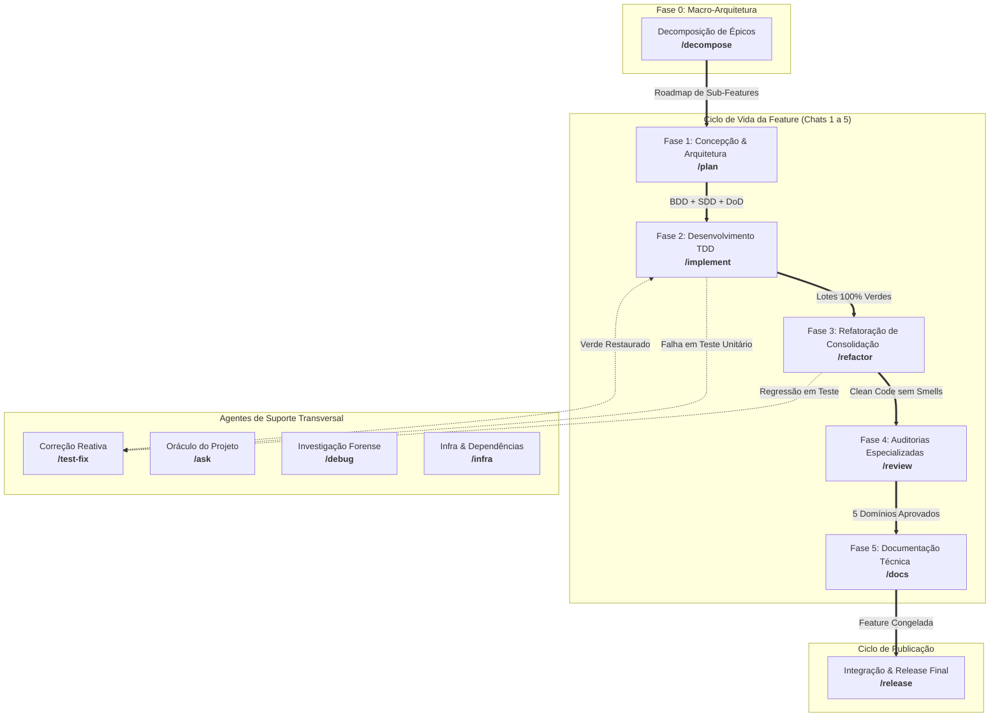

# Catálogo de Agentes e Workflows (`docs/agentes`)

Os **Agentes Orquestradores** atuam como os condutores do ciclo de desenvolvimento no **Antigravity IDE**. No padrão Antigravity 2.0 / `agentskills.io`, cada agente corresponde diretamente a uma **Skill Autossuficiente** em `skills/<nome>/` acionada via slash command no chat (ex: `/plan`, `/implement`, `/refactor`), encapsulando o pipeline de execução da fase, validações de qualidade (*Quality Gates*), referências cirúrgicas, templates e scripts automatizados.

---

## 🗺️ Mapa de Fases e Workflows

---

## 📋 Inventário Geral de Agentes

### 1. Protocolo Foundational
* [`core-gemini.md`](core-gemini.md): Protocolo da Antigravity Engine, Pair-Programming ativo, Status Banner inicial, Double-Strike Rule, governança de memória SSOT e limpeza de worktrees.

### 2. Ciclo de Vida da Feature (Fases 0 a 5)
* [`decompose.md`](decompose.md) — **`/decompose` (Fase 0):** Decomposição de macro-demandas em fatias verticais monotônicas com contratos e mocks primeiro.
* [`plan.md`](plan.md) — **`/plan` (Fase 1):** Concepção e arquitetura com debate Outcome-Based, Git Flow branch, especificação BDD, contratos SDD e inicialização do Living DoD.
* [`implement.md`](implement.md) — **`/implement` (Fase 2):** Desenvolvimento orientado a testes (TDD) em lotes de contexto, loop Red-Green-Blue (com micro-refatoração), micro-checkpoints e linha do tempo no DoD.
* [`refactor.md`](refactor.md) — **`/refactor` (Fase 3):** Refatoração de consolidação com Clean Code e SOLID, restrita ao `git diff`, análise de complexidade AST ($V(G) \le 10$) e rollback imediato.
* [`review.md`](review.md) — **`/review` (Fase 4):** Auditoria multidomínio Script-First em 5 óticas (Arquitetura, Segurança OWASP v2, Qualidade, Performance, Resiliência) com Taint Analysis e relatório pericial.
* [`docs.md`](docs.md) — **`/docs` (Fase 5):** Atualização de READMEs validados contra manifests, docstrings com rastreabilidade Obsidian e congelamento seguro da branch da feature.

### 3. Pipeline de Liberação
* [`release.md`](release.md) — **`/release`:** Portão de 100% DoD, suíte de integração e E2E em 9 estágios estruturados, bump de SemVer cumulativo, consolidação de `CHANGELOG.md` e merges de Git Flow em `main` e `develop`.

### 4. Suporte e Diagnósticos
* [`test-fix.md`](test-fix.md) — **`/test-fix`:** Depuração reativa para falhas de testes unitários ou integração, isolando causa raiz em 1 frase e aplicando correções cirúrgicas no código de produção.
* [`ask.md`](ask.md) — **`/ask`:** Oráculo técnico do projeto para consultas arquiteturais e conceituais em modo estritamente Read-Only, navegando no Obsidian Vault e citando referências concretas.
* [`debug.md`](debug.md) — **`/debug`:** Investigação forense de bugs em produção, crashes e falhas de infraestrutura via metodologia dos 5 Whys e artefato interativo de causa raiz.
* [`infra.md`](infra.md) — **`/infra`:** Gerenciamento seguro de manifestos (`package.json`, `pyproject.toml`), contêineres Docker e variáveis `.env.example`, protegendo contra vazamento de segredos.

---

## 🔗 Relação com as Skills
Cada agente orquestrador é sustentado por um pacote de skill em `skills/<nome>/` contendo instruções (`SKILL.md`), referências operacionais (`references/`), templates (`resources/`) e scripts utilitários (`scripts/`). Consulte o catálogo técnico detalhado em [`docs/skills/README.md`](../skills/README.md).
