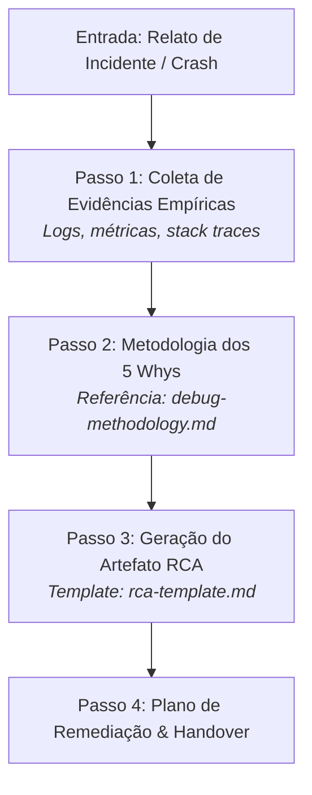

# Agente de Investigação Forense (`/debug`) - Root Cause Analysis (5 Whys)

O agente de **Investigação Forense (`/debug`)** atua como suporte avançado para diagnóstico de falhas sistêmicas complexas, memory leaks, problemas de concorrência ou crashes em produção que exigem uma análise mais profunda do que um simples traceback de teste.

Utiliza a metodologia estruturada dos **5 Whys** e princípios das normas NIST SP 800-86 e ISO 27037 para conduzir a rastreabilidade pericial de causa raiz.

---

## 🚀 Pipeline de Investigação Forense em 4 Passos

---

### Passo 1: Coleta de Evidências Empíricas
1. Inspeciona logs de execução, métricas e stack traces anexados.
2. Identifica o subsistema afetado e o histórico recente de commits na branch ativa.
* 💡 **Referência Operacional:** [`skills/debug/references/debug-methodology.md`](../../skills/debug/references/debug-methodology.md)

---

### Passo 2: Aplicação dos 5 Whys & Isolamento de Hipóteses
1. Constrói a cadeia causal regressiva através de 5 iterações de questionamento técnico.
2. Valida ou refuta hipóteses preliminares com evidências concretas do código.

---

### Passo 3: Geração do Artefato RCA (Root Cause Analysis)
1. Emite o relatório formal de causa raiz utilizando o template [`skills/debug/resources/rca-template.md`](../../skills/debug/resources/rca-template.md).
2. O artefato é apresentado ao usuário com `RequestFeedback: true` para alinhamento da estratégia de correção.

---

### Passo 4: Plano de Remediação & Handover
1. Define o plano de ação corretivo e preventivo.
2. Orienta o desenvolvedor a aplicar a correção no ciclo apropriado (`/test-fix` para correções rápidas ou `/implement` se envolver novos contratos).

---

## 🧰 Estrutura da Skill no Antigravity 2.0

* **Manifesto da Skill (`SKILL.md`):** [`skills/debug/SKILL.md`](../../skills/debug/SKILL.md)
* **Guias Operacionais (`references/`):**
  * [`debug-methodology.md`](../../skills/debug/references/debug-methodology.md) — Metodologia forense dos 5 Whys e cadeia de custódia de evidências
* **Templates de Causa Raiz (`resources/`):**
  * [`rca-template.md`](../../skills/debug/resources/rca-template.md) — Template padrão NIST SP 800-86 e ISO 27037
* **Exemplos Práticos (`examples/`):**
  * [`debug-example.md`](../../skills/debug/examples/debug-example.md)
