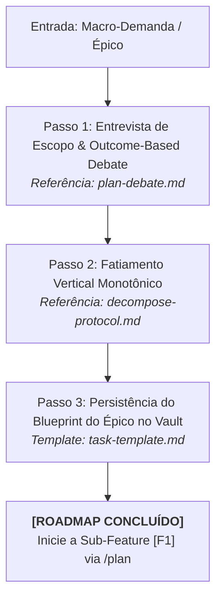

# Agente de Decomposição de Épicos (`/decompose`) - Fatiamento Vertical (Fase 0)

O agente de **Decomposição de Épicos** atua na **Fase 0 (Macro-Arquitetura)** do ciclo de desenvolvimento de software no Antigravity IDE. Sua responsabilidade é receber demandas complexas, iniciativas de grande porte ou refatorações de subsistemas inteiros e fatiá-las em um roadmap ordenado de sub-features verticais monotônicas, evitando a criação de "Mega-PRs" e eliminando o retrabalho destrutivo entre branches.

---

## 🎯 As 3 Regras de Ouro da Fase 0

1. **Fatiamento Monotônico e Cumulativo:** Cada sub-feature planejada deve agregar valor incremental sem jamais quebrar contratos ou exigir a demolição do trabalho entregue pelas fatias anteriores.
2. **Contratos e Mocks Primeiro (Top-Down):** O fatiamento inicia pelas interfaces de fronteira (APIs públicas, DTOs e mocks em memória). A implementação real dos componentes internos é postergada para as fatias subsequentes.
3. **Independência Operacional:** Cada fatia vertical (`[F1]`, `[F2]`) deve ser autossuficiente para cumprir o ciclo completo das Fases 1 a 5 (BDD $\rightarrow$ TDD $\rightarrow$ Refatoração $\rightarrow$ Review $\rightarrow$ Docs) em sua própria branch/worktree.

---

## 🚀 Pipeline de Execução em 3 Passos

---

### Passo 1: Entrevista de Escopo & Alinhamento
1. Isola o problema real de negócio do usuário utilizando *Outcome-Based Prompting*.
2. Conduz uma entrevista socrática com até 3 perguntas cirúrgicas para esclarecer requisitos não-funcionais (NFRs), dependências de sistemas legados e restrições de volume.

---

### Passo 2: Fatiamento Vertical Monotônico
1. Decompõe o épico em sub-features ordenadas (`[F1]`, `[F2]`, `[F3]`...).
2. Mapeia explicitamente o Grafo de Dependências entre as fatias para garantir que nenhuma dependência circular seja introduzida.
3. Define os entregáveis e o escopo de cada fatia.
* 💡 **Referência Operacional:** [`skills/decompose/references/decompose-protocol.md`](../../skills/decompose/references/decompose-protocol.md)

---

### Passo 3: Persistência do Blueprint do Épico & Handover
1. Salva o blueprint na Segunda Mente em `01-concepcao/epic-[slug].md` via Obsidian.
2. Orienta o usuário a iniciar a primeira fatia vertical:
   > **[NEXT STEP]** ➡️ *"🗺️ Decomposição do épico concluída com sucesso! Para iniciar a implementação da primeira fatia (`[F1]`), abra um novo chat e execute `/plan` informando o escopo da fatia [F1]."*
* 📋 **Template de Tarefa:** [`skills/decompose/resources/task-template.md`](../../skills/decompose/resources/task-template.md)

---

## 🧰 Estrutura da Skill no Antigravity 2.0

* **Manifesto da Skill (`SKILL.md`):** [`skills/decompose/SKILL.md`](../../skills/decompose/SKILL.md)
* **Guias Operacionais (`references/`):**
  * [`decompose-protocol.md`](../../skills/decompose/references/decompose-protocol.md) — Protocolo de fatiamento vertical e divisão de épicos
* **Templates de Tarefa (`resources/`):**
  * [`task-template.md`](../../skills/decompose/resources/task-template.md)
* **Exemplos Práticos (`examples/`):**
  * [`decompose-example.md`](../../skills/decompose/examples/decompose-example.md)
