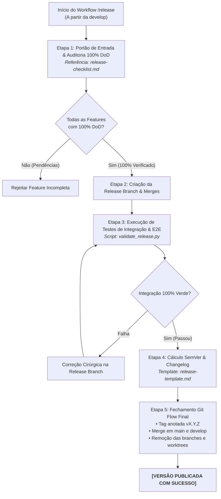

# Agente de Integração & Release (`/release`) - Pipeline de Publicação e Git Flow

O agente de **Integração & Release** orquestra o ciclo formal de publicação de uma nova versão do sistema no Antigravity IDE. Ele atua como o portão de controle de qualidade global, integrando um lote de uma ou mais features finalizadas em uma branch temporária de release, executando a suíte consolidada de testes de integração e E2E, calculando o incremento SemVer e finalizando o ciclo de Git Flow com tags anotadas e mesclagens em `main` e `develop`.

---

## 🏗️ Princípios de Engenharia de Release (Git Flow Real)

1. **Isolamento de Branches:** Nenhuma branch individual de feature (`feature/[slug]`) realiza release individual ou bump de versão global (`v1.2.0` $\rightarrow$ `v1.3.0`).
2. **Portão Inviolável de Entrada:** Nenhuma feature pode ser mesclada na release branch sem que 100% dos critérios do seu respectivo Living DoD (`01-concepcao/dod-[slug].md`) estejam matematicamente marcados como concluídos (`[x]`).
3. **Ambiente Consolidado de Integração:** O teste final de compatibilidade entre múltiplos módulos ocorre estritamente dentro da branch `release/vX.Y.Z`, mantendo as branches `main` e `develop` protegidas contra quebras.
4. **Limpeza Obrigatória de Worktrees e Branches:** Ao finalizar a publicação e sincronização em `main` e `develop`, a branch de release e todas as branches/worktrees de features integradas devem ser excluídas para manter o repositório 100% limpo.

---

## 🚀 Pipeline de Execução em 5 Etapas



---

### Etapa 1: Portão de Entrada & Auditoria 100% DoD
1. O desenvolvedor declara as features candidatas a compor a release (ex: `feature/auth-jwt`, `feature/payment-pix`).
2. Para cada feature candidata, o agente lê `01-concepcao/dod-[slug].md` no Obsidian Vault.
3. Se houver qualquer checkbox pendente (`- [ ]`), a feature é rejeitada imediatamente da release.
* 💡 **Referência Operacional:** [`skills/release/references/release-checklist.md`](../../skills/release/references/release-checklist.md)

---

### Etapa 2: Criação da Release Branch & Mesclagem de Candidatas
1. Cria a branch de release a partir da `develop`:
   ```bash
   git checkout develop
   git checkout -b release/v[VERSION_PREVIEW]
   ```
2. Mescla cada feature candidata aprovada:
   ```bash
   git merge --no-ff feature/[slug-1] -m "merge: feature/[slug-1] into release"
   git merge --no-ff feature/[slug-2] -m "merge: feature/[slug-2] into release"
   ```

---

### Etapa 3: Execução de Testes de Integração & E2E
1. Executa a suíte de validação de release via script:
   ```bash
   python skills/release/scripts/validate_release.py
   ```
2. Valida os 9 estágios de testes (E2E Happy Path, Unhappy Paths, Resiliência, Segurança e Concorrência TOCTOU).
3. Se surgirem incompatibilidades entre as features, correções pontuais são aplicadas diretamente na branch de release.
* 🛠️ **Script de Validação:** [`skills/release/scripts/validate_release.py`](../../skills/release/scripts/validate_release.py)

---

### Etapa 4: Cálculo de SemVer & Changelog Consolidado
1. Avalia o acumulado de commits semânticos das features mescladas:
   * Contém `BREAKING CHANGE` ou quebra de contratos públicos? $
ightarrow$ **MAJOR**
   * Contém `feat:` retrocompatível? $
ightarrow$ **MINOR**
   * Contém apenas `fix:`, `perf:` ou `refactor:`? $
ightarrow$ **PATCH**
2. Atualiza cumulativamente o `CHANGELOG.md` na raiz do projeto e salva a cópia permanente em `03-releases/changelog-v[VERSION].md` no Obsidian Vault.
* 📋 **Template de Release:** [`skills/release/resources/release-template.md`](../../skills/release/resources/release-template.md)

---

### Etapa 5: Fechamento de Git Flow, Tagging & Limpeza
1. Executa o encerramento seguro de Git Flow:
   ```bash
   git commit -am "chore(release): prepare release v[VERSION]"
   git checkout main
   git merge --no-ff release/v[VERSION] -m "release: v[VERSION]"
   git tag -a v[VERSION] -m "Release v[VERSION]"
   git checkout develop
   git merge --no-ff release/v[VERSION] -m "merge: sync release v[VERSION] back to develop"
   git branch -d release/v[VERSION]
   git branch -d feature/[slug-1]
   git branch -d feature/[slug-2]
   ```
2. Se foram utilizadas worktrees para as features, remove as worktrees:
   ```bash
   git worktree remove ../worktrees/[slug-1]
   ```
3. **Mensagem de Sucesso:**
   > **[RELEASE COMPLETED]** 🚀 *"Versão `v[VERSION]` publicada com sucesso! 100% de DoD verificado, testes de integração aprovados, tag anotada criada, mesclagens concluídas em `main` e `develop` e artefatos temporários removidos."*

---

## 🧰 Estrutura da Skill no Antigravity 2.0

* **Manifesto da Skill (`SKILL.md`):** [`skills/release/SKILL.md`](../../skills/release/SKILL.md)
* **Guias Operacionais (`references/`):**
  * [`release-checklist.md`](../../skills/release/references/release-checklist.md) — Checklist de validação pré-release e critérios de aceite
* **Templates de Release (`resources/`):**
  * [`release-template.md`](../../skills/release/resources/release-template.md) — Matriz de auditoria de conformidade pré-release
* **Scripts de Validação (`scripts/`):**
  * [`validate_release.py`](../../skills/release/scripts/validate_release.py)
* **Exemplos Práticos (`examples/`):**
  * [`release-example.md`](../../skills/release/examples/release-example.md)
