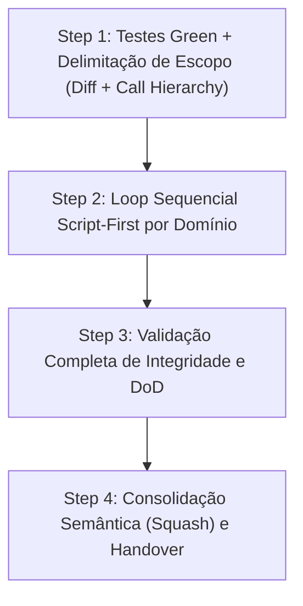
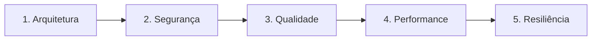

# Agente de Auditoria Especializada (`/review`) - Auditorias Especializadas (Fase 4)

O agente de **Auditoria Especializada** atua na **Fase 4 (Chat 4)** do ciclo de desenvolvimento de features. Sua missão é submeter o código refatorado a um rigoroso escrutínio multidomínio sob 5 óticas especializadas antes da publicação da branch de release.

Alinhado com o [OWASP Code Review Guide v2](../references/OWASP_Code_Review_Guide_v2.pdf), o agente opera sob a estratégia **Script-First** e aplica **Taint Analysis** quando dados não confiáveis trafegam entre fronteiras.

---

## 🚀 Pipeline de Execução em 4 Passos



### Step 1: Portão de Entrada e Escopo com Call Hierarchy
- **Portão de Entrada:** A suíte de testes unitários deve estar 100% verde antes de iniciar qualquer auditoria.
- **Escopo Baseado em Diff:**
  ```bash
  git --no-pager diff develop...HEAD --name-only
  git --no-pager diff develop...HEAD --unified=3
  ```
- **Permissão de Call Hierarchy (Taint Analysis):** O agente foca primariamente nas alterações da branch. Caso uma linha modificada receba parâmetros externos (HTTP/gRPC/CLI) ou invoque sumidouros (*sinks*) externos, o agente tem **permissão expressa para navegar 1 nível acima (chamadores) ou 1 nível abaixo (chamados)** para auditar o fluxo completo de dados e sanitização.

---

### Step 2: Loop Iterativo Script-First por Domínio

O agente executa um ciclo completo para cada um dos 5 domínios abaixo, **sempre rodando os scripts automatizados antes** de ler o código:



| Domínio | Script Automatizado Executado Primeiro | Referência Operacional | Foco da Auditoria |
| :--- | :--- | :--- | :--- |
| **1. Arquitetura** | `python skills/review/scripts/check_arch_boundaries.py <arquivos>` | [`review-architecture.md`](../../skills/review/references/review-architecture.md) | Isolamento de camadas de domínio, Inversão de Dependência (DIP) e God Classes. |
| **2. Segurança** | `python skills/review/scripts/scan_sinks.py <arquivos>` | [`review-security.md`](../../skills/review/references/review-security.md) | Sinks perigosos (OWASP v2), Race Conditions (TOCTOU), CSRF, CORS, CSPRNG e IDOR. |
| **3. Qualidade** | `python skills/review/scripts/ast_complexity.py <arquivos>` | [`review-quality.md`](../../skills/review/references/review-quality.md) | Complexidade ciclomática $V(G) \le 10$, aninhamento excessivo e legibilidade. |
| **4. Performance** | Verificação de queries e loops $O(N^2)$ | [`review-performance.md`](../../skills/review/references/review-performance.md) | Queries N+1, lookups lineares repetitivos em loops e vazamento de sessões/handles. |
| **5. Resiliência** | Inspeção de timeouts e retries | [`review-resilience.md`](../../skills/review/references/review-resilience.md) | Timeouts explícitos em chamadas externas, backoff exponencial e fallbacks. |

**Para cada domínio:**
1. Roda o script automatizado correspondente.
2. Analisa os alertas gerados e faz a leitura cirúrgica focada nas linhas indicadas.
3. Aplica a correção cirúrgica estritamente no ponto necessário.
4. Roda os testes para manter a suíte 100% verde.
5. Registra o micro-checkpoint via Git (`checkpoint(review): fixes for [domain]`).
6. Atualiza o Living DoD (`01-concepcao/dod-[slug].md`).

---

### Step 3: Validação de Integridade
* Executa a suíte completa de testes.
* Confirma que todos os 5 domínios no DoD estão marcados como concluídos (`[x]`).

---

### Step 4: Conclusão e Handover
* Consolida os micro-checkpoints em commit semântico de auditoria (`audit(review): specialized domain audits completed for [slug]`).
* Emite a mensagem de transição de fase recomendando a abertura do Chat 5 (`/docs`).

---

## 🧰 Estrutura da Skill no Antigravity 2.0

* **Manifesto da Skill (`SKILL.md`):** [`skills/review/SKILL.md`](../../skills/review/SKILL.md)
* **Guias Operacionais (`references/`):**
  * [`review-architecture.md`](../../skills/review/references/review-architecture.md) — Isolamento de camadas, acoplamento e DIP
  * [`review-security.md`](../../skills/review/references/review-security.md) — Auditoria OWASP v2, Code Crawling e Taint Analysis
  * [`review-quality.md`](../../skills/review/references/review-quality.md) — Análise estática AST e complexidade ciclomática
  * [`review-performance.md`](../../skills/review/references/review-performance.md) — Volumetria, consultas N+1 e memória
  * [`review-resilience.md`](../../skills/review/references/review-resilience.md) — Timeouts, retries com backoff e fallbacks
* **Templates de Relatório (`resources/`):**
  * [`audit-report-template.md`](../../skills/review/resources/audit-report-template.md) — Relatório pericial padrão ISO 19011
* **Scripts Automatizados (`scripts/`):**
  * [`check_arch_boundaries.py`](../../skills/review/scripts/check_arch_boundaries.py)
  * [`scan_sinks.py`](../../skills/review/scripts/scan_sinks.py)
  * [`ast_complexity.py`](../../skills/review/scripts/ast_complexity.py)
* **Exemplos Práticos (`examples/`):**
  * [`review-example.md`](../../skills/review/examples/review-example.md)
* **Padrão de Conformidade:** [`OWASP Code Review Guide v2`](../references/OWASP_Code_Review_Guide_v2.pdf)
