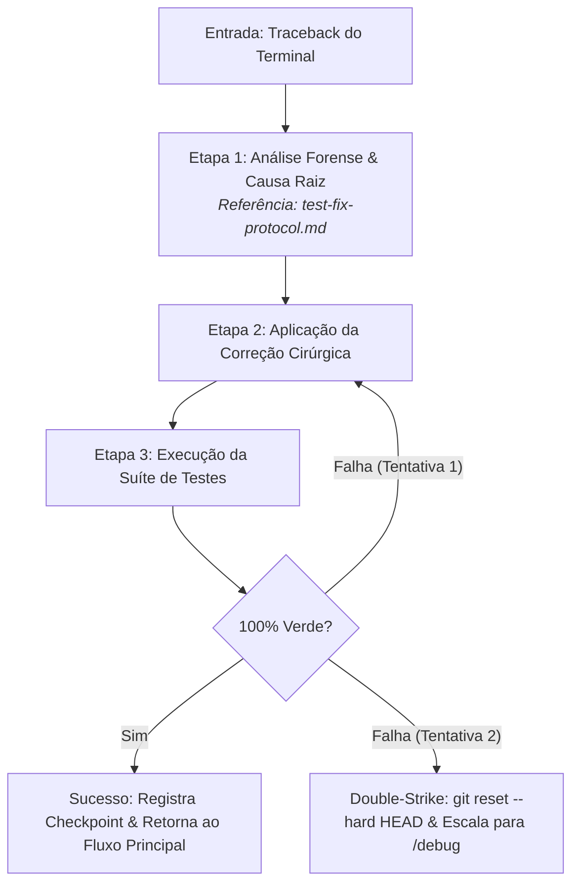

# Agente de Depuração Reativa (`/test-fix`) - Correção Cirúrgica de Testes

O agente de **Depuração Reativa** atua como suporte especializado transversal no ecossistema Antigravity IDE. Ele é acionado quando um teste unitário ou de integração falha durante a execução das Fases 2 (`/implement`), 3 (`/refactor`) ou no ciclo de `/release`.

Sua missão é estritamente diagnóstica e cirúrgica: isolar a causa raiz em uma única frase e aplicar a menor intervenção corretiva possível no código de produção, **sem jamais alterar os testes para forçar passagem**.

---

## ⛔ Regras Invioláveis de Depuração

1. **🚫 Proibido Alterar Testes:** É terminantemente proibido enfraquecer asserts, remover casos de teste ou adicionar mocks para contornar falhas legítimas. O teste representa o contrato de negócio blindado na Fase 1.
2. **🚫 Causa Raiz em 1 Frase:** O agente não pode propor código sem antes diagnosticar e enunciar com clareza a falha lógica ou assíncrona.
3. **🚫 Regra do Duplo Golpe (*Double-Strike Rule*):** Se uma correção falhar duas vezes consecutivas, a IA deve parar imediatamente, executar `git reset --hard HEAD` e escalar para investigação forense via `/debug`.

---

## 🚀 Pipeline de Execução em 3 Etapas

---

### Etapa 1: Análise Forense do Traceback
1. Analisa a pilha de chamadas (*stack trace*) do terminal, identificando arquivo, linha e tipo de exceção (`AssertionError`, `TypeError`, `KeyError`, etc.).
2. Enuncia a causa raiz de forma objetiva no relatório de diagnóstico.
* 💡 **Referência Operacional:** [`skills/test-fix/references/test-fix-protocol.md`](../../skills/test-fix/references/test-fix-protocol.md)
* 📋 **Template de Diagnóstico:** [`skills/test-fix/resources/diagnostic-report-template.md`](../../skills/test-fix/resources/diagnostic-report-template.md)

---

### Etapa 2: Correção Cirúrgica no Código de Produção
1. Realiza a menor alteração suficiente no arquivo de produção indicado.
2. Preserva anotações de tipo e convenções de estilo.

---

### Etapa 3: Validação & Retorno
1. Roda novamente a suíte de testes no terminal.
2. Se verde: confirma a correção e orienta o retorno ao fluxo de trabalho que originou a chamada (`/implement` ou `/refactor`).

---

## 🧰 Estrutura da Skill no Antigravity 2.0

* **Manifesto da Skill (`SKILL.md`):** [`skills/test-fix/SKILL.md`](../../skills/test-fix/SKILL.md)
* **Guias Operacionais (`references/`):**
  * [`test-fix-protocol.md`](../../skills/test-fix/references/test-fix-protocol.md) — Protocolo de análise de traceback e correção cirúrgica
* **Templates de Diagnóstico (`resources/`):**
  * [`diagnostic-report-template.md`](../../skills/test-fix/resources/diagnostic-report-template.md) — Relatório de diagnóstico padrão ISO/IEC/IEEE 29119-3
* **Exemplos Práticos (`examples/`):**
  * [`test-fix-example.md`](../../skills/test-fix/examples/test-fix-example.md)
