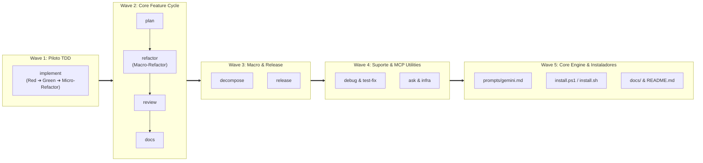

# Planejamento de Migração: Workflows para Skills Autossuficientes

| Metadado | Detalhe |
| :--- | :--- |
| 📅 **Data de Criação / Revisão** | **18/09/2026** (Revisado em **26/10/2026**) |
| 🚀 **Status** | **Aprovado via `/grill-me` e Revisão Arquitetural / Em Execução** |
| 🌿 **Branch de Execução** | `migrate_workflows_to_skills` / `feature/migracao-workflows-para-skills` |
| 📂 **Diretório Alvo** | `workflows-skill/` (11 Skills de Ciclo de Vida + 2 Skills Utilitárias MCP) |
| 🔒 **Diretórios Legados (Read-Only)** | `workflows/` e `skills/` (Preservados como referência intacta) |
| 🎯 **Objetivo** | Migrar a arquitetura de orquestração do Antigravity baseada em Workflows legados (`.md`) e skills fragmentadas para pacotes de Agent Skills autossuficientes com nomes diretos de comando (`/implement`, `/plan`, `/refactor`, etc.), alinhados ao padrão aberto `agentskills.io` e à skill oficial `/migrate-workflows`. |

---

## 1. Contexto, Diagnóstico e Motivação

### 1.1. Depreciação Oficial dos Workflows Legados
Conforme estabelecido pela engenharia do Google Antigravity e documentado em [`docs/references/Workflows to Skills Migration.md`](../references/Workflows%20to%20Skills%20Migration.md), os Workflows baseados em arquivos únicos `.md` estão **oficialmente depreciados e serão desativados em 01 de Novembro de 2026**.

A plataforma Antigravity 2.0 e a CLI `agy` adotaram o padrão aberto de **Agent Skills** ([agentskills.io](https://agentskills.io/home)), que oferece:
1. **Progressive Context Loading:** Carregamento de metadados (`name`, `description`) no início da sessão, postergando a leitura de instruções completas (`SKILL.md`, `references/`, `resources/`) até o momento exato da ativação.
2. **Directory Bundling:** Agrupamento nativo de manuais operacionais (`references/`), templates/schemas (`resources/`), scripts executáveis (`scripts/`) e exemplos práticos (`examples/`).
3. **Conversão Nativa em Slash Commands:** Qualquer pasta de skill se torna imediatamente acessível via comando `/<skill-name>` no chat (ex: `workflows-skill/implement/SKILL.md` $\rightarrow$ `/implement`).

### 1.2. O Problema do Acoplamento Transversal Atual ("Context Hopping")
Na arquitetura anterior descrita em [`docs/README.md`](../README.md), os workflows atuavam como "routers" leves, delegando a execução técnica para 24 skills atômicas separadas em `skills/`:
* No workflow [`workflows/implement.md`](../../workflows/implement.md) (Fase 2 - TDD), o agente precisava coordenar chamadas a 6 skills externas: `tdd-plan`, `tdd-tests`, `tdd-code`, `test-fix`, `dod` e `git`.
* A skill `skills/git`, por exemplo, cobria 5 modos operacionais distintos (validação de branches, micro-checkpoints, squashes de fechamento de fase, rollbacks e release final com tags semânticas).
* **Impacto Negativo:** Ao invocar `skills/git` durante o TDD, o agente consumia tokens desnecessários com modos irrelevantes para a fase corrente (como release e tags), aumentando a latência de raciocínio e o risco de desvios operacionais. Além disso, o ciclo TDD não possuía uma etapa explícita de **Micro-Refatoração (Blue Phase)** por lote, empurrando toda a limpeza básica (nomes de variáveis, extração de métodos simples, ajustes de superclasses locais) para a Fase 3.

### 1.3. A Nova Arquitetura: Skills Autossuficientes + Especialistas Profundas
Em vez de um workflow que dispara leituras cruzadas em múltiplas pastas externas, o ecossistema em `workflows-skill/` adota uma **Arquitetura Híbrida e Autossuficiente** com nomes limpos e diretos:

1. **Skills de Ciclo de Vida Autossuficientes (`/implement`, `/plan`, `/refactor`, `/review`, `/docs`, `/decompose`, `/release`, `/test-fix`, `/debug`, `/ask`, `/infra`):**
   * Cada fluxo de trabalho é convertido em um pacote completo mantendo seu nome direto de comando (ex: `workflows-skill/implement/`).
   * Possui seu próprio `SKILL.md` (orquestrador enxuto com pipeline de fases), uma pasta `references/` com sub-procedimentos cirúrgicos contextualizados (`tdd-plan.md`, `tdd-test.md`, `tdd-code.md`, `tdd-refactor.md`, `tdd-test-fix.md`, `tdd-dod.md`, `tdd-git.md`) e uma pasta `resources/` exclusiva para templates (`plan-template.md`, `task-template.md`).
   * Cada sub-procedimento em `references/` contém **apenas as diretrizes pertinentes àquele fluxo específico** (ex: `tdd-git.md` aborda estritamente micro-checkpoints por lote e commit de fechamento da fase TDD).

2. **Duplo Nível de Refatoração e Depuração (Embutido vs. Especialista Profundo):**
   * **Micro-Refatoração (Embutida em `implement` via `references/tdd-refactor.md`) vs. Macro-Refatoração (`refactor`):**
     * *Durante o TDD (`implement` — Blue Phase):* Após os testes do lote passarem (Green), o agente executa uma refatoração rápida e focada **apenas na classe/componente recém-implementado no lote atual** (melhoria de nomes de variáveis/métodos, eliminação de duplicação óbvia, ajuste de herança/superclasses locais e tipagem).
     * *Ao final da Feature (`refactor` — Fase 3):* Antes da auditoria e integração na `develop`, executa-se uma refatoração estrutural profunda e sistêmica sobre **todo o diff da feature** (`git diff develop...HEAD`), analisando a interação entre todas as classes criadas, validando complexidade ciclomática via script AST (`V(G) <= 10`), aplicando SOLID entre módulos e gerando a Matriz de Evidências de Refatoração. Como o trabalho local pesado já foi amortizado durante o TDD, a Fase 3 torna-se mais limpa e estratégica.
   * **Correção Rápida no Loop (`*-test-fix.md`) vs. Depuração Cirúrgica Dedicada (`test-fix` / `debug`):**
     * *1ª e 2ª tentativa de falha em teste:* Resolvidas diretamente dentro de `implement` ou `refactor` usando o guia local `references/*-test-fix.md`.
     * *Double-Strike Rule (> 2 falhas consecutivas ou quebra sistêmica):* O agente executa rollback imediato (`git reset --hard HEAD`) e recomenda escalar para um chat focado com a skill profunda `/test-fix` ou `/debug`.


---

## 2. Decisões de Design Consolidadas

| Dimensão | Decisão Aprovada | Justificativa Arquitetural |
| :--- | :--- | :--- |
| **Ciclo TDD Completo (Red-Green-Refactor)** | Inclusão de `references/tdd-refactor.md` exclusivo na skill `implement` | Restaura a 3ª fase clássica do TDD no nível do lote atual (limpeza de variáveis, métodos e superclasses locais), deixando a skill `refactor` para a consolidação sistêmica de toda a feature. |
| **Separação `references/` vs `resources/`** | Convenção estrita do Antigravity (`agentskills.io`) | `references/` armazena exclusivamente guias operacionais, manuais passo a passo e checklists; `resources/` armazena exclusivamente templates de documentos e artefatos. |
| **Imutabilidade do Legado** | Diretórios `workflows/` e `skills/` são estritamente **READ-ONLY** | Nenhum arquivo original será editado ou removido durante a construção das Waves 1 a 4. Servem como baseline de consulta e garantem zero risco de regressão. |
| **Portabilidade de Scripts** | Python-First (`.py`) | Scripts utilitários de validação e scanners implementados/adaptados em Python para execução idêntica no Windows (PowerShell) e Linux/macOS. |
| **Estratégia de Rollout** | Abordagem em 5 Ondas (Waves 1 a 5) | Valida o piloto (`implement`), expande para o ciclo de feature, cobre macro/release, migra suporte/MCPs e finaliza na Wave 5 atualizando `prompts/gemini.md` e instaladores (`install.ps1` / `install.sh`). |
| **Garantia de Qualidade** | Testes automatizados de integridade (`tests/test_flow_skills_integrity.py`) | Valida conformidade do frontmatter YAML, separação `references/` vs `resources/`, existência física de links relativos e sintaxe dos scripts Python. |

---

## 3. Anatomia Padrão das Skills em `workflows-skill/`

Todas as skills no diretório `workflows-skill/` devem aderir rigidamente à convenção oficial do Antigravity:

```text
workflows-skill/<skill-name>/
├── SKILL.md                 # Manifesto obrigatório: YAML frontmatter + Pipeline de execução e Decision Tree
├── references/              # Guias operacionais contextualizados, checklists e regras da fase
│   ├── <etapa-1>.md
│   └── <etapa-2>.md
├── resources/               # Templates puros de artefatos e documentos (.md)
│   └── <template-1>.md
├── scripts/                 # (Opcional) Scripts auxiliares executáveis Python-First (.py)
│   └── ...
└── examples/                # (Opcional) Exemplos práticos de entrada, contexto e saída
    └── ...
```

### 3.1. Estrutura do `SKILL.md` (Manifesto)
Cada `SKILL.md` é estruturado em quatro blocos fundamentais:
1. **YAML Frontmatter:** `name` padronizado (`<skill-name>`) e `description` rica em terceira pessoa (mínimo de 50 caracteres), incluindo gatilhos de ativação semântica e menção explícita ao slash command `/<skill-name>`.
2. **Restrições e Escopo Operacional:** Regras invioláveis da fase (ex: Read-Only em `ask`, Zero Código de Produção em `plan`, Escopo de Lote vs. Escopo de Branch entre `implement` e `refactor`).
3. **Pipeline de Fases e Portões de Validação (Validation Gates):** Definição sequencial das etapas, entradas obrigatórias, artefatos gerados, links diretos para `./references/*.md` e `./resources/*.md`, e condições explícitas de saída.
4. **Protocolo de Handover (`[NEXT STEP]`):** Recomendação clara de transição para o próximo chat/skill ao encerrar a fase.

---

## 4. Mapeamento Geral das 13 Skills em `workflows-skill/`

A tabela a seguir estabelece o inventário completo dos **13 pacotes** que compõem `workflows-skill/`:

| # | Origem Legada (`workflows/` + `skills/`) | Nova Skill (`workflows-skill/`) | Comando | Guias Operacionais em `references/` | Templates em `resources/` | Scripts em `scripts/` | Exemplos em `examples/` |
| :--- | :--- | :--- | :--- | :--- | :--- | :--- | :--- |
| **1** | `workflows/implement.md` + `tdd-*` | **`implement`** | `/implement` | `tdd-plan.md`, `tdd-test.md` (Red), `tdd-code.md` (Green), `tdd-refactor.md` (Blue/Local), `tdd-test-fix.md`, `tdd-dod.md`, `tdd-git.md` | `plan-template.md`, `task-template.md`, `pivot-template.md` | - | `sample_task_list.md`, `sample_batch_execution.md` |
| **2** | `workflows/plan.md` + `plan-*` | **`plan`** | `/plan` | `plan-debate.md`, `plan-bdd.md`, `plan-sdd.md`, `plan-dod.md`, `plan-git.md` | `template_proposals.md`, `template_bdd.md`, `template_sdd.md`, `template_dod.md` | `validate_sdd_contracts.py`, `validate_branch.py` | `bdd_checkout_example.md`, `sdd_checkout_example.md` |
| **3** | `workflows/refactor.md` + `skills/refactor` | **`refactor`** | `/refactor` | `refactor-clean-code.md`, `refactor-solid.md`, `refactor-test-fix.md`, `refactor-git.md`, `refactor-dod.md` | `refactor_checklist_template.md` | `ast_complexity.py` | `sample_feature_refactoring.md` |
| **4** | `workflows/review.md` + `review-*` | **`review`** | `/review` | `review-arch.md`, `review-security.md`, `review-quality.md`, `review-perf.md`, `review-resilience.md`, `review-git.md`, `review-dod.md` | `template_architecture.md`, `template_security.md`, `template_quality.md`, `template_performance.md`, `template_resilience.md` | `check_arch_boundaries.py`, `scan_sinks.py`, `ast_complexity.py` | - |
| **5** | `workflows/docs.md` + `skills/docs` | **`docs`** | `/docs` | `docs-readme.md`, `docs-docstrings.md`, `docs-dod.md`, `docs-git.md` | `template_root_readme.md`, `template_module_readme.md` | - | - |
| **6** | `workflows/decompose.md` + `plan-decompose` | **`decompose`** | `/decompose` | `decompose-debate.md`, `decompose-slicing.md`, `decompose-audit.md` | `template_epic.md` | - | `sample_epic_breakdown.md` |
| **7** | `workflows/release.md` + `release` + `test-integration` | **`release`** | `/release` | `release-dod-gate.md`, `release-e2e.md`, `release-semver.md`, `release-git.md` | `template_integration_log.md`, `template_changelog.md` | `validate_release.py` | - |
| **8** | `workflows/test-fix.md` + `skills/test-fix` | **`test-fix`** | `/test-fix` | `test-fix-traceback.md`, `test-fix-surgical.md`, `test-fix-git.md` | `error_checklist_template.md` | - | `sample_traceback_fix.md` |
| **9** | `workflows/debug.md` + `skills/debug` | **`debug`** | `/debug` | `debug-5-whys.md`, `debug-forensics.md`, `debug-rca.md` | `template_rca.md` | - | - |
| **10** | `workflows/ask.md` + `skills/ask` | **`ask`** | `/ask` | `ask-readonly.md`, `ask-citation.md` | - | - | `sample_grounded_answer.md` |
| **11** | `workflows/infra.md` + `skills/infra` | **`infra`** | `/infra` | `infra-manifests.md`, `infra-docker.md`, `infra-secrets.md` | `template_env_example.md` | `validate_env.py` | - |
| **12** | `skills/obsidian` | **`obsidian`** | `/obsidian` | `EXECUTION.md` (Busca, Leitura, `vault_patch`, ADRs, Pivots e Wikilinks) | `template_adr.md`, `template_pivot.md`, `template_domain_rule.md` | - | - |

---

## 5. Detalhamento do Roadmap de Migração em 5 Ondas (Waves)



---

### Wave 1: Piloto — `implement` (Fase 2 - Ciclo TDD Completo)

O fluxo de implementação TDD (`/implement`) é o coração operacional do desenvolvimento e o candidato ideal para piloto, consolidando planejamento em lotes, Red, Green, Micro-Refactor, DoD e Git Checkpoints em uma única skill autossuficiente.

#### Ciclo TDD por Lote em `implement`
Para cada Lote de Contexto aprovado em `task_list.md`:
1. **Fase Red (`references/tdd-test.md`):** Escrita de testes unitários AAA (Arrange-Act-Assert) com isolamento estrito por mocks (zero I/O real).
2. **Fase Green (`references/tdd-code.md`):** Implementação do código de produção mínimo e tipado capaz de fazer os testes passarem ("Make it Work"). Caso ocorra falha, diagnóstico rápido via `references/tdd-test-fix.md` (respeitando a Double-Strike Rule).
3. **Fase Blue — Micro-Refatoração Local (`references/tdd-refactor.md`):** Com os testes do lote 100% verdes, revisão imediata e cirúrgica **apenas das classes/funções criadas ou alteradas neste lote**:
   * Melhoria de nomenclatura de variáveis, parâmetros e métodos para clareza semântica.
   * Extração de sub-métodos privados para evitar funções longas já no nascimento.
   * Ajustes de herança, superclasses, interfaces locais e eliminação de código duplicado dentro da classe.
   * Re-execução imediata dos testes do lote para garantir que continuam 100% verdes.
4. **Governança do Lote (`references/tdd-dod.md` & `references/tdd-git.md`):** Marcação do lote em `task_list.md`, registro na linha do tempo do `dod-[slug].md` (via `@obsidian`) e gravação de micro-checkpoint local (`checkpoint(implement): batch [N] - [descricao]`).

#### Estrutura Física de `workflows-skill/implement`
```text
workflows-skill/implement/
├── SKILL.md
├── references/
│   ├── tdd-plan.md           # Decomposição em Dependent Context Batches
│   ├── tdd-test.md           # Fase Red: Padrão AAA, matriz de cobertura e isolamento de mocks
│   ├── tdd-code.md           # Fase Green: Código mínimo tipado ("Make it Work") e protocolo de pivots
│   ├── tdd-refactor.md       # Fase Blue (Micro-Refactor): Limpeza local da classe/lote atual (nomes, superclasses, métodos)
│   ├── tdd-test-fix.md       # Diagnóstico reativo de falhas no loop TDD e Double-Strike Rule
│   ├── tdd-dod.md            # Atualização incremental da timeline no dod-[slug].md
│   └── tdd-git.md            # Micro-checkpoints por lote (Modo 2) e fechamento da fase
├── resources/
│   ├── plan-template.md      # Template para implementation_plan.md
│   ├── task-template.md      # Template para task_list.md com estados [ ] -> [/] -> [x]
│   └── pivot-template.md     # Template para registro de desvios arquiteturais
└── examples/
    ├── sample_task_list.md
    └── sample_batch_execution.md
```

#### Entregáveis da Wave 1
1. Criação completa de `workflows-skill/implement/`.
2. Criação da suíte de testes automatizados `tests/test_flow_skills_integrity.py`.
3. Validação via terminal (`pytest tests/test_flow_skills_integrity.py`).

---

### Wave 2: Core Feature Cycle (`plan`, `refactor`, `review`, `docs`)

Cobre as fases 1, 3, 4 e 5 do ciclo de vida de uma feature em janelas de chat efêmeras.

#### 1. `plan` (Fase 1: Concepção & Arquitetura — `/plan`)
* **Objetivo:** Debate socrático de escopo (Outcome-Based), setup de branch Git Flow, especificação BDD (Gherkin), blueprint SDD com contratos tipados e inicialização do Living DoD no Obsidian.
* **References:** `plan-debate.md`, `plan-bdd.md`, `plan-sdd.md`, `plan-dod.md`, `plan-git.md`.
* **Resources:** `template_proposals.md`, `template_bdd.md`, `template_sdd.md`, `template_dod.md`.
* **Scripts:** `scripts/validate_sdd_contracts.py`, `scripts/validate_branch.py` (convertido de `.sh` para `.py` multiplataforma).

#### 2. `refactor` (Fase 3: Refatoração de Consolidação da Feature — `/refactor`)
* **Objetivo (Macro-Refatoração):** Enquanto o `/implement` cuidou da limpeza individual de cada classe durante sua criação, o `/refactor` enxerga **a floresta inteira** (`git diff develop...HEAD`). Analisa o acoplamento entre todas as classes implementadas na feature, harmoniza hierarquias e contratos internos, reduz complexidade ciclomática global (`V(G) <= 10`) e aplica princípios SOLID transversais sob proteção da suíte completa de testes.
* **References:** `refactor-clean-code.md`, `refactor-solid.md`, `refactor-test-fix.md`, `refactor-git.md`, `refactor-dod.md`.
* **Resources:** `refactor_checklist_template.md` (inclui Matriz de Evidências de Refatoração).
* **Scripts:** `scripts/ast_complexity.py`.

#### 3. `review` (Fase 4: Auditorias Especializadas — `/review`)
* **Objetivo:** Auditoria iterativa Script-First sobre o diff da branch em 5 domínios (Arquitetura, Segurança OWASP Top 10/ASVS, Qualidade AST, Performance e Resiliência), operando em Mode A (Audit-Only) ou Mode B (`--fix`).
* **References:** `review-arch.md`, `review-security.md`, `review-quality.md`, `review-perf.md`, `review-resilience.md`, `review-git.md`, `review-dod.md`.
* **Resources:** `template_architecture.md`, `template_security.md`, `template_quality.md`, `template_performance.md`, `template_resilience.md`.
* **Scripts:** `scripts/check_arch_boundaries.py`, `scripts/scan_sinks.py`, `scripts/ast_complexity.py`.

#### 4. `docs` (Fase 5: Documentação Técnica & Feature Freeze — `/docs`)
* **Objetivo:** Sincronização de READMEs (raiz e módulo), docstrings rastreáveis ao Obsidian (`[[sdd-[slug]]]`), marcação final do DoD de desenvolvimento e congelamento da branch `feature/[slug]` (sem merge prematuro em `develop`).
* **References:** `docs-readme.md`, `docs-docstrings.md`, `docs-dod.md`, `docs-git.md`.
* **Resources:** `template_root_readme.md`, `template_module_readme.md`.

---

### Wave 3: Macro-Arquitetura e Publicação (`decompose`, `release`)

#### 1. `decompose` (Fase 0: Macro-Arquitetura e Fatiamento de Épicos — `/decompose`)
* **Objetivo:** Alinhamento Outcome-Based do macro-problema e decomposição vertical evolutiva monotônica em sub-features compatíveis (DAG acíclico, contratos primeiro), persistindo `01-concepcao/epic-[slug].md`.
* **References:** `decompose-debate.md`, `decompose-slicing.md`, `decompose-audit.md`.
* **Resources:** `template_epic.md`.

#### 2. `release` (Ciclo de Integração & Release — `/release`)
* **Objetivo:** Portão de auditoria 100% DoD das features candidatas, criação de branch `release/vX.Y.Z`, execução da suíte de integração/E2E em 9 estágios, cálculo cumulativo SemVer 2.0.0, geração de `CHANGELOG.md` e fechamento Git Flow (merges em `main` e `develop` + tag anotada).
* **References:** `release-dod-gate.md`, `release-e2e.md`, `release-semver.md`, `release-git.md`.
* **Resources:** `template_integration_log.md`, `template_changelog.md`.
* **Scripts:** `scripts/validate_release.py`.

---

### Wave 4: Suporte, Diagnóstico e Skills Utilitárias MCP

#### 1. `test-fix` (Depuração Cirúrgica Reativa — Escalada Double-Strike — `/test-fix`)
* **Objetivo:** Skill dedicada para quando um erro de teste persiste após 2 tentativas no loop local. Isola a causa raiz do traceback em 1 frase e aplica correção cirúrgica no código de produção sem adulterar asserções de teste.
* **References:** `test-fix-traceback.md`, `test-fix-surgical.md`, `test-fix-git.md`.
* **Resources:** `error_checklist_template.md`.

#### 2. `debug` (Investigação Forense / 5 Whys — `/debug`)
* **Objetivo:** Análise forense de causa raiz (5 Porquês) para crashes complexos de runtime, falhas sistêmicas ou regressões misteriosas, gerando artefato de RCA antes de intervir.
* **References:** `debug-5-whys.md`, `debug-forensics.md`, `debug-rca.md`.
* **Resources:** `template_rca.md`.

#### 3. `ask` (Oráculo Read-Only do Projeto — `/ask`)
* **References:** `ask-readonly.md`, `ask-citation.md`.

#### 4. `infra` (Infraestrutura, Manifestos e Segredos — `/infra`)
* **Objetivo:** Gestão segura de dependências (`pyproject.toml`, `package.json`), Dockerfiles e `.env.example` com proteção absoluta contra vazamento de secrets.
* **References:** `infra-manifests.md`, `infra-docker.md`, `infra-secrets.md`.
* **Resources:** `template_env_example.md`.
* **Scripts:** `scripts/validate_env.py`.


---

### Wave 5: Integração do Core Engine, Instaladores e Documentação

Após as 13 skills em `workflows-skill/` estarem implementadas e 100% validadas pelos testes automatizados:

1. **Atualização do Prompt Global (`prompts/gemini.md`):**
2. **Evolução dos Instaladores (`install.ps1`, `install.sh`, `install.bat`):**
   * Atualizar os scripts de instalação para sincronizar os pacotes de `workflows-skill/` diretamente para o diretório de skills do Antigravity (`~/.gemini/config/skills/` no modo Global e `.agents/skills/` no modo Project), eliminando a necessidade de instalar arquivos em `global_workflows/` ou `.agents/workflows/` (depreciados).
   * Preservar integralmente o mecanismo de backup transacional (`manifest.json`), `--dry-run`, `--restore` e `--uninstall`.
3. **Atualização da Documentação (`README.md` e `docs/`):**
   * Atualizar diagramas de arquitetura e catálogos para refletir a nova arquitetura unificada baseada em Agent Skills autossuficientes.

---

## 6. Plano de Validação Automatizada (Quality Gate)

Para assegurar a integridade estrutural de todos os pacotes em `workflows-skill/`, será implementada a suíte `tests/test_flow_skills_integrity.py`.

### 6.1. Critérios Verificados pelo Test Suite
1. **Conformidade do Frontmatter YAML:**
   * Campo `description` presente, em terceira pessoa, não vazio e com no mínimo 50 caracteres.
2. **Convenção Estrita de Diretórios (`references/` vs `resources/`):**
   * Verifica que cada skill possui `SKILL.md` e separa corretamente guias operacionais em `references/` e templates em `resources/`.
3. **Integridade Referencial de Arquivos (Zero Broken Links):**
   * Todos os links Markdown relativos citados em `SKILL.md` e em `references/*.md` apontando para `./references/`, `./resources/`, `./scripts/` ou `./examples/` devem existir fisicamente no disco.
4. **Validade Sintática e Executabilidade de Scripts Python:**
   * Todo script `.py` em `scripts/` deve compilar sem erros (`py_compile`) e passar nos testes unitários de scanners existentes (`tests/skills/test_scanners.py`).

---

## 7. Definição de Pronto (DoD) da Migração

- [ ] **Diretórios Legados Intactos (Waves 1–4):** Nenhuma linha de arquivo em `workflows/` ou `skills/` foi alterada ou removida.
- [ ] **Ciclo TDD com Micro-Refatoração:** A skill `implement` contempla explicitamente as fases Red (`tdd-test.md`), Green (`tdd-code.md`) e Blue/Micro-Refactor (`tdd-refactor.md`), diferenciando-se da Macro-Refatoração da feature em `refactor`.
- [ ] **Sub-procedimentos Contextualizados:** Cada guia em `references/` contém apenas as instruções pertinentes ao fluxo correspondente, sem herança de ruído genérico.
- [ ] **Scripts Python-First:** Todos os scripts utilitários em `scripts/` escritos em Python multiplataforma com zero dependências externas não padronizadas.
- [ ] **Test Suite 100% Green:** Suíte `tests/test_flow_skills_integrity.py` + `tests/skills/test_scanners.py` executando com 100% de aprovação.
- [ ] **Wave 5 Concluída:** `prompts/gemini.md`, instaladores (`install.ps1` / `install.sh`) e documentação atualizados para instalar e operar a partir de `workflows-skill/`.
