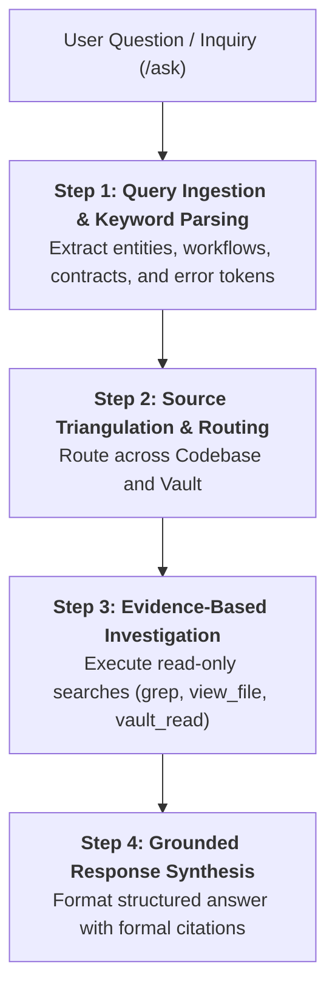

# Skill: Project Oracle (`/ask`)

Operates as the **knowledge consultation bridge** across the project repository, architecture records, and the Obsidian Vault, answering conceptual, behavioral, and implementation questions in **Strictly Read-Only Mode**.

---

## Universal Operational Guardrails

- **Zero Modifications (Strict Read-Only Mode):**
  - Creating, updating, appending to, or deleting any file in the workspace or Obsidian Vault is strictly forbidden.
- **Zero Mutating Commands:**
  - Running modifying terminal commands (package installations, database migrations, build scripts that generate tracked artifacts, Git commits, branch checkouts) is strictly prohibited.
  - Permitted terminal usage is strictly limited to non-modifying diagnostics (`git --no-pager log`, `git status`, `python --version`).
- **Grounded Evidence Requirement:**
  - Speculation, guessing, and hallucinating system behavior are strictly prohibited.
  - Every technical claim must be explicitly anchored in code lines (`file:///path#L10-L25`) or Obsidian Vault notes (`[[note]]`).

---

## Execution Pipeline in 4 Steps

### Step 1: Query Ingestion & Keyword Parsing
1. Parse the incoming inquiry to identify core technical subjects:
   - Domain entities, interfaces, or classes.
   - Specific user journeys or API endpoints.
   - Architectural policies, conventions, or design patterns.
   - Stack traces, error codes, or configuration variables.
2. Isolate whether the inquiry seeks:
   - *Current Implementation:* "Where and how is X implemented?"
   - *Architectural Rationale:* "Why was X designed this way?"
   - *Governance / Policy:* "What is our convention regarding Y?"

### Step 2: Source Triangulation & Routing
Determine the authoritative sources required to answer the inquiry:
- **Codebase Truth (Source of Execution):** Code files, test suites, and manifests (`pyproject.toml`, `package.json`).
- **Obsidian Vault (Source of Intent & Decisions):**
  - `00-core-rules/`: Conventions, domain glossary, and ADRs.
  - `01-concepcao/`: Feature BDD scenarios and SDD blueprints.
  - `02-auditorias/`: Domain audit reports and technical pivot logs.
  - `03-releases/`: Consolidated changelogs and release notes.
- **Guideline Reference:** See [`./references/ask-sources.md`](./references/ask-sources.md).

### Step 3: Evidence-Based Investigation (Read-Only)
1. Use non-mutating search tools (`grep_search`, `find_by_name`, `view_file`) to locate exact source lines.
2. Read corresponding architecture notes in the Vault.
3. Cross-reference claims between documentation and actual implementation:
   - If documentation contradicts code, document the discrepancy explicitly.
4. If the requested information is absent or undocumented, state the absence transparently (epistemic humility).

### Step 4: Grounded Response Synthesis & Citations
1. Construct a structured, concise response directly in the conversation:
   - **Direct Answer:** Executive summary answering the query in 1-2 sentences.
   - **Architectural Rationale:** Policy or intent anchored in Vault wikilinks (`[[note-name]]`).
   - **Implementation Evidence:** Concrete logic anchored in file paths with line references (`file:///path#L10-L25`).
   - **Gaps & Edge Cases:** Uncovered areas or discrepancies discovered.
   - **Recommended Next Action:** If modifications are needed, recommend the appropriate skill (`/plan`, `/implement`, `/test-fix`, or `/debug`).
2. **Review Examples:** Consult [`./examples/ask-example.md`](./examples/ask-example.md).

---

## Bundled References & Examples

- **Operational Guide:**
  - [`references/ask-sources.md`](./references/ask-sources.md) — Source triangulation framework, Obsidian navigation taxonomy, citation standards, and inquiry routing.
- **Session Walkthroughs:**
  - [`examples/ask-example.md`](./examples/ask-example.md) — Representative ask consultations (architectural query, code-tracing query, handling documentation gaps).
