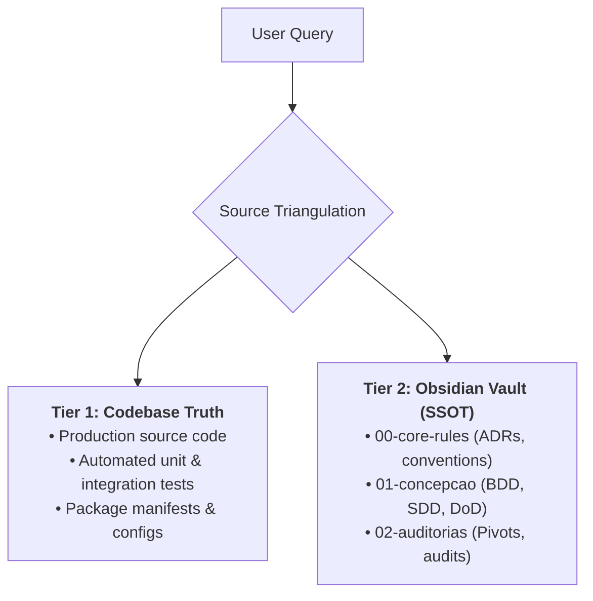

# Ask Sources: Context Discovery, Inquiry Routing & Source Triangulation

This operational reference provides the methodology for conducting evidence-based, strictly read-only investigations across codebase repositories and the Obsidian Vault knowledge base.

---

## 1. Universal Read-Only Guardrails

The `/ask` workflow functions strictly in consultative mode. Agents must strictly adhere to the following negative constraints:

| Prohibited Action | Enforcement Mechanism | Correct Alternative |
|:---|:---|:---|
| Writing or modifying code | Tool call rejection | Cite the existing code and suggest `/implement` or `/plan`. |
| Creating or modifying Vault notes | Tool call rejection | Suggest updating documentation in Phase 5 via `/docs`. |
| Running tests or builds | Tool call rejection | Explain existing test files; do not run active runners. |
| Making Git commits or branch switches | Tool call rejection | Provide the exact `git checkout` command for the user to run. |
| Hallucinating or extrapolating | Fact-checking gate | State clearly: *"This behavior is not documented or present in the codebase."* |

---

## 2. The 2-Tier Source Triangulation Framework

To ensure accurate, comprehensive responses, synthesize evidence across two complementary source tiers:



### Tier 1: Codebase Truth (What the System Actually Does)
- Code files (`.py`, `.ts`, `.go`, etc.) represent the absolute ground truth of current runtime behavior.
- Automated tests (`tests/`) indicate the verified behavioral boundaries and edge cases.
- Configuration manifests (`pyproject.toml`, `Dockerfile`, `.env.example`) define environmental boundaries.

### Tier 2: Obsidian Vault (Why the System Does It)
The Obsidian Vault provides architectural intent, business constraints, and evolution history:
- `00-core-rules/`:
  - `conventions.md`: Global coding, naming, and architectural conventions.
  - `domain-glossary.md`: Canonical ubiquitous domain language definitions.
  - `adrs/adr-[slug].md`: Architectural Decision Records explaining structural choices.
- `01-concepcao/`:
  - `epic-[slug].md`: Macro-architecture decomposition blueprints.
  - `bdd-[slug].md`: User-facing behavioral scenarios and acceptance criteria.
  - `sdd-[slug].md`: Software Design Documents with component diagrams and typed contracts.
  - `dod-[slug].md`: Definition of Done tracking.
- `02-auditorias/`:
  - `audit-[domain]-[slug].md`: Static review findings across Architecture, Security, Quality, Perf, Resilience.
  - `pivots-[slug].md`: Records of design deviations taken during TDD implementation.
- `03-releases/`:
  - `changelog-vX.Y.Z.md`: Production release history and SemVer notes.

---

## 3. Inquiry Routing & Context-Isolated Investigation Protocol (`Model: "flash_lite"`)

When an inquiry arrives, execute this structured investigation workflow:

```text
[Parse Query Keywords]
       │
       ├─► Architectural / Policy Query? ──► Search Obsidian `00-core-rules/` & `01-concepcao/`
       │
       ├─► Implementation / Bug Query?  ──► Grep codebase & inspect corresponding tests
       │
       └─► Release / History Query?     ──► Inspect `03-releases/` & Git commit history
```

### Search Tool Sequence & Conditional Subagent Routing (`Model: "flash_lite"`):
- **Direct Lookup (1–2 known files):** Run `grep_search`, `find_by_name`, or `read_file` directly in the Main Orchestrator.
- **Broad Survey (> 2 files or cross-module/Vault investigation):** Delegate the search sequence to the built-in read-only **`research`** subagent (`TypeName: "research"`, `Model: "flash_lite"`) so raw search outputs and intermediate file reads stay out of the main conversation context window:
  1. `grep_search`: Fast pattern match for class names, function definitions, routes, or error strings across the repository.
  2. `find_by_name`: Locate relevant files by name when file structure is known or suspected.
  3. `view_file` / `read_file`: Read specific line ranges containing the identified logic, imports, and docstrings.
  4. `read_vault_note` / `search_query`: Locate matching architectural rationale in the Obsidian Vault.

---

## 4. Formal Citation Standards

Every response must provide concrete, traceable citations using standardized Markdown formatting:

### 1. Codebase Citations:
Always format file citations as Markdown links with the `file:///` scheme and line number ranges:

```markdown
- Single file: [auth_service.py](file:///path/to/project/auth_service.py)
- Specific lines: [auth_service.py#L42-L65](file:///path/to/project/auth_service.py#L42-L65)
- Manifest citation: [pyproject.toml#L18](file:///path/to/project/pyproject.toml#L18)
```

### 2. Obsidian Vault Citations:
Always format Vault citations using native wikilink syntax:
- General convention: `[[conventions]]`
- Specific ADR: `[[adr-002-jwt-authentication]]`
- Feature blueprint: `[[sdd-user-registration]]`
- Audit report: `[[audit-security-payment-gateway]]`

### 3. Epistemic Humility & Handling Gaps:
When the requested behavior cannot be verified:
- Clearly state what was searched: *"Searched codebase for `TokenRevocationService` and Vault note `[[conventions]]`."*
- State the gap unequivocally: *"No automated token revocation or blacklisting mechanism is currently implemented."*
- Propose the constructive next step: *"To specify and implement token revocation, begin with `/plan`."*

---

## 5. Inquiry Routing Decision Tree

Guide the user to the appropriate follow-up workflow based on their ultimate objective:

| If the user's inquiry reveals... | Recommend this Skill: |
|:---|:---:|
| A desire to specify a new feature or change existing contracts | `/plan` |
| An approved plan ready for code implementation | `/implement` |
| A failing unit or integration test requiring surgical repair | `/test-fix` |
| An unexplained runtime exception or crash needing 5 Whys analysis | `/debug` |
| Structural code rot, cyclomatic complexity, or SOLID violations | `/refactor` |
| A multi-domain code quality or security audit request | `/review` |
| A complex, multi-PR initiative needing vertical slicing | `/decompose` |
| Outdated documentation or missing module READMEs | `/docs` |
