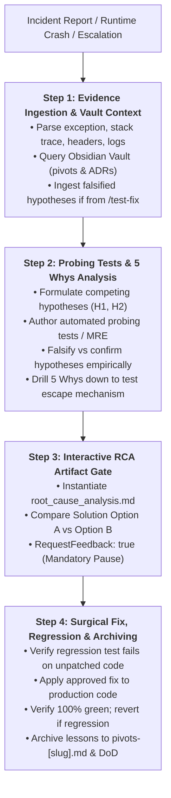

# Skill: Forensic Bug Investigation & Root Cause Analysis (`/debug`)

Orchestrates deep forensic diagnosis of critical runtime crashes, unhandled exceptions, asynchronous race conditions, resource leaks, and integration failures that escaped pre-merge test suites or escalated from `/test-fix`. Employs the **Scientific Method**, **Empirical Probing Tests**, the **5 Whys Framework**, and an interactive Root Cause Analysis (RCA) approval gate before modifying code.

---

## Universal Operational Guardrails

- **Mandatory Approval Phase Gate (`RequestFeedback: true`):** The agent is strictly prohibited from editing production code or test files until the Root Cause Analysis artifact (`root_cause_analysis.md`) has been generated from [`./resources/rca-template.md`](./resources/rca-template.md) and explicitly approved by the user.
- **Scientific Evidence & Empirical Probing Tests:** Speculating, guessing, or patching symptoms blindly by merely reading source code is strictly forbidden. Competing hypotheses ($H_1, H_2$) must be empirically tested and falsified using **automated probing/characterization tests** or deterministic Minimal Reproducible Examples (MRE) before proposing solutions.
- **Escalation Ingestion from `/test-fix`:** When invoked following a Double-Strike failure/rollback in `/test-fix`, immediately ingest the failing test node, full stack trace, and the two already-falsified hypotheses to avoid redundant investigations.
- **Isolated Diagnostic Commands:** Provide all CLI diagnostic and reproduction commands in individual, isolated `bash` blocks for clean copying and execution.
- **Strict 5 Whys Depth:** The 5th "Why?" in the analysis must mandatorily answer: *"Why did our existing automated test suite fail to catch this defect before runtime?"*
- **Mandatory Regression Test:** Every bug resolution must include a permanent, reproducible regression test that fails before the fix (Red) and passes green after the fix (Green).
- **Regression Recovery Loop:** If a proposed fix fails during verification or introduces collateral test breakages in Step 4, immediately revert via `git reset --hard HEAD`, record the falsification, and formulate a new hypothesis ($H_3$).
- **Obsidian & Living DoD Persistence:** Record the resolution, root cause, and architectural takeaways in the Obsidian Vault at `02-auditorias/pivots-[slug].md` via `@obsidian` and synchronize status in `01-concepcao/dod-[slug].md`.

---

## Execution Pipeline in 4 Steps



### Step 1: Initial Triage & Evidence Gathering
1. Parse the incoming incident report, error logs, and stack traces to isolate:
   - Primary exception type and message.
   - HTTP status code or process exit code.
   - Active execution environment (OS, Python runtime version, worker concurrency model).
   - Component boundaries, database drivers, or third-party APIs involved.
2. If escalated from `/test-fix` (Double-Strike triggered):
   - Ingest the failing test identifier (`path/to/test_file.py::test_name`).
   - Ingest the two previously falsified hypotheses to avoid repeating dead-end attempts.
3. Search the Obsidian Vault via `@obsidian` for previous occurrences, architectural pivots, or known constraints:
   - `02-auditorias/pivots-[slug].md` (historical technical pivots).
   - `00-core-rules/adrs/` (architectural decision records).
4. Confirm repository branch and working directory cleanliness via `git -C <path> status --short`.
5. **Detailed Reference:** Review [`./references/debug-methodology.md`](./references/debug-methodology.md).

### Step 2: Probing Tests & 5 Whys Analysis (Scientific Method)
1. Formulate at least two competing hypotheses ($H_1$, $H_2$) to prevent confirmation bias.
2. Define explicit falsification criteria for each hypothesis.
3. **Execute Automated Probing Tests (Characterization Testing):**
   - Do not guess or attempt to spot defects purely through visual code inspection.
   - Author isolated, automated probing tests (or an MRE script) that programmatically exercise edge conditions, inject network/boundary errors via controlled mocks, or simulate concurrency to observe actual runtime state.
   - Run probing tests to deterministically prove or falsify $H_1$ and $H_2$.
4. Execute the **5 Whys Inquiry Chain**, starting from the observable symptom down to the systemic defect. Ensure Why 5 specifically addresses why the existing automated test suite allowed the defect to escape.

### Step 3: Root Cause Analysis (RCA) Artifact & Interactive Approval Gate
1. Instantiate the Root Cause Analysis artifact `root_cause_analysis.md` using [`./resources/rca-template.md`](./resources/rca-template.md).
2. Detail:
   - Incident context and verified symptoms.
   - Step-by-step 5 Whys derivation.
   - Hypothesis evaluation matrix with probing test outcomes.
   - Trade-off comparison between **Option A (Recommended Surgical Fix)** and **Option B (Alternative/Architectural Fix)**.
   - Concrete regression test design (derived directly from the confirmed probing test).
3. **Phase Gate:** Present the artifact to the user with `RequestFeedback: true`.
   > ⚠️ **MANDATORY PAUSE:** Wait for explicit user confirmation before touching any codebase files.

### Step 4: Surgical Resolution, Regression Safeguard & Knowledge Archiving
1. Upon user approval, author the permanent regression test in the appropriate test suite (e.g., `tests/regression/` or `tests/integration/`).
2. Run the regression test to guarantee it **fails deterministically** on unpatched code:
   ```bash
   python -m pytest tests/regression/test_defect_regression.py -v
   ```
3. Apply the approved surgical fix strictly to the identified production files.
4. Run the full test suite to guarantee zero regressions:
   ```bash
   python -m pytest tests/ -v
   ```
5. **Regression Recovery Loop:**
   - If the regression test still fails or existing tests break, **do not layer unverified edits**.
   - Immediately execute `git reset --hard HEAD` to restore the clean baseline.
   - Record the failed attempt as a falsified hypothesis, formulate $H_3$, and re-evaluate.
6. Commit the fix and regression test using structured semantic format:
   ```bash
   git add path/to/source.py tests/path/test_regression.py
   git commit -m "fix(debug): resolve [defect description] with regression test"
   ```
7. Append the incident resolution and takeaways to the Obsidian Vault in `02-auditorias/pivots-[slug].md` via `@obsidian` and update `01-concepcao/dod-[slug].md`.
8. Issue the completion summary:
   > **[NEXT STEP]** *"Forensic bug resolution complete! Root cause eradicated, regression test verified green, and findings archived in Obsidian. Resume normal operations or proceed to `/review` if preparing for release."*

---

## Bundled References, Resources & Concrete Examples

- **Operational Methodology:**
  - [`references/debug-methodology.md`](./references/debug-methodology.md) — Comprehensive guide covering the Scientific Method, MRE construction, Probing/Characterization Tests, 5 Whys execution, hypothesis evaluation, and interactive gate protocol.
- **Pure Templates:**
  - [`resources/rca-template.md`](./resources/rca-template.md) — Unpopulated Root Cause Analysis artifact template for interactive phase gate submission (`root_cause_analysis.md`).
- **Concrete Walkthrough:**
  - [`examples/debug-example.md`](./examples/debug-example.md) — End-to-end walkthrough diagnosing an asynchronous connection pool starvation bug, complete with 5 Whys, MRE reproduction, and regression testing.
