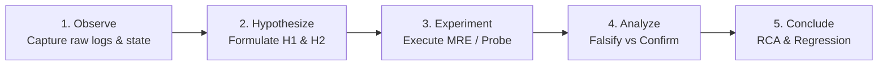

# Forensic Investigation Methodology & The 5 Whys Framework (`/debug`)

This guide defines the scientific investigation principles, hypothesis invalidation protocols, and Root Cause Analysis (RCA) standards applied during forensic debugging under `/debug`.

---

## 1. The Scientific Method in Software Diagnostics

Debugging complex runtime defects requires treating the software system as an empirical subject. The process follows five rigorous stages:



1. **Observe (Empirical Evidence):** Record observable facts: timestamp, exception type, thread/process ID, input payload, database connection pool state, memory utilization. Do not accept assumptions as facts.
2. **Hypothesize (Competing Explanations):** Formulate at least two distinct causal explanations for the failure:
   - Primary Hypothesis ($H_1$): Most probable failure mechanism.
   - Alternative Hypothesis ($H_2$): Competing mechanism (e.g., timing/concurrency, configuration mismatch, network timeout).
3. **Experiment (Minimal Reproducible Example):** Isolate the smallest code snippet or test scenario that deterministically triggers the bug without extraneous application baggage.
4. **Analyze (Falsification):** Evaluate test results against hypotheses. A hypothesis is considered valid only when its falsification criteria fail to trigger.
5. **Conclude (RCA & Permanent Fix):** Document findings and design the surgical solution and automated regression safeguard.

---

## 2. Minimal Reproducible Example (MRE) Construction

An MRE strips away the vast majority of the application to isolate the single failing mechanism.

### Key MRE Characteristics:
- **Minimal:** Uses the absolute fewest lines of code, minimal imports, and smallest payload.
- **Self-Contained:** Can be executed standalone from the terminal without external database dependencies (or with a deterministic in-memory mock).
- **Deterministic:** Fails 100% of the time under specified conditions (or with a controlled concurrency loop for race conditions).

### Diagnostic Command Standards:
All diagnostic and reproduction commands must be written in isolated `bash` blocks:
```bash
# Run isolated MRE reproduction script
python scripts/reproduce_issue.py --concurrency 5 --timeout 2.0
```

---

## 3. The 5 Whys Framework (Root Cause Extraction)

The **5 Whys** method is an iterative questioning technique used to explore the cause-and-effect relationships underlying a software failure.

```
Observable Symptom (Surface)
  └── Why 1? Direct cause of symptom
        └── Why 2? Underlying condition enabling direct cause
              └── Why 3? Flaw in implementation or architecture
                    └── Why 4? Omission in design or error handling
                          └── Why 5? (MANDATORY TEST ESCAPE) Why did tests miss this?
```

### The Mandatory 5th Why Rule:
In `/debug`, the **5th Why must always answer why the existing test suite and quality gates failed to detect the defect before it hit runtime**. 

- *Incorrect 5th Why:* "Because the developer forgot to add a try/catch." (Superficial, points blame, lacks systemic value).
- *Correct 5th Why:* "Because unit tests in `tests/unit/test_worker.py` mocked the database session using a simple object that lacked pool connection lifecycle semantics, meaning unclosed connections were never counted or flagged during CI."

---

## 4. Hypothesis Formulation & Invalidation Matrix

To prevent confirmation bias, evaluate competing hypotheses systematically:

| Hypothesis | Proposed Mechanism | Falsification Test / Probe | Observed Outcome | Status |
| :--- | :--- | :--- | :--- | :--- |
| **$H_1$ (Database Timeout)** | Upstream database drops connection under load. | Measure database latency directly via ping and isolated query probe during crash. | Database response latency remained $< 2\text{ms}$; zero network drops. | **Falsified** |
| **$H_2$ (Connection Leak)** | Worker exceptions skip connection release, exhausting pool. | Monitor `pool.checkedout()` count before and after forced worker exception in MRE. | Connection count increments on every exception and never decrements. | **Confirmed** |

---

## 5. The Root Cause Analysis (RCA) Interactive Gate

Before modifying any source code, the agent must instantiate `root_cause_analysis.md` using [`../resources/rca-template.md`](../resources/rca-template.md) and pause for user approval.

### Phase Gate Checklist:
- [ ] Incident symptoms, environment, and error signatures documented.
- [ ] 5 Whys sequence detailed, with Why 5 answering test escape.
- [ ] Competing hypotheses evaluated with empirical evidence.
- [ ] **Option A (Recommended)** vs **Option B (Alternative)** analyzed with trade-offs.
- [ ] Explicit regression test plan specified.
- [ ] Submitted with `RequestFeedback: true`.

---

## 6. Permanent Regression Prevention & Knowledge Persistence

Once the user approves the RCA:
1. **Author the Regression Test:** Create a new test in `tests/regression/` or `tests/integration/`. Run it before editing production code to verify that it reproduces the exact failure.
2. **Apply the Surgical Fix:** Edit production code to eradicate the root cause identified in Why 4 and Why 5.
3. **Verify Green Status:** Re-run the regression test and confirm 100% pass rate.
4. **Archive to Obsidian Vault:** Open `02-auditorias/pivots-[slug].md` via `@obsidian` and append the incident log, architectural takeaways, and link to the new regression test.
