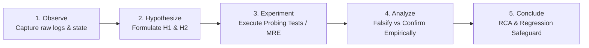

# Forensic Investigation Methodology & The 5 Whys Framework (`/debug`)

This guide defines the scientific investigation principles, hypothesis invalidation protocols, empirical probing tests, and Root Cause Analysis (RCA) standards applied during forensic debugging under `/debug`.

---

## 1. The Scientific Method in Software Diagnostics

Debugging complex runtime defects requires treating the software system as an empirical subject. Speculating, guessing, or patching symptoms blindly by reading source code is strictly prohibited. The process follows five rigorous stages:



1. **Observe (Empirical Evidence):** Record observable facts: timestamp, exception type, thread/process ID, input payload, database connection pool state, memory utilization. Do not accept assumptions as facts.
2. **Hypothesize (Competing Explanations):** Formulate at least two distinct causal explanations for the failure:
   - Primary Hypothesis ($H_1$): Most probable failure mechanism.
   - Alternative Hypothesis ($H_2$): Competing mechanism (e.g., timing/concurrency, configuration mismatch, network timeout).
3. **Experiment (Automated Probing Tests):** Isolate the defect mechanism by writing automated characterization tests or a deterministic Minimal Reproducible Example (MRE).
4. **Analyze (Falsification):** Evaluate test outputs against hypotheses. A hypothesis is considered valid only when its falsification criteria fail to trigger under rigorous testing.
5. **Conclude (RCA & Permanent Fix):** Document findings, obtain user approval, apply the surgical fix, verify zero regressions, and commit.

---

## 2. Empirical Probing Tests (Characterization Testing)

Rather than passively reading code and trying to deduce the failure mechanism mentally, `/debug` mandates the use of **automated probing tests** (also known as characterization or exploratory tests).

### 2.1. Why Probing Tests Over Guesswork?
- **Immunity to Confirmation Bias:** Code inspection often leads developers or AI models to see what they expect to see. A test runner reports only ground truth.
- **Precision in Boundary Conditions:** Probing tests pass extreme inputs (`None`, empty collections, maximum integers, malformed UTF-8) to verify where boundaries break.
- **Controlled Fault Injection:** Using mocks with `side_effect=Exception`, probing tests simulate external infrastructure failures (timeouts, network resets, HTTP 500s) deterministically.
- **Immediate Path to Permanent Regression Safeguard:** The probing test that successfully reproduces and confirms the bug becomes the foundation for the permanent regression test in Step 4.

### 2.2. Probing Test Execution Pattern:
```python
# tests/probing/test_probe_connection_lifecycle.py
import pytest
from unittest.mock import AsyncMock

@pytest.mark.asyncio
async def test_probe_pool_leak_on_upstream_timeout():
    """Probing test for H2: Checks if pool exhausts when upstream times out."""
    pool = ConnectionPool(max_size=2)
    client = NotificationClient(pool=pool)
    client.http_post = AsyncMock(side_effect=TimeoutError("Gateway timeout"))

    with pytest.raises(TimeoutError):
        await client.dispatch_notification("PAYLOAD-1")

    # Empirical check: did the checkout leak?
    assert pool.checkedout_count == 0, f"Leaked {pool.checkedout_count} connections!"
```

---

## 3. Minimal Reproducible Example (MRE) Construction

When defects involve complex multi-process concurrency, memory leaks, or operating system signals, an MRE script isolates the failing mechanism from application baggage.

### Key MRE Characteristics:
- **Minimal:** Uses the absolute fewest lines of code, minimal imports, and smallest payload.
- **Self-Contained:** Can be executed standalone from the terminal without external database dependencies (or with a deterministic in-memory mock).
- **Deterministic:** Fails 100% of the time under specified conditions (or with a controlled concurrency loop for race conditions).

### Diagnostic Command Standards:
All diagnostic and reproduction commands must be written in isolated `bash` blocks:
```bash
# Run isolated MRE reproduction script
python scripts/reproduce_issue.py --concurrency 5 --timeout 2.0
```

---

## 4. The 5 Whys Framework (Root Cause Extraction)

The **5 Whys** method is an iterative questioning technique used to explore the cause-and-effect relationships underlying a software failure.

```
Observable Symptom (Surface)
  └── Why 1? Direct cause of symptom
        └── Why 2? Underlying condition enabling direct cause
              └── Why 3? Flaw in implementation or architecture
                    └── Why 4? Omission in design or error handling
                          └── Why 5? (MANDATORY TEST ESCAPE) Why did tests miss this?
```

### The Mandatory 5th Why Rule:
In `/debug`, the **5th Why must always answer why the existing test suite and quality gates failed to detect the defect before it hit runtime**. 

- *Incorrect 5th Why:* "Because the developer forgot to add a try/catch." (Superficial, points blame, lacks systemic value).
- *Correct 5th Why:* "Because unit tests in `tests/unit/test_worker.py` mocked the database session using a simple object that lacked pool connection lifecycle semantics, meaning unclosed connections were never counted or flagged during CI."

---

## 5. Hypothesis Formulation & Invalidation Matrix

To prevent confirmation bias, evaluate competing hypotheses systematically using evidence from probing tests:

| Hypothesis | Proposed Mechanism | Falsification Test / Probe | Observed Outcome | Status |
| :--- | :--- | :--- | :--- | :--- |
| **$H_1$ (Database Timeout)** | Upstream database drops connection under load. | Measure database latency directly via ping and isolated query probe during crash. | Database response latency remained $< 2\text{ms}$; zero network drops. | **Falsified** |
| **$H_2$ (Connection Leak)** | Worker exceptions skip connection release, exhausting pool. | Monitor `pool.checkedout()` count in probing test with injected mock exception. | Connection count increments on every exception and never decrements. | **Confirmed Root Cause** |

---

## 6. The Root Cause Analysis (RCA) Interactive Gate

Before modifying any source code, the agent must instantiate `root_cause_analysis.md` using [`../resources/rca-template.md`](../resources/rca-template.md) and pause for user approval.

### Phase Gate Checklist:
- [ ] Incident symptoms, environment, and error signatures documented.
- [ ] 5 Whys sequence detailed, with Why 5 answering test escape.
- [ ] Competing hypotheses evaluated with empirical probing test evidence.
- [ ] **Option A (Recommended)** vs **Option B (Alternative)** analyzed with trade-offs.
- [ ] Explicit regression test plan specified.
- [ ] Submitted with `RequestFeedback: true`.

---

## 7. Regression Safeguards & Recovery Loop

Once the user approves the RCA:
1. **Author the Permanent Regression Test:** Create a new test in `tests/regression/` or `tests/integration/`. Run it before editing production code to verify that it **fails deterministically** (Red).
2. **Apply the Surgical Fix:** Edit production code to eradicate the root cause identified in Why 4 and Why 5.
3. **Verify Green Status:** Re-run the regression test and confirm 100% pass rate.
4. **Full Suite Verification:** Run the full test suite to guarantee zero collateral breakages.
5. **Regression Recovery Loop:**
   - If tests fail after the fix, **never apply unverified trial-and-error edits**.
   - Immediately execute `git reset --hard HEAD` to restore the clean baseline.
   - Record the failed attempt as a falsified hypothesis, formulate $H_3$, and re-evaluate.
6. **Archive to Obsidian Vault & Living DoD:**
   - Append the incident log and architectural takeaways in `02-auditorias/pivots-[slug].md` via `@obsidian`.
   - Synchronize status in the Living DoD at `01-concepcao/dod-[slug].md`.

---

## 8. Escalation Handover from `/test-fix`

When `/test-fix` triggers the Double-Strike Rule (two consecutive failed surgical attempts), execution must cleanly escalate to `/debug`:
1. Ingest the failing test node and traceback.
2. Ingest the two previously falsified hypotheses from `/test-fix` so `/debug` does not repeat them.
3. Formulate fresh hypotheses ($H_3, H_4$) using deeper probing tests and architectural analysis.
