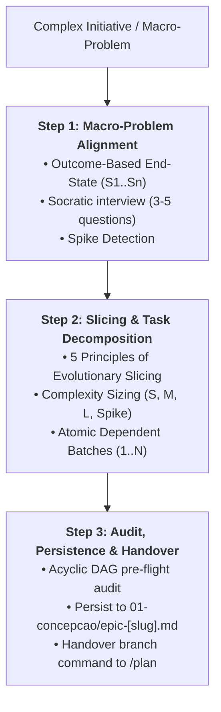

# Skill: Task Decomposition & Epic Slicing (`/decompose`)

Orchestrates **Phase 0 (Macro-Architecture & Task Breakdown)** of the development lifecycle, decomposing large initiatives, cross-cutting migrations, and complex product epics into ordered vertical slices and atomic task checklists before feature planning begins.

---

## Operational Scope & Boundaries

- **Input Scope:**
  - Complex architectural demands, multi-system initiatives, or broad feature requests exceeding a single-chat context window or single PR.
  - Existing codebase context, architectural documentation, and dependency manifests.
- **Output Artifacts:**
  - Epic Blueprint (`01-concepcao/epic-[slug].md`) or Atomic Task Breakdown (`task_list.md`) following [`./resources/task-template.md`](./resources/task-template.md).
- **Scope Limits:**
  - Operates strictly at macro and intermediate architecture levels.
  - Granular file diffs, low-level class method signatures, and TDD batch mechanics belong to Phase 1 via `/plan` and Phase 2 via `/implement`.

---

## Execution Pipeline in 3 Steps



### Step 1: Macro-Problem Alignment & Debate (Outcome-Based)
1. Ingest user requirements and examine current codebase context, domain boundaries, and existing conventions.
2. Formulate the **Desired Observable End-State**, extracting verifiable success criteria ($S_1 \dots S_n$).
3. Treat user-suggested implementations strictly as working hypotheses; eliminate the macro XY Problem and challenge fragile assumptions.
4. Conduct an adaptive Socratic interview asking **3 to 5 targeted questions** per turn using the interactive `ask_question` tool as the primary channel.
5. Formulate 2 (default) or at most 3 distinct macro-slicing strategies (MVP-First vs. Contract-First vs. Strangler Fig) in the Slicing Strategy Matrix.
6. **Spike Detection:** If critical technical uncertainty or an unproven library prevents confident breakdown, isolate a timeboxed **Spike** task before continuing.
- **Operational Guides:** [`./references/decompose-debate.md`](./references/decompose-debate.md) | [`./references/decompose-protocol.md`](./references/decompose-protocol.md)

### Step 2: Evolutionary Slicing & Complexity Sizing
1. Decompose the initiative into vertical slices applying the **5 Principles of Evolutionary Slicing**:
   - *Verifiable Delivery:* Every slice delivers observable behavior or a justified technical enabler.
   - *Compatible Evolution:* Sub-feature $N+1$ extends $N$ without destructive rework or breaking prior tests.
   - *Explicit Boundaries:* Model boundary contracts (`IRepository`, `IClient`) alongside the first consumer; isolate with Fakes.
   - *Incremental Integration:* Continuous integration to `develop` under quality gates; never defer integration adapters.
   - *Single-Chat Calibration:* Each sub-feature must fit comfortably into one ephemeral chat session.
2. Perform **Complexity Sizing** ($S$, $M$, $L$, $Spike$):
   - Items evaluated as $L$ must be sliced into $S$ or $M$ sub-features.
3. Structure work into **Atomic Dependent Batches**:
   - **Batch 1:** Domain entities, value objects, and base boundary contracts (zero dependencies).
   - **Intermediate Batches:** Use cases, domain services, and business rules consuming Batch 1.
   - **Final Batch:** Infrastructure adapters, controllers, and end-to-end integration.
4. Enforce the **Anti-Bureaucracy Directive**:
   - Keep conditional sections concise (1 line or `N/A: [reason]`). Prohibit micro-implementation details reserved for `/plan`.
5. Populate the breakdown using [`./resources/task-template.md`](./resources/task-template.md).

### Step 3: Consistency Audit, Persistence & Handover
1. Execute the **Pre-Flight Consistency Audit**:
   - Verify that the dependency graph is a strict Directed Acyclic Graph (DAG).
   - Ensure every shared contract has an identified introducer and at least one consumer.
   - Confirm that no slice depends on parallel unmerged branches.
2. Present the decomposition artifact with `RequestFeedback: true`.
3. Upon approval, persist the blueprint to the Obsidian Vault at `01-concepcao/epic-[slug].md`.
4. Issue the phase transition handover recommendation:
   ```bash
   git switch develop; git pull --ff-only; git switch -c feature/[first-feature-slug]
   ```
   > **[NEXT STEP]** *"Macro-architecture decomposition complete! Run the git command above and execute `/plan` to initiate Phase 1 feature conception."*

---

## Bundled References & Templates

- **Operational Methodology & Debate:**
  - [`references/decompose-debate.md`](./references/decompose-debate.md) — Socratic interview protocol, `ask_question` tool usage, XY Problem elimination, and macro-slicing proposals.
  - [`references/decompose-protocol.md`](./references/decompose-protocol.md) — Slicing methodology, atomic batching, complexity sizing, DAG audit.
- **Pure Templates:**
  - [`resources/task-template.md`](./resources/task-template.md) — Pure task checklist, dependency mapping, and complexity tracking template.
- **Concrete Examples:**
  - [`examples/decompose-example.md`](./examples/decompose-example.md) — End-to-end decomposition walkthrough of an asynchronous notification and audit epic.
