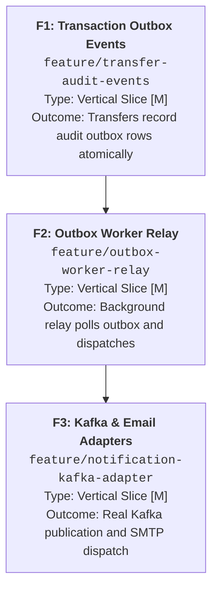

# Representative Decomposition Session: Audit Log & Notification Pipeline

This walkthrough illustrates a full execution of `/decompose` on a complex initiative: introducing asynchronous audit logging and notification events to a financial transaction service.

---

## Step 1: Macro-Problem Alignment (Outcome-Based)

### User Prompt:
> "We need to add Kafka and publish audit events whenever a money transfer occurs, and also send an email notification to the user."

### Agent Socratic Alignment:
1. **Desired Observable End-State:**
   Every approved transaction records a tamper-proof audit event and triggers an asynchronous customer notification without increasing transaction API latency above 150ms.
2. **Hypothesis Evaluation:**
   Directly coupling Kafka into the core transfer endpoint introduces tight coupling and single-point-of-failure risks. An internal transactional event outbox pattern decouples the transfer persistence from external broker availability.
3. **Socratic Questions Asked:**
   - *Q1 (Delivery Guarantee):* Is at-least-once delivery acceptable for audit records and email notifications? $\rightarrow$ *Answer: Yes, at-least-once with idempotent consumer processing.*
   - *Q2 (Transaction Atomicity):* Must the audit log record be committed in the same database transaction as the transfer? $\rightarrow$ *Answer: Yes, guaranteed audit trail is mandatory.*
   - *Q3 (External Dependency):* Is Kafka infrastructure already provisioned in staging? $\rightarrow$ *Answer: In staging yes, but local development requires in-memory or containerized fallbacks.*

---

## Step 2: Evolutionary Slicing & Roadmap Generation

The initiative is decomposed into 3 monotonic, evolutionary vertical slices:
- **Feature 1 (`feature/transfer-audit-events`):** Domain Transaction Events & Outbox Interface (`[M]`).
- **Feature 2 (`feature/outbox-worker-relay`):** Outbox Polling Relay & In-Memory Dispatcher (`[M]`).
- **Feature 3 (`feature/notification-kafka-adapter`):** Concrete Kafka & Email Notification Adapters (`[M]`).

### Dependency Graph (Acyclic DAG)



---

## Step 3: Decomposed Sub-Feature Specifications

### Sub-Feature 1: Transaction Domain Events & Outbox Table
- **Branch:** `feature/transfer-audit-events`
- **Type:** Vertical Slice `[M]`
- **Objective:** Atomically persist an `AuditEvent` payload into an outbox repository within the primary transfer database transaction.
- **Batches:**
  - *Batch 1 `[S]` (Domain Core):* `AuditEvent` value object, `AuditEventType` enum, and `IAuditOutboxRepository` interface.
  - *Batch 2 `[M]` (Use Case):* Enrich `TransferFundsUseCase` to stage `AuditEvent` upon transfer completion. Tested with `InMemoryAuditOutboxRepository`.
  - *Batch 3 `[M]` (Adapter):* PostgreSQL relational outbox table migration and SQLAlchemy adapter.
- **Acceptance Criteria:**
  - [ ] Every successful fund transfer creates a corresponding outbox row with status `PENDING`.
  - [ ] If fund transfer rolls back, outbox entry is also rolled back atomically.

### Sub-Feature 2: Outbox Worker Relay & Internal Dispatcher
- **Branch:** `feature/outbox-worker-relay`
- **Type:** Vertical Slice `[M]`
- **Objective:** Provide a resilient polling background worker that reads `PENDING` outbox entries and publishes them to an abstract `IEventPublisher`.
- **Batches:**
  - *Batch 1 `[S]` (Contract):* `IEventPublisher` interface and in-memory test spy publisher.
  - *Batch 2 `[M]` (Relay Logic):* `OutboxRelayWorker` with batch locking (`SELECT ... FOR UPDATE SKIP LOCKED`), status transitions (`PENDING` $\rightarrow$ `PUBLISHED` / `FAILED`), and exponential backoff retry.
- **Acceptance Criteria:**
  - [ ] Worker processes up to 100 pending events per batch without duplicate execution under concurrent workers.
  - [ ] Transient dispatch errors mark outbox rows for retry with backoff.

### Sub-Feature 3: Concrete Kafka & Notification Adapters
- **Branch:** `feature/notification-kafka-adapter`
- **Type:** Vertical Slice `[M]`
- **Objective:** Implement the real Kafka producer adapter and customer email notification handler.
- **Batches:**
  - *Batch 1 `[M]` (Kafka Adapter):* `KafkaEventPublisher` implementing `IEventPublisher` with connection timeouts and message serialization.
  - *Batch 2 `[M]` (Notification Consumer):* Consumer listening to published transfer events and issuing templated confirmation emails via `IEmailClient`.
- **Acceptance Criteria:**
  - [ ] Messages successfully published to target Kafka topic verified by integration test.
  - [ ] Email dispatch service invoked with sanitized account masking.

---

## Step 4: Handover Block

```bash
git switch develop && git pull --ff-only && git switch -c feature/transfer-audit-events
```

> **[NEXT STEP]** *"Macro-architecture decomposition complete! Branch `feature/transfer-audit-events` created. Open a **NEW CHAT (Chat 1)** and run `/plan` to design the BDD scenarios, SDD contracts, and Living DoD for Sub-Feature 1."*
