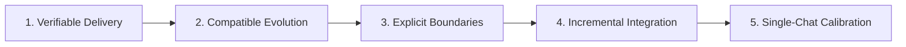

# Decompose Protocol: Task Breakdown & Evolutionary Slicing Methodology

This operational guide establishes the engineering protocols for decomposing complex epics, large refactoring initiatives, and architectural shifts into atomic, evolutionary, and verifiable task sequences.

---

## 1. Outcome-Based Problem Alignment & Debate

Before decomposing any initiative into tasks, conduct the technical alignment debate according to [`./decompose-debate.md`](./decompose-debate.md):

1. **Desired End-State First:**
   Define the observable system state when the work is complete ($S_1 \dots S_n$).
   - *Anti-Pattern:* "We need to install Redis and create celery tasks." (Activity-based)
   - *Best Practice:* "The system processes image conversions asynchronously, returning task status in under 200ms and notifying clients upon completion." (Outcome-based)
2. **Treat User Proposals as Hypotheses:**
   Evaluate whether proposed tools or patterns are strictly necessary or introduce accidental complexity. Eliminate the macro XY Problem.
3. **Socratic Interview Protocol (`ask_question`):**
   Limit inquiries to **3 to 5 surgical questions** using the interactive `ask_question` tool. Focus on boundary constraints, SLAs, PII/security, and legacy integration points.
4. **Macro-Slicing Strategy Matrix:**
   Formulate 2 to 3 distinct proposals (e.g., MVP-First vs. Contract-First vs. Strangler Fig) before proceeding to task generation.
5. **Spike Identification:**
   If a core architectural decision depends on unknown library behavior or external API capabilities, extract a timeboxed **Spike** task ($S \le 2\text{h}$) to establish an ADR or proof-of-concept.
- **Full Alignment Guide:** Consult [`./decompose-debate.md`](./decompose-debate.md).

---

## 2. The 5 Principles of Evolutionary Slicing



### Principle 1: Verifiable Delivery
- Every sub-feature must deliver demonstrable, observable behavior or an explicitly justified Technical Enabler.
- Purely technical slices must identify their immediate consumer in the subsequent batch.

### Principle 2: Compatible Evolution (Monotonicity)
- Slices must build monotonically: Slice $N+1$ consumes and extends Slice $N$ without requiring destructive rewrites, regression fixes, or contract breakage.
- Never use horizontal slicing where Layer 1 (database) is built blindly and reworked when Layer 3 (API) is reached.

### Principle 3: Explicit Boundaries (Fakes vs. Mocks)
- Model typed boundary contracts (`IRepository`, `IClient`, `INotifier`) alongside the use case that first consumes them.
- Provide functional in-memory **Fakes** for test isolation during development.
- Do not equate in-memory Fake tests with proof of real infrastructure integration; real adapters require dedicated integration tests.

### Principle 4: Incremental Integration
- Every completed slice is merged into `develop` under continuous integration gates (lint, unit tests, coverage).
- Do not accumulate unmerged feature branches. Use feature toggles or internal wiring to keep unreleased capabilities dark.

### Principle 5: Single-Chat Calibration
- A sub-feature must fit cleanly into the lifecycle of **one ephemeral chat session**:
  $$\text{Planning (/plan)} \longrightarrow \text{TDD (/implement)} \longrightarrow \text{Refactor (/refactor)} \longrightarrow \text{Review (/review)} \longrightarrow \text{Docs (/docs)}$$
- If a slice requires multiple unrelated domain models or spans across more than 5 new classes, it is too large and must be split.

---

## 3. Complexity Sizing & Slicing Triggers

Calibrate each decomposed item using standard complexity tiers:

| Size | Scope & Characteristics | Typical File Footprint | Slicing Action |
|:---:|:---|:---|:---|
| **`[S]`** (Small) | Single entity, value object, or isolated utility function. Clear logic, zero external dependencies. | 1 to 2 files | Ready for execution in single batch. |
| **`[M]`** (Medium) | Standard use case, service orchestration, or boundary adapter with in-memory Fake. Multiple test cases. | 3 to 5 files | Ideal size for a single feature slice. |
| **`[L]`** (Large) | Cross-domain feature, multiple asynchronous flows, or complex database schema migration with external APIs. | 6+ files | **MUST be decomposed** into smaller `[S]` or `[M]` sub-features. |
| **`[SPIKE]`** | Unknown technical risk, unverified third-party library, or missing architectural decision. | 0 production files (ADR/POC) | Timeboxed investigation prior to roadmap execution. |

### Immediate Slicing Triggers:
Decompose further whenever:
- A task touches both domain logic and external infrastructure simultaneously.
- A task requires more than 3 distinct database table migrations.
- The happy path and error recovery mechanisms are both complex. (Split into: F1 Happy Path $\rightarrow$ F2 Hardening & Exceptions).

---

## 4. Atomic Dependent Batching Rules

When ordering tasks within a slice or epic roadmap, enforce dependent batch ordering:

1. **Batch 1 — Domain Core & Base Abstractions (Zero Dependencies):**
   - Pure domain entities, value objects, domain exceptions, and abstract interface contracts.
   - Zero I/O, zero network, zero database dependencies.
2. **Intermediate Batches — Application Services & Business Workflows:**
   - Use cases and domain service orchestrators consuming Batch 1 contracts.
   - Tested against in-memory Fakes and mocks.
3. **Final Batch — Adapters, API Endpoints & Wiring:**
   - Concrete infrastructure adapters (SQLAlchemy, HTTP clients, message brokers).
   - Controllers/routers, dependency injection configuration, and integration tests.

---

## 5. Pre-Flight Consistency Audit Checklist

Before releasing any decomposition blueprint or task list for execution, verify:

- [ ] **Acyclic Dependency Graph (DAG):** Trace all dependencies ($F_1 \rightarrow F_2 \dots$). Verify zero circular references.
- [ ] **Roadmap Synchronization:** Every node in the Mermaid dependency diagram corresponds 1:1 with an entry in the task table.
- [ ] **Explicit Contract Ownership:** Every introduced interface has a defined introducer slice and at least one identified consumer.
- [ ] **Zero Parallel Unmerged Dependencies:** No sub-feature depends on another feature currently unmerged in a detached branch.
- [ ] **Token Economy & Anti-Bureaucracy Compliance:**
  - Micro-implementation details (variable names, private helper methods, TDD order) are excluded and delegated to `/plan`.
  - Conditional operational sections occupy at most 1 line or state `N/A: [reason]`.

---

## 6. Handover Protocols

Once the decomposition artifact is generated:
1. Review the generated checklist with [`../resources/task-template.md`](../resources/task-template.md).
2. Compare the output against the representative scenario in [`../examples/decompose-example.md`](../examples/decompose-example.md).
3. Provide the exact transition command pointing to the first sub-feature:
   ```bash
   git switch develop && git pull --ff-only && git switch -c feature/[first-feature-slug]
   ```
4. Handover to Phase 1 via `/plan`.
