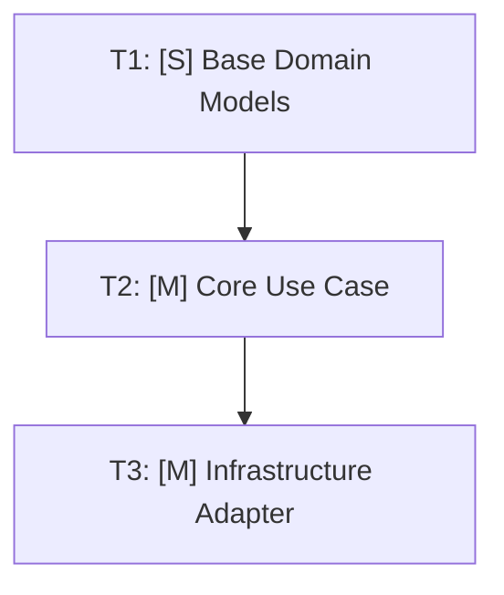

# Task Breakdown: {{EPIC_OR_FEATURE_TITLE}}

## 1. Overview & Observable Desired End-State

### 1.1 Core Objective & Outcome
- **Core Objective:** {{CORE_OBJECTIVE_DESCRIPTION}}
- **Desired Observable Outcome:** {{DESIRED_OBSERVABLE_OUTCOME}}
- **Target Branch / Integration:** `{{TARGET_BRANCH}}` into `{{BASE_BRANCH}}` (Slug must match `^[a-z0-9]+(-[a-z0-9]+)*$`)

### 1.2 Success Criteria

| ID | Criteria | Validation Method |
|:---|:---|:---|
| S1 | {{CRITERIA_DESCRIPTION}} | {{TEST_COMMAND_OR_INSPECTION}} |
| S2 | {{CRITERIA_DESCRIPTION}} | {{TEST_COMMAND_OR_INSPECTION}} |

### 1.3 Security & Trust Boundaries (OWASP Guardrails)

| Slice / Batch | PII / Sensitive Data Classification | RBAC / Auth & Rate-Limit Boundary | Trust Boundary & Redaction Rules |
|:---|:---|:---|:---|
| T1 (`batch-1-domain`) | {{PII_FIELDS_OR_NONE}} | {{DOMAIN_INVARIANTS}} | Zero raw secrets/PII in domain exceptions or logs |
| T2 (`batch-2-service`) | {{SERVICE_DATA_CLASSIFICATION}} | {{AUTHZ_SCOPE_AND_IDEMPOTENCY}} | Enforce authorization scope prior to state mutation |
| T3 (`batch-3-adapter`) | {{INFRA_ENCRYPTION_AT_REST_TRANSIT}} | {{RATE_LIMIT_AND_INGRESS_GUARD}} | External I/O untrusted; parameterize queries & redact logs |

---

## 2. Dependency Roadmap & Sizing



### Task Inventory

| Task ID | Slice / Feature | Size | Dependencies | Contracts Introduced | Contracts Consumed | Status | Target Branch / Batch |
|:---|:---|:---:|:---:|:---|:---|:---:|:---|
| T1 | {{TASK_1_NAME}} | [S] | — | `I{{ENTITY}}Repository`, `{{ENTITY}}` | — | [ ] | `batch-1-domain` |
| T2 | {{TASK_2_NAME}} | [M] | T1 | `I{{SERVICE}}UseCase` | `I{{ENTITY}}Repository`, `{{ENTITY}}` | [ ] | `batch-2-service` |
| T3 | {{TASK_3_NAME}} | [M] | T2 | — | `I{{ENTITY}}Repository`, `I{{SERVICE}}UseCase` | [ ] | `batch-3-adapter` |

---

## 3. Atomic Batch Execution Tracking

### Batch 1: Domain Core & Contracts (Zero Dependencies)
- [ ] **T1.1:** {{ATOMIC_TASK_DESCRIPTION}} `[S]`
  - *Contract Introduced:* `{{INTERFACE_OR_TYPE}}`
  - *Acceptance:* {{VERIFIABLE_ACCEPTANCE_CONDITION}}
- [ ] **T1.2:** {{ATOMIC_TASK_DESCRIPTION}} `[S]`
  - *Contract Introduced:* `{{INTERFACE_OR_TYPE}}`
  - *Acceptance:* {{VERIFIABLE_ACCEPTANCE_CONDITION}}

### Batch 2: Use Cases & Application Logic
- [ ] **T2.1:** {{ATOMIC_TASK_DESCRIPTION}} `[M]`
  - *Consumes:* `T1.1`, `T1.2`
  - *Test Double:* Functional in-memory Fake
  - *Acceptance:* {{VERIFIABLE_ACCEPTANCE_CONDITION}}
- [ ] **T2.2:** {{ATOMIC_TASK_DESCRIPTION}} `[S]`
  - *Consumes:* `T2.1`
  - *Acceptance:* {{VERIFIABLE_ACCEPTANCE_CONDITION}}

### Batch 3: Infrastructure Adapters & System Wiring
- [ ] **T3.1:** {{ATOMIC_TASK_DESCRIPTION}} `[M]`
  - *Consumes:* `T1.1` (Implements concrete adapter)
  - *Validation:* Real integration test suite
  - *Acceptance:* {{VERIFIABLE_ACCEPTANCE_CONDITION}}
- [ ] **T3.2:** {{ATOMIC_TASK_DESCRIPTION}} `[S]`
  - *Consumes:* `T2.1`, `T3.1` (API route / CLI entrypoint wiring)
  - *Acceptance:* {{VERIFIABLE_ACCEPTANCE_CONDITION}}

---

## 4. Definition of Done Checklist

- [ ] Deterministic DAG validation passed (`python skills/decompose/scripts/validate_dag.py 01-concepcao/epic-{{EPIC_SLUG}}.md --slug {{EPIC_SLUG}}`).
- [ ] All atomic tasks marked completed (`[x]`).
- [ ] Unit test suite passing 100% green (`pytest tests/unit/ -v`).
- [ ] In-memory Fakes match interface signatures of real adapters.
- [ ] Real infrastructure integration tests passing (`pytest tests/integration/ -v`).
- [ ] Security & Trust Boundaries (Section 1.3) verified with zero PII/secret leakage.
- [ ] Clean semantic commits recorded per batch.

---

## 5. Handover

- **Next Phase:** Phase 1 (`/plan`) or Phase 2 (`/implement`)
- **Checkout Command (slug strictly validated via `^[a-z0-9]+(-[a-z0-9]+)*$`):**
  ```bash
  git switch develop; git pull --ff-only; git switch -c feature/{{FIRST_FEATURE_SLUG}}
  ```
