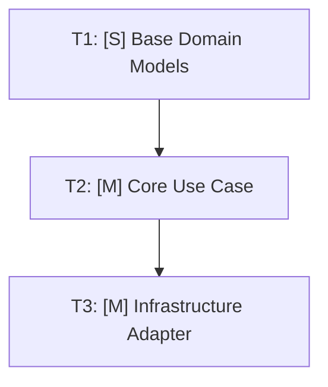

# Task Breakdown: {{EPIC_OR_FEATURE_TITLE}}

## 1. Overview & Observable Desired End-State
- **Core Objective:** {{CORE_OBJECTIVE_DESCRIPTION}}
- **Desired Observable Outcome:** {{DESIRED_OBSERVABLE_OUTCOME}}
- **Target Branch / Integration:** `{{TARGET_BRANCH}}` into `{{BASE_BRANCH}}`

### Success Criteria

| ID | Criteria | Validation Method |
|:---|:---|:---|
| S1 | {{CRITERIA_DESCRIPTION}} | {{TEST_COMMAND_OR_INSPECTION}} |
| S2 | {{CRITERIA_DESCRIPTION}} | {{TEST_COMMAND_OR_INSPECTION}} |

---

## 2. Dependency Roadmap & Sizing



### Task Inventory

| ID | Task Description | Size | Depends On | Status | Target Branch / Batch |
|:---|:---|:---:|:---:|:---:|:---|
| T1 | {{TASK_1_NAME}} | [S] | — | [ ] | `batch-1-domain` |
| T2 | {{TASK_2_NAME}} | [M] | T1 | [ ] | `batch-2-service` |
| T3 | {{TASK_3_NAME}} | [M] | T2 | [ ] | `batch-3-adapter` |

---

## 3. Atomic Batch Execution Tracking

### Batch 1: Domain Core & Contracts (Zero Dependencies)
- [ ] **T1.1:** {{ATOMIC_TASK_DESCRIPTION}} `[S]`
  - *Contract Introduced:* `{{INTERFACE_OR_TYPE}}`
  - *Acceptance:* {{VERIFIABLE_ACCEPTANCE_CONDITION}}
- [ ] **T1.2:** {{ATOMIC_TASK_DESCRIPTION}} `[S]`
  - *Contract Introduced:* `{{INTERFACE_OR_TYPE}}`
  - *Acceptance:* {{VERIFIABLE_ACCEPTANCE_CONDITION}}

### Batch 2: Use Cases & Application Logic
- [ ] **T2.1:** {{ATOMIC_TASK_DESCRIPTION}} `[M]`
  - *Consumes:* `T1.1`, `T1.2`
  - *Test Double:* Functional in-memory Fake
  - *Acceptance:* {{VERIFIABLE_ACCEPTANCE_CONDITION}}
- [ ] **T2.2:** {{ATOMIC_TASK_DESCRIPTION}} `[S]`
  - *Consumes:* `T2.1`
  - *Acceptance:* {{VERIFIABLE_ACCEPTANCE_CONDITION}}

### Batch 3: Infrastructure Adapters & System Wiring
- [ ] **T3.1:** {{ATOMIC_TASK_DESCRIPTION}} `[M]`
  - *Consumes:* `T1.1` (Implements concrete adapter)
  - *Validation:* Real integration test suite
  - *Acceptance:* {{VERIFIABLE_ACCEPTANCE_CONDITION}}
- [ ] **T3.2:** {{ATOMIC_TASK_DESCRIPTION}} `[S]`
  - *Consumes:* `T2.1`, `T3.1` (API route / CLI entrypoint wiring)
  - *Acceptance:* {{VERIFIABLE_ACCEPTANCE_CONDITION}}

---

## 4. Definition of Done Checklist

- [ ] All atomic tasks marked completed (`[x]`).
- [ ] Unit test suite passing 100% green (`pytest tests/unit/ -v`).
- [ ] In-memory Fakes match interface signatures of real adapters.
- [ ] Real infrastructure integration tests passing (`pytest tests/integration/ -v`).
- [ ] No regression introduced into existing baseline.
- [ ] Clean semantic commits recorded per batch.

---

## 5. Handover

- **Next Phase:** Phase 1 (`/plan`) or Phase 2 (`/implement`)
- **Checkout Command:**
  ```bash
  git switch develop && git pull --ff-only && git switch -c feature/{{FIRST_FEATURE_SLUG}}
  ```
