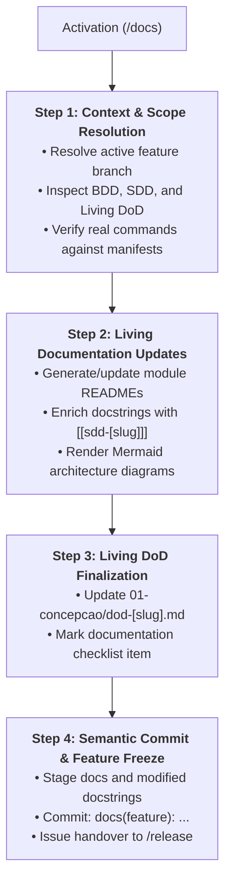

# Skill: Technical Feature Documentation & Feature Freeze (`/docs`)

Orchestrates **Phase 5** of the feature development lifecycle, synchronizing living technical documentation (module and root READMEs, Mermaid architectural data flows, and Obsidian-traceable docstrings), updating the Living DoD, and executing the semantic feature freeze.

---

## Universal Operational Guardrails

- **Zero Production Logic Alteration:** Scope within source code files is strictly limited to inserting or correcting docstrings, comments, and explicit type annotations. Changing control flow, expressions, imports, or variable assignments is strictly prohibited.
- **Manifest-Checked Execution Commands:** Documented commands (installation, testing, linting, running) must be validated against actual project manifests (`pyproject.toml`, `package.json`, `Cargo.toml`, `Makefile`). Generating obsolete or fictitious commands is forbidden.
- **Safe Mermaid Diagram Conventions:** All node labels in Mermaid diagrams must be enclosed in double quotes (e.g., `A["Client / Input"] --> B["Domain Service"]`) to prevent rendering errors.
- **Obsidian Vault Bidirectional Traceability:** Every documented module and enriched docstring must link to its design specification via `Ref: Obsidian note [[sdd-[slug] ]]`.
- **Feature Freeze Discipline:** The feature branch must NEVER be merged directly into `develop` or `main` during `/docs`. The branch is sealed with a semantic commit and left frozen for `/release`.

---

## Execution Pipeline in 4 Steps



### Step 1: Context & Scope Resolution
1. Identify the active feature branch using `git --no-pager branch --show-current` (or `git rev-parse --abbrev-ref HEAD`).
2. Locate and inspect feature specifications in the Obsidian Vault:
   - BDD Scenarios: `01-concepcao/bdd-[slug].md`
   - SDD Blueprint: `01-concepcao/sdd-[slug].md`
   - Living DoD Log: `01-concepcao/dod-[slug].md`
3. Inspect repository manifest files (`pyproject.toml`, `package.json`, etc.) to extract verified commands for build, test, and execution.
4. **Detailed Reference:** Review [`./references/docs-guidelines.md`](./references/docs-guidelines.md).

### Step 2: Living Documentation Updates
1. Create or update module-level `README.md` files in subdirectories modified by the feature using [`./resources/doc-template.md`](./resources/doc-template.md).
2. Ensure every module documentation includes:
   - Clear architectural purpose and designated layer (Domain, Infrastructure, Application, Interface).
   - Safe Mermaid data flow diagram with double-quoted node labels.
   - Component mapping table enumerating key files and responsibilities.
   - Documented design decisions, trade-offs, and testing strategies.
   - Obsidian wikilinks to relevant design notes (`[[sdd-[slug] ]]`).
3. If the feature alters root project setup, update the root `README.md` onboarding commands.
4. Insert in-code docstrings into newly added or modified classes and functions, appending Obsidian traceability annotations:
   ```python
   """
   Short operational summary.

   Ref: Obsidian note [[sdd-[slug] ]]
   """
   ```

### Step 3: Living DoD Finalization
1. Open the living log in `01-concepcao/dod-[slug].md`.
2. Mark the Phase 5 documentation item as completed:
   ```markdown
   - [x] Technical documentation updated via /docs (READMEs and docstrings).
   ```
3. Record completion in the DoD chronological event timeline.

### Step 4: Semantic Commit & Feature Freeze
1. Stage all documentation files, updated READMEs, and modified source files:
   ```bash
   git add README.md 01-concepcao/dod-[slug].md path/to/module/README.md path/to/source/
   git commit -m "docs(feature): technical documentation and docstrings for [slug]"
   ```
2. **Safety Boundary Enforcement:** Do NOT execute `git checkout develop` or `git merge`. The branch `feature/[slug]` is frozen and ready for bundling.
3. Issue the standard phase completion handover notice:
   > **[NEXT STEP]** *"Phase 5 (Documentation) completed successfully! The individual lifecycle for this feature is complete. The branch `feature/[slug]` is frozen and ready to be bundled into the next release via the `/release` workflow."*

---

## Bundled References, Resources & Examples

- **Operational Guide:**
  - [`references/docs-guidelines.md`](./references/docs-guidelines.md) — Documentation standards, architectural diagrams, changelogs, docstring formats, and Phase 5 feature freeze governance.
- **Pure Templates:**
  - [`resources/doc-template.md`](./resources/doc-template.md) — Pure documentation template for root showcases, module architecture guides, changelog entries, and docstrings.
- **Representative Output:**
  - [`examples/docs-example.md`](./examples/docs-example.md) — Real-world documentation walkthrough demonstrating module README generation, docstrings, DoD updates, and semantic freeze commit.
