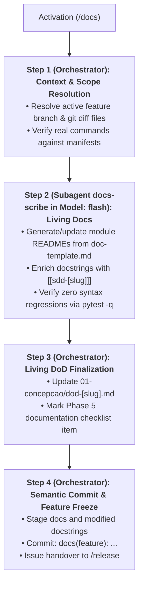

# Skill: Technical Feature Documentation & Feature Freeze (`/docs` — SDD 2.0)

Orchestrates Phase 5 of the feature development lifecycle under the **SDD 2.0 (Elephant & Goldfish)** model, synchronizing living technical documentation (module and root READMEs, Mermaid architectural data flows, and Obsidian-traceable docstrings) via a context-isolated **`docs-scribe` subagent (`Model: "flash"`)**, updating the Living DoD, and executing the semantic feature freeze.

---

## Universal Operational Guardrails

- **Zero Production Logic Alteration:** Scope within source code files is strictly limited to inserting or correcting docstrings, comments, and explicit type annotations. Changing control flow, expressions, imports, or variable assignments is strictly prohibited.
- **Cost-Efficient Subagent Offloading (`Model: "flash"`):** Bulk generation of module `README.md` files and in-code docstrings in Step 2 is delegated to the `docs-scribe` subagent running on `Model: "flash"`, keeping full-file reads and docstring edits out of the main orchestrator's context window.
- **Manifest-Checked Execution Commands:** Documented commands (installation, testing, linting, running) must be validated against actual project manifests (`pyproject.toml`, `package.json`, `Cargo.toml`, `Makefile`). Generating obsolete or fictitious commands is forbidden.
- **Safe Mermaid Diagram Conventions:** All node labels in Mermaid diagrams must be enclosed in double quotes (e.g., `A["Client / Input"] --> B["Domain Service"]`) to prevent rendering errors.
- **Obsidian Vault Bidirectional Traceability:** Every documented module and enriched docstring must link to its design specification via `Ref: Obsidian note [[sdd-[slug]]]`.
- **Feature Freeze Discipline:** The feature branch must NEVER be merged directly into `develop` or `main` during `/docs`. The branch is sealed with a semantic commit and left frozen for `/release`.

---

## Execution Pipeline in 4 Steps (Orchestrator + `docs-scribe` Flash Subagent)



### Step 1: Context & Scope Resolution *(Main Orchestrator)*
1. Identify the active feature branch and modified files using:
   ```bash
   git --no-pager branch --show-current
   git --no-pager diff develop...HEAD --name-only
   ```
2. Locate feature specifications in the Obsidian Vault:
   - BDD Scenarios: `01-concepcao/bdd-[slug].md`
   - SDD Blueprint: `01-concepcao/sdd-[slug].md`
   - Living DoD Log: `01-concepcao/dod-[slug].md`
3. Inspect repository manifest files (`pyproject.toml`, `package.json`, etc.) to extract verified commands for build, test, and execution.
4. **Detailed References:** Review [`./references/docs-guidelines.md`](./references/docs-guidelines.md) and [`./references/docs-subagents.md`](./references/docs-subagents.md).

### Step 2: Living Documentation & Docstring Updates *(Subagent `docs-scribe` — `Model: "flash"`)*
1. Define and invoke the **`docs-scribe`** subagent (`EnableWriteTools: true`, `Model: "flash"`) following [`./references/docs-subagents.md`](./references/docs-subagents.md), providing the modified file list, manifest commands, and paths to `01-concepcao/sdd-[slug].md` and `01-concepcao/bdd-[slug].md`.
2. Inside its isolated context window, `docs-scribe` executes:
   - Creates or updates module-level `README.md` files in subdirectories modified by the feature using [`./resources/doc-template.md`](./resources/doc-template.md) (including architectural layer, double-quoted Mermaid data flow diagram, component mapping table, design trade-offs, and `[[sdd-[slug]]]` wikilinks).
   - Updates root `README.md` onboarding commands if the feature alters root project setup.
   - Inserts in-code docstrings into newly added or modified classes and functions with Obsidian traceability annotations:
     ```python
     """
     Short operational summary.

     Ref: Obsidian note [[sdd-[slug]]]
     """
     ```
   - Runs `python -m pytest -q` to guarantee that docstring insertions caused zero indentation or syntax regressions.

### Step 3: Living DoD Finalization *(Main Orchestrator)*
1. Receive the completion summary from `docs-scribe` and open `01-concepcao/dod-[slug].md`.
2. Mark the Phase 5 documentation item as completed:
   ```markdown
   - [x] Technical documentation updated via /docs (READMEs and docstrings).
   ```
3. Record completion in the DoD chronological event timeline.

### Step 4: Semantic Commit & Feature Freeze *(Main Orchestrator)*
1. Stage all documentation files, updated READMEs, and modified source files:
   ```bash
   git add README.md 01-concepcao/dod-[slug].md path/to/module/README.md path/to/source/
   git commit -m "docs(feature): technical documentation and docstrings for [slug]"
   ```
2. **Safety Boundary Enforcement:** Do NOT execute `git checkout develop` or `git merge`. The branch `feature/[slug]` is frozen and ready for bundling.
3. Issue the standard phase completion handover notice:
   > **[NEXT STEP]** *"Phase 5 (Documentation — SDD 2.0) completed successfully! The individual lifecycle for this feature is complete. The branch `feature/[slug]` is frozen and ready to be bundled into the next release via the `/release` workflow."*

---

## Bundled References, Resources & Examples

- **Operational Guides:**
  - [`references/docs-subagents.md`](./references/docs-subagents.md) — Cost-efficient `docs-scribe` (`Model: "flash"`) subagent orchestration and non-destructive docstring verification.
  - [`references/docs-guidelines.md`](./references/docs-guidelines.md) — Documentation standards, architectural diagrams, changelogs, docstring formats, and Phase 5 feature freeze governance.
- **Pure Templates:**
  - [`resources/doc-template.md`](./resources/doc-template.md) — Pure documentation template for root showcases, module architecture guides, changelog entries, and docstrings.
- **Representative Output:**
  - [`examples/docs-example.md`](./examples/docs-example.md) — Real-world documentation walkthrough demonstrating module README generation, docstrings, DoD updates, and semantic freeze commit.
