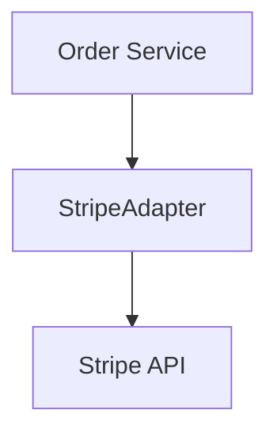

# Documentation Walkthrough (`examples/docs-example.md`)

Trace for `feature/payment-stripe`. Guidelines: [`docs-guidelines.md`](../references/docs-guidelines.md), [`docs-subagents.md`](../references/docs-subagents.md). Template: [`doc-template.md`](../resources/doc-template.md).

## 1. Generated `src/adapters/payment/README.md`

```markdown
# Module: `src/adapters/payment`
* **Purpose:** Payment gateway integrations with circuit breaker.
* **Layer:** Adapter | **SDD:** `[[sdd-payment-stripe]]`



| File | Responsibility | Exports |
| :--- | :--- | :--- |
| `stripe_adapter.py` | Adapts Stripe API to `IPaymentGateway` | `StripePaymentAdapter` |
| `circuit_breaker.py` | Detects payment provider outages | `CircuitBreakerGuard` |
```

## 2. In-Code Docstring (`src/adapters/payment/stripe_adapter.py`)

```python
class StripePaymentAdapter(IPaymentGateway):
    """Stripe adapter. Ref: Obsidian note [[sdd-payment-stripe]]"""
    def charge(self, key: str, cents: int, token: str) -> ChargeReceipt:
        """Idempotent charge. Ref: Obsidian note [[sdd-payment-stripe]]"""
        ...
```

## 3. DoD & Commit Trace

```markdown
### Living DoD (`01-concepcao/dod-payment-stripe.md`)
- [x] Technical documentation updated via /docs (READMEs and docstrings).
```
```bash
git add src/adapters/payment/README.md src/adapters/payment/stripe_adapter.py 01-concepcao/dod-payment-stripe.md
git commit -m "docs(payment-stripe): technical documentation and docstrings for stripe adapter"
```
