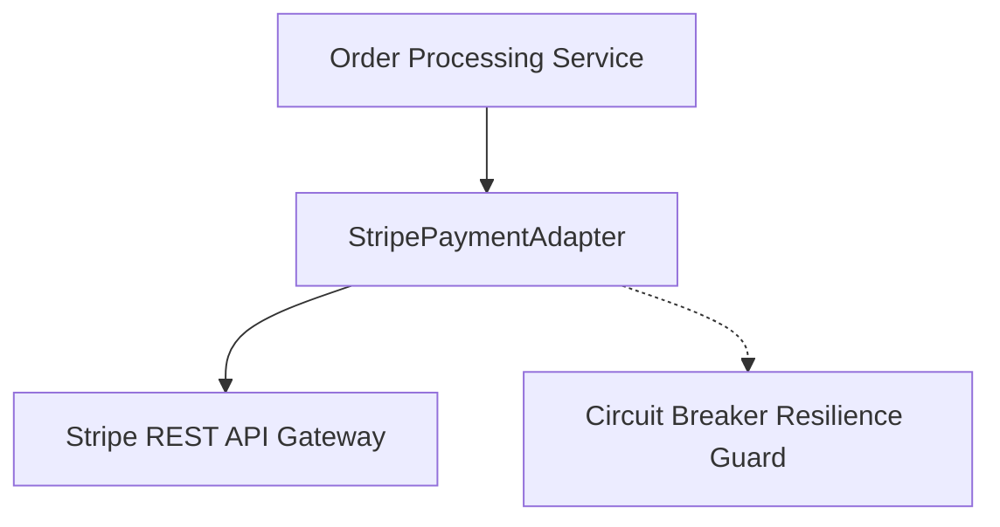

# Example Walkthrough: Phase 5 Documentation & Feature Freeze

This artifact demonstrates the exact outputs generated by `/docs` during Phase 5 for a feature branch named `feature/payment-stripe`.

---

## 1. Input Context
- **Active Branch:** `feature/payment-stripe`
- **Obsidian Specs:**
  - `01-concepcao/bdd-payment-stripe.md`
  - `01-concepcao/sdd-payment-stripe.md`
  - `01-concepcao/dod-payment-stripe.md`
- **Active Manifest:** `pyproject.toml` with `poetry` and `pytest`.

---

## 2. Generated Module Documentation: `src/adapters/payment/README.md`

```markdown
# Module: `src/adapters/payment`

## Overview
* **Purpose:** Implements external payment gateway integrations with automated circuit breaker failover.
* **Architectural Layer:** Infrastructure / Adapter

## Architecture & Data Flow


## Component Mapping
| File | Responsibility | Key Interfaces / Exports |
| :--- | :--- | :--- |
| `stripe_adapter.py` | Adapts Stripe API to domain `IPaymentGateway` | `StripePaymentAdapter` |
| `circuit_breaker.py` | Detects remote payment provider outages | `CircuitBreakerGuard` |
| `exceptions.py` | Normalizes upstream Stripe errors into domain errors | `PaymentGatewayError` |

## Design Decisions & Trade-offs
* **Decision:** Implemented client-side circuit breaker with 5 consecutive failure trip threshold.
* **Rationale:** Protects downstream checkout requests from hanging during third-party gateway downtime.
* **Alternative Discarded:** Relying solely on HTTP timeouts; rejected due to high cumulative thread blocking under load.

## Testing Strategy
* **Test Types:** Unit tests with mock HTTP responses; integration tests against Stripe sandbox.
* **Critical Scenarios Covered:** Idempotent token reuse, network timeout fallback, card decline normalization.

## Related Context & Traceability
* **BDD Specification:** `[[bdd-payment-stripe]]`
* **SDD Blueprint:** `[[sdd-payment-stripe]]`
* **Living DoD Log:** `[[dod-payment-stripe]]`
```

---

## 3. Enriched In-Code Docstring (`src/adapters/payment/stripe_adapter.py`)

```python
class StripePaymentAdapter(IPaymentGateway):
    """
    Outbound infrastructure adapter implementing Stripe v3 payment processing.

    Ref: Obsidian note [[sdd-payment-stripe]]
    """

    def charge(self, idempotency_key: str, amount_cents: int, token: str) -> ChargeReceipt:
        """
        Executes an idempotent customer card charge via Stripe.

        Args:
            idempotency_key: UUIDv4 ensuring request deduplication.
            amount_cents: Integer transaction value in minor currency units.
            token: Payment source token issued by Stripe Elements.

        Returns:
            ChargeReceipt containing the gateway transaction ID and timestamp.

        Raises:
            PaymentDeclinedError: When card authorization is denied.
            GatewayTimeoutError: When upstream network communication fails.

        Ref: Obsidian note [[sdd-payment-stripe]]
        """
        ...
```

---

## 4. Updated Living DoD: `01-concepcao/dod-payment-stripe.md`

```markdown
### Phase 5: Technical Documentation
- [x] Technical documentation updated via /docs (READMEs and docstrings).

### Event Timeline
- `2026-10-26T16:50:00Z` - Technical documentation synchronized for `payment-stripe`. Module README generated, docstrings enriched with `[[sdd-payment-stripe]]`.
```

---

## 5. Semantic Commit & Feature Freeze Output

```bash
$ git add src/adapters/payment/README.md src/adapters/payment/stripe_adapter.py 01-concepcao/dod-payment-stripe.md
$ git commit -m "docs(payment-stripe): technical documentation and docstrings for stripe adapter"
[feature/payment-stripe a8f12c4] docs(payment-stripe): technical documentation and docstrings for stripe adapter
 3 files changed, 85 insertions(+)
 create mode 100644 src/adapters/payment/README.md
```

### Agent Completion Message
> **[NEXT STEP]** *"Phase 5 (Documentation) completed successfully! The individual lifecycle for this feature is complete. The branch `feature/payment-stripe` is frozen and ready to be bundled into the next release via the `/release` workflow."*

---

## 6. Referential Integrity Verification
This example references:
- Operational Guide: [`../references/docs-guidelines.md`](../references/docs-guidelines.md)
- Template: [`../resources/doc-template.md`](../resources/doc-template.md)
