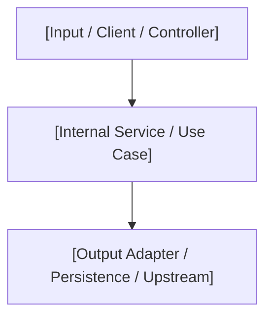
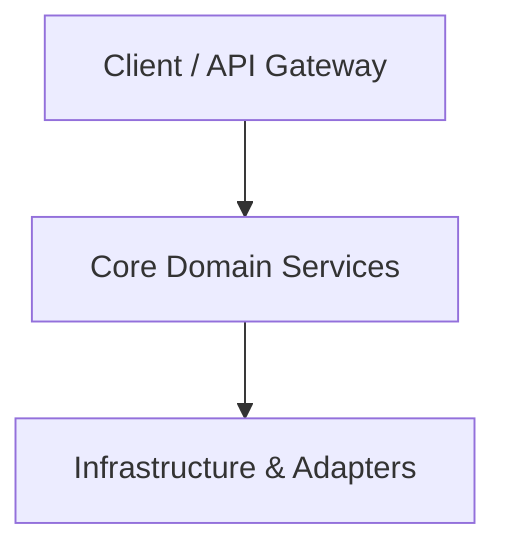

# Documentation Templates

This resource provides pure, unpopulated templates for root showcases, local module architecture documentation, feature changelog entries, and in-code docstrings.

---

## Template 1: Local Module Documentation (`[module]/README.md`)

```markdown
# Module: `[Module / Directory Name]`

## Overview
* **Purpose:** `[Concise description of the architectural responsibility of this directory]`
* **Architectural Layer:** `[Domain / Application / Infrastructure / Interface]`

## Architecture & Data Flow


## Component Mapping
| File | Responsibility | Key Interfaces / Exports |
| :--- | :--- | :--- |
| `[filename.ext]` | `[Description of role]` | `[Classes, Functions, Types]` |

## Design Decisions & Trade-offs
* **Decision:** `[Technical choice adopted]`
* **Rationale:** `[Why this choice was made]`
* **Alternative Discarded:** `[Option evaluated and why it was rejected]`

## Testing Strategy
* **Test Types:** `[Unit / Integration / Contract]`
* **Critical Scenarios Covered:** `[Edge cases, error handling, mock isolation]`

## Related Context & Traceability
* **BDD Specification:** `[[bdd-[slug] ]]`
* **SDD Blueprint:** `[[sdd-[slug] ]]`
* **Living DoD Log:** `[[dod-[slug] ]]`
```

---

## Template 2: Root Project Showcase (`README.md`)

```markdown
# [Project Name]

> [!NOTE]
> **Vision:** `[Concise sentence describing project purpose, target audience, and primary outcome]`

---

## Tech Stack
* **Language & Runtime:** `[e.g., Python 3.11+ / Node.js 20+]`
* **Core Frameworks:** `[Frameworks used]`
* **Persistence & Storage:** `[Databases, caches, ORM]`
* **Testing & Quality:** `[Test runners, linters, static analyzers]`
* **Architecture:** `[e.g., Clean Architecture / Hexagonal / Agent Skills]`

---

## High-Level Architecture


---

## Getting Started

### Prerequisites
* `[Prerequisite 1 with version]`
* `[Prerequisite 2 with version]`

### Installation & Execution
```bash
# Clone the repository
git clone [repository-url]
cd [directory-name]

# Install dependencies (manifest-verified)
[install command]

# Run the application
[run command]

# Run automated test suite
[test command]
```

---

## Contributing & License
`[License details and contribution guidelines]`
```

---

## Template 3: Feature Changelog Entry

```markdown
### [Added | Changed | Fixed | Security]
- `[Feature / Component Name]`: `[Concise summary of changes introduced]` (`Ref: [[sdd-[slug] ]]`)
```

---

## Template 4: In-Code Docstring Template

```python
def [function_name]([param]: [type]) -> [return_type]:
    """
    [One-line summary of function behavior].

    Args:
        [param]: [Parameter description].

    Returns:
        [Return value description].

    Raises:
        [ErrorType]: [Condition triggering error].

    Ref: Obsidian note [[sdd-[slug] ]]
    """
```
