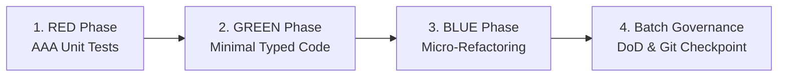

# Skill: Iterative TDD Implementation (`/implement`)

Orchestrates **Phase 2 (Chat 2)** of the feature development lifecycle, implementing approved BDD specifications and SDD architecture blueprints through an iterative, batch-based Test-Driven Development (TDD) cycle.

---

## Operational Scope & Boundaries

- **Input Prerequisites:**
  - Approved BDD behavioral scenarios (`01-concepcao/bdd-[slug].md`)
  - Approved SDD architectural blueprint (`01-concepcao/sdd-[slug].md`)
  - Initialized Living DoD (`01-concepcao/dod-[slug].md`)
- **Scope Limits:**
  - Operates strictly on unit-testable components within the feature scope.
  - Integration, E2E suites, and release packaging belong to subsequent phases.
  - Refactoring is strictly confined to **Micro-Refactoring** (local class/method cleanup in the active batch). Systemic, cross-feature refactoring is reserved for `/refactor`.

---

## Execution Pipeline in 3 Steps

### Step 1: Batch Loading & Verification Gate
1. Read the feature artifacts from the Obsidian Vault or repository:
   - `01-concepcao/bdd-[slug].md`
   - `01-concepcao/sdd-[slug].md`
   - `01-concepcao/dod-[slug].md`
2. Formulate or review the **Dependent Context Batches** in `task_list.md`:
   - **Batch 1:** Domain entities, value objects, and base interfaces (zero external dependencies).
   - **Intermediate Batches:** Domain services, use cases, and business logic.
   - **Final Batch:** Controller/API wiring and orchestration adapters.
3. **Phase Gate:** Present the batch plan to the user (`RequestFeedback: true`). Advance to Step 2 only after explicit confirmation or user approval.

---

### Step 2: Tri-Phase TDD Iteration Loop per Batch

For every batch defined in `task_list.md`, execute the complete Red-Green-Blue cycle:



1. **RED Phase — Unit Tests & Mock Isolation:**
   - Write comprehensive unit tests adhering to the Arrange-Act-Assert (AAA) pattern.
   - Enforce mock isolation (`autospec=True`) with zero live I/O.
   - Execute tests to verify that they fail for the intended reason.
   - **Guide:** [`./references/tdd-test.md`](./references/tdd-test.md)
   - **Template:** [`./resources/test-template.py`](./resources/test-template.py)

2. **GREEN Phase — Minimal Typed Production Code:**
   - Write the minimal, strictly typed production code necessary to make tests pass ("Make it Work").
   - Maintain Clean Architecture boundary separation (no DB/HTTP in domain).
   - If an SDD contract deviation is required, record a technical pivot immediately.
   - Run tests to confirm 100% green status.
   - **Guide:** [`./references/tdd-code.md`](./references/tdd-code.md)
   - **Template:** [`./resources/code-template.py`](./resources/code-template.py)

3. **BLUE Phase — Local Micro-Refactor:**
   - Clean up newly created code: improve variable/method names, extract private helpers, eliminate local duplication.
   - Restrict changes strictly to the current batch's scope.
   - Re-run the batch unit tests immediately to guarantee 100% green state.
   - **Guide:** [`./references/tdd-refactor.md`](./references/tdd-refactor.md)

4. **Batch Governance & Checkpoints:**
   - Update `task_list.md` marking the current batch completed (`[x]`).
   - Append batch timeline entry to `01-concepcao/dod-[slug].md`.
   - Record atomic Git commit or micro-checkpoint.
   - **Guides:** [`./references/tdd-dod.md`](./references/tdd-dod.md) | [`./references/tdd-git.md`](./references/tdd-git.md)

---

### Step 3: Phase 2 Conclusion & Handover

1. Execute the entire unit test suite in the terminal:
   ```bash
   python -m pytest tests/unit/ -v
   ```
2. Verify all criteria in [`./references/tdd-dod.md`](./references/tdd-dod.md) are satisfied.
3. Consolidate batch checkpoints into a structured Phase 2 commit via [`./references/tdd-git.md`](./references/tdd-git.md) (Mode 3 Phase Squash).
4. Issue the mandatory phase transition handover recommendation:
   > **[NEXT STEP]** *"Phase 2 (TDD Implementation) completed with 100% unit tests passing green! Open a **NEW CHAT (Chat 3)** and run `/refactor` to consolidate code design, verify AST cyclomatic complexity (V(G) <= 10), and apply systemic SOLID principles across the feature diff."*

---

## Reference Guide & Template Index

- **Operational Guides:**
  - [`references/tdd-test.md`](./references/tdd-test.md) — Red phase protocol, AAA pattern, mock isolation, coverage matrix.
  - [`references/tdd-code.md`](./references/tdd-code.md) — Green phase protocol, minimal typed code, boundary adherence, technical pivots.
  - [`references/tdd-refactor.md`](./references/tdd-refactor.md) — Blue phase protocol, local micro-refactoring, Clean Code standards.
  - [`references/tdd-git.md`](./references/tdd-git.md) — Git commit formatting (`test:`, `feat:`, `refactor:`), checkpoints, and phase squash.
  - [`references/tdd-dod.md`](./references/tdd-dod.md) — Definition of Done checklist for the implementation phase.
- **Pure Templates:**
  - [`resources/test-template.py`](./resources/test-template.py) — Production-ready AAA unit test template.
  - [`resources/code-template.py`](./resources/code-template.py) — Production-ready typed implementation class template.
- **Walkthroughs:**
  - [`examples/tdd-example.md`](./examples/tdd-example.md) — Full end-to-end TDD batch cycle walkthrough.
