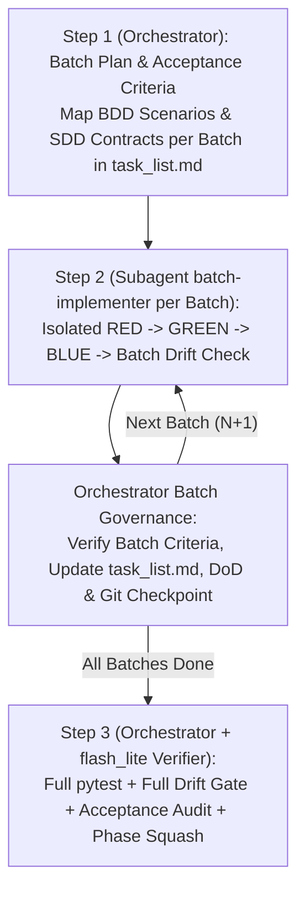
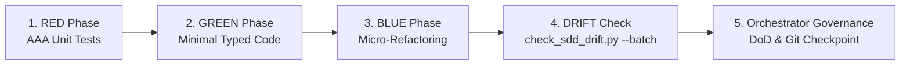

# Skill: Iterative TDD Implementation (`/implement` — SDD 2.0)

Orchestrates the feature development lifecycle under the **SDD 2.0 (Elephant & Goldfish)** model, implementing approved BDD specifications and SDD architecture blueprints through an iterative, batch-isolated Test-Driven Development (TDD) cycle enforced by explicit **Batch Acceptance Criteria**, a deterministic **Drift Gate** (`check_sdd_drift.py`), and a fast read-only verification subagent (`goldfish-drift-auditor` on `Model: "flash_lite"`).

---

## Operational Scope & Boundaries

- **Input Prerequisites:**
  - Approved BDD behavioral scenarios (`01-concepcao/bdd-[slug].md`)
  - Approved SDD architectural blueprint (`01-concepcao/sdd-[slug].md`)
  - Initialized Living DoD (`01-concepcao/dod-[slug].md`)
- **Scope Limits:**
  - Operates strictly on unit-testable components within the feature scope.
  - Integration, E2E suites, and release packaging belong to subsequent phases.
  - Refactoring is strictly confined to **Micro-Refactoring** (local class/method cleanup in the active batch). Systemic, cross-feature refactoring is reserved for `/refactor`.

---

## Execution Pipeline in 3 Steps (Orchestrator + Batch Subagents + Drift Gate)



### Step 1: Batch Loading, Acceptance Criteria & Verification Gate *(Main Orchestrator)*
1. Read the feature artifacts from the Obsidian Vault or repository:
   - `01-concepcao/bdd-[slug].md`
   - `01-concepcao/sdd-[slug].md`
   - `01-concepcao/dod-[slug].md`
2. Formulate or review the **Dependent Context Batches** in `task_list.md`:
   - **Batch 1:** Domain entities, value objects, and base interfaces (zero external dependencies).
   - **Intermediate Batches:** Domain services, use cases, and business logic.
   - **Final Batch:** Controller/API wiring and orchestration adapters.
3. **Define Explicit Batch Acceptance Criteria (`Critérios de Aceite`):**
   Every batch in `task_list.md` **MUST** declare verifiable acceptance criteria before coding begins so `batch-implementer` knows exactly when the batch is complete (see [`./references/tdd-subagents.md`](./references/tdd-subagents.md)):
   - **Target Files:** Exact `src/...` and `tests/unit/test_...` paths for the batch.
   - **SDD Contracts Mapped:** Exact classes, `<<Interface>>` ports, methods, and `*Error` exceptions to implement in this batch.
   - **BDD Scenarios Covered:** Exact Gherkin scenario titles/tags (`@happy-path`, `@unhappy-path`, `@security`, `@concurrency`) that must be asserted in this batch's unit tests.
4. **Phase Gate:** Present `task_list.md` (with its Batch Acceptance Criteria) to the user (`RequestFeedback: true`). Advance to Step 2 only after explicit confirmation or user approval.

---

### Step 2: Context-Isolated Tri-Phase TDD Loop per Batch *(Subagent `batch-implementer` + Orchestrator)*

For every batch $N$ defined in `task_list.md`, the Orchestrator invokes a fresh, context-isolated **`batch-implementer`** subagent (`EnableWriteTools: true`, `Model: "inherit"`) following [`./references/tdd-subagents.md`](./references/tdd-subagents.md) so intermediate `pytest` tracebacks never pollute the main conversation:



1. **RED Phase — Unit Tests & Mock Isolation (`batch-implementer`):**
   - Write comprehensive unit tests adhering to the Arrange-Act-Assert (AAA) pattern covering all **BDD Scenarios Mapped** to Batch $N$.
   - Enforce mock isolation (`autospec=True`) with zero live I/O.
   - Execute tests to verify that they fail for the intended reason.
   - **Guide:** [`./references/tdd-test.md`](./references/tdd-test.md)
   - **Template:** [`./resources/test-template.py`](./resources/test-template.py)

2. **GREEN Phase — Minimal Typed Production Code (`batch-implementer`):**
   - Write the minimal, strictly typed production code necessary to satisfy the batch tests and **SDD Contracts Mapped** ("Make it Work").
   - Maintain Clean Architecture boundary separation (no DB/HTTP in domain).
   - If an SDD contract deviation is required, record a technical pivot immediately in `02-auditorias/pivots-[slug].md`.
   - Run tests to confirm 100% green status.
   - **Guide:** [`./references/tdd-code.md`](./references/tdd-code.md)
   - **Template:** [`./resources/code-template.py`](./resources/code-template.py)

3. **BLUE Phase — Local Micro-Refactor (`batch-implementer`):**
   - Clean up newly created code: improve variable/method names, extract private helpers, eliminate local duplication.
   - Restrict changes strictly to the current batch's scope.
   - Re-run the batch unit tests immediately to guarantee 100% green state.
   - **Guide:** [`./references/tdd-refactor.md`](./references/tdd-refactor.md)

4. **Batch Drift Check (`batch-implementer`):**
   - Run the SDD Drift Gate validator in batch mode to verify that all classes created in the batch match SDD public method contracts:
     ```bash
     python skills/implement/scripts/check_sdd_drift.py 01-concepcao/sdd-[slug].md <batch_src_files> --batch --pivots 02-auditorias/pivots-[slug].md
     ```

5. **Batch Governance & Checkpoints *(Main Orchestrator)*:**
   - Receive the clean batch summary from `batch-implementer`.
   - Update `task_list.md` marking the current batch and its Acceptance Criteria completed (`[x]`).
   - Append batch timeline entry to `01-concepcao/dod-[slug].md`.
   - Record atomic Git commit or micro-checkpoint.
   - **Guides:** [`./references/tdd-dod.md`](./references/tdd-dod.md) | [`./references/tdd-git.md`](./references/tdd-git.md) | [`./references/tdd-subagents.md`](./references/tdd-subagents.md)

---

### Step 3: Phase 2 Drift Gate, `flash_lite` Acceptance Audit & Handover *(Orchestrator + `goldfish-drift-auditor`)*

1. Execute the entire unit test suite in the terminal:
   ```bash
   python -m pytest tests/unit/ -v
   ```
2. Execute the **Full Exit SDD Drift Gate** across all implemented source files:
   ```bash
   python skills/implement/scripts/check_sdd_drift.py 01-concepcao/sdd-[slug].md src/ --check-files --pivots 02-auditorias/pivots-[slug].md
   ```
3. Invoke the fast read-only **`goldfish-drift-auditor`** subagent (`EnableWriteTools: false`, `Model: "flash_lite"`) per [`./references/tdd-subagents.md`](./references/tdd-subagents.md) to verify 100% compliance across `task_list.md` Acceptance Criteria, BDD-to-Unit-Test scenario parity, and Living DoD checklist completeness.
4. Verify all criteria in [`./references/tdd-dod.md`](./references/tdd-dod.md) are satisfied.
5. Consolidate batch checkpoints into a structured Phase 2 commit via [`./references/tdd-git.md`](./references/tdd-git.md) (Mode 3 Phase Squash).
6. Issue the mandatory phase transition handover recommendation:
   > **[NEXT STEP]** *"Phase 2 (TDD Implementation — SDD 2.0) completed with 100% unit tests passing green, 100% batch acceptance criteria verified, and zero SDD Drift! Open a **NEW CHAT** and run `/refactor` to consolidate code design, verify AST cyclomatic complexity (V(G) <= 10), and apply systemic SOLID principles across the feature diff."*

---

## Reference Guide & Template Index

- **Operational Guides:**
  - [`references/tdd-subagents.md`](./references/tdd-subagents.md) — Batch Acceptance Criteria schema, `batch-implementer` orchestration, `check_sdd_drift.py` protocol, and `goldfish-drift-auditor` (`Model: "flash_lite"`).
  - [`references/tdd-test.md`](./references/tdd-test.md) — Red phase protocol, AAA pattern, mock isolation, coverage matrix.
  - [`references/tdd-code.md`](./references/tdd-code.md) — Green phase protocol, minimal typed code, boundary adherence, technical pivots.
  - [`references/tdd-refactor.md`](./references/tdd-refactor.md) — Blue phase protocol, local micro-refactoring, Clean Code standards.
  - [`references/tdd-git.md`](./references/tdd-git.md) — Git commit formatting (`test:`, `feat:`, `refactor:`), checkpoints, and phase squash.
  - [`references/tdd-dod.md`](./references/tdd-dod.md) — Definition of Done checklist for the implementation phase.
- **Automated CLI Validators:**
  - [`scripts/check_sdd_drift.py`](./scripts/check_sdd_drift.py) — Deterministic AST/Contract Drift Gate validator comparing code against `01-concepcao/sdd-[slug].md`.
- **Pure Templates:**
  - [`resources/test-template.py`](./resources/test-template.py) — Production-ready AAA unit test template.
  - [`resources/code-template.py`](./resources/code-template.py) — Production-ready typed implementation class template.
- **Walkthroughs:**
  - [`examples/tdd-example.md`](./examples/tdd-example.md) — Full end-to-end TDD batch cycle walkthrough.
