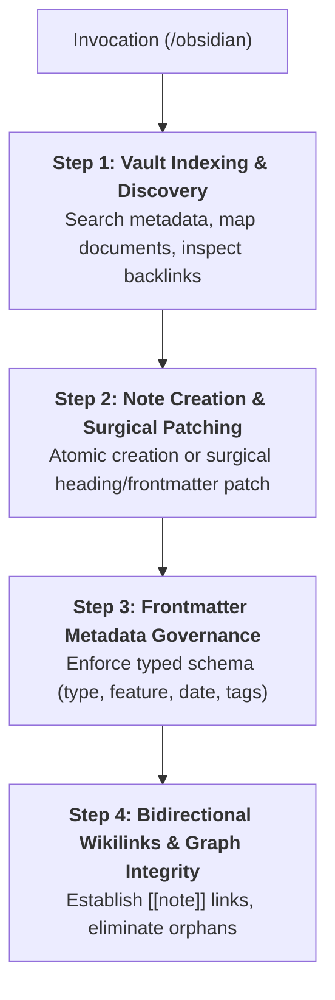

# Skill: Obsidian Vault Governance (`/obsidian`)

Operates as the **Single Source of Truth (SSOT) knowledge bridge** for the project repository, managing architectural records, domain rules, Living DoD progress, and technical pivots within the local Obsidian Vault.

---

## Universal Operational Guardrails

- **Surgical Patching Over Full Overwrites:**
  - Avoid full-file rewrites (`vault_write`) when updating existing living notes (e.g., Living DoD, audit logs, feature status).
  - Use `vault_patch` with `targetType: "heading"` or `targetType: "frontmatter"` to apply targeted, incremental modifications.
- **Zero Temporary Drafts:**
  - Never populate the vault with incomplete scratch notes, temporary logs, or speculative thoughts. Every note must be atomic, curated, and permanent.
- **Zero Metadata Hallucination:**
  - The `feature` field in YAML frontmatter must strictly match the active Git branch slug (e.g., `user-auth`, `cart-checkout`) or `"global"` for cross-cutting standards.
- **History Immutability:**
  - Superseded ADRs or domain rules must never be deleted. Create a new document that references the superseded note via `[[adr-old-slug]]` in the `supersedes` relationship.

---

## Execution Pipeline in 4 Steps

### Step 1: Vault Indexing & Pre-flight Discovery
1. Identify existing relevant notes before creating new documents or modifying existing ones:
   - Execute metadata query using `search_query` (e.g., `type: adr`, `feature: [slug]`, `tag: domain`).
   - Retrieve note hierarchy or document structure via `vault_get_document_map` or `vault_read`.
2. Inspect backlinks (`backlinks`) when examining or updating core rules in `00-core-rules/` to analyze downstream feature impacts.

### Step 2: Note Creation & Surgical Patching
1. **New Note Creation:**
   - Instantiate documents in their canonical vault directory (`00-core-rules/`, `01-concepcao/`, `02-auditorias/`, `03-releases/`).
   - Use unpopulated templates from [`./resources/note-template.md`](./resources/note-template.md).
2. **Surgical Patching (`vault_patch`):**
   - For section updates (e.g. adding a pivot log entry or updating a DoD checkpoint), target the section heading with `targetType: "heading"`.
   - For metadata updates (e.g. status transition, tags), target `targetType: "frontmatter"`.
   - Protocol details: Consult [`./references/obsidian-protocol.md`](./references/obsidian-protocol.md).

### Step 3: Frontmatter Metadata Governance
1. Every note must feature a strict YAML frontmatter block on lines 1-N.
2. Required schema attributes:
   - `type`: Category (`adr`, `domain_rule`, `pivot`, `sdd`, `bdd`, `dod`, `audit`, `changelog`).
   - `feature`: Branch slug or `"global"`.
   - `project`: Repository project identifier (`antigravity`).
   - `date`: ISO timestamp (`YYYY-MM-DD`).
   - `description`: Single-line summary of note intent.
   - `tags`: Hierarchical taxonomy list (`phase/concepcao`, `architecture`, `core`).

### Step 4: Bidirectional Wikilinks & Graph Integrity
1. Establish relationships using `[[target-note]]` syntax without file extension.
2. Verify that linked target notes exist on disk before emitting wikilinks.
3. Keep the knowledge graph acyclic where appropriate, connecting features to ADRs, domain rules, and SDD contracts.
4. Review practical linking examples in [`./examples/obsidian-example.md`](./examples/obsidian-example.md).

---

## Bundled References & Resources

- **Operational Manual:**
  - [`references/obsidian-protocol.md`](./references/obsidian-protocol.md) — Vault folder architecture, note lifecycle, frontmatter schemas, surgical patch protocol, and atomic writing guidelines.
- **Artifact Templates:**
  - [`resources/note-template.md`](./resources/note-template.md) — Unpopulated templates for Architecture Decision Records (ADR), Business Domain Rules, and Technical Pivot notes.
- **Session Walkthrough:**
  - [`examples/obsidian-example.md`](./examples/obsidian-example.md) — End-to-end walkthrough illustrating vault indexing, note creation, surgical patching, and bidirectional wikilink validation.
