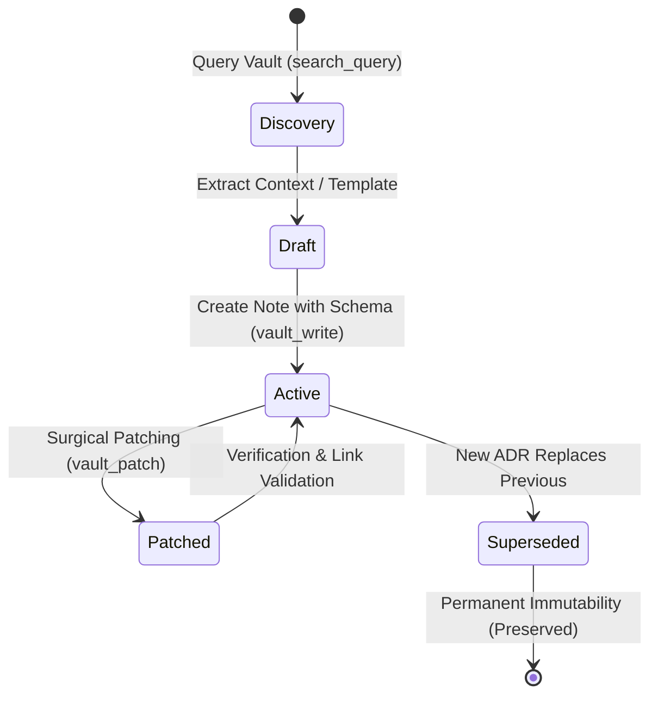

# Protocol: Obsidian Vault Architecture & Note Governance

This reference manual governs the operational lifecycle, folder taxonomy, metadata schemas, surgical patch protocols, and link integrity for managing knowledge in the Obsidian Vault.

---

## 1. Vault Directory Architecture

All notes managed by `/obsidian` must reside within the canonical 5-tier directory hierarchy:

```
Obsidian Vault Root/
├── 00-core-rules/
│   ├── adrs/                   # Architecture Decision Records (adr-[slug].md)
│   ├── domain-glossary.md      # Ubiquitous domain language definitions
│   └── conventions.md          # Code standards, tooling rules, and architectural invariants
├── 01-concepcao/
│   ├── bdd-[slug].md           # Living BDD Gherkin user stories & scenarios
│   ├── sdd-[slug].md           # Typed SDD software design specifications & interface contracts
│   ├── epic-[slug].md          # Epic architecture breakdown & vertical slicing DAG
│   └── dod-[slug].md           # Living Definition of Done checklist for the feature
├── 02-auditorias/
│   ├── audit-[domain]-[slug].md# Domain audit reports (arch, security, quality, perf, resilience)
│   └── pivots-[slug].md        # Technical deviation logs and refactoring decisions
├── 03-releases/
│   ├── changelog-v[X.Y.Z].md   # SemVer release notes, merged features, and E2E logs
│   └── release-manifest.md     # Release candidate tracking and tagging verification
└── 04-templates/               # Reference templates for notes (read-only templates)
```

---

## 2. Note Lifecycle & Transition States



1. **Discovery**: Identify whether an existing note covers the subject using `search_query` and metadata filters (`type`, `feature`, `tags`).
2. **Creation**: Instantiate new notes using the exact templates in `resources/note-template.md`.
3. **Evolution (Surgical Patching)**: Maintain living documents via `vault_patch`. Never overwrite the whole file to append an entry or update a checkbox.
4. **Supersession**: When an architectural rule changes, do not delete or modify the historical decision. Create a new ADR with `status: accepted` and update the old ADR frontmatter to `status: superseded` with a link to `[[adr-new-slug]]`.

---

## 3. Strict Frontmatter Schemas

Every note in the vault must start with a YAML frontmatter block adhering to these schemas:

### 3.1 Architecture Decision Record (ADR)
```yaml
---
type: adr
feature: "{{FEATURE_SLUG}}"       # or "global" for system-wide decisions
project: antigravity
date: "YYYY-MM-DD"
description: "Brief summary of the architecture decision and trade-offs"
status: "accepted"                # proposed | accepted | superseded | rejected
tags:
  - adr
  - architecture
  - phase/concepcao
---
```

### 3.2 Business Domain Rule
```yaml
---
type: domain_rule
feature: global
project: antigravity
date: "YYYY-MM-DD"
description: "Ubiquitous business constraint or domain policy definition"
status: "active"
tags:
  - domain
  - business-rule
  - core
---
```

### 3.3 Technical Pivot Note
```yaml
---
type: pivot
feature: "{{FEATURE_SLUG}}"
project: antigravity
date: "YYYY-MM-DD"
description: "Technical deviation, bug isolation, or refactoring pivot during TDD"
status: "resolved"
tags:
  - pivot
  - bugfix
  - phase/auditorias
---
```

---

## 4. Surgical Patch Protocol (`vault_patch`)

Full-file rewrites discard concurrent updates, pollute git diffs, and risk corrupting historical notes. The surgical patch protocol defines strict rules for incremental edits:

### 4.1 Heading-Targeted Patch (`targetType: "heading"`)
* **When to Use**: Appending audit findings, adding new scenarios to BDD notes, recording a pivot entry, or updating batch checklists in the Living DoD.
* **Mechanism**:
  - Specify `targetType: "heading"`.
  - Specify `heading`: The exact markdown heading (e.g. `## Technical Deviation Log`).
  - Specify `action`: `append` (inserts content at the end of the section) or `replace` (replaces section body).
* **Syntax Requirement**: Keep markdown headers cleanly formatted with a preceding and trailing blank line.

### 4.2 Frontmatter-Targeted Patch (`targetType: "frontmatter"`)
* **When to Use**: Updating note status (e.g., from `proposed` to `accepted`), appending tags, or modifying the description.
* **Mechanism**:
  - Specify `targetType: "frontmatter"`.
  - Provide key-value pairs to update or merge.
  - Never mangle the delimiter boundaries (`---`).

---

## 5. Atomic Note Writing & Wikilink Integrity

1. **One Concept per Note**: Each note represents a single entity, ADR, pivot, or contract. Do not aggregate unrelated concepts into a single file.
2. **Wikilink Syntax**: Use `[[note-name]]` without folder paths or file extensions.
   - Example: `[[adr-0012-jwt-authentication]]`, `[[domain-glossary]]`.
3. **Piped Links**: When referring to a note with alternative display text, use `[[note-name|Display Text]]`.
4. **Anchor Links**: When linking to a specific section, use `[[note-name#Section Heading]]`.
5. **Backlink Impact Analysis**: Before modifying or superseding any rule in `00-core-rules/`, query backlinks using `backlinks` to identify all dependent features and contracts across the repository.
