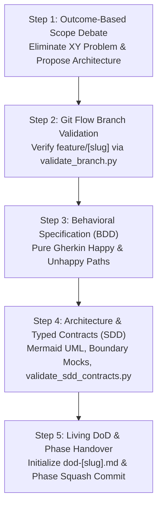

# Skill: Architectural Conception & Planning (`/plan`)

Orchestrates **Phase 1 (Chat 1)** of the feature development lifecycle, transforming business requirements into formal behavioral specifications (BDD Gherkin), robust technical blueprints with typed contracts (SDD), and an initialized Living Definition of Done (DoD), all under strict Git Flow branch isolation.

---

## Universal Restriction: Zero Production Code

> [!WARNING]
> **Strict Phase Gate Lock:** Writing application production code or functional test suites is **strictly prohibited** during Phase 1. The sole objective is architectural conception, behavioral modeling, typed interface contracts, and governance setup. Production implementation begins exclusively in Phase 2 via `/implement`.

---

## Operational Scope & Boundaries

- **Input Prerequisites:**
  - Business problem statement, user request, or feature epic from `/decompose` (`01-concepcao/epic-[slug].md`).
  - Access to repository architecture, package manifests (`pyproject.toml`, `package.json`), and Obsidian Vault ADRs (`00-core-rules/adrs/`).
- **Phase Deliverables:**
  - Validated Git Flow feature branch (`feature/[slug]` or `feat/[slug]`).
  - Behavioral specification in pure Gherkin (`01-concepcao/bdd-[slug].md`).
  - Technical architecture with Mermaid models and typed contracts (`01-concepcao/sdd-[slug].md`).
  - Initialized Living Definition of Done tracking document (`01-concepcao/dod-[slug].md`).
  - Consolidated Phase 1 semantic commit (`docs(conception): BDD, SDD, and DoD specifications for [slug]`).

---

## Execution Pipeline in 5 Steps



### Step 1: Outcome-Based Scope Debate & Consensus
1. Analyze existing codebase patterns, architecture boundaries, and package manifests.
2. Focus strictly on the **Desired End-State** (the observable functional business capability).
3. Treat user-suggested implementation steps as preliminary hypotheses, never as hard constraints.
4. Conduct an adaptive Socratic interview asking **3 to 5 targeted questions** per turn using the interactive `ask_question` tool as the primary channel.
5. Formulate 2 (default) or at most 3 distinct proposals in the architectural proposal matrix:
   - **Proposal 1 (Pragmatic / Incremental):** Minimal friction, low effort.
   - **Proposal 2 (Architecturally Ideal / Scalable):** Clean Architecture, high decoupling, prepared for scale.
   - *Proposal 3 (Balanced / Hybrid - Optional):* Balanced trade-off or alternative technical vector.
6. Present proposals with `RequestFeedback: true` using [`resources/plan-template.md`](./resources/plan-template.md).
7. Advance to Step 2 only upon explicit user approval or "Proceed" selection.
- **Operational Guide:** [`references/plan-debate.md`](./references/plan-debate.md)

---

### Step 2: Branch Strategy & Worktree Isolation
1. Validate that the current repository state is not located on a protected base branch (`main`, `master`, `develop`, `production`).
2. Run the automated cross-platform branch validator:
   ```bash
   python workflows-skill/plan/scripts/validate_branch.py
   ```
3. If on a base branch or unbranchable state, create and checkout the isolated feature branch:
   ```bash
   git checkout -b feature/[slug]
   ```
   *(Or for bugfixes: `git checkout -b fix/[slug]`)*.
4. If working across multiple concurrent features, establish an isolated git worktree.
- **Operational Guide:** [`references/plan-git.md`](./references/plan-git.md)
- **Validation Script:** [`scripts/validate_branch.py`](./scripts/validate_branch.py)

---

### Step 3: Behavioral Specification (BDD)
1. Model requirements strictly in pure Gherkin syntax (`Given/When/Then`).
2. Adhere to ubiquitous business language; strictly avoid leaking technical implementation jargon (such as `SELECT`, `JSON`, `HTTP 200`, or database column names) into Gherkin steps.
3. Formulate comprehensive coverage:
   - **Happy Path:** Primary successful end-to-end user journey.
   - **Unhappy Paths:** Validation errors, boundary limits, unauthorized access, and conflicting system states.
4. Save the specification in the Obsidian Vault or docs folder at `01-concepcao/bdd-[slug].md`.
- **Operational Guide:** [`references/plan-bdd.md`](./references/plan-bdd.md)
- **Document Template:** [`resources/plan-template.md`](./resources/plan-template.md)

---

### Step 4: Technical Architecture & Typed Contracts (SDD)
1. Translate BDD behavioral requirements into a concrete technical blueprint.
2. Construct mandatory dual visual models in Mermaid.js:
   - `sequenceDiagram`: Micro-architectural execution flow across layers (`Client -> Controller/API -> Domain Service -> Port -> Adapter/Fake`), with `autonumber` and message labels enclosed in double quotes.
   - `classDiagram`: Class structures, DTOs, interfaces (`<<Interface>>`), and in-memory test doubles (`<<Fake>>` or `<<Mock>>`).
3. Define typed boundary contracts and request/response schemas using language-native types (e.g., Pydantic in Python or Zod in TypeScript).
4. Model boundary contract schemas using [`resources/sdd-contract-template.yaml`](./resources/sdd-contract-template.yaml).
5. Compile the File Impact Analysis table (Additive vs. Mutative file modifications with risk grading).
6. Validate the SDD specification syntax and Mermaid quotation rules:
   ```bash
   python workflows-skill/plan/scripts/validate_sdd_contracts.py 01-concepcao/sdd-[slug].md
   ```
- **Operational Guide:** [`references/plan-sdd.md`](./references/plan-sdd.md)
- **Schema Template:** [`resources/sdd-contract-template.yaml`](./resources/sdd-contract-template.yaml)
- **Validation Script:** [`scripts/validate_sdd_contracts.py`](./scripts/validate_sdd_contracts.py)

---

### Step 5: Living DoD Initialization & Phase Handover
1. Initialize the Living Definition of Done tracking document at `01-concepcao/dod-[slug].md`.
2. Populate Phase 1 criteria with verified links to BDD, SDD, and initial non-functional requirements (NFRs).
3. Verify all Phase 1 checklist items are marked complete.
4. Execute the Phase 1 squash commit consolidating all specification artifacts:
   ```bash
   git add 01-concepcao/
   git commit -m "docs(conception): BDD, SDD, and DoD specifications for [slug]"
   ```
5. Emit the mandatory session handover recommendation:
   > **[NEXT STEP]** *"Phase 1 (Conception & Architecture) completed successfully with validated BDD scenarios, typed SDD contracts, and initialized Living DoD! Open a **NEW CHAT (Chat 2)** and run `/implement` to initiate the iterative TDD development cycle."*
- **Operational Guide:** [`references/plan-dod.md`](./references/plan-dod.md)

---

## Reference Guide & Template Index

- **Operational Execution Guides:**
  - [`references/plan-debate.md`](./references/plan-debate.md) — Socratic interview protocol, XY Problem elimination, and architectural proposal matrix.
  - [`references/plan-git.md`](./references/plan-git.md) — Git Flow branch conventions, worktree isolation, base branch locks, and Mode 3 phase squash.
  - [`references/plan-bdd.md`](./references/plan-bdd.md) — Pure Gherkin specification rules, ubiquitous language, and Happy/Unhappy path coverage matrix.
  - [`references/plan-sdd.md`](./references/plan-sdd.md) — Clean Architecture boundaries, Mermaid sequence/class diagrams, typed contracts, and boundary mocks.
  - [`references/plan-dod.md`](./references/plan-dod.md) — Living Definition of Done governance, timeline setup, and Phase Gate 1 checklist.
- **Pure Artifact Templates:**
  - [`resources/plan-template.md`](./resources/plan-template.md) — Comprehensive unpopulated template for the complete architectural plan.
  - [`resources/sdd-contract-template.yaml`](./resources/sdd-contract-template.yaml) — Pure YAML schema template for typed SDD contracts and interfaces.
- **Multiplatform Utility Scripts:**
  - [`scripts/validate_sdd_contracts.py`](./scripts/validate_sdd_contracts.py) — Python CLI validator for mandatory SDD sections and Mermaid double-quote syntax.
  - [`scripts/validate_branch.py`](./scripts/validate_branch.py) — Python CLI validator for Git Flow branch naming and base branch locks.
- **Concrete Walkthrough Example:**
  - [`examples/plan-example.md`](./examples/plan-example.md) — Production-grade reference architectural plan output.
