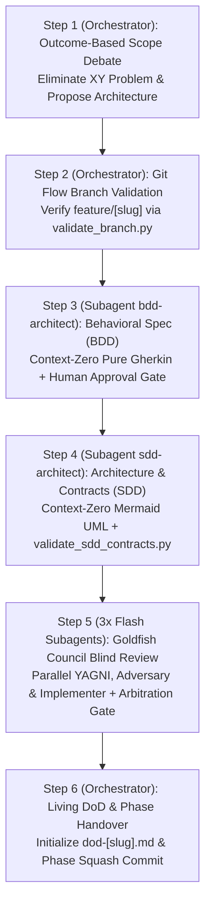

# Skill: Architectural Conception & Planning (`/plan` — SDD 2.0)

Orchestrates the feature development lifecycle under the **SDD 2.0 (Elephant & Goldfish)** model, transforming business requirements into formal behavioral specifications (BDD Gherkin), robust technical blueprints with typed contracts (SDD), parallel blind critiques (Goldfish Council), and an initialized Living Definition of Done (DoD), all under strict Git Flow branch isolation.

---

## Universal Restriction: Zero Production Code

> [!WARNING]
> **Strict Phase Gate Lock:** Writing application production code or functional test suites is **strictly prohibited**. The sole objective is architectural conception, behavioral modeling, typed interface contracts, blind adversarial specification review, and governance setup. Production implementation begins exclusively in `/implement`.

---

## Operational Scope & Boundaries

- **Input Prerequisites:**
  - Business problem statement, user request, or feature epic from `/decompose` (`01-concepcao/epic-[slug].md`).
  - Access to repository architecture, package manifests (`pyproject.toml`, `package.json`), and Obsidian Vault ADRs (`00-core-rules/adrs/`).
- **Phase Deliverables:**
  - Validated Git Flow feature branch (`feature/[slug]` or `feat/[slug]`).
  - Context-Zero behavioral specification in pure Gherkin (`01-concepcao/bdd-[slug].md`).
  - Context-Zero technical architecture with Mermaid models and typed contracts (`01-concepcao/sdd-[slug].md`).
  - Arbitrated Goldfish Council blind review (`goldfish-yagni`, `goldfish-adversary`, `goldfish-implementer`).
  - Initialized Living Definition of Done tracking document (`01-concepcao/dod-[slug].md`).
  - Consolidated semantic commit (`docs(conception): BDD, SDD, and DoD specifications for [slug]`).

---

## Execution Pipeline in 6 Steps (Orchestrator + Subagents)



### Step 1: Outcome-Based Scope Debate & Consensus *(Main Orchestrator)*
1. Analyze existing codebase patterns, architecture boundaries, and package manifests.
2. Focus strictly on the **Desired End-State** (the observable functional business capability).
3. Treat user-suggested implementation steps as preliminary hypotheses, never as hard constraints.
4. Conduct an adaptive Socratic interview asking **3 to 5 targeted questions** per turn using the interactive `ask_question` tool as the primary channel.
5. Formulate 2 (default) or at most 3 distinct proposals in the architectural proposal matrix:
   - **Proposal 1 (Pragmatic / Incremental):** Minimal friction, low effort.
   - **Proposal 2 (Architecturally Ideal / Scalable):** Clean Architecture, high decoupling, prepared for scale.
   - *Proposal 3 (Balanced / Hybrid - Optional):* Balanced trade-off or alternative technical vector.
6. Present proposals with `RequestFeedback: true` using [`resources/plan-template.md`](./resources/plan-template.md).
7. Advance to Step 2 only upon explicit user approval or "Proceed" selection.
- **Operational Guide:** [`references/plan-debate.md`](./references/plan-debate.md)

---

### Step 2: Branch Strategy & Worktree Isolation *(Main Orchestrator)*
1. Validate that the current repository state is not located on a protected base branch (`main`, `master`, `develop`, `production`).
2. Run the automated cross-platform branch validator:
   ```bash
   python skills/plan/scripts/validate_branch.py
   ```
3. If on a base branch or unbranchable state, create and checkout the isolated feature branch:
   ```bash
   git checkout -b feature/[slug]
   ```
   *(Or for bugfixes: `git checkout -b fix/[slug]`)*.
4. If working across multiple concurrent features, establish an isolated git worktree.
- **Operational Guide:** [`references/plan-git.md`](./references/plan-git.md)
- **Validation Script:** [`scripts/validate_branch.py`](./scripts/validate_branch.py)

---

### Step 3: Context-Zero Behavioral Specification — BDD *(Subagent `bdd-architect`)*
1. Define and invoke the isolated `bdd-architect` subagent (`EnableWriteTools: true`, `Model: "inherit"`) following [`references/plan-goldfish.md`](./references/plan-goldfish.md).
2. **Context Firewall:** Pass **only** the approved Desired End-State and selected Architectural Proposal summary (never the raw Step 1 chat transcript).
3. `bdd-architect` models requirements strictly in pure Gherkin syntax (`Given/When/Then`) using ubiquitous business language (zero SQL, HTTP, or JSON jargon):
   - **Happy Path (`@happy-path`):** Primary successful end-to-end user journey.
   - **Unhappy Paths (`@unhappy-path`, `@security`, `@concurrency`):** Validation errors, boundary limits, unauthorized access, and conflicting system states.
4. `bdd-architect` saves the specification at `01-concepcao/bdd-[slug].md`.
5. **Human Approval Gate:** The Orchestrator presents `01-concepcao/bdd-[slug].md` to the user for verification before invoking Step 4.
- **Operational Guides:** [`references/plan-bdd.md`](./references/plan-bdd.md) | [`references/plan-goldfish.md`](./references/plan-goldfish.md)
- **Document Template:** [`resources/plan-template.md`](./resources/plan-template.md)

---

### Step 4: Context-Zero Technical Architecture & Typed Contracts — SDD *(Subagent `sdd-architect`)*
1. Define and invoke the isolated `sdd-architect` subagent (`EnableWriteTools: true`, `Model: "inherit"`), providing **only** `01-concepcao/bdd-[slug].md`, the approved proposal tier, and repository manifests.
2. `sdd-architect` translates BDD behavioral requirements into a concrete technical blueprint at `01-concepcao/sdd-[slug].md`:
   - `sequenceDiagram`: Micro-architectural execution flow across layers (`Client -> Controller/API -> Domain Service -> Port -> Adapter/Fake`), with `autonumber`, double-quoted message labels, and explicit `alt / else` error branches for negative BDD scenarios.
   - `classDiagram`: Class structures, DTOs, interfaces (`<<Interface>>`), and in-memory test doubles (`<<Fake>>` or `<<Mock>>`) with **100% method parity** against the `sequenceDiagram`.
   - Typed boundary contracts, domain exceptions (`*Error` / `*Exception`), and request/response schemas using language-native types and [`resources/sdd-contract-template.yaml`](./resources/sdd-contract-template.yaml).
   - File Impact Analysis table (Additive vs. Mutative file modifications with risk grading).
3. `sdd-architect` validates syntax, Mermaid quotation rules, and BDD↔SDD semantic parity:
   ```bash
   python skills/plan/scripts/validate_sdd_contracts.py 01-concepcao/sdd-[slug].md --bdd 01-concepcao/bdd-[slug].md
   ```
- **Operational Guides:** [`references/plan-sdd.md`](./references/plan-sdd.md) | [`references/plan-goldfish.md`](./references/plan-goldfish.md)
- **Schema Template:** [`resources/sdd-contract-template.yaml`](./resources/sdd-contract-template.yaml)
- **Validation Script:** [`scripts/validate_sdd_contracts.py`](./scripts/validate_sdd_contracts.py)

---

### Step 5: Parallel "Goldfish Council" Blind Review & Arbitration *(3 Read-Only Subagents + Orchestrator)*
1. Define and invoke **3 parallel read-only subagents** (`EnableWriteTools: false`, `Model: "flash"`) in a single turn to attack `01-concepcao/bdd-[slug].md` and `01-concepcao/sdd-[slug].md` with zero prior chat context:
   - 🐠 **`goldfish-yagni`:** Hunts overengineering, unnecessary layers, and redundant abstractions vs. existing codebase modules.
   - 🐠 **`goldfish-adversary`:** Hunts race conditions, concurrency flaws, orphan states, and unmapped `@unhappy-path`/`@security`/`@concurrency` edge cases.
   - 🐠 **`goldfish-implementer`:** Simulates a blind Phase 2 (`/implement`) TDD developer, flagging any ambiguous method signature, DTO constraint, or `<<Fake>>` behavior.
2. **Interactive Arbitration Gate:** The Orchestrator consolidates the 3 reports into the **Goldfish Arbitration Matrix** and invokes `ask_question` so the user decides which findings to accept, defer, or reject.
3. For accepted changes, the Orchestrator messages `sdd-architect` (and/or `bdd-architect`) via `send_message` to apply surgical patches and re-run [`scripts/validate_sdd_contracts.py`](./scripts/validate_sdd_contracts.py).
- **Operational Guide:** [`references/plan-goldfish.md`](./references/plan-goldfish.md)

---

### Step 6: Living DoD Initialization & Phase Handover *(Main Orchestrator)*
1. Initialize the Living Definition of Done tracking document at `01-concepcao/dod-[slug].md`.
2. Populate Phase 1 criteria with verified links to BDD, SDD, the Goldfish Council arbitration summary, and initial non-functional requirements (NFRs).
3. Verify all Phase 1 checklist items (`1.1` through `1.6`) are marked complete.
4. Execute the Phase 1 squash commit consolidating all specification artifacts:
   ```bash
   git add 01-concepcao/
   git commit -m "docs(conception): BDD, SDD, and DoD specifications for [slug]"
   ```
5. Emit the mandatory session handover recommendation:
   > **[NEXT STEP]** *"Phase 1 (Conception & Architecture — SDD 2.0) completed successfully with Context-Zero BDD scenarios, typed SDD contracts, Goldfish Council arbitration, and initialized Living DoD! Open a **NEW CHAT** and run `/implement` to initiate the iterative TDD development cycle."*
- **Operational Guide:** [`references/plan-dod.md`](./references/plan-dod.md)

---

## Reference Guide & Template Index

- **Operational Execution Guides:**
  - [`references/plan-debate.md`](./references/plan-debate.md) — Socratic interview protocol, XY Problem elimination, and architectural proposal matrix.
  - [`references/plan-git.md`](./references/plan-git.md) — Git Flow branch conventions, worktree isolation, base branch locks, and Mode 3 phase squash.
  - [`references/plan-bdd.md`](./references/plan-bdd.md) — Context-Zero pure Gherkin specification rules, ubiquitous language, and Happy/Unhappy path coverage matrix.
  - [`references/plan-sdd.md`](./references/plan-sdd.md) — Clean Architecture boundaries, Mermaid sequence/class diagrams, semantic method parity, and typed contracts.
  - [`references/plan-goldfish.md`](./references/plan-goldfish.md) — Context-Zero subagent orchestration (`bdd-architect`, `sdd-architect`), parallel Flash Goldfish Council personas, and Arbitration Matrix protocol.
  - [`references/plan-dod.md`](./references/plan-dod.md) — Living Definition of Done governance, timeline setup, and Phase Gate 1 checklist.
- **Pure Artifact Templates:**
  - [`resources/plan-template.md`](./resources/plan-template.md) — Comprehensive unpopulated template for the complete SDD 2.0 architectural plan.
  - [`resources/sdd-contract-template.yaml`](./resources/sdd-contract-template.yaml) — Pure YAML schema template for typed SDD contracts and interfaces.
- **Multiplatform Utility Scripts:**
  - [`scripts/validate_sdd_contracts.py`](./scripts/validate_sdd_contracts.py) — Python CLI validator for mandatory SDD sections, Mermaid double-quote syntax, `sequenceDiagram`↔`classDiagram` method parity, and BDD↔SDD error parity.
  - [`scripts/validate_branch.py`](./scripts/validate_branch.py) — Python CLI validator for Git Flow branch naming and base branch locks.
- **Concrete Walkthrough Example:**
  - [`examples/plan-example.md`](./examples/plan-example.md) — Production-grade reference SDD 2.0 architectural plan output.
